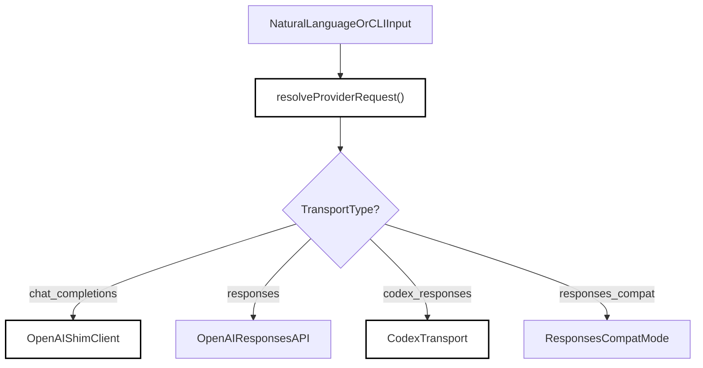
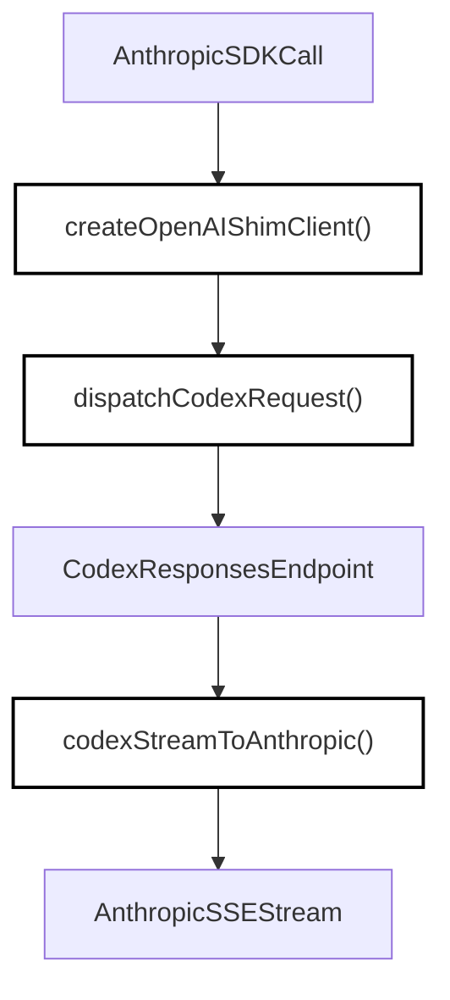

# OpenAI & Codex Shim

Relevant source files

The following files were used as context for generating this wiki page:

- [eslint.config.js](eslint.config.js)
- [reports/any-usage.baseline.json](reports/any-usage.baseline.json)
- [scripts/any-usage-report.ts](scripts/any-usage-report.ts)
- [scripts/grpc-cli.ts](scripts/grpc-cli.ts)
- [scripts/provider-recommend.test.ts](scripts/provider-recommend.test.ts)
- [src/commands/cache-probe/cache-probe.test.ts](src/commands/cache-probe/cache-probe.test.ts)
- [src/commands/cache-probe/cache-probe.ts](src/commands/cache-probe/cache-probe.ts)
- [src/commands/cache-probe/index.ts](src/commands/cache-probe/index.ts)
- [src/commands/provider/provider.test.tsx](src/commands/provider/provider.test.tsx)
- [src/commands/provider/provider.tsx](src/commands/provider/provider.tsx)
- [src/proto/openclaude.proto](src/proto/openclaude.proto)
- [src/services/api/codexShim.test.ts](src/services/api/codexShim.test.ts)
- [src/services/api/codexShim.ts](src/services/api/codexShim.ts)
- [src/services/api/openaiShim.test.ts](src/services/api/openaiShim.test.ts)
- [src/services/api/openaiShim.ts](src/services/api/openaiShim.ts)
- [src/services/api/openaiShim/codexDispatch.test.ts](src/services/api/openaiShim/codexDispatch.test.ts)
- [src/services/api/openaiShim/codexDispatch.ts](src/services/api/openaiShim/codexDispatch.ts)
- [src/services/api/providerConfig.local.test.ts](src/services/api/providerConfig.local.test.ts)
- [src/services/api/providerConfig.ts](src/services/api/providerConfig.ts)

## Purpose & Scope

The OpenAI & Codex Shim layer serves as the multi-provider bridge in OpenClaude, intercepting Anthropic SDK calls (`anthropic.beta.messages.create`) and transparently translating them into OpenAI-compatible Chat Completions, OpenAI Responses, or OpenAI Codex `/responses` payloads [src/services/api/openaiShim.ts:1-7](). Responses are streamed back in the Anthropic Server-Sent Events (SSE) format so that the rest of the agent core remains completely agnostic of the underlying vendor backend.

This parent page provides a high-level architectural overview of provider request resolution, the shim client lifecycle, Codex transport integration, and strict schema normalization. For deep technical details on request execution, transport modules, and format converters, refer to the child pages:
- [Request Preparation & Execution](#4.1.1) — Request executors, transport wrappers, schema sanitizers, and Ollama integration adapters.
- [Message & Stream Conversion](#4.1.2) — Bidirectional message translation, response adapters, stream converters, and XML tool-call parsers.

---

## 1. Provider Request Resolution & Routing

When the user specifies a model or configures environment variables (such as `CLAUDE_CODE_USE_OPENAI=1` or Codex shortcuts like `codexplan`), OpenClaude invokes `resolveProviderRequest` [src/services/api/providerConfig.ts:94-96]() to determine the target transport protocol, base URL, and reasoning effort.

*Diagram 1: Provider Request Resolution mapping user/CLI inputs to code entities like `resolveProviderRequest`.*

**Sources:**
- `src/services/api/providerConfig.ts:165-176`
- `src/services/api/openaiShim.ts:1-37`

---

## 2. The OpenAI Shim Client (`createOpenAIShimClient`)

The core entry point for non-Anthropic providers is `createOpenAIShimClient` [src/services/api/openaiShim.ts:24](). This function returns a mock-compatible Anthropic client whose `.beta.messages.create` method builds an OpenAI-compatible request body, negotiates credential pools [src/services/api/credentialPool.ts:115-119](), and dispatches the request through the configured transport [src/services/api/providerConfig.ts:162-166]().

The shim handles credential rotation (`OPENAI_API_KEYS`), custom authorization headers, Azure OpenAI Foundry styles, and GitHub Copilot API tokens [src/services/api/openaiShim.ts:11-37](). Depending on the resolved `ResolvedProviderRequest` transport, requests are routed either to standard chat endpoints or specialized Codex dispatchers [src/services/api/openaiShim.ts:67]().

**Sources:**
- `src/services/api/openaiShim.ts:1-129`
- `src/services/api/credentialPool.ts:115-119`

---

## 3. Codex Transport & `/responses` Protocol

For flagship models (such as `gpt-5.6-sol`, `gpt-5.3-codex-spark`, or the `codexplan`/`codexspark` aliases), OpenClaude switches to the `codex_responses` transport [src/services/api/providerConfig.ts:84-123, 162](). This communicates directly with Codex backend endpoints (`https://chatgpt.com/backend-api/codex`) using specialized SSE streaming and message structures [src/services/api/codexShim.ts:43-93]().

*Diagram 2: Codex Request Dispatch and Stream Conversion Pipeline connecting `dispatchCodexRequest` and `codexStreamToAnthropic`.*

**Sources:**
- `src/services/api/codexShim.ts:43-93`
- `src/services/api/openaiShim/codexDispatch.ts:63-165`
- `src/services/api/providerConfig.ts:84-123`

---

## 4. Request Preparation, Execution & Schema Normalization

Before HTTP transmission, requests undergo strict parameter sanitization, tool formatting, and schema normalization to ensure compatibility with strict JSON schema validators on OpenAI and Codex backends [src/services/api/openaiShim/toolConversion.ts:105]() and `src/services/api/openaiSchemaSanitizer.js` [src/services/api/codexShim.ts:9]().

For detailed information on request preparation pipelines, transport timeouts, retry policies, and local Ollama adapters, see [Request Preparation & Execution](#4.1.1).

**Sources:**
- `src/services/api/openaiShim.ts:69-90`
- `src/services/api/codexShim.ts:9`

---

## 5. Message & Stream Conversion

The shim layer acts as a bidirectional translator for conversation turns. Anthropic message arrays, system prompts, and tool definitions are converted into OpenAI messages, functions, or Responses API inputs [src/services/api/openaiShim/messageConversion.ts:139-141](). Conversely, incoming SSE chunks from OpenAI, Gemini, or Codex are parsed and re-emitted as Anthropic-compatible stream events (`content_block_start`, `content_block_delta`, `message_delta`, etc.) [src/services/api/openaiShim.ts:71-78]().

For detailed coverage of stream adapters, Gemini signature preservation, XML tool-call parsing, and marker echo guards, see [Message & Stream Conversion](#4.1.2).

**Sources:**
- `src/services/api/openaiShim.ts:71-78`
- `src/services/api/openaiShim/messageConversion.ts:1-15`