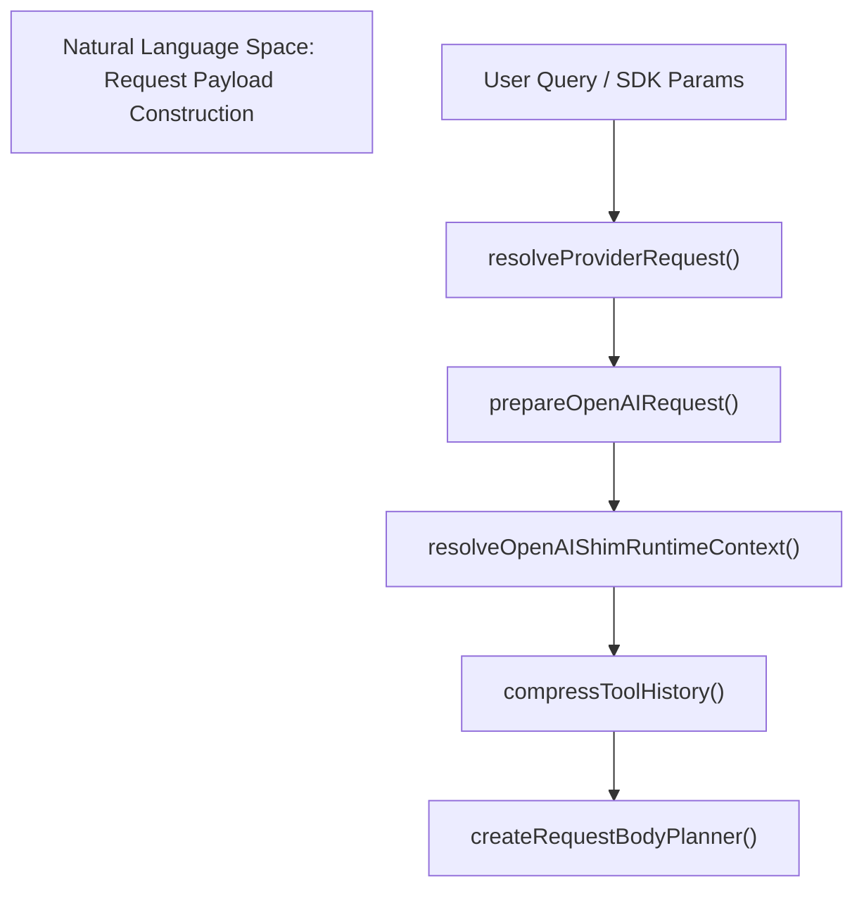
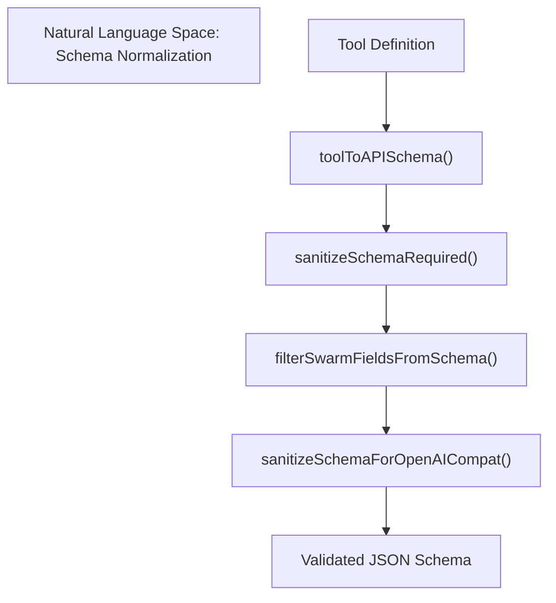
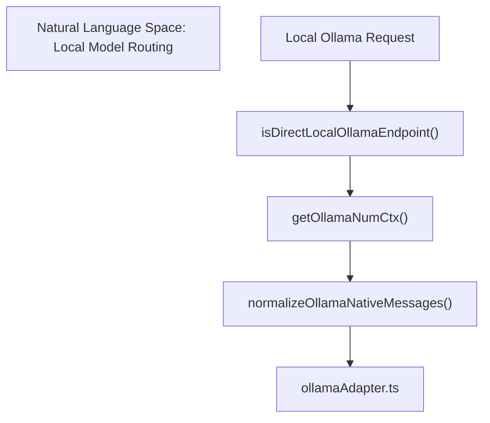

# Request Preparation & Execution

Relevant source files

The following files were used as context for generating this wiki page:

- [docs/litellm-setup.md](docs/litellm-setup.md)
- [src/__tests__/bugfixes.test.ts](src/__tests__/bugfixes.test.ts)
- [src/integrations/discoveryCache.ts](src/integrations/discoveryCache.ts)
- [src/integrations/gateways/custom.test.ts](src/integrations/gateways/custom.test.ts)
- [src/integrations/gateways/custom.ts](src/integrations/gateways/custom.ts)
- [src/interactiveHelpers.tsx](src/interactiveHelpers.tsx)
- [src/services/api/claude.timeout.test.ts](src/services/api/claude.timeout.test.ts)
- [src/services/api/openaiSchemaSanitizer.ts](src/services/api/openaiSchemaSanitizer.ts)
- [src/services/api/openaiShim.architecture.test.ts](src/services/api/openaiShim.architecture.test.ts)
- [src/services/api/openaiShim/geminiStreamConversion.test.ts](src/services/api/openaiShim/geminiStreamConversion.test.ts)
- [src/services/api/openaiShim/ollamaAdapter.test.ts](src/services/api/openaiShim/ollamaAdapter.test.ts)
- [src/services/api/openaiShim/ollamaAdapter.ts](src/services/api/openaiShim/ollamaAdapter.ts)
- [src/services/api/openaiShim/requestPreparation.test.ts](src/services/api/openaiShim/requestPreparation.test.ts)
- [src/services/api/openaiShim/requestPreparation.ts](src/services/api/openaiShim/requestPreparation.ts)
- [src/services/api/openaiShim/transport.test.ts](src/services/api/openaiShim/transport.test.ts)
- [src/services/api/openaiShim/transport.ts](src/services/api/openaiShim/transport.ts)
- [src/tools/SkillTool/SkillTool.ts](src/tools/SkillTool/SkillTool.ts)
- [src/utils/api.swarmFields.test.ts](src/utils/api.swarmFields.test.ts)
- [src/utils/api.test.ts](src/utils/api.test.ts)
- [src/utils/api.ts](src/utils/api.ts)
- [src/utils/envProviderOption.ts](src/utils/envProviderOption.ts)
- [src/utils/ripgrep.test.ts](src/utils/ripgrep.test.ts)
- [src/utils/ripgrep.ts](src/utils/ripgrep.ts)
- [src/utils/schemaSanitizer.test.ts](src/utils/schemaSanitizer.test.ts)
- [src/utils/schemaSanitizer.ts](src/utils/schemaSanitizer.ts)
- [src/utils/setupScreenGates.test.ts](src/utils/setupScreenGates.test.ts)
- [src/utils/setupScreenGates.ts](src/utils/setupScreenGates.ts)

## Purpose and Scope

This page documents the request preparation and execution pipeline within OpenClaude's OpenAI-compatible shim layer (`src/services/api/openaiShim/`) and its associated utilities. This subsystem is responsible for transforming normalized internal request parameters (messages, system prompts, and tool definitions) into provider-specific payloads, sanitizing JSON schemas to prevent gateway rejections, dispatching requests through the transport module with deadline tracking, and handling specialized local endpoints such as the Ollama adapter.

Sources: `src/services/api/openaiShim/requestPreparation.ts:1-124](), [src/services/api/openaiShim/transport.ts:1-76](), [src/utils/schemaSanitizer.ts:1-54]()

---

## 1. Request Preparation Phase (`prepareOpenAIRequest`)

Before any payload hits the network, `prepareOpenAIRequest` (`src/services/api/openaiShim/requestPreparation.ts`) orchestrates the assembly of the request context. It evaluates model runtime limits and resolves transport compatibility requirements.

*Figure 1: Request preparation pipeline linking high-level agent inputs to transport-specific payload planning functions.*

Sources: `src/services/api/openaiShim/requestPreparation.ts:112-203](), [src/integrations/runtimeMetadata.ts:1-50]()

The preparation workflow performs the following steps:
- **Runtime Context Resolution**: Inspects `processEnv`, `baseUrl`, and requested model names to select the active route and shim configuration (`openaiShimConfig`) via `resolveOpenAIShimRuntimeContext` [src/services/api/openaiShim/requestPreparation.ts:136-149]().
- **Effective Transport Selection**: Maps endpoint paths like `/responses` or `/messages` to concrete transport identifiers (`chat_completions`, `responses`, `gemini`) [src/services/api/openaiShim/requestPreparation.ts:150-156]().
- **Tool History Compression**: Unless implicit prefix caching is active (e.g., on OpenAI, DeepSeek, or xAI routes managed by `providerUsesImplicitPrefixCaching`), tool histories are compressed using `compressToolHistory` [src/services/api/openaiShim/requestPreparation.ts:76-178]().
- **Message Conversion**: Transforms raw messages into OpenAI-compatible format via `convertMessages` [src/services/api/openaiShim/requestPreparation.ts:184-194]().

Sources: `src/services/api/openaiShim/requestPreparation.ts:112-203]()

---

## 2. Schema Sanitization & Tool Handling

Gateway validation strictness often causes `400` errors due to schema mismatches (e.g., missing properties referenced in `required` arrays or unsupported custom attributes). OpenClaude implements recursive schema sanitization to guarantee strict compatibility.

*Figure 2: Schema validation and sanitization mapping raw tool metadata through OpenClaude transformation functions.*

Key functions involved in schema normalization include:
- `sanitizeSchemaRequired`: Recursively checks object property maps to ensure that any entry in the `required` array exists within `properties`, preventing `Extra required key supplied` errors [src/utils/api.ts:143-177]().
- `filterSwarmFieldsFromSchema`: Strips swarm-specific parameters (`launchSwarm`, `teammateCount`, `team_name`) when swarm features are disabled [src/utils/api.ts:98-135]().
- `sanitizeSchemaForOpenAICompat`: Strips provider-incompatible keywords (such as `$comment`, `$schema`, `examples`, `patternProperties`, etc.) defined in `src/utils/schemaSanitizer.ts` while preserving valid `enum` and `type` structures [src/utils/schemaSanitizer.ts:1-192]().

Sources: `src/utils/api.ts:98-177](), [src/utils/schemaSanitizer.ts:1-54]()

---

## 3. Request Execution, Transport & Timeouts (`transport.ts`)

Once a request is prepared, `transport.ts` manages HTTP communication with robust timeout handling, proxy retries, and signal cancellation.

| Component / Function | Responsibility |
| :--- | :--- |
| `getApiTimeoutMs` | Parses `API_TIMEOUT_MS` from process environment or falls back to `DEFAULT_API_TIMEOUT_MS` (600,000ms), bounded by `MAX_API_TIMEOUT_MS` [src/services/api/openaiShim/transport.ts:66-76](). |
| `ResponseHeadersTimeoutError` | Error thrown when an OpenAI-compatible request receives no response headers within the configured deadline [src/services/api/openaiShim/transport.ts:36-43](). |
| `preserveCallerAbortError` | Ensures caller-initiated aborts or timeout errors correctly bubble up with their original cancellation reasons [src/services/api/openaiShim/transport.ts:57-64](). |
| `fetchWithProxyRetry` | Executes HTTP/S requests with configured proxy settings and automatic retry wrappers [src/services/api/openaiShim/transport.ts:28-30](). |

Sources: `src/services/api/openaiShim/transport.ts:1-76](), [src/services/api/fetchWithProxyRetry.ts:1-50]()

---

## 4. Ollama Adapter & Local Endpoint Execution

Local providers like Ollama require specific parameter adjustments (such as mapping context window size via `num_ctx` and bypassing OpenAI-specific stream options if unsupported).

*Figure 3: Ollama adapter routing local endpoint calls through native message and parameter adapters.*

The Ollama adapter (`src/services/api/openaiShim/ollamaAdapter.ts`) handles:
- Detecting direct local endpoints via `isDirectLocalOllamaEndpoint` [src/services/api/openaiShim/requestPreparation.ts:179-183]().
- Adjusting context window parameters (`num_ctx`) based on model configuration [src/services/api/openaiShim/requestPreparation.ts:33-35]().
- Normalizing native message structures for local LLM inference engines [src/services/api/openaiShim/ollamaAdapter.ts:1-50]().

Sources: `src/services/api/openaiShim/requestPreparation.ts:179-195](), [src/services/api/openaiShim/ollamaAdapter.ts:1-50]()