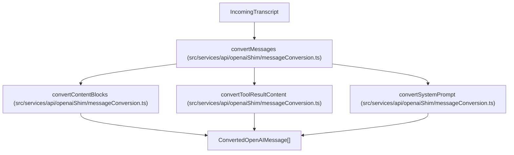
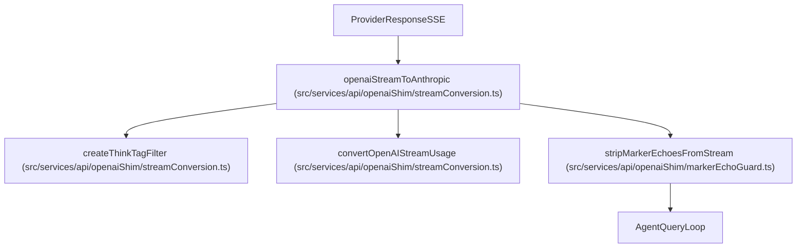

# Message & Stream Conversion

Relevant source files

The following files were used as context for generating this wiki page:

- [src/services/api/openaiShim/geminiStreamConversion.ts](src/services/api/openaiShim/geminiStreamConversion.ts)
- [src/services/api/openaiShim/markerEchoGuard.test.ts](src/services/api/openaiShim/markerEchoGuard.test.ts)
- [src/services/api/openaiShim/markerEchoGuard.ts](src/services/api/openaiShim/markerEchoGuard.ts)
- [src/services/api/openaiShim/messageConversion.test.ts](src/services/api/openaiShim/messageConversion.test.ts)
- [src/services/api/openaiShim/messageConversion.ts](src/services/api/openaiShim/messageConversion.ts)
- [src/services/api/openaiShim/responseAdapters.test.ts](src/services/api/openaiShim/responseAdapters.test.ts)
- [src/services/api/openaiShim/responseAdapters.ts](src/services/api/openaiShim/responseAdapters.ts)
- [src/services/api/openaiShim/responseConversion.test.ts](src/services/api/openaiShim/responseConversion.test.ts)
- [src/services/api/openaiShim/responseConversion.ts](src/services/api/openaiShim/responseConversion.ts)
- [src/services/api/openaiShim/streamConversion.test.ts](src/services/api/openaiShim/streamConversion.test.ts)
- [src/services/api/openaiShim/streamConversion.ts](src/services/api/openaiShim/streamConversion.ts)
- [src/services/api/openaiShim/xmlToolCallParsing.test.ts](src/services/api/openaiShim/xmlToolCallParsing.test.ts)
- [src/services/api/openaiShim/xmlToolCallParsing.ts](src/services/api/openaiShim/xmlToolCallParsing.ts)

## Purpose & Scope
This page details the message translation, response adaptation, stream conversion, and fallback parsing subsystems housed within `src/services/api/openaiShim/`. OpenClaude maintains an Anthropic-centric internal data contract while supporting 200+ LLM providers via OpenAI-compatible, Gemini, and Ollama APIs. This module bridges input transcripts, real-time Server-Sent Events (SSE) streams, non-streaming responses, and tool-call markup between formats.

Sources: `src/services/api/openaiShim/messageConversion.ts:1-291`, `src/services/api/openaiShim/responseAdapters.ts:1-215`

---

## 1. Message Conversion Pipeline (`messageConversion.ts`)

The message conversion module transforms internal transcript objects into OpenAI-compatible request payloads (`ConvertedOpenAIMessage[]`). 

### Key Functions
* `convertMessages`: Iterates over conversation history, validates message continuity, handles alternating role constraints, strips orphan tool results, and processes image/text content blocks [src/services/api/openaiShim/messageConversion.ts:143-180]().
* `convertSystemPrompt`: Normalizes string or array-based system instructions, filtering out internal billing headers [src/services/api/openaiShim/messageConversion.ts:21-33]().
* `convertToolResultContent`: Formats tool output blocks (text, base64 images, tool references) and prepends error markers when execution fails [src/services/api/openaiShim/messageConversion.ts:47-90]().

Title: Message Conversion Code-Entity Bridge

Sources: `src/services/api/openaiShim/messageConversion.ts:21-180`

### Handling Edge Cases
* **Consecutive Role Coalescing**: To prevent alternation errors (Issue #202), consecutive user or assistant messages are joined together [src/services/api/openaiShim/messageConversion.test.ts:90-117]().
* **Orphan Tool Results**: Tool results whose corresponding `tool_use` IDs are missing from the transcript are filtered out to prevent downstream API rejection [src/services/api/openaiShim/messageConversion.test.ts:119-141]().
* **Stripped Thinking Blocks**: Assistant messages containing only thinking or redacted thinking blocks that get stripped are dropped to prevent empty assistant turns [src/services/api/openaiShim/messageConversion.test.ts:143-161]().

Sources: `src/services/api/openaiShim/messageConversion.ts:1-291`, `src/services/api/openaiShim/messageConversion.test.ts:1-351`

---

## 2. Response Adapters & Facade (`responseAdapters.ts`)

`responseAdapters.ts` acts as the central dispatch hub for handling provider responses, uniting non-streaming JSON translation, Anthropic SSE passthrough, OpenAI stream conversion, and Gemini stream conversion.

### Key Exports and Functions
* `makeMessageId()`: Generates unique message IDs (`msg_...`) using cryptographic UUIDs [src/services/api/openaiShim/responseAdapters.ts:43-45]().
* `nextTextToolCallSequence()`: Maintains a monotonic sequence counter for text and XML fallback tool calls [src/services/api/openaiShim/messageConversion.ts:49-53]().
* `openaiStreamToAnthropic()`: Wraps OpenAI stream conversion with marker echo protection (`stripMarkerEchoesFromStream`) [src/services/api/openaiShim/responseAdapters.ts:126-162]().
* `geminiSseToAnthropic()`: Adapts Gemini SSE streams into Anthropic events [src/services/api/openaiShim/responseAdapters.ts:92-106]().

Sources: `src/services/api/openaiShim/responseAdapters.ts:1-215`

---

## 3. OpenAI Stream Conversion (`streamConversion.ts`)

The OpenAI stream translator consumes SSE frames from OpenAI-compatible gateways and emits Anthropic-compatible `AnthropicStreamEvent` async generator events.

### Key Responsibilities
* **Chunk State Tracking**: Manages active tool calls, JSON buffers, thinking tag filters (`createThinkTagFilter`), and Ollama text buffering [src/services/api/openaiShim/streamConversion.ts:143-179]().
* **Usage Translation**: `convertOpenAIStreamUsage` normalizes provider raw usage metadata (including cached input tokens) into Anthropic `AnthropicUsage` format [src/services/api/openaiShim/streamConversion.ts:102-107]().
* **Robust JSON Repair**: Utilizes `repairPossiblyTruncatedObjectJson` to recover malformed or truncated tool arguments at stream termination [src/services/api/openaiShim/streamConversion.test.ts:122-131]().

Title: Stream Conversion and Marker Guard Pipeline

Sources: `src/services/api/openaiShim/streamConversion.ts:102-179`, `src/services/api/openaiShim/markerEchoGuard.ts:58-126`

Sources: `src/services/api/openaiShim/streamConversion.ts:1-1172`, `src/services/api/openaiShim/streamConversion.test.ts:1-736`

---

## 4. Gemini Stream Conversion (`geminiStreamConversion.ts`)

`geminiSseToAnthropic` handles Google Gemini's native SSE stream format, translating `usageMetadata`, `candidates`, `content.parts`, and `functionCall` objects into Anthropic protocol events.

### Implementation Details
* **Idle Timeout & Tracing**: Wraps stream reading with `readWithIdleTimeout` and tracks metrics via `createProviderStreamTrace` [src/services/api/openaiShim/geminiStreamConversion.ts:69-116]().
* **Finish Reason Mapping**: `mapFinishReason` maps Gemini finish reasons (`MAX_TOKENS`, `SAFETY`, `RECITATION`, `STOP`) to Anthropic equivalents (`max_tokens`, `tool_use`, `end_turn`) [src/services/api/openaiShim/geminiStreamConversion.ts:90-97]().

Sources: `src/services/api/openaiShim/geminiStreamConversion.ts:1-315`

---

## 5. XML & Raw Tool-Call Parsing (`xmlToolCallParsing.ts`)

Some models (such as GLM, Qwen, or Tencent HY3) emit tool calls as XML markup (`<tool_call>...</tool_call>`) inside text streams rather than structured API tool fields.

### Key Functions
* `parseXmlToolCalls`: Scans text for standard or HY3-specific tool call blocks, extracting function names and arguments [src/services/api/openaiShim/xmlToolCallParsing.ts:156-185]().
* `findXmlToolCallOpener`: Locates the earliest occurrence of an XML tool call opener tag in a stream chunk [src/services/api/openaiShim/xmlToolCallParsing.ts:89-95]().
* `trailingXmlOpenerPrefixLen`: Calculates the length of a trailing partial opener split across SSE deltas, enabling the stream handler to hold back incomplete tags [src/services/api/openaiShim/xmlToolCallParsing.ts:74-87]().

Sources: `src/services/api/openaiShim/xmlToolCallParsing.ts:1-252`

---

## 6. Marker Echo Guard (`markerEchoGuard.ts`)

To resolve issue #2039, where models echoed the shim's old `"[Tool results received]"` marker verbatim and terminated loops prematurely, `markerEchoGuard.ts` implements a dual-layer defense.

### Guard Layers
1. `stripEchoedToolResultsMarker()`: Whole-text cleanup removing literal occurrences from non-streaming responses and request histories [src/services/api/openaiShim/markerEchoGuard.ts:30-33]().
2. `stripMarkerEchoesFromStream()`: An async generator wrapper inspecting Anthropic text deltas, filtering out markers while preserving surrounding prose and holding back partial suffixes across chunk boundaries [src/services/api/openaiShim/markerEchoGuard.ts:58-126]().

Sources: `src/services/api/openaiShim/markerEchoGuard.ts:1-127`, `src/services/api/openaiShim/markerEchoGuard.test.ts:1-120`