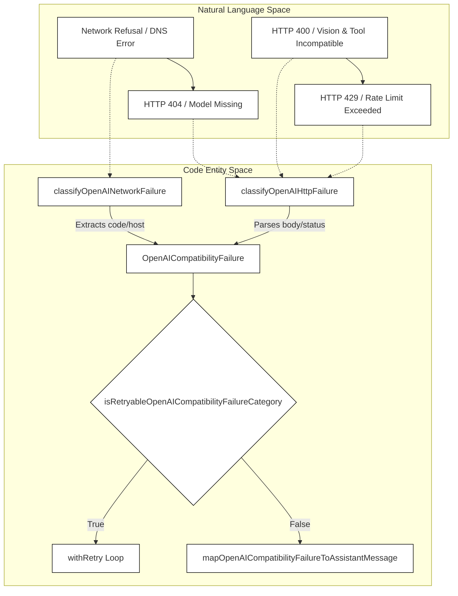
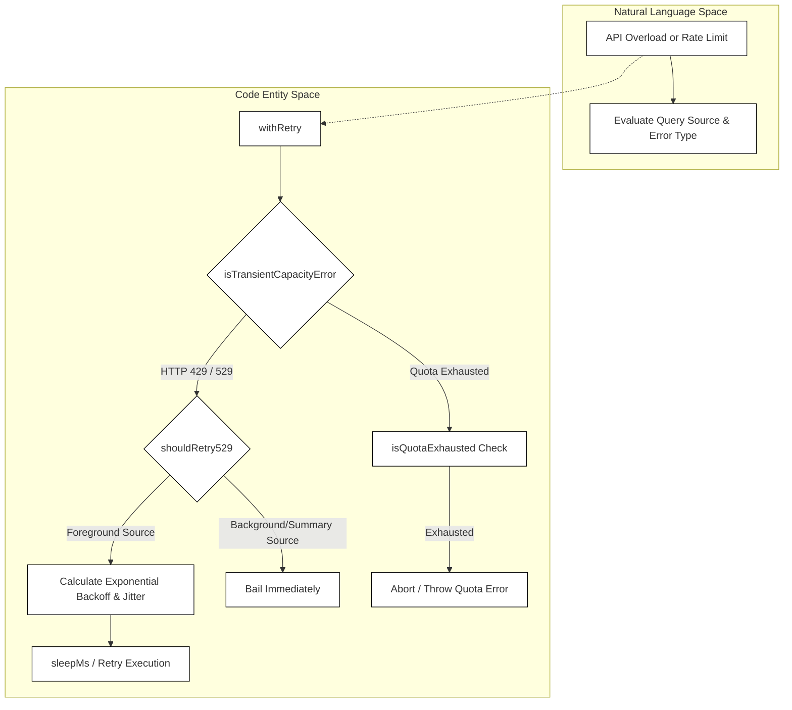

# Errors, Retries & Networking

Relevant source files

The following files were used as context for generating this wiki page:

- [src/query/toolFailureLoopGuard.test.ts](src/query/toolFailureLoopGuard.test.ts)
- [src/query/toolFailureLoopGuard.ts](src/query/toolFailureLoopGuard.ts)
- [src/query/transitions.ts](src/query/transitions.ts)
- [src/services/AgentSummary/agentSummary.test.ts](src/services/AgentSummary/agentSummary.test.ts)
- [src/services/AgentSummary/agentSummary.ts](src/services/AgentSummary/agentSummary.ts)
- [src/services/api/claude.abortClassification.test.ts](src/services/api/claude.abortClassification.test.ts)
- [src/services/api/errors.openaiCompatibility.test.ts](src/services/api/errors.openaiCompatibility.test.ts)
- [src/services/api/errors.ts](src/services/api/errors.ts)
- [src/services/api/fetchWithProxyRetry.test.ts](src/services/api/fetchWithProxyRetry.test.ts)
- [src/services/api/fetchWithProxyRetry.ts](src/services/api/fetchWithProxyRetry.ts)
- [src/services/api/openaiErrorClassification.test.ts](src/services/api/openaiErrorClassification.test.ts)
- [src/services/api/openaiErrorClassification.ts](src/services/api/openaiErrorClassification.ts)
- [src/services/api/openaiShim/requestExecutor.integration.test.ts](src/services/api/openaiShim/requestExecutor.integration.test.ts)
- [src/services/api/openaiShim/requestExecutor.test.ts](src/services/api/openaiShim/requestExecutor.test.ts)
- [src/services/api/openaiShim/requestExecutor.ts](src/services/api/openaiShim/requestExecutor.ts)
- [src/services/api/withRetry.test.ts](src/services/api/withRetry.test.ts)
- [src/services/api/withRetry.ts](src/services/api/withRetry.ts)
- [src/services/extractMemories/extractMemories.abort.test.ts](src/services/extractMemories/extractMemories.abort.test.ts)
- [src/services/extractMemories/extractMemories.ts](src/services/extractMemories/extractMemories.ts)
- [src/utils/abortReasons.test.ts](src/utils/abortReasons.test.ts)
- [src/utils/abortReasons.ts](src/utils/abortReasons.ts)
- [src/utils/proxy.test.ts](src/utils/proxy.test.ts)
- [src/utils/proxy.ts](src/utils/proxy.ts)
- [src/utils/queryLifecycle.test.ts](src/utils/queryLifecycle.test.ts)
- [src/utils/userAgent.ts](src/utils/userAgent.ts)

## Purpose and Scope
This page details the error classification, retry orchestration, proxy wrappers, abort management, and token-cap recovery systems within OpenClaude (`src/services/api/`). These mechanisms ensure robust fault tolerance across first-party Anthropic endpoints and 200+ third-party LLM providers, translating low-level network failures, HTTP status codes, and provider-specific error payloads into structured runtime exceptions, actionable UI notifications, or controlled recovery cycles.

---

## 1. Error Classification & Normalization

OpenClaude standardizes raw network errors and HTTP error responses from diverse gateways via an explicit failure categorization engine. The system distinguishes between network-level exceptions (such as DNS failures and connection refusals) and HTTP status-based application errors.

Categories are defined in `[src/services/api/openaiErrorClassification.ts:1-19]()` as `OpenAICompatibilityFailureCategory`:
- `connection_refused`
- `localhost_resolution_failed`
- `request_timeout`
- `network_error`
- `auth_invalid`
- `rate_limited`
- `quota_exhausted`
- `model_not_found`
- `endpoint_not_found`
- `vision_not_supported`
- `context_overflow`
- `tool_call_incompatible`
- `tool_stream_unsupported`
- `stream_options_unsupported`
- `malformed_provider_response`
- `provider_unavailable`
- `unknown`

Structured failure objects (`OpenAICompatibilityFailure`) bundle metadata such as source type, category, retryability, diagnostic hints, status codes, and request URLs `[src/services/api/openaiErrorClassification.ts:20-29]()`.

*Title: Error Classification and Normalization Flow*
Sources: `[src/services/api/openaiErrorClassification.ts:1-100]()`, `[src/services/api/errors.ts:68-168]()`

When an OpenAI-compatible provider encounters an error, category markers are embedded or parsed to construct user-facing assistant error messages `[src/services/api/errors.ts:68-123]()`. For instance, `localhost_resolution_failed` generates local server configuration hints `[src/services/api/errors.ts:88-95]()`, while `model_not_found` suggests alternative commands like `/model` or `--model` depending on interactive state `[src/services/api/errors.ts:112-116]`.

Sources: `[src/services/api/openaiErrorClassification.ts:1-100]()`, `[src/services/api/errors.ts:68-168]()`

---

## 2. Retry Orchestration & withRetry

The core retry driver is implemented in `[src/services/api/withRetry.ts]()`. It wraps API calls with exponential backoff, jitter, rate-limit header parsing (`Retry-After`), capacity exhaustion checks (`529`), and foreground query source restrictions.

### Retry Bounds and Configuration
- **Max Retries:** Defaults to `10` attempts, bounded by `MAX_CONFIGURABLE_RETRIES` (`100`), configurable via environment variables `OPENCLAUDE_MAX_RETRIES` or legacy `CLAUDE_CODE_MAX_RETRIES` `[src/services/api/withRetry.ts:62-63]()`.
- **Delay Base:** Defaults to `500ms` (`DEFAULT_RETRY_DELAY_MS`), capped at `60,000ms` (`MAX_RETRY_DELAY_BASE_MS`) `[src/services/api/withRetry.ts:66-68]()`.

### Foreground vs. Background 529 Retry Policy
HTTP `529` (Overloaded / Capacity) errors are filtered by query source `[src/services/api/withRetry.ts:75-95]()`. Only interactive foreground sources (`repl_main_thread`, `sdk`, `agent:*`, `compact`, `hook_agent`, etc.) retry on `529` to prevent recursive gateway amplification during system-wide outages `[src/services/api/withRetry.ts:70-74]()`. Unattended persistent retry mode (`CLAUDE_CODE_UNATTENDED_RETRY`) extends retry duration up to 100 attempts with periodic keep-alive yields `[src/services/api/withRetry.ts:104-123]()`.

*Title: Retry Orchestration Decision Tree*
Sources: `[src/services/api/withRetry.ts:75-155]()`, `[src/services/api/withRetry.ts:104-149]()`

Sources: `[src/services/api/withRetry.ts:62-155]()`

---

## 3. Proxy Fetch Wrappers & Transport Execution

Network requests executed through the OpenAI shim leverage `[src/services/api/openaiShim/requestExecutor.ts]()`, which manages credential pooling, proxy configurations, Keep-Alive controls, and low-level connection resets.

Stale connection errors (`ECONNRESET`, `EPIPE`) detected during transport are handled by resetting connection states and forcing fresh socket allocations `[src/services/api/withRetry.ts:157-163]()`. Proxy error recovery delegates through `[src/services/api/fetchWithProxyRetry.ts]()`, which intercepts proxy negotiation failures and executes fallback connection strategies without proxy routing if configured.

Sources: `[src/services/api/openaiShim/requestExecutor.ts:1-208]()`, `[src/services/api/withRetry.ts:157-163]()`

---

## 4. Abort Reasons & Cancellation Handling

Query executions and network streams observe `AbortSignal` hierarchies managed across the agent lifecycle. Cancellation tokens distinguish between user interrupts, query timeouts, background task bails, and missing tool result aborts `[src/utils/abortReasons.ts]()`.

When an operation is aborted, `APIUserAbortError` is thrown or propagated through generator streams, ensuring that downstream cleanups (such as closing streams or releasing credential leases) execute deterministically `[src/services/api/withRetry.ts:60]()`. Tool execution failure loops also monitor synthetic abort results to prevent runaway failure cascades `[src/query/toolFailureLoopGuard.ts:10-20]()`.

Sources: `[src/utils/abortReasons.ts:1-50]()`, `[src/services/api/withRetry.ts:60]()`, `[src/query/toolFailureLoopGuard.ts:10-20]()`

---

## 5. Max-Token Cap Retry & Cost/Quota Recovery

Certain gateways (such as OpenRouter) return `402` or `429` responses with instructions to adjust `max_tokens` when output token parameters exceed billing allocations or provider capability caps `[src/services/api/withRetry.ts:130-134]()`. 

`withRetry` inspects errors for affordable max-token adjustments `[src/services/api/withRetry.ts:132]()`. If a request fails due to token bounds or cost ceilings, the retry orchestrator automatically recalculates bounded output parameters (`FLOOR_OUTPUT_TOKENS = 3000` `[src/services/api/withRetry.ts:64]()`) and re-dispatches the request with modified payload constraints.

Sources: `[src/services/api/withRetry.ts:64]()`, `[src/services/api/withRetry.ts:130-149]()`