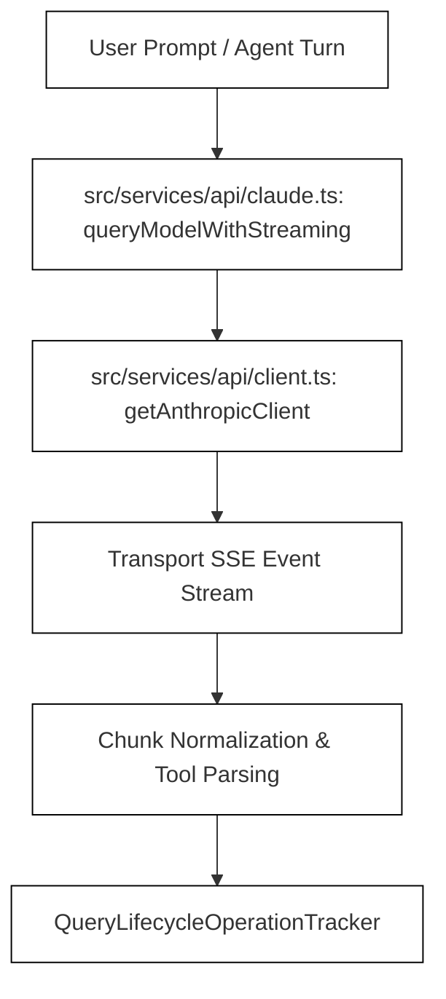
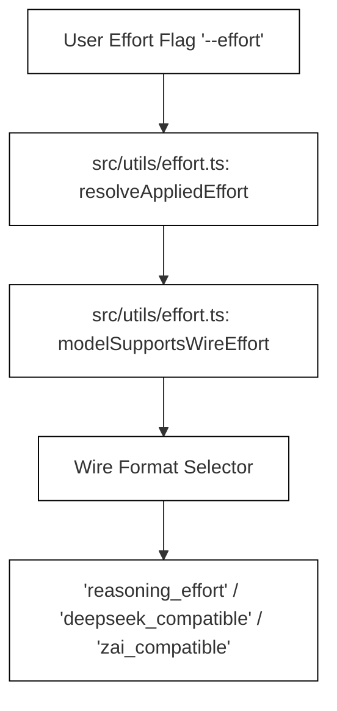

# Anthropic Client Lifecycle & Reasoning Effort

Relevant source files

The following files were used as context for generating this wiki page:

- [docs/smart-routing.md](docs/smart-routing.md)
- [src/commands/login/login.tsx](src/commands/login/login.tsx)
- [src/commands/smartroute/index.test.ts](src/commands/smartroute/index.test.ts)
- [src/commands/smartroute/index.ts](src/commands/smartroute/index.ts)
- [src/components/ConsoleOAuthFlow.test.tsx](src/components/ConsoleOAuthFlow.test.tsx)
- [src/components/ConsoleOAuthFlow.tsx](src/components/ConsoleOAuthFlow.tsx)
- [src/components/CustomSelect/select-input-option.tsx](src/components/CustomSelect/select-input-option.tsx)
- [src/constants/apiLimits.ts](src/constants/apiLimits.ts)
- [src/hooks/usePasteHandler.image-path-error.test.ts](src/hooks/usePasteHandler.image-path-error.test.ts)
- [src/hooks/usePasteHandler.test.ts](src/hooks/usePasteHandler.test.ts)
- [src/hooks/usePasteHandler.ts](src/hooks/usePasteHandler.ts)
- [src/integrations/brands/glm.ts](src/integrations/brands/glm.ts)
- [src/integrations/models/glm.ts](src/integrations/models/glm.ts)
- [src/integrations/vendors/zai.ts](src/integrations/vendors/zai.ts)
- [src/services/api/claude.lifecycle.test.ts](src/services/api/claude.lifecycle.test.ts)
- [src/services/api/claude.ts](src/services/api/claude.ts)
- [src/services/api/smartModelRouting.test.ts](src/services/api/smartModelRouting.test.ts)
- [src/services/api/smartModelRouting.ts](src/services/api/smartModelRouting.ts)
- [src/utils/imageMockLifecycle.consumer.test.ts](src/utils/imageMockLifecycle.consumer.test.ts)
- [src/utils/imagePaste.clipboard-error.test.ts](src/utils/imagePaste.clipboard-error.test.ts)
- [src/utils/thinking.test.ts](src/utils/thinking.test.ts)
- [src/utils/thinking.ts](src/utils/thinking.ts)

This page details the core Anthropic API client lifecycle (`claude.ts`), streaming event management, token and context limit resolutions, reasoning effort / thinking mode mapping, and smart model/agent routing mechanisms within OpenClaude.

---

## 1. Streaming Lifecycle & Request Execution (`claude.ts`)

The primary execution engine for interacting with Anthropic models (and through shims, multi-provider gateways) is centered around `src/services/api/claude.ts`. This module coordinates streaming event loops, side-task abort handling, token consumption tracking, and non-streaming fallbacks.

Key functions controlling execution include:
- `queryModelWithStreaming`: Manages the Server-Sent Events (SSE) stream, tracking content blocks, tool calls, and lifecycle operations (`[src/services/api/claude.ts:1-200]()`).
- `executeNonStreamingRequest`: Fallback method used when streaming is disabled or unsupported by a specific provider shim (`[src/services/api/claude.ts:51-59]()`).
- `queryHaiku`: Dedicated pipeline for lightweight auxiliary tasks using fast models (`[src/services/api/claude.ts:51-59]()`).

Timeout enforcement, idle stream detection, and interruption traces are managed via `src/utils/abortReasons.js` and `src/utils/interruptionTrace.js` to ensure hung sockets or user cancellations are cleanly propagated.

Sources: `[src/services/api/claude.ts:1-200](), [src/services/api/client.ts:1-65]()`

---

## 2. API Limits, Context Windows & Quotas

Model capability limits, maximum output tokens, and context window resolutions are dynamically computed based on active model names, vendor integrations, and runtime configuration flags.

Important modules governing these limits:
- `src/utils/context.ts`: Provides `getContextWindowForModel`, `getModelMaxOutputTokens`, and 1M context experimental handling (`[src/services/api/claude.ts:78-82]()`).
- `src/services/claudeAiLimits.js`: Tracks OAuth and subscription quota exhaustion via `currentLimits` and header extractors (`[src/services/api/claude.ts:110-114]()`).
- `src/utils/effort.ts`: Resolves reasoning bounds and output token ceiling expansions when reasoning tokens consume a large portion of the budget.

Sources: `[src/services/api/claude.ts:78-114](), [src/utils/effort.ts:1-90]()`

---

## 3. Thinking and Effort Resolution

Reasoning effort and thinking parameters are normalized across native Anthropic reasoning parameters and OpenAI-compatible shims (such as DeepSeek and Z.AI GLM formats).

Key utilities:
- `resolveAppliedEffort`: Maps app-state effort levels (`low`, `medium`, `high`, `xhigh`, `max`, `ultracode`) to concrete backend representations (`[src/services/api/claude.ts:83]`, `[src/utils/effort.ts:169-170]()`).
- `modelSupportsEffort` / `modelSupportsWireEffort`: Evaluates capability metadata from model descriptors and integration catalogs (`[src/utils/effort.ts:152-160]()`).
- `modelSupportsThinking`: Determines whether extended thinking blocks should be injected into the payload (`[src/utils/thinking.ts:72-123]()`).

Sources: `[src/utils/effort.ts:1-180](), [src/utils/thinking.ts:1-150]()`

---

## 4. Smart Model & Agent Routing

OpenClaude supports multi-provider profile switching and automated model selection for sub-tasks (such as code compaction, fast filtering, or specialized agent sub-loops).

Key modules:
- `src/services/api/client.ts`: Constructs the underlying SDK client instance, managing authentication routing via `src/services/api/authRouting.js` and credential pools (`[src/services/api/client.ts:56-61]()`).
- `src/services/api/agentRouting.ts`: Handles specialized agent instruction routing and model capability matching.
- `src/utils/model/model.js`: Exposes helpers like `getDefaultSonnetModel`, `getDefaultOpusModel`, and `getSmallFastModel` (`[src/services/api/claude.ts:98-103]()`).

Sources: `[src/services/api/client.ts:1-70](), [src/services/api/claude.ts:98-103]()`