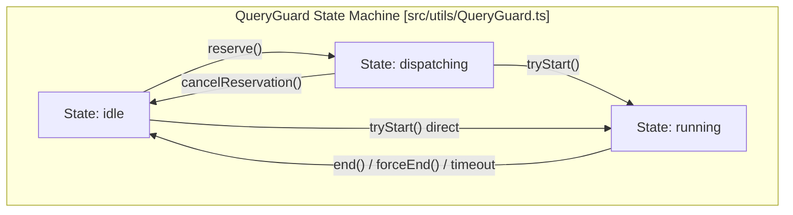

# Query Orchestration & Lifecycle

<details>
<summary>Relevant source files</summary>

The following files were used as context for generating this wiki page:

- [src/Tool.ts](src/Tool.ts)
- [src/commands/set-context-window/set-context-window.test.ts](src/commands/set-context-window/set-context-window.test.ts)
- [src/components/Settings/Config.tsx](src/components/Settings/Config.tsx)
- [src/components/Settings/queryIdleTimeoutConfig.test.ts](src/components/Settings/queryIdleTimeoutConfig.test.ts)
- [src/components/Settings/queryIdleTimeoutSetting.ts](src/components/Settings/queryIdleTimeoutSetting.ts)
- [src/query.ts](src/query.ts)
- [src/query/autoCompactCooldown.test.ts](src/query/autoCompactCooldown.test.ts)
- [src/query/providerMaxTokensCapRetry.test.ts](src/query/providerMaxTokensCapRetry.test.ts)
- [src/query/toolFailureLoopGuard.test.ts](src/query/toolFailureLoopGuard.test.ts)
- [src/query/toolFailureLoopGuard.ts](src/query/toolFailureLoopGuard.ts)
- [src/query/transitions.ts](src/query/transitions.ts)
- [src/screens/REPL.queryLifecycle.test.ts](src/screens/REPL.queryLifecycle.test.ts)
- [src/screens/REPL.tsx](src/screens/REPL.tsx)
- [src/services/AgentSummary/agentSummary.test.ts](src/services/AgentSummary/agentSummary.test.ts)
- [src/services/AgentSummary/agentSummary.ts](src/services/AgentSummary/agentSummary.ts)
- [src/services/api/claude.abortClassification.test.ts](src/services/api/claude.abortClassification.test.ts)
- [src/services/compact/autoCompact.test.ts](src/services/compact/autoCompact.test.ts)
- [src/services/compact/autoCompact.ts](src/services/compact/autoCompact.ts)
- [src/services/compact/compact.ts](src/services/compact/compact.ts)
- [src/services/extractMemories/extractMemories.abort.test.ts](src/services/extractMemories/extractMemories.abort.test.ts)
- [src/services/extractMemories/extractMemories.ts](src/services/extractMemories/extractMemories.ts)
- [src/services/mcp/client.activity.test.ts](src/services/mcp/client.activity.test.ts)
- [src/services/mcp/client.test.ts](src/services/mcp/client.test.ts)
- [src/services/mcp/client.ts](src/services/mcp/client.ts)
- [src/tools/AgentTool/runAgent.routing.test.ts](src/tools/AgentTool/runAgent.routing.test.ts)
- [src/tools/TaskOutputTool/TaskOutputTool.activity.test.ts](src/tools/TaskOutputTool/TaskOutputTool.activity.test.ts)
- [src/tools/TaskOutputTool/TaskOutputTool.tsx](src/tools/TaskOutputTool/TaskOutputTool.tsx)
- [src/utils/QueryGuard.test.ts](src/utils/QueryGuard.test.ts)
- [src/utils/QueryGuard.ts](src/utils/QueryGuard.ts)
- [src/utils/abortReasons.test.ts](src/utils/abortReasons.test.ts)
- [src/utils/abortReasons.ts](src/utils/abortReasons.ts)
- [src/utils/config.ts](src/utils/config.ts)
- [src/utils/forkedAgent.ts](src/utils/forkedAgent.ts)
- [src/utils/queryGuardConfig.test.ts](src/utils/queryGuardConfig.test.ts)
- [src/utils/queryGuardConfig.ts](src/utils/queryGuardConfig.ts)
- [src/utils/queryLifecycle.test.ts](src/utils/queryLifecycle.test.ts)
- [src/utils/queryLifecycle.ts](src/utils/queryLifecycle.ts)

</details>


## Purpose and Scope
This page details the core query orchestration and lifecycle engine in OpenClaude. It covers the asynchronous `query()` generator loop, the `QueryGuard` state machine protecting against stuck operations, granular execution leases and timeouts, turn transitions, stop hooks, and doom-loop mitigation via the tool failure loop guard.

---

## 1. The `query()` Generator & Main Turn Loop

The primary execution driver for any agent turn or conversation step is the `query()` generator function defined in `src/query.ts`. This generator handles message preprocessing, context assembly, API dispatch, model smart-routing, tool orchestration, and automatic compaction checks.

Title: "Query Loop Execution Pipeline"
```mermaid
graph TD
    subcode["Code Entity Space: src/query.ts"]
        Q["query() generator"] --> Prep["buildQueryConfig()"]
        Prep --> Model["decideTurnModel()"]
        Model --> Call["deps.callModel()"]
        Call --> Stream["Stream Event Processing"]
        Stream --> Tools{{"Tool Use Blocks?"}}
        Tools -->|Yes| ExecTools["runTools() / StreamingToolExecutor"]
        ExecTools --> Loop["Continue Turn Loop"]
        Tools -->|No| Term["Terminal / End Turn"]
    end

    classDef code fill:#f5f5f5,stroke:#333,stroke-width:1px;
    class Q,Prep,Model,Call,Stream,Tools,ExecTools,Loop,Term code;
```
*Figure 1: Bridge from natural language turn loop to `src/query.ts` execution flow.*

When a query begins, `query()` initializes configuration parameters via `buildQueryConfig()` [src/query.ts:137](), validates tool permissions, resolves the active model through smart routing (`decideTurnModel`) [src/query.ts:155](), and dispatches requests to the underlying provider client. Throughout the stream, token budgets are tracked and checked via `checkTokenBudget()` [src/query.ts:165]().

Sources:
- `src/query.ts` [src/query.ts:1-168]()

---

## 2. `QueryGuard` State Machine & Lifecycles

To prevent concurrent query re-entrancy and manage unresponsive threads, OpenClaude implements a synchronous state machine called `QueryGuard` in `src/utils/QueryGuard.ts`. 

`QueryGuard` operates across three core states [src/utils/QueryGuard.ts:121]():
- `idle`: No query is active; safe to dequeue and process new items.
- `dispatching`: An item has been dequeued, but the asynchronous initialization chain has not yet invoked `tryStart()`.
- `running`: The query is actively executing its turn loop.

Title: "QueryGuard State Machine"

*Figure 2: `QueryGuard` state transitions and lease management.*

The guard integrates with React's `useSyncExternalStore` inside UI components like `src/screens/REPL.tsx` [src/screens/REPL.tsx:39]() to accurately reflect whether a query is active in the terminal interface.

Sources:
- `src/utils/QueryGuard.ts` [src/utils/QueryGuard.ts:120-144]()
- `src/screens/REPL.tsx` [src/screens/REPL.tsx:39-40]()

---

## 3. Leases, Timeouts, and Operation Tracking

The query runtime uses bounded leases and multi-tier timeout watchdogs to handle hangs during network requests or tool executions.

### Lease Mechanics
Subsystems (such as `api`, `tool`, `bash`, or `subagent`) acquire time-bounded leases via `QueryGuardLeaseInput` structures [src/utils/QueryGuard.ts:60](). Each active lease produces a `QueryGuardLease` handle containing a unique ID and a single-use `release()` method [src/utils/QueryGuard.ts:77]().

### Timeout Tiers
1. **Idle Timeout**: Bounded by `DEFAULT_QUERY_IDLE_TIMEOUT_MS` (5 minutes) [src/utils/QueryGuard.ts:48](), triggering a force-end if no activity occurs.
2. **Hard Maximum Query Limit**: Bounded by `DEFAULT_QUERY_HARD_MAX_MS` (30 minutes) [src/utils/QueryGuard.ts:49](), which acts as an absolute ceiling for long-running workflows.
3. **Operation Snapshots**: `QueryLifecycleOperationTracker` captures active API calls and tool uses so that timeout payloads contain precise diagnostic telemetry [src/utils/QueryGuard.ts:139]().

Sources:
- `src/utils/QueryGuard.ts` [src/utils/QueryGuard.ts:48-144]()

---

## 4. Turn Transitions and Flow Control

As a query turn executes, control passes through transition definitions in `src/query/transitions.ts`. The orchestrator evaluates whether a turn should continue (`Continue`) or terminate (`Terminal`) based on stop conditions, tool errors, or user interruptions.

When a model response includes tool calls, control transitions to execution handlers. If execution succeeds without triggering fatal abort conditions, the loop feeds tool results back into the conversation history and initiates the next model turn.

Sources:
- `src/query/transitions.ts` [src/query/transitions.ts:1-31]()
- `src/query.ts` [src/query.ts:140-146]()

---

## 5. Stop Hooks & Doom-Loop Guards

To prevent agents from getting stuck in infinite error loops (e.g., repeatedly failing to edit the same file with identical invalid syntax), OpenClaude combines stop hooks with a tool failure loop guard.

Title: "Tool Failure Loop Guard Pipeline"
```mermaid
graph TD
    subcode["Code Entity Space: src/query/toolFailureLoopGuard.ts"]
        Results["Tool Results Collection"] --> Parse["updateToolFailureLoopGuard()"]
        Parse --> Count{{"Check Signature / Path Counts"}}
        Count -->|Exceeds Threshold| Trip["Return tripped: true (Abort Turn)"]
        Count -->|Approaching Threshold| Advise["Emit Advisory Warning"]
        Count -->|Success| Reset["Reset Persistent Signatures"]
    end

    classDef code fill:#f5f5f5,stroke:#333,stroke-width:1px;
    class Results,Parse,Count,Trip,Advise,Reset code;
```
*Figure 3: Tool failure loop guard decision pipeline.*

### Tool Failure Loop Guard (`toolFailureLoopGuard.ts`)
- **State Structure**: Maintains `persistentSignatureCounts`, `signatureCounts`, `categoryCounts`, and `pathCounts` [src/query/toolFailureLoopGuard.ts:22-27]().
- **Threshold Evaluation**: Configurable via `getToolFailureLoopThreshold()` [src/query/toolFailureLoopGuard.ts:61-77]() (defaulting to 3 identical failures).
- **Advisories vs. Trips**: When failures approach the threshold minus one, the guard emits an advisory warning message to guide the model [src/query/toolFailureLoopGuard.ts:171](). When the threshold is reached, it trips and aborts the loop with a structured error category.

### Stop Hooks (`stopHooks.ts`)
Post-turn stop hooks (`handleStopHooks`) inspect conversation output and environmental flags to determine if execution should halt or require user confirmation [src/query.ts:131]().

Sources:
- `src/query/toolFailureLoopGuard.ts` [src/query/toolFailureLoopGuard.ts:1-88]()
- `src/query.ts` [src/query.ts:131]()