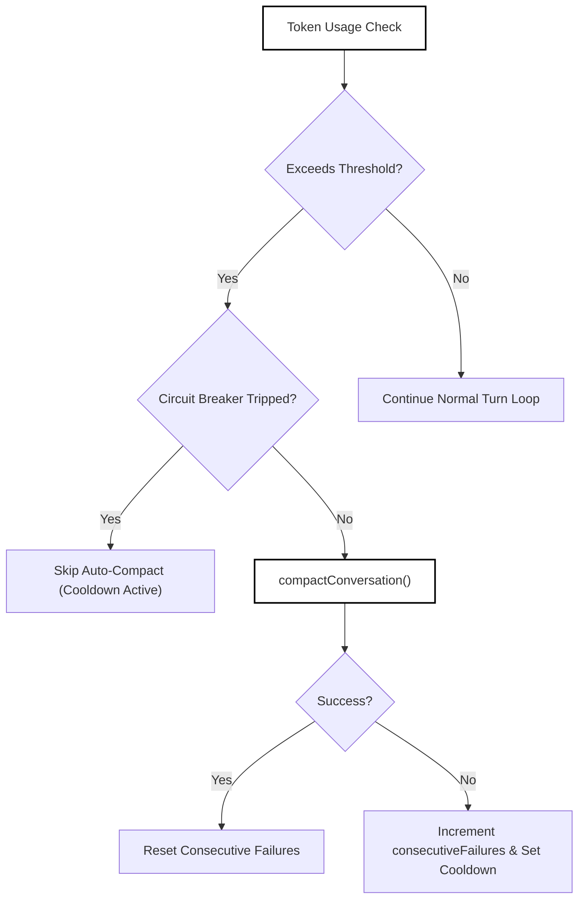
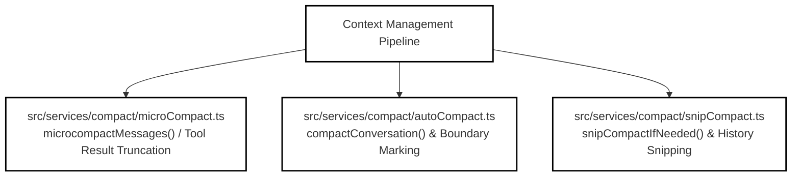
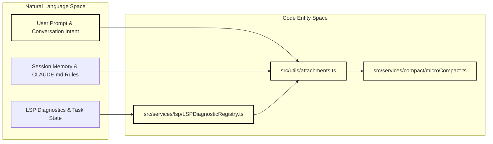
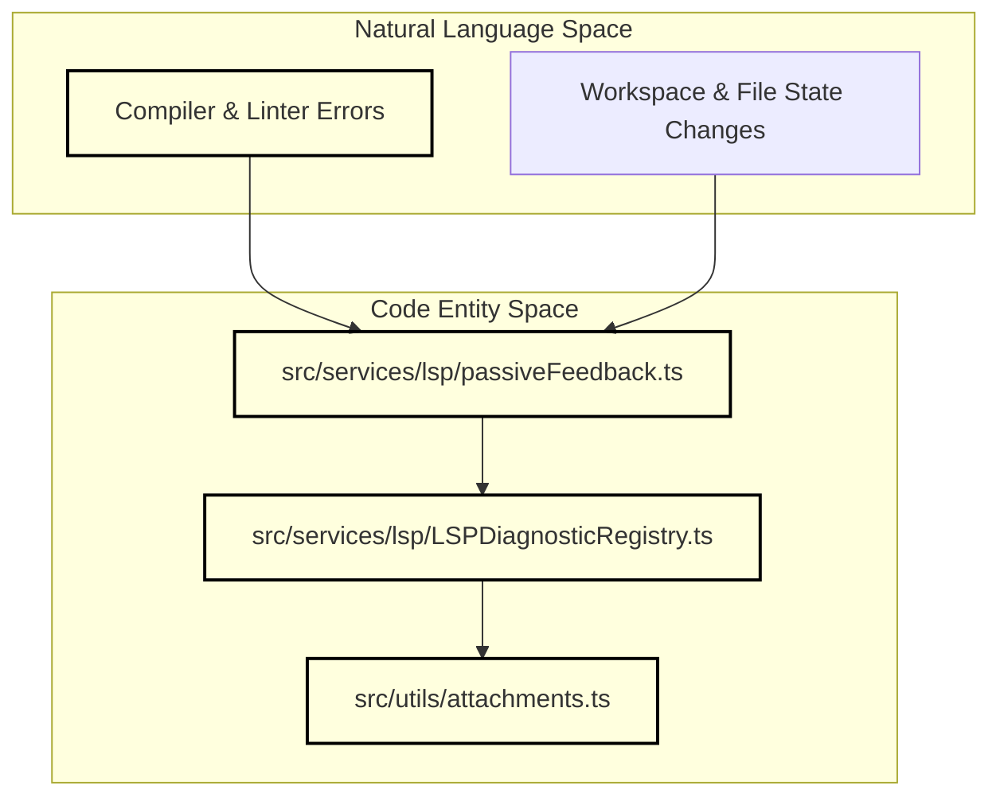

# Compaction & Context Management

Relevant source files

The following files were used as context for generating this wiki page:

- [src/QueryEngine.ts](src/QueryEngine.ts)
- [src/cli/handlers/autoMode.ts](src/cli/handlers/autoMode.ts)
- [src/commands/diagnostics/diagnostics.test.ts](src/commands/diagnostics/diagnostics.test.ts)
- [src/commands/diagnostics/diagnostics.ts](src/commands/diagnostics/diagnostics.ts)
- [src/commands/diagnostics/index.test.ts](src/commands/diagnostics/index.test.ts)
- [src/commands/diagnostics/index.ts](src/commands/diagnostics/index.ts)
- [src/commands/dream/dream.ts](src/commands/dream/dream.ts)
- [src/commands/dream/index.ts](src/commands/dream/index.ts)
- [src/entrypoints/mcp.test.ts](src/entrypoints/mcp.test.ts)
- [src/entrypoints/mcp.ts](src/entrypoints/mcp.ts)
- [src/memdir/findRelevantMemories.ts](src/memdir/findRelevantMemories.ts)
- [src/services/compact/cachedMicrocompact.test.ts](src/services/compact/cachedMicrocompact.test.ts)
- [src/services/compact/cachedMicrocompact.ts](src/services/compact/cachedMicrocompact.ts)
- [src/services/compact/microCompact.test.ts](src/services/compact/microCompact.test.ts)
- [src/services/compact/microCompact.ts](src/services/compact/microCompact.ts)
- [src/services/compact/snipCompact.test.ts](src/services/compact/snipCompact.test.ts)
- [src/services/compact/snipCompact.ts](src/services/compact/snipCompact.ts)
- [src/services/diagnosticTracking.test.ts](src/services/diagnosticTracking.test.ts)
- [src/services/diagnosticTracking.ts](src/services/diagnosticTracking.ts)
- [src/services/lsp/LSPDiagnosticRegistry.test.ts](src/services/lsp/LSPDiagnosticRegistry.test.ts)
- [src/services/lsp/LSPDiagnosticRegistry.ts](src/services/lsp/LSPDiagnosticRegistry.ts)
- [src/services/lsp/LSPServerManager.ts](src/services/lsp/LSPServerManager.ts)
- [src/services/lsp/passiveFeedback.ts](src/services/lsp/passiveFeedback.ts)
- [src/tools/FileEditTool/FileEditTool.ts](src/tools/FileEditTool/FileEditTool.ts)
- [src/tools/FileWriteTool/FileWriteTool.ts](src/tools/FileWriteTool/FileWriteTool.ts)
- [src/tools/SnipTool/SnipTool.test.ts](src/tools/SnipTool/SnipTool.test.ts)
- [src/tools/SnipTool/SnipTool.ts](src/tools/SnipTool/SnipTool.ts)
- [src/tools/SnipTool/prompt.ts](src/tools/SnipTool/prompt.ts)
- [src/utils/attachments.contextEfficiency.test.ts](src/utils/attachments.contextEfficiency.test.ts)
- [src/utils/attachments.extractors.test.ts](src/utils/attachments.extractors.test.ts)
- [src/utils/attachments.lspDiagnostics.test.ts](src/utils/attachments.lspDiagnostics.test.ts)
- [src/utils/attachments.nestedDirs.test.ts](src/utils/attachments.nestedDirs.test.ts)
- [src/utils/attachments.ts](src/utils/attachments.ts)
- [src/utils/dragDropPaths.ts](src/utils/dragDropPaths.ts)
- [src/utils/sessionStorage.test.ts](src/utils/sessionStorage.test.ts)

## Purpose and Scope

This page details OpenClaude's context management and history compaction subsystems, located primarily under `src/services/compact/` [src/services/compact/autoCompact.ts:1-638] and `src/utils/attachments.ts` [src/utils/attachments.ts:1-177]. It covers the auto-compaction circuit breaker, conversation compaction routines (`compact`, `microCompact`, `snipCompact`), context collapse mechanisms, and asynchronous attachment injection strategies (including LSP diagnostics) designed to maintain context efficiency across long-running coding sessions.

---

## 1. Auto-Compact Circuit Breaker

The auto-compaction system monitors conversation token usage against model context windows and triggers automated summarization when approaching thresholds.

### Key Logic & Thresholds
- **Effective Context Window**: Calculated via `getEffectiveContextWindowSize()` in `src/services/compact/autoCompact.ts` [src/services/compact/autoCompact.ts:41-86], reserving tokens for summary output (`MAX_OUTPUT_TOKENS_FOR_SUMMARY = 20_000`) and respecting overrides or environment caps (`CLAUDE_CODE_AUTO_COMPACT_WINDOW`).
- **Buffer Thresholds**: Auto-compact triggers when token usage reaches `AUTOCOMPACT_BUFFER_TOKENS` (30,000 tokens) below the effective context window [src/services/compact/autoCompact.ts:107-114].
- **Circuit Breaker & Cooldown**: To protect against retry storms when context is irrecoverably over limits (e.g., `prompt_too_long` errors), consecutive failures are tracked via `AutoCompactTrackingState` [src/services/compact/autoCompact.ts:88-105]. Pausing occurs after `MAX_CONSECUTIVE_AUTOCOMPACT_FAILURES = 3` failures, enforcing a cooldown of `AUTOCOMPACT_FAILURE_COOLDOWN_MS` (default 5 minutes) [src/services/compact/autoCompact.ts:125-135].

Sources: [src/services/compact/autoCompact.ts:88-151]

---

## 2. Compaction Routines: compact, microCompact, & snipCompact

OpenClaude employs hierarchical compaction strategies to manage prompt sizes:

Sources: [src/services/compact/autoCompact.ts:27-34](), [src/services/compact/microCompact.ts:1-49](), [src/services/compact/snipCompact.ts:118-124]()

### Micro-Compacting (`microCompact`)
- Operates on individual turns and tool outputs without summarizing the whole conversation [src/services/compact/microCompact.ts:1-49].
- Truncates verbose built-in and MCP tool results (e.g., `Read`, shell tools, `Grep`, `WebFetch`, and `mcp__*` prefix tools) using `isCompactableTool()` [src/services/compact/microCompact.ts:34-49].
- Clears stale tool results with placeholders such as `[Old tool result content cleared]` (`TIME_BASED_MC_CLEARED_MESSAGE`) [src/services/compact/microCompact.ts:29].

### Full Conversation Compaction (`compact`)
- Invoked via `compactConversation()` or auto-compaction triggers [src/services/compact/autoCompact.ts:27-32].
- Summarizes past message history into a compact summary block, establishing a `compact_boundary` marker in the transcript.
- Re-injects essential preserved segments (`headUuid`, `anchorUuid`, `tailUuid`) to maintain semantic continuity [src/utils/sessionStorage.test.ts:104-126].

### History Snipping (`snipCompact`)
- Gated by runtime logic in `src/services/compact/snipCompact.ts` [src/services/compact/snipCompact.ts:74-76].
- Selectively removes intermediate or redundant message nodes using `markForSnip()` and `snipCompactIfNeeded()`, recording `snip_boundary` metadata without losing active conversational anchors [src/services/compact/snipCompact.ts:55-72,118-140].
- Coordinates token pressure nudges via `shouldNudgeForSnips()` and `SNIP_NUDGE_TEXT` [src/services/compact/snipCompact.ts:78-116].

Sources:
- [src/services/compact/microCompact.ts:1-49]()
- [src/services/compact/snipCompact.ts:55-140]()
- [src/utils/sessionStorage.test.ts:104-126]()

---

## 3. Context Collapse & Attachments

Context efficiency is further maintained via asynchronous attachment injectors and structural collapse mechanisms.

### Attachments & Context Efficiency
- Managed by `src/utils/attachments.ts`, which gathers context from memory files (`CLAUDE.md`), tasks, plans, IDE selections, and LSP diagnostics [src/utils/attachments.ts:38-55].
- Integrates with `LSPDiagnosticRegistry` (`src/services/lsp/LSPDiagnosticRegistry.ts`) to feed asynchronous compiler and linter diagnostics into conversation inputs under strict volume-limiting bounds (`MAX_TOTAL_DIAGNOSTICS = 30`) [src/services/lsp/LSPDiagnosticRegistry.ts:48-51,31-46].

Sources: [src/utils/attachments.ts:1-177](), [src/services/lsp/LSPDiagnosticRegistry.ts:31-65]()

- **Deduplication and Limits**: Prevents unbounded memory growth via LRU caches (`deliveredDiagnostics`, `recentDiagnosticFileActivity`) and debounces bursts within `DIAGNOSTIC_DELIVERY_DEBOUNCE_MS` (250ms) [src/services/lsp/LSPDiagnosticRegistry.ts:52-60,117-123].

Sources: [src/services/lsp/passiveFeedback.ts:117-198](), [src/services/lsp/LSPDiagnosticRegistry.ts:31-46](), [src/utils/attachments.ts:38-55]()

Sources:
- [src/utils/attachments.ts:35-55]()
- [src/services/lsp/LSPDiagnosticRegistry.ts:31-65]()
- [src/services/lsp/passiveFeedback.ts:117-198]()