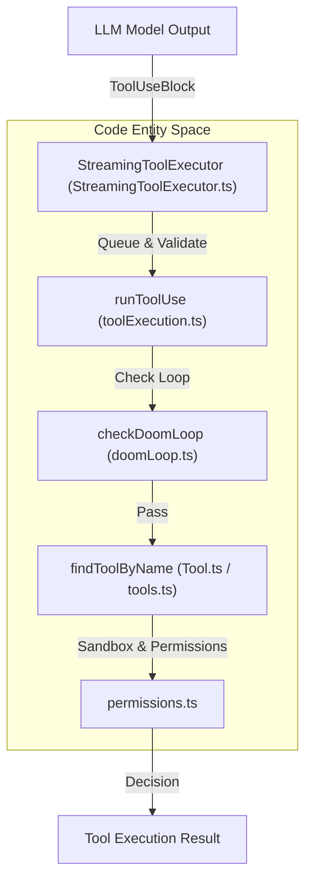

# Tools & Permissions

<details>
<summary>Relevant source files</summary>

The following files were used as context for generating this wiki page:

- [src/services/api/claude.toolHistoryRouting.test.ts](src/services/api/claude.toolHistoryRouting.test.ts)
- [src/services/api/compressToolHistory.test.ts](src/services/api/compressToolHistory.test.ts)
- [src/services/api/compressToolHistory.ts](src/services/api/compressToolHistory.ts)
- [src/services/api/openaiShim.compression.test.ts](src/services/api/openaiShim.compression.test.ts)
- [src/services/tools/StreamingToolExecutor.test.ts](src/services/tools/StreamingToolExecutor.test.ts)
- [src/services/tools/StreamingToolExecutor.ts](src/services/tools/StreamingToolExecutor.ts)
- [src/services/tools/toolExecution.test.ts](src/services/tools/toolExecution.test.ts)
- [src/services/tools/toolExecution.ts](src/services/tools/toolExecution.ts)
- [src/utils/doomLoop.test.ts](src/utils/doomLoop.test.ts)
- [src/utils/doomLoop.ts](src/utils/doomLoop.ts)

</details>


The OpenClaude tool system and permission gating architecture provides a secure, extensible interface for the agent core (`[src/services/tools/toolExecution.ts:1-201]()`) to interact with the host environment, execute code, manipulate files, perform web searches, and spawn sub-agents. Every tool invocation is intercepted, validated, sandbox-checked, and subject to interactive or automated permission policies before execution.

Sources: `[src/Tool.ts:1-200]()`, `[src/tools.ts:1-129]`, `[src/services/tools/toolExecution.ts:1-201]()`

## Tool Execution & Permission Pipeline Architecture

The following diagram illustrates how natural language tool requests flow through `StreamingToolExecutor` and `toolExecution.ts` into registry lookup, doom-loop protection (`doomLoop.ts`), and permission verification.


Sources: `[src/Tool.ts:1-200]()`, `[src/tools.ts:1-129]()`, `[src/services/tools/StreamingToolExecutor.ts:52-166]()`, `[src/services/tools/toolExecution.ts:1-201]()`, `[src/utils/doomLoop.ts:59-82]()`

---

## 6.1. Tool Framework & Execution

The core tool system centers around the `Tool` and `ToolUseContext` interfaces defined in `[src/Tool.ts:1-200]()`. Tools are aggregated and registered via `[src/tools.ts:1-129]()`, allowing dynamic loading of built-in and optional features. The execution pipeline managed in `[src/services/tools/toolExecution.ts:1-201]()` and `[src/services/tools/StreamingToolExecutor.ts:52-166]()` handles streaming tool outputs, argument parsing, error recovery, tool result storage, and tool history compression (`[src/services/api/compressToolHistory.ts:1-88]()`) to keep context window usage efficient during long agent loops.

For details, see [Tool Framework & Execution](#6.1).

Sources: `[src/Tool.ts:1-200]()`, `[src/tools.ts:1-129]()`, `[src/services/tools/toolExecution.ts:1-201]()`, `[src/services/tools/StreamingToolExecutor.ts:52-166]()`, `[src/services/api/compressToolHistory.ts:1-88]()`

---

## 6.2. Shell Tools (Bash / PowerShell)

Shell execution is handled by `BashTool` and `PowerShellTool`. These tools implement rigorous command semantics, command-line parsing, sandboxing via `[src/tools/BashTool/shouldUseSandbox.ts:151-181]()`, read-only command validation via `[src/tools/BashTool/readOnlyValidation.ts:1-50]()`, and output handling. The system analyzes shell command structures to distinguish read-only inspection commands from state-mutating actions, automatically determining whether operating system sandboxing is required.

For details, see [Shell Tools (Bash / PowerShell)](#6.2).

Sources: `[src/tools/BashTool/shouldUseSandbox.ts:151-181]()`, `[src/tools/BashTool/readOnlyValidation.ts:1-50]()`

---

## 6.3. File & Code Tools

File and code manipulation utilities include `FileReadTool`, `FileWriteTool`, `FileEditTool`, glob/grep engines powered by ripgrep, Language Server Protocol (LSP) diagnostics integration, repository map generators, and snippet compression utilities. These tools incorporate read deduplication and safe path validation to prevent unauthorized access outside working directory bounds.

For details, see [File & Code Tools](#6.3).

Sources: `[src/tools.ts:6-11]()`

---

## 6.4. Web Search & Fetch Tools

The web search subsystem provides a modular provider framework supporting Brave, Exa, Tavily, DuckDuckGo, and custom backends alongside `WebFetchTool`. These modules incorporate domain safety checks, user-agent headers, configurable timeouts, and rate-limiting to safely retrieve external content into the agent's context.

For details, see [Web Search & Fetch Tools](#6.4).

Sources: `[src/tools.ts:11-46]()`

---

## 6.5. Agents, Tasks & Swarm

OpenClaude supports multi-agent orchestration via `AgentTool`, `runAgent`, `resumeAgent`, built-in agent definitions, agent routing mechanisms, and task tracking tools (`TaskCreateTool`, `TaskGetTool`, `TaskUpdateTool`, `TaskListTool`) `[src/tools.ts:72-75]()`. Swarm spawn utilities and git worktree isolation allow concurrent sub-agent execution while protecting main query states.

For details, see [Agents, Tasks & Swarm](#6.5).

Sources: `[src/tools.ts:3-69]()`

---

## 6.6. Permissions & Safety

The permission and safety architecture governs all tool executions through a comprehensive permission model, filesystem/path validation, bash permissions, yolo classifier, dangerous pattern matching, and interactive permission dialogs (`[src/components/permissions/MonitorPermissionRequest/MonitorPermissionRequest.tsx:15-35]()`). 

The permission workflow interacts directly with user input handlers and background checks:

```mermaid
sequenceDiagram
  participant Agent as Agent Loop
  participant Perm as "permissions.ts"
  participant Handler as "interactiveHandler.ts"
  participant UI as "MonitorPermissionRequest.tsx"

  Agent->>Perm: "Check Tool Permission"
  Perm->>Handler: "Trigger Interactive Prompt"
  Handler->>UI: "Render Prompt Options"
  UI-->>Handler: "User Selects Decision"
  Handler-->>Perm: "Resolve Permission Decision"
  Perm-->>Agent: "Proceed or Abort"

  subgraph "Code Entity Space"
    Perm
    Handler
    UI
  end
```
Sources: `[src/utils/permissions/permissions.ts:1-50]()`, `[src/hooks/toolPermission/handlers/interactiveHandler.ts:1-64]()`, `[src/components/permissions/MonitorPermissionRequest/MonitorPermissionRequest.tsx:15-35]()`

For details, see [Permissions & Safety](#6.6).

Sources: `[src/utils/permissions/permissions.ts:1-50]()`, `[src/hooks/toolPermission/handlers/interactiveHandler.ts:1-64]()`, `[src/components/permissions/MonitorPermissionRequest/MonitorPermissionRequest.tsx:15-35]()`