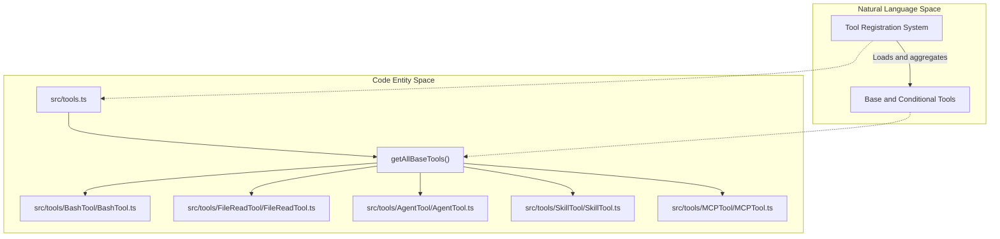
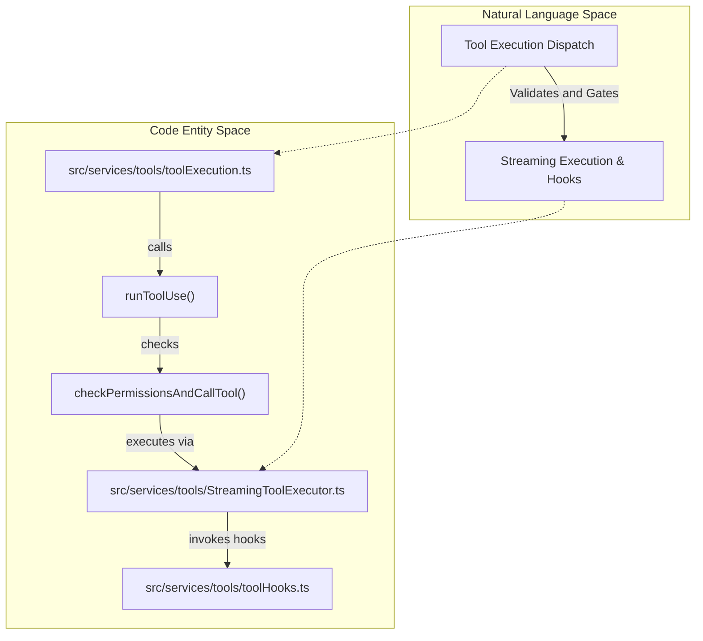
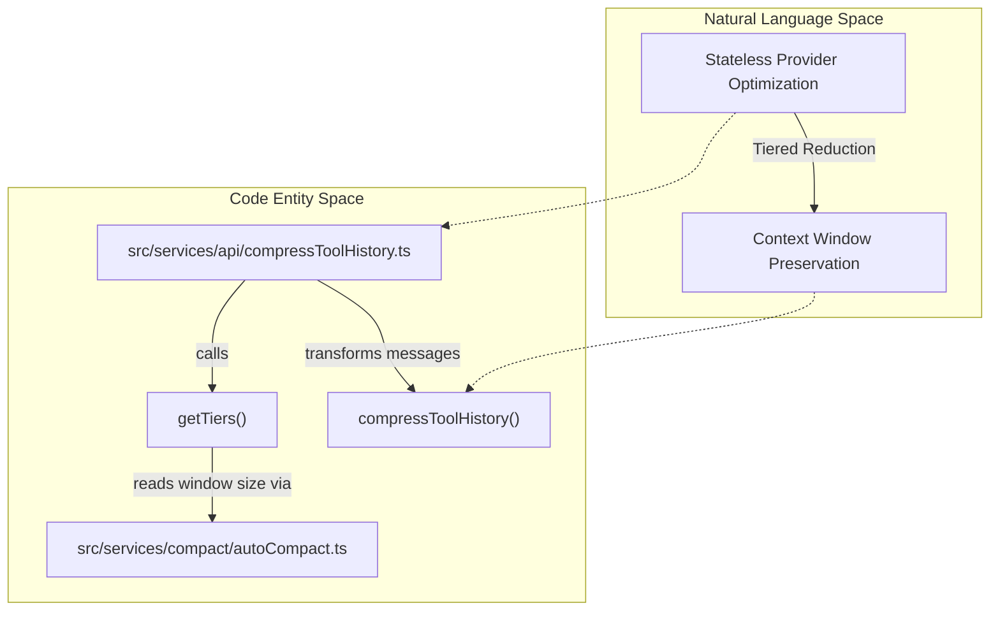

# Tool Framework & Execution

<details>
<summary>Relevant source files</summary>

The following files were used as context for generating this wiki page:

- [src/services/api/claude.toolHistoryRouting.test.ts](src/services/api/claude.toolHistoryRouting.test.ts)
- [src/services/api/compressToolHistory.test.ts](src/services/api/compressToolHistory.test.ts)
- [src/services/api/compressToolHistory.ts](src/services/api/compressToolHistory.ts)
- [src/services/api/openaiSchemaSanitizer.ts](src/services/api/openaiSchemaSanitizer.ts)
- [src/services/api/openaiShim.compression.test.ts](src/services/api/openaiShim.compression.test.ts)
- [src/services/tools/StreamingToolExecutor.test.ts](src/services/tools/StreamingToolExecutor.test.ts)
- [src/services/tools/StreamingToolExecutor.ts](src/services/tools/StreamingToolExecutor.ts)
- [src/services/tools/toolExecution.test.ts](src/services/tools/toolExecution.test.ts)
- [src/services/tools/toolExecution.ts](src/services/tools/toolExecution.ts)
- [src/services/tools/toolHooks.test.ts](src/services/tools/toolHooks.test.ts)
- [src/test/toolFixtures.ts](src/test/toolFixtures.ts)
- [src/tools/BashTool/commandSemantics.test.ts](src/tools/BashTool/commandSemantics.test.ts)
- [src/tools/BashTool/commandSemantics.ts](src/tools/BashTool/commandSemantics.ts)
- [src/tools/BashTool/utils.test.ts](src/tools/BashTool/utils.test.ts)
- [src/tools/BashTool/utils.ts](src/tools/BashTool/utils.ts)
- [src/tools/MCPTool/MCPTool.test.ts](src/tools/MCPTool/MCPTool.test.ts)
- [src/tools/MCPTool/MCPTool.ts](src/tools/MCPTool/MCPTool.ts)
- [src/tools/PowerShellTool/commandSemantics.test.ts](src/tools/PowerShellTool/commandSemantics.test.ts)
- [src/tools/PowerShellTool/commandSemantics.ts](src/tools/PowerShellTool/commandSemantics.ts)
- [src/tools/ReadMcpResourceTool/ReadMcpResourceTool.ts](src/tools/ReadMcpResourceTool/ReadMcpResourceTool.ts)
- [src/tools/SkillTool/SkillTool.ts](src/tools/SkillTool/SkillTool.ts)
- [src/utils/api.swarmFields.test.ts](src/utils/api.swarmFields.test.ts)
- [src/utils/api.test.ts](src/utils/api.test.ts)
- [src/utils/api.ts](src/utils/api.ts)
- [src/utils/doomLoop.test.ts](src/utils/doomLoop.test.ts)
- [src/utils/doomLoop.ts](src/utils/doomLoop.ts)
- [src/utils/ripgrep.test.ts](src/utils/ripgrep.test.ts)
- [src/utils/ripgrep.ts](src/utils/ripgrep.ts)
- [src/utils/schemaSanitizer.test.ts](src/utils/schemaSanitizer.test.ts)
- [src/utils/schemaSanitizer.ts](src/utils/schemaSanitizer.ts)

</details>


## Purpose & Scope
This page details the technical architecture of OpenClaude's tool framework, execution pipeline, lifecycle tracking, result storage, and tool history compression. It covers how tools are defined, registered, validated, executed via streaming runtimes, orchestrated through lifecycle monitors, and optimized for context windows across different LLM backends.

---

## 1. Tool Interface & Registry Architecture

OpenClaude models external capabilities through a structured `Tool` interface and aggregates them via a centralized registry. 

The core tool contract is defined in `src/Tool.ts`, which sets out schema definitions (`ToolInputJSONSchema`), execution contexts (`ToolUseContext`), and permission scopes (`ToolPermissionContext`) [src/Tool.ts:1-200](). Dynamic tool properties and MCP integrations (such as `MCPTool`) utilize specialized validation and schema sanitization pipelines located in `src/tools/MCPTool/MCPTool.ts` and `src/utils/api.ts` [src/tools/MCPTool/MCPTool.ts:1-182](), [src/utils/api.ts:98-135]().

Tools are aggregated and conditionally loaded in `src/tools.ts`. This module imports standard built-in tools (such as `BashTool`, `FileReadTool`, `FileEditTool`, `AgentTool`, and `SkillTool`) alongside feature-flagged or lazily-required tools [src/tools.ts:1-129]().



*Sources: [src/Tool.ts:1-200](), [src/tools.ts:1-129](), [src/tools/MCPTool/MCPTool.ts:1-182](), [src/utils/api.ts:98-135]()*

---

## 2. Tool Execution Pipeline & Streaming Executor

When the model emits a `tool_use` block, OpenClaude routes the request through the execution pipeline located in `src/services/tools/toolExecution.ts` and managed by `src/services/tools/StreamingToolExecutor.ts`.

The primary execution driver is `runToolUse()`, which coordinates schema validation, permission checks via `CanUseToolFn`, hook execution (`runPreToolUseHooks`, `runPostToolUseHooks`), telemetry logging, and error handling [src/services/tools/toolExecution.ts:1-201]().



*Sources: [src/services/tools/toolExecution.ts:1-201](), [src/services/tools/StreamingToolExecutor.ts]()*

---

## 3. Query Orchestration & Lifecycle Tracking

Tool execution interacts closely with query lifecycle guards to monitor active operations, enforce timeouts, and handle cancellations.

`QueryLifecycleOperationTracker` in `src/utils/queryLifecycle.ts` records active API calls and tool uses (`QueryActiveToolUse`), tracking start timestamps, timeouts, and process flags (such as whether a tool use is a Bash command) [src/utils/queryLifecycle.ts:1-200]().

### Lifecycle Snapshot Structure
```typescript
export type QueryActiveToolUse = {
  toolUseId: string
  toolName: string
  startedAt: number
  isBash?: boolean
  timeoutMs?: number
}
```

*Sources: [src/utils/queryLifecycle.ts:1-200]()*

---

## 4. Tool Result Storage & Management

Tool outputs can be voluminous (e.g., file contents, grep results, test outputs). OpenClaude manages these outputs through specialized storage utilities (`src/utils/toolResultStorage.js`).

Functions like `processToolResultBlock` handle normalization, content replacement state, sanitization, and truncation before results are committed to conversation history or persisted to session storage.

*Sources: [src/services/tools/toolExecution.ts:1-201](), [src/utils/queryLifecycle.ts:1-200]()*

---

## 5. Tool History Compression

For stateless or OpenAI-compatible providers (such as Copilot, Mistral, or Ollama), OpenClaude implements tiered history compression via `src/services/api/compressToolHistory.ts`.

Instead of completely destroying older history or relying on Claude-specific prompt caching layers, `compressToolHistory()` analyzes conversation age against the model's effective context window (`getEffectiveContextWindowSize()`) and applies tiered reduction [src/services/api/compressToolHistory.ts:1-181]().

### Compression Tiers
- **Recent Tier**: Full fidelity retained for recent exchanges to preserve working context.
- **Mid Tier**: Long content truncated to `MID_MAX_CHARS` (2,000 characters) with summary markers [src/services/api/compressToolHistory.ts:37-88]().
- **Older Tier**: Collapsed into compact stubs containing tool name, brief inputs, and status codes.



*Sources: [src/services/api/compressToolHistory.ts:1-181](), [src/services/compact/autoCompact.ts]()*