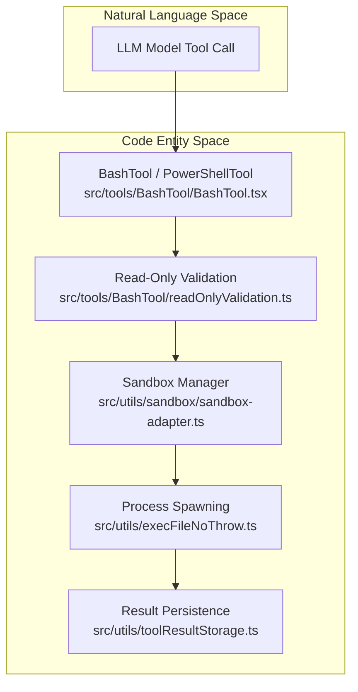
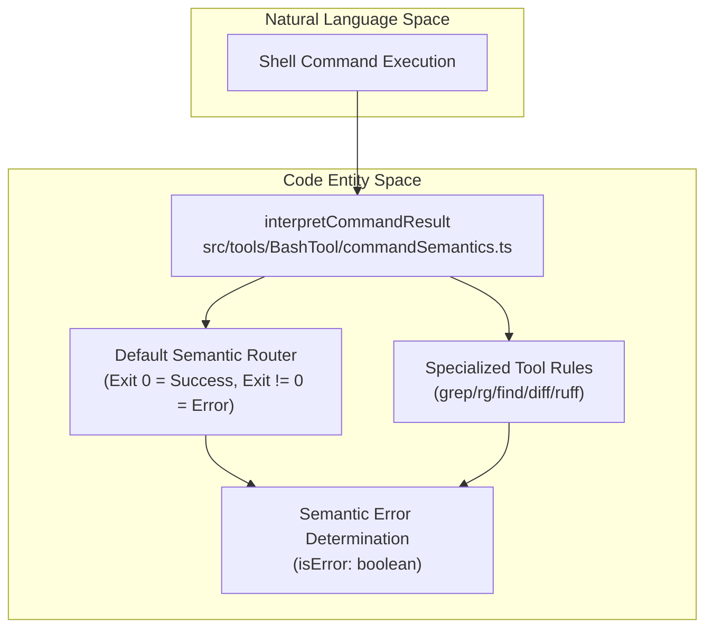

# Shell Tools (Bash / PowerShell)

Relevant source files

The following files were used as context for generating this wiki page:

- [scripts/no-raw-abort-signal-timeout.test.ts](scripts/no-raw-abort-signal-timeout.test.ts)
- [src/commands/lsp/lsp.test.ts](src/commands/lsp/lsp.test.ts)
- [src/components/permissions/BashPermissionRequest/BashPermissionRequest.tsx](src/components/permissions/BashPermissionRequest/BashPermissionRequest.tsx)
- [src/hooks/fileSuggestions.test.ts](src/hooks/fileSuggestions.test.ts)
- [src/hooks/fileSuggestions.ts](src/hooks/fileSuggestions.ts)
- [src/services/tools/queryActivityLease.test.ts](src/services/tools/queryActivityLease.test.ts)
- [src/services/tools/queryActivityLease.ts](src/services/tools/queryActivityLease.ts)
- [src/services/tools/toolOrchestration.test.ts](src/services/tools/toolOrchestration.test.ts)
- [src/services/tools/toolOrchestration.ts](src/services/tools/toolOrchestration.ts)
- [src/tools/BashTool/BashTool.errorOutput.test.ts](src/tools/BashTool/BashTool.errorOutput.test.ts)
- [src/tools/BashTool/BashTool.sandboxAnalysis.test.ts](src/tools/BashTool/BashTool.sandboxAnalysis.test.ts)
- [src/tools/BashTool/BashTool.tsx](src/tools/BashTool/BashTool.tsx)
- [src/tools/BashTool/bashCommandAnalysis.test.ts](src/tools/BashTool/bashCommandAnalysis.test.ts)
- [src/tools/BashTool/bashCommandAnalysis.ts](src/tools/BashTool/bashCommandAnalysis.ts)
- [src/tools/BashTool/bashPermissions.test.ts](src/tools/BashTool/bashPermissions.test.ts)
- [src/tools/BashTool/bashPermissions.ts](src/tools/BashTool/bashPermissions.ts)
- [src/tools/BashTool/modeValidation.test.ts](src/tools/BashTool/modeValidation.test.ts)
- [src/tools/BashTool/modeValidation.ts](src/tools/BashTool/modeValidation.ts)
- [src/tools/BashTool/pathValidation.ts](src/tools/BashTool/pathValidation.ts)
- [src/tools/BashTool/prompt.ts](src/tools/BashTool/prompt.ts)
- [src/tools/BashTool/readOnlyValidation.test.ts](src/tools/BashTool/readOnlyValidation.test.ts)
- [src/tools/BashTool/readOnlyValidation.ts](src/tools/BashTool/readOnlyValidation.ts)
- [src/tools/BashTool/shouldUseSandbox.test.ts](src/tools/BashTool/shouldUseSandbox.test.ts)
- [src/tools/BashTool/shouldUseSandbox.ts](src/tools/BashTool/shouldUseSandbox.ts)
- [src/tools/PowerShellTool/PowerShellTool.errorOutput.test.ts](src/tools/PowerShellTool/PowerShellTool.errorOutput.test.ts)
- [src/tools/PowerShellTool/PowerShellTool.tsx](src/tools/PowerShellTool/PowerShellTool.tsx)
- [src/tools/PowerShellTool/prompt.ts](src/tools/PowerShellTool/prompt.ts)
- [src/utils/claudeCodeHints.ts](src/utils/claudeCodeHints.ts)
- [src/utils/execFileNoThrow.test.ts](src/utils/execFileNoThrow.test.ts)
- [src/utils/execFileNoThrow.ts](src/utils/execFileNoThrow.ts)
- [src/utils/mcpOutputStorage.ts](src/utils/mcpOutputStorage.ts)
- [src/utils/toolResultStorage.preview.test.ts](src/utils/toolResultStorage.preview.test.ts)
- [src/utils/toolResultStorage.test.ts](src/utils/toolResultStorage.test.ts)
- [src/utils/toolResultStorage.ts](src/utils/toolResultStorage.ts)
- [vscode-extension/openclaude-vscode/src/presentation.js](vscode-extension/openclaude-vscode/src/presentation.js)
- [vscode-extension/openclaude-vscode/src/presentation.test.js](vscode-extension/openclaude-vscode/src/presentation.test.js)
- [vscode-extension/openclaude-vscode/src/state.js](vscode-extension/openclaude-vscode/src/state.js)
- [vscode-extension/openclaude-vscode/src/state.test.js](vscode-extension/openclaude-vscode/src/state.test.js)

## Purpose and Scope
This page details the shell execution infrastructure in OpenClaude, focusing on `BashTool` (`[src/tools/BashTool/BashTool.tsx:1]()`) and `PowerShellTool` (`[src/tools/PowerShellTool/PowerShellTool.tsx:1]()`). It covers command semantics interpretation, sandboxing configuration, read-only constraint validation, safe process execution wrappers, and output handling strategies including disk persistence for large payloads.

---

## 1. Shell Tool Architecture & Execution Pipeline

OpenClaude provides dual-platform shell integrations: `BashTool` for POSIX environments and `PowerShellTool` for Windows environments. Both tools share common architectural patterns for input validation, permission gating, sandbox execution, and result streaming.

Diagram Title: Shell Tool Execution Pipeline

Sources: `[src/tools/BashTool/BashTool.tsx:1-55]`, `[src/tools/PowerShellTool/PowerShellTool.tsx:1-49]`, `[src/utils/execFileNoThrow.ts:132-150]`, `[src/utils/toolResultStorage.ts:159-184]()`.

---

## 2. Command Semantics & Exit Code Interpretation

Unlike basic shell execution wrappers that treat any non-zero exit code as an unhandled failure, OpenClaude implements command-aware semantics via `interpretCommandResult` (`[src/tools/BashTool/commandSemantics.ts]()`). Tools like `grep`, `ripgrep` (`rg`), `find`, and `diff` return non-zero exit codes for normal operational states (e.g., `grep` returning `1` when no matches are found).

Diagram Title: Command Semantics Interpretation Pipeline

For instance, `grep` and `rg` returning exit code `1` are classified as successful searches with zero matches rather than execution failures `[src/tools/BashTool/commandSemantics.test.ts:41-71]()`. Similarly, test runners and linters (such as `ruff`) yielding non-zero codes for lint violations are correctly routed without aborting the agent query loop `[src/tools/BashTool/commandSemantics.test.ts:165-178]()`.

Sources: `[src/tools/BashTool/commandSemantics.test.ts:1-178]`, `[src/tools/PowerShellTool/commandSemantics.ts]()`.

---

## 3. Sandboxing & Read-Only Validation

Before a shell command is dispatched to the host system or container environment, it undergoes strict security and constraint validations:

* **Read-Only Validation**: Functions such as `checkReadOnlyConstraints` (`[src/tools/BashTool/readOnlyValidation.ts:1-51]()`) evaluate whether compound or piped commands adhere to read-only guarantees when operating in restricted modes.
* **Sandbox Detection**: `shouldUseSandbox` and `shouldUseSandboxForPresentation` (`[src/tools/BashTool/shouldUseSandbox.ts]()`, `[src/tools/BashTool/BashTool.tsx:52]()`) determine if execution must be isolated within a `SandboxManager` adapter (`[src/utils/sandbox/sandbox-adapter.ts]()`).
* **Environment Sanitization**: Execution wrappers check for control characters and unauthorized environment variable modifications.

Sources: `[src/tools/BashTool/BashTool.tsx:36-52]`, `[src/tools/PowerShellTool/PowerShellTool.tsx:30-46]`, `[src/tools/BashTool/readOnlyValidation.ts:1-51]()`.

---

## 4. Safe Process Spawning & Execution Wrappers

Shell command execution relies on robust Node.js child process abstractions provided by `execFileNoThrow` and `execFileNoThrowWithCwd` (`[src/utils/execFileNoThrow.ts:132-172]()`). These wrappers leverage `cross-spawn` (`[src/utils/execFileNoThrow.ts:6]()`) to ensure cross-platform compatibility (such as `.cmd` / `.bat` handling on Windows) without invoking raw, vulnerable shell strings.

Key validation checks performed prior to spawning include:
* `validateExecutable`: Rejects empty or control-character-laden executable names (`[src/utils/execFileNoThrow.ts:55-70]()`).
* `validateArgs`: Prevents command argument injection via control characters (`[src/utils/execFileNoThrow.ts:72-79]()`).
* `sanitizeEnvironment`: Strips control characters from environment keys and values (`[src/utils/execFileNoThrow.ts:91-113]()`).

Sources: `[src/utils/execFileNoThrow.ts:1-338]()`.

---

## 5. Output Handling & Large Result Persistence

Shell commands frequently emit massive stdout/stderr payloads that would otherwise exhaust model context windows. OpenClaude addresses this through asynchronous disk persistence (`[src/utils/toolResultStorage.ts:159-184]()`).

When output sizes exceed established thresholds, results are persisted via `persistToolResult` or `persistPowerShellOutputFile` (`[src/tools/PowerShellTool/PowerShellTool.tsx:54-105]()`):

1. **File Capping & Streaming**: Streams data up to configured bounds (e.g., 64MB for PowerShell outputs) into session-specific directories (`[src/tools/PowerShellTool/PowerShellTool.tsx:52]()`).
2. **Preview Generation**: Generates UTF-8 safe head-and-tail previews (`[src/utils/toolResultStorage.ts:118-131]()`) within bounded character limits (`PREVIEW_SIZE_BYTES`).
3. **Model Hinting**: Appends contextual hints directing the model to inspect full outputs via file read tools when necessary (`[src/tools/PowerShellTool/PowerShellTool.tsx:107-134]()`).

Sources: `[src/tools/BashTool/BashTool.errorOutput.test.ts:1-186]`, `[src/tools/PowerShellTool/PowerShellTool.tsx:54-134]`, `[src/utils/toolResultStorage.ts:159-184]()`.