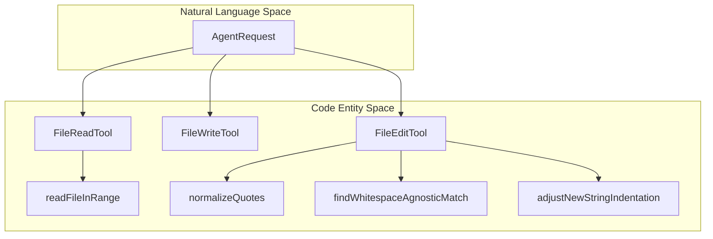
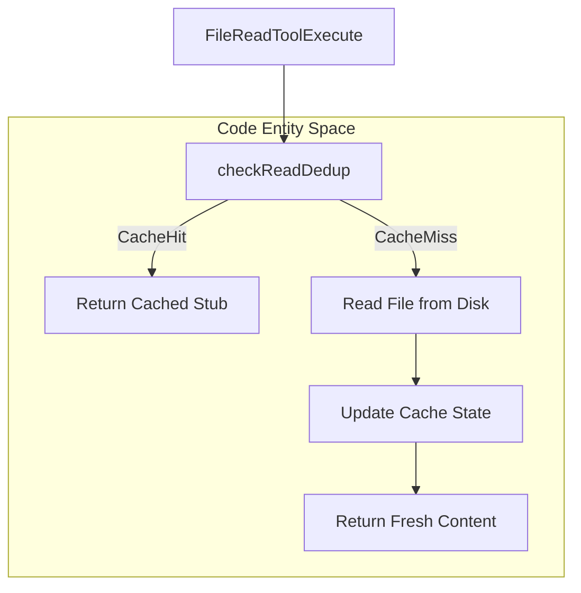
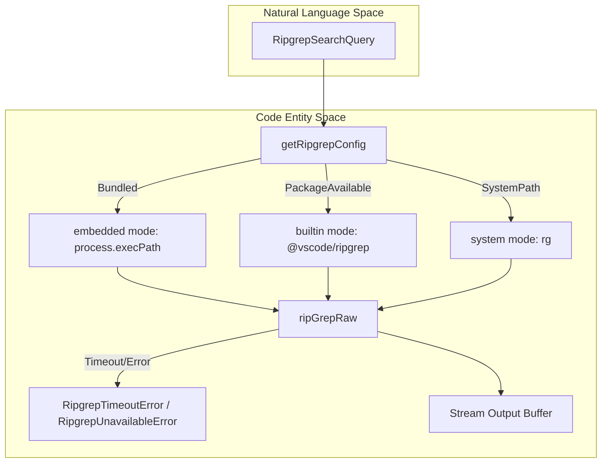
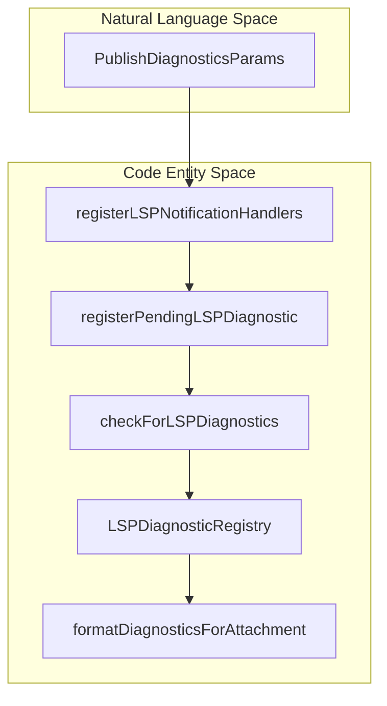

# File & Code Tools

Relevant source files

The following files were used as context for generating this wiki page:

- [src/commands/diagnostics/diagnostics.test.ts](src/commands/diagnostics/diagnostics.test.ts)
- [src/commands/diagnostics/diagnostics.ts](src/commands/diagnostics/diagnostics.ts)
- [src/commands/diagnostics/index.test.ts](src/commands/diagnostics/index.test.ts)
- [src/commands/diagnostics/index.ts](src/commands/diagnostics/index.ts)
- [src/services/diagnosticTracking.test.ts](src/services/diagnosticTracking.test.ts)
- [src/services/diagnosticTracking.ts](src/services/diagnosticTracking.ts)
- [src/services/lsp/LSPDiagnosticRegistry.test.ts](src/services/lsp/LSPDiagnosticRegistry.test.ts)
- [src/services/lsp/LSPDiagnosticRegistry.ts](src/services/lsp/LSPDiagnosticRegistry.ts)
- [src/services/lsp/LSPServerManager.ts](src/services/lsp/LSPServerManager.ts)
- [src/services/lsp/passiveFeedback.ts](src/services/lsp/passiveFeedback.ts)
- [src/tools/FileEditTool/FileEditTool.ts](src/tools/FileEditTool/FileEditTool.ts)
- [src/tools/FileEditTool/utils.test.ts](src/tools/FileEditTool/utils.test.ts)
- [src/tools/FileEditTool/utils.ts](src/tools/FileEditTool/utils.ts)
- [src/tools/FileReadTool/FileReadTool.oversized.test.ts](src/tools/FileReadTool/FileReadTool.oversized.test.ts)
- [src/tools/FileReadTool/FileReadTool.ts](src/tools/FileReadTool/FileReadTool.ts)
- [src/tools/FileReadTool/readDedup.test.ts](src/tools/FileReadTool/readDedup.test.ts)
- [src/tools/FileReadTool/readDedup.ts](src/tools/FileReadTool/readDedup.ts)
- [src/tools/FileWriteTool/FileWriteTool.ts](src/tools/FileWriteTool/FileWriteTool.ts)
- [src/utils/attachments.extractors.test.ts](src/utils/attachments.extractors.test.ts)
- [src/utils/attachments.lspDiagnostics.test.ts](src/utils/attachments.lspDiagnostics.test.ts)
- [src/utils/attachments.nestedDirs.test.ts](src/utils/attachments.nestedDirs.test.ts)
- [src/utils/attachments.ts](src/utils/attachments.ts)
- [src/utils/dragDropPaths.ts](src/utils/dragDropPaths.ts)

This page documents the technical architecture of file manipulation, code searching, indexing, and diagnostic integration utilities within OpenClaude. These subsystems govern how the agent reads files, applies surgical patches, executes `ripgrep` searches, deduplicates read operations, and processes asynchronous Language Server Protocol (LSP) diagnostics.

---

## 1. File Operations: Read, Write & Edit Architecture

OpenClaude provides dedicated tools (`FileReadTool`, `FileWriteTool`, `FileEditTool`) for filesystem interaction, enforcing security boundaries, token limits, and robust text matching.

### `FileReadTool`
`FileReadTool` (`[src/tools/FileReadTool/FileReadTool.ts]()`) handles reading text documents, images, notebooks, and PDFs. Key internal mechanisms include:
- **Device Blocking**: Prevents infinite-output or blocking device reads (such as `/dev/zero`, `/dev/random`, or `/dev/stdin`) via `isBlockedDevicePath` (`[src/tools/FileReadTool/FileReadTool.ts:123-134]()`).
- **Token Budgeting**: Enforces per-read character and token caps via `MaxFileReadTokenExceededError` (`[src/tools/FileReadTool/FileReadTool.ts:15-18]()`), redirecting oversized files to `readFileInRange` (`[src/tools/FileReadTool/FileReadTool.ts:78-79]()`) for targeted pagination.
- **Rich Media Support**: Automatically detects image formats (`detectImageFormatFromBuffer`) (`[src/tools/FileReadTool/FileReadTool.ts:46-50]()`), extracts PDF pages (`extractPDFPages`) (`[src/tools/FileReadTool/FileReadTool.ts:65-66]()`), and parses Jupyter Notebook cells (`readNotebook`) (`[src/tools/FileReadTool/FileReadTool.ts:61-63]()`).

### `FileWriteTool` & `FileEditTool`
`FileWriteTool` (`[src/tools/FileWriteTool/FileWriteTool.ts]()`) manages file creation and atomic overwrites. `FileEditTool` (`[src/tools/FileEditTool/FileEditTool.ts]()`) applies patch-style search-and-replace edits.
- **Quote Normalization**: Converts curly quotes (`‘`, `’`, `“`, `”`) to straight quotes (`'`) during search matching, restoring typography via `preserveQuoteStyle` (`[src/tools/FileEditTool/utils.ts:31-37](), [src/tools/FileEditTool/utils.ts:104-136]()`).
- **Whitespace-Agnostic Matching**: `findWhitespaceAgnosticMatch` (`[src/tools/FileEditTool/utils.ts:67-93](), [src/tools/FileEditTool/utils.test.ts:8-125]()`) matches blocks despite minor indentation or trailing whitespace discrepancies while protecting inline token boundaries.
- **Indentation Recovery**: `adjustNewStringIndentation` (`[src/tools/FileEditTool/utils.test.ts:127-147]()`) infers and aligns target indentation for newly inserted blocks.

*Sources: `[src/tools/FileReadTool/FileReadTool.ts:1-191]`, `[src/tools/FileEditTool/utils.ts:1-214]`, `[src/tools/FileEditTool/utils.test.ts:1-147]`*

---

## 2. Read Deduplication (`readDedup`)

To eliminate redundant file reads within conversation turns, OpenClaude implements read deduplication (`[src/tools/FileReadTool/readDedup.ts]()`).
- `checkReadDedup` (`[src/tools/FileReadTool/readDedup.ts:62-88]()`) evaluates prior file state cache entries against current disk modification times (`getModificationTime`) and requested byte ranges.
- **Outcomes (`ReadDedupResult`)**:
  - `miss`: Normal file read is executed.
  - `unchanged`: Returns the `FILE_UNCHANGED_STUB` (`[src/tools/FileReadTool/prompt.js:86-86]()`) without rereading disk.
  - `touched`: File modification time changed, but byte content is identical (e.g. from `git checkout` or formatters). Updates cache timestamp and returns the stub.

*Sources: `[src/tools/FileReadTool/FileReadTool.ts:92-92]`, `[src/tools/FileReadTool/readDedup.ts:1-89]`, `[src/tools/FileReadTool/readDedup.test.ts:1-114]`*

---

## 3. Search & Code Indexing: Ripgrep (`ripgrep.ts`)

File searching, grep queries, and file listing rely on `ripgrep` (`rg`). The configuration module (`[src/utils/ripgrep.ts]()`) resolves execution modes across deployment environments.

### Ripgrep Configuration Modes
`resolveRipgrepConfig` (`[src/utils/ripgrep.ts:59-91](), [src/utils/ripgrep.test.ts:12-91]()`) selects from three modes:
1. **`system`**: Uses the system-installed `rg` binary on `PATH`.
2. **`builtin`**: Uses the prepackaged binary from the `@vscode/ripgrep` package (`resolveBuiltinRgPath`) (`[src/utils/ripgrep.ts:37-49]()`).
3. **`embedded`**: Uses the parent executable in standalone compiled Bun builds (`isInBundledMode`) (`[src/utils/ripgrep.ts:71-78]()`).

### Error Handling & Timeouts
- If spawning fails, `wrapRipgrepUnavailableError` (`[src/utils/ripgrep.ts:175-194](), [src/utils/ripgrep.test.ts:93-115]()`) catches `ENOENT` / `EAGAIN` errors and formats installation hints (`getRipgrepInstallHint`) (`[src/utils/ripgrep.ts:164-173]()`).
- Long-running queries throw `RipgrepTimeoutError` (`[src/utils/ripgrep.ts:140-148]()`) while preserving partial results.

*Sources: `[src/utils/ripgrep.ts:1-211]`, `[src/utils/ripgrep.test.ts:1-115]`*

---

## 4. LSP Diagnostics & Asynchronous Feedback

OpenClaude integrates with Language Server Protocol (LSP) servers to stream compiler diagnostics into agent context.

### Registry & Passive Feedback
- **`LSPDiagnosticRegistry`** (`[src/services/lsp/LSPDiagnosticRegistry.ts]()`): Stores incoming diagnostics from `textDocument/publishDiagnostics` notifications.
- **Storm Control**: Limits alert fatigue by tracking sliding windows (`DIAGNOSTIC_STORM_WINDOW_MS = 60_000`) (`[src/services/lsp/LSPDiagnosticRegistry.ts:56-65]()`) and capping total items (`MAX_TOTAL_DIAGNOSTICS = 30`) (`[src/services/lsp/LSPDiagnosticRegistry.ts:48-51]()`).
- **Debounced Delivery**: Coalesces rapid burst changes using `DIAGNOSTIC_DELIVERY_DEBOUNCE_MS` (`[src/services/lsp/LSPDiagnosticRegistry.ts:60-61]()`) before emitting attachments into conversation state.
- **Cross-Turn Deduplication**: Uses an LRU cache (`deliveredDiagnostics`) (`[src/services/lsp/LSPDiagnosticRegistry.ts:117-119]()`) to prevent re-sending identical diagnostic reports.
- **Passive Feedback Handler**: `registerLSPNotificationHandlers` (`[src/services/lsp/passiveFeedback.ts:125-198]()`) attaches listeners to all active LSP servers, formatting diagnostic payloads via `formatDiagnosticsForAttachment` (`[src/services/lsp/passiveFeedback.ts:43-100]()`).

*Sources: `[src/services/lsp/LSPDiagnosticRegistry.ts:1-234]`, `[src/services/lsp/LSPDiagnosticRegistry.test.ts:1-217]`, `[src/services/lsp/passiveFeedback.ts:1-198]`*