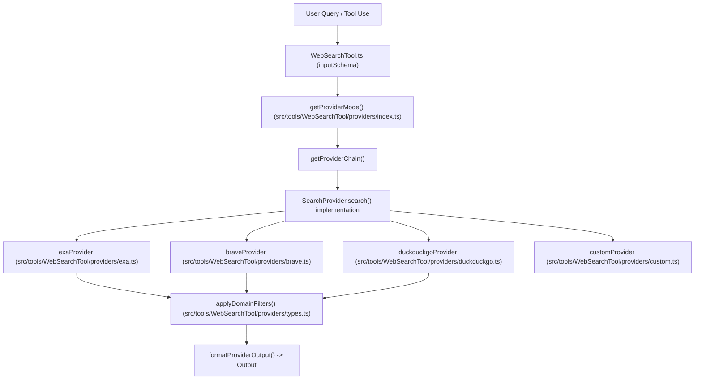
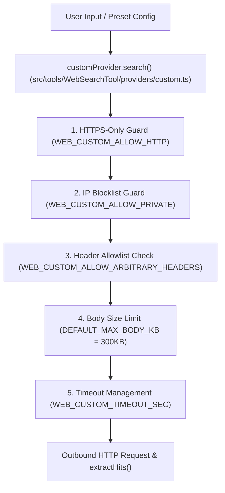

# Web Search & Fetch Tools

<details>
<summary>Relevant source files</summary>

The following files were used as context for generating this wiki page:

- [.gitattributes](.gitattributes)
- [bin/import-specifier.mjs](bin/import-specifier.mjs)
- [bin/import-specifier.test.mjs](bin/import-specifier.test.mjs)
- [docs/repo-map.md](docs/repo-map.md)
- [scripts/render-coverage-heatmap.ts](scripts/render-coverage-heatmap.ts)
- [src/bridge/trustedDevice.ts](src/bridge/trustedDevice.ts)
- [src/commands/repomap/index.ts](src/commands/repomap/index.ts)
- [src/commands/repomap/repomap.test.ts](src/commands/repomap/repomap.test.ts)
- [src/commands/search/search.test.tsx](src/commands/search/search.test.tsx)
- [src/commands/search/searchSettings.test.ts](src/commands/search/searchSettings.test.ts)
- [src/commands/search/searchSettings.ts](src/commands/search/searchSettings.ts)
- [src/components/TextInput.tsx](src/components/TextInput.tsx)
- [src/keybindings/loadUserBindings.ts](src/keybindings/loadUserBindings.ts)
- [src/services/mcp/officialRegistry.test.ts](src/services/mcp/officialRegistry.test.ts)
- [src/services/mcp/officialRegistry.ts](src/services/mcp/officialRegistry.ts)
- [src/tools/WebFetchTool/WebFetchTool.ts](src/tools/WebFetchTool/WebFetchTool.ts)
- [src/tools/WebFetchTool/applyPromptFallback.test.ts](src/tools/WebFetchTool/applyPromptFallback.test.ts)
- [src/tools/WebFetchTool/domainCheck.test.ts](src/tools/WebFetchTool/domainCheck.test.ts)
- [src/tools/WebFetchTool/utils.ts](src/tools/WebFetchTool/utils.ts)
- [src/tools/WebSearchTool/README_SEARCH_PROVIDERS.md](src/tools/WebSearchTool/README_SEARCH_PROVIDERS.md)
- [src/tools/WebSearchTool/WebSearchTool.test.ts](src/tools/WebSearchTool/WebSearchTool.test.ts)
- [src/tools/WebSearchTool/WebSearchTool.ts](src/tools/WebSearchTool/WebSearchTool.ts)
- [src/tools/WebSearchTool/providers/anysearch.test.ts](src/tools/WebSearchTool/providers/anysearch.test.ts)
- [src/tools/WebSearchTool/providers/anysearch.ts](src/tools/WebSearchTool/providers/anysearch.ts)
- [src/tools/WebSearchTool/providers/bing.ts](src/tools/WebSearchTool/providers/bing.ts)
- [src/tools/WebSearchTool/providers/brave.test.ts](src/tools/WebSearchTool/providers/brave.test.ts)
- [src/tools/WebSearchTool/providers/brave.ts](src/tools/WebSearchTool/providers/brave.ts)
- [src/tools/WebSearchTool/providers/custom.test.ts](src/tools/WebSearchTool/providers/custom.test.ts)
- [src/tools/WebSearchTool/providers/custom.ts](src/tools/WebSearchTool/providers/custom.ts)
- [src/tools/WebSearchTool/providers/duckduckgo.test.ts](src/tools/WebSearchTool/providers/duckduckgo.test.ts)
- [src/tools/WebSearchTool/providers/duckduckgo.ts](src/tools/WebSearchTool/providers/duckduckgo.ts)
- [src/tools/WebSearchTool/providers/exa.test.ts](src/tools/WebSearchTool/providers/exa.test.ts)
- [src/tools/WebSearchTool/providers/exa.ts](src/tools/WebSearchTool/providers/exa.ts)
- [src/tools/WebSearchTool/providers/firecrawl.test.ts](src/tools/WebSearchTool/providers/firecrawl.test.ts)
- [src/tools/WebSearchTool/providers/firecrawl.ts](src/tools/WebSearchTool/providers/firecrawl.ts)
- [src/tools/WebSearchTool/providers/index.test.ts](src/tools/WebSearchTool/providers/index.test.ts)
- [src/tools/WebSearchTool/providers/index.ts](src/tools/WebSearchTool/providers/index.ts)
- [src/tools/WebSearchTool/providers/jina.ts](src/tools/WebSearchTool/providers/jina.ts)
- [src/tools/WebSearchTool/providers/linkup.ts](src/tools/WebSearchTool/providers/linkup.ts)
- [src/tools/WebSearchTool/providers/mojeek.ts](src/tools/WebSearchTool/providers/mojeek.ts)
- [src/tools/WebSearchTool/providers/tavily.ts](src/tools/WebSearchTool/providers/tavily.ts)
- [src/tools/WebSearchTool/providers/you.ts](src/tools/WebSearchTool/providers/you.ts)
- [src/utils/messages/planMode.test.ts](src/utils/messages/planMode.test.ts)
- [src/utils/messages/planMode.ts](src/utils/messages/planMode.ts)

</details>


## Purpose and Scope
This section covers the technical implementation of web search and web fetch capabilities within OpenClaude (`WebSearchTool` and `WebFetchTool`). It details the extensible multi-provider search framework (`brave`, `exa`, `tavily`, `duckduckgo`, custom APIs, etc.), client-side domain filtering, custom adapter security guardrails, domain blocklist verification for fetching, and timeout/retry orchestration.

Sources: `src/tools/WebSearchTool/WebSearchTool.ts:1-55()`, `src/tools/WebSearchTool/providers/types.ts:1-48()`, `src/tools/WebFetchTool/utils.ts:1-50()`

---

## 1. WebSearchTool Provider Architecture

The search framework decouples the tool execution layer from specific search vendor APIs via the `SearchProvider` interface. `WebSearchTool` coordinates requests by resolving the active provider mode (`auto`, explicit vendor, or native LLM search) and invoking matching adapters.


*Diagram 1: Natural Language Space to Code Entity Space mapping for provider search execution.*

Sources: `src/tools/WebSearchTool/WebSearchTool.ts:33-118()`, `src/tools/WebSearchTool/providers/types.ts:41-48()`, `src/tools/WebSearchTool/providers/index.ts:1-100()`

---

## 2. Built-in Search Providers & Adapters

OpenClaude supports numerous search backends. Selection mode (`WEB_SEARCH_PROVIDER`) controls whether searches fall through sequentially (`auto`) or execute via a strict single vendor.

### Supported Search Backends Summary

| Provider | Config Env Var | Auth Header / Mechanism | Method |
| :--- | :--- | :--- | :--- |
| **Exa (Default)** | `EXA_API_KEY` (or free tier) | `x-api-key` | POST |
| **Brave** | `BRAVE_API_KEY` | `X-Subscription-Token` (bare token) | GET |
| **Tavily** | `TAVILY_API_KEY` | `Authorization: Bearer` | POST |
| **DuckDuckGo** | *(None — Zero-config fallback)* | None (SDK scraper) | SDK |
| **Ollama** | `OLLAMA_BASE_URL` / `OLLAMA_API_KEY` | Local sign-in or `Bearer` | POST |
| **Custom API** | `WEB_SEARCH_API` / `WEB_PROVIDER` | Configurable | GET/POST |

Sources: `src/tools/WebSearchTool/README_SEARCH_PROVIDERS.md:34-55()`, `src/tools/WebSearchTool/providers/exa.ts:78-83()`, `src/tools/WebSearchTool/providers/brave.ts:14-20()`

---

## 3. Custom Provider & Security Guardrails

The `customProvider` adapter allows integration with any HTTP endpoint (`WEB_SEARCH_API`) or built-in preset (`searxng`, `google`, `brave`, `serpapi`) [src/tools/WebSearchTool/providers/custom.ts:1-27()]. Because it creates a generic outbound HTTP client, strict security guardrails prevent SSRF and data exfiltration:


*Diagram 2: Natural Language Space to Code Entity Space for Custom API security checks.*

Sources: `src/tools/WebSearchTool/providers/custom.ts:14-27()`, `src/tools/WebSearchTool/providers/custom.test.ts:30-107()`

---

## 4. Domain Filtering & Normalization

All search adapters rely on shared domain filtering and hit normalization utilities defined in `src/tools/WebSearchTool/providers/types.ts` [src/tools/WebSearchTool/providers/types.ts:1-8].

* **`normalizeHit(raw)`**: Parses arbitrary JSON shapes from diverse APIs using well-known field aliases (`TITLE_KEYS`, `URL_KEYS`, `DESC_KEYS`, `SOURCE_KEYS`) [src/tools/WebSearchTool/providers/types.ts:54-85()].
* **`applyDomainFilters(hits, input)`**: Client-side filtering that evaluates `allowed_domains` and `blocked_domains` against safe hostnames (`safeHostname`) and subdomain matching rules (`hostMatchesDomain`) [src/tools/WebSearchTool/providers/types.ts:91-137()].

```typescript
export function hostMatchesDomain(host: string, domain: string): boolean {
  const normalizedHost = host.toLowerCase()
  const normalizedDomain = domain.toLowerCase()
  if (normalizedHost === normalizedDomain) return true
  return normalizedHost.endsWith('.' + normalizedDomain)
}
```
*(Source: `src/tools/WebSearchTool/providers/types.ts:102-115()`)*

Sources: `src/tools/WebSearchTool/providers/types.ts:51-137()`

---

## 5. WebFetchTool & Domain Blocklist Verification

`WebFetchTool` fetches raw page content while enforcing safety and policy restrictions via `checkDomainBlocklist` [src/tools/WebFetchTool/utils.ts:1-50()].

* **First-Party Anthropic Mode**: Queries the remote domain check endpoint via Axios when running against official Anthropic endpoints [src/tools/WebFetchTool/domainCheck.test.ts:71-87()].
* **Alternative Providers (OpenAI / Gemini / GitHub)**: Short-circuits domain checks to return `allowed` without external API overhead [src/tools/WebFetchTool/domainCheck.test.ts:42-70()].

Sources: `src/tools/WebFetchTool/domainCheck.test.ts:42-87()`

---

## 6. Timeouts, Retries & Fallbacks

To ensure responsiveness in `auto` search mode, requests are bounded by robust timeout wrappers and retry mechanisms:

* **Timeout Enforcers**: `withWebSearchTimeout` and `fetchJsonWithWebSearchTimeout` apply a default 15-second timeout (configurable via `WEB_SEARCH_TIMEOUT_SEC`) [src/tools/WebSearchTool/README_SEARCH_PROVIDERS.md:112-120(), src/tools/WebSearchTool/providers/timeout.ts:1-25()].
* **DuckDuckGo Resilience**: Implements up to 3 retries with exponential backoff plus jitter, specifically handling scraper rate limits and anomaly responses with actionable error hints (`DDG_ANOMALY_HINT`) [src/tools/WebSearchTool/providers/duckduckgo.ts:13-42(), 87-129()].
* **Diagnostic Empty Hints**: If all backends return zero results, `buildEmptyAdapterResultHint` formats a detailed message listing available API keys (`EXA_API_KEY`, `TAVILY_API_KEY`, etc.) or native provider escape hatches [src/tools/WebSearchTool/WebSearchTool.ts:120-144()].

Sources: `src/tools/WebSearchTool/providers/duckduckgo.ts:9-42()`, `src/tools/WebSearchTool/providers/timeout.ts:1-30()`, `src/tools/WebSearchTool/WebSearchTool.ts:120-144()`