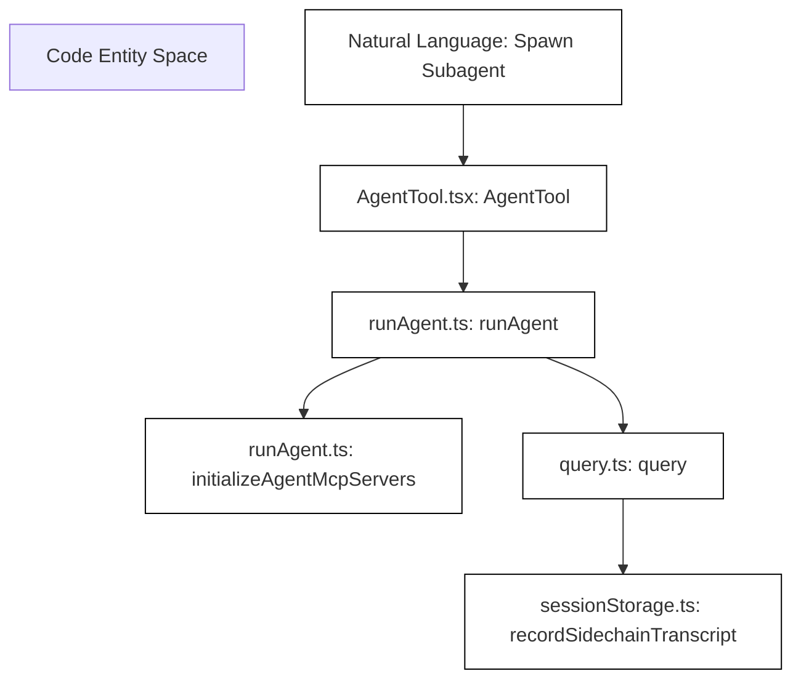
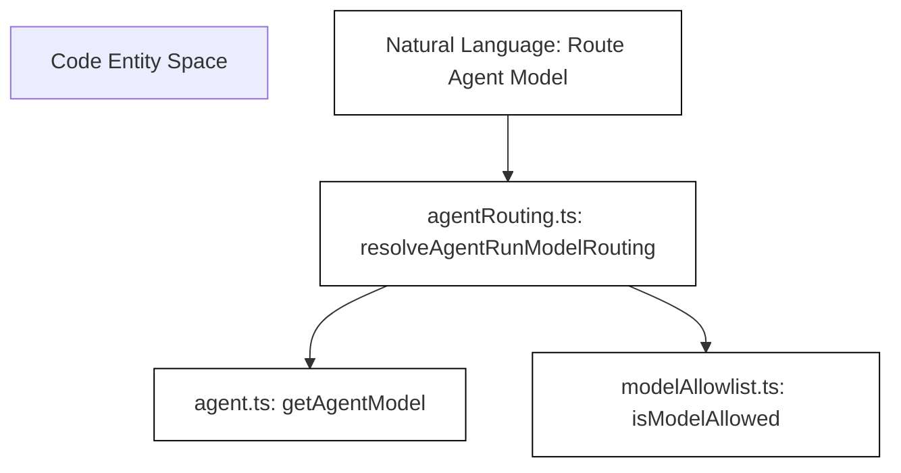

# Agents, Tasks & Swarm

Relevant source files

The following files were used as context for generating this wiki page:

- [docs/agent-routing.md](docs/agent-routing.md)
- [knip.json](knip.json)
- [src/services/api/agentRouting.test.ts](src/services/api/agentRouting.test.ts)
- [src/services/api/agentRouting.ts](src/services/api/agentRouting.ts)
- [src/services/api/vertexClient.test.ts](src/services/api/vertexClient.test.ts)
- [src/services/api/vertexClient.ts](src/services/api/vertexClient.ts)
- [src/skills/bundled/batch.ts](src/skills/bundled/batch.ts)
- [src/tools/AgentTool/AgentTool.routing.test.ts](src/tools/AgentTool/AgentTool.routing.test.ts)
- [src/tools/AgentTool/AgentTool.teammateModel.test.ts](src/tools/AgentTool/AgentTool.teammateModel.test.ts)
- [src/tools/AgentTool/AgentTool.tsx](src/tools/AgentTool/AgentTool.tsx)
- [src/tools/AgentTool/built-in/codeReviewerAgent.test.ts](src/tools/AgentTool/built-in/codeReviewerAgent.test.ts)
- [src/tools/AgentTool/built-in/codeReviewerAgent.ts](src/tools/AgentTool/built-in/codeReviewerAgent.ts)
- [src/tools/AgentTool/builtInAgents.ts](src/tools/AgentTool/builtInAgents.ts)
- [src/tools/AgentTool/prompt.ts](src/tools/AgentTool/prompt.ts)
- [src/tools/AgentTool/resumeAgent.ts](src/tools/AgentTool/resumeAgent.ts)
- [src/tools/AgentTool/runAgent.ts](src/tools/AgentTool/runAgent.ts)
- [src/tools/shared/spawnMultiAgent.ts](src/tools/shared/spawnMultiAgent.ts)
- [src/utils/cleanup.test.ts](src/utils/cleanup.test.ts)
- [src/utils/cleanup.ts](src/utils/cleanup.ts)
- [src/utils/fileHistory.ts](src/utils/fileHistory.ts)
- [src/utils/permissions/permissions.test.ts](src/utils/permissions/permissions.test.ts)
- [src/utils/sessionStorage.ts](src/utils/sessionStorage.ts)
- [src/utils/settings/types.ts](src/utils/settings/types.ts)
- [src/utils/settings/worktreeSettings.test.ts](src/utils/settings/worktreeSettings.test.ts)
- [src/utils/worktree.agentBase.fixture.ts](src/utils/worktree.agentBase.fixture.ts)
- [src/utils/worktree.agentBase.test.ts](src/utils/worktree.agentBase.test.ts)
- [src/utils/worktree.git.test.ts](src/utils/worktree.git.test.ts)
- [src/utils/worktree.test.ts](src/utils/worktree.test.ts)
- [src/utils/worktree.ts](src/utils/worktree.ts)

## Purpose and Scope

This page covers the subagent execution pipeline, built-in agent definitions, task control primitives, git worktree isolation, and swarm spawning utilities within OpenClaude. The subagent system allows the primary agent query loop to delegate bounded sub-tasks to specialized or general-purpose child agents, utilizing isolated execution contexts, prompt caching, custom tool overrides, and multi-process worktrees.

---

## 1. AgentTool, `runAgent`, & `resumeAgent` Pipeline

The agent execution architecture is centered around `AgentTool`, which is invoked by the LLM when it decides to delegate work. The pipeline spans three primary orchestration modules:
- `[src/tools/AgentTool/AgentTool.tsx]()`: Defines the Zod input schemas, parameter parsing, foreground/background lifecycle management, forking flags, and UI rendering hooks.
- `[src/tools/AgentTool/runAgent.ts]()`: Handles agent initialization, environment injection, sub-mcp server bootstrapping via `[src/services/mcp/client.ts]()`, and invocation of the core query engine.
- `[src/tools/AgentTool/resumeAgent.ts]()`: Restores suspended or backgrounded agent sessions from disk using serialized transcript and session metadata.

### Data Flow & Execution Sequence

*Figure 1: Natural Language Subagent Invocation to Code Entity Space Data Flow.*

Sources: `[src/tools/AgentTool/AgentTool.tsx:1-98]`, `[src/tools/AgentTool/runAgent.ts:1-170]`, `[src/utils/sessionStorage.ts:1-114]()`

### Key Functions and Classes

- `AgentTool`: Defined in `[src/tools/AgentTool/AgentTool.tsx:1-98]()`, processes runtime options like `subagent_type`, `model`, `description`, and `prompt`. Supports fork subagents via `[src/tools/AgentTool/forkSubagent.js]()`.
- `runAgent`: Defined in `[src/tools/AgentTool/runAgent.ts:1-1121]()`, builds subagent context, resolves model routing via `[src/services/api/agentRouting.ts:1-108]()`, and starts a sidechain transcript using `[src/utils/sessionStorage.ts:1-114]()`.
- `resumeAgent`: Defined in `[src/tools/AgentTool/resumeAgent.ts]()`, reloads persisted sidechain transcripts and resumes the query loop.

Sources: `[src/tools/AgentTool/AgentTool.tsx:1-98]`, `[src/tools/AgentTool/runAgent.ts:1-170]`, `[src/tools/AgentTool/resumeAgent.ts:1-200]`, `[src/services/api/agentRouting.ts:1-108]`, `[src/utils/sessionStorage.ts:1-114]()`

---

## 2. Built-in Agents & Smart Agent Routing

OpenClaude includes a set of built-in specialized agent definitions that can be addressed by `subagent_type`. 

### Built-in Agent Catalog

| Agent Type | Source File | Role / Purpose |
| :--- | :--- | :--- |
| `general-purpose` | `[src/tools/AgentTool/built-in/generalPurposeAgent.ts]()` | Handles generic, multi-file code editing, bug-fixing, and search tasks. |
| `code-reviewer` | `[src/tools/AgentTool/built-in/codeReviewerAgent.ts]()` | Analyzes diffs, checks code quality, and reports lint or architectural violations. |

Sources: `[src/tools/AgentTool/builtInAgents.ts:1-50]`, `[src/tools/AgentTool/prompt.ts:1-123]()`

### Smart Agent Routing Architecture

The routing subsystem determines model allocation and teammate provider routing for spawned agents via `[src/services/api/agentRouting.ts:1-201]()`.

*Figure 2: Agent Routing Mapping from Natural Language Intent to Routing Code Entities.*

Sources: `[src/services/api/agentRouting.ts:1-180]`, `[src/tools/AgentTool/AgentTool.tsx:16-38]`, `[docs/agent-routing.md:1-133]()`

---

## 3. Task Management & Background Execution (`Task*` Tools)

Background execution allows subagents to run asynchronously while the main REPL or parent agent continues processing other instructions.

### Background Task Lifecycle

1. **Foreground Registration**: When an agent runs, it calls `registerAgentForeground` or `registerAsyncAgent` from `[src/tasks/LocalAgentTask/LocalAgentTask.ts]()`.
2. **Auto-Backgrounding**: If execution exceeds `getAutoBackgroundMs()` (default 120,000ms or via `tengu_auto_background_agents` GrowthBook gate defined in `[src/tools/AgentTool/AgentTool.tsx:84-89]()`), the agent transitions to a background process marker.
3. **Task Completion / Failure**: Handled by `completeAgentTask` and `failAgentTask`, updating the task output path `[src/utils/task/diskOutput.js]()` and emitting SDK notification events via `[src/utils/sdkEventQueue.js]()`.
4. **Task Output Tool**: Reads intermediate or final progress artifacts generated by background tasks.

Sources: `[src/tools/AgentTool/AgentTool.tsx:17-89]`, `[src/utils/task/diskOutput.js:1-50]()`

---

## 4. Worktrees & Swarm Spawn Utilities

To prevent file contention and pollution when running multi-agent swarms, OpenClaude integrates git worktrees and multi-process swarm launchers.

### Worktree Isolation Mechanics

- **Slug Validation**: `validateWorktreeSlug` in `[src/utils/worktree.ts:82-103]()` ensures worktree names are safe against path traversal (`..`, absolute paths, forbidden characters).
- **Directory Symlinking**: `symlinkDirectories` in `[src/utils/worktree.ts:118-154]()` links large immutable folders (such as `node_modules`) from the main repository root to the worktree path to prevent disk bloat.
- **Session State**: `WorktreeSession` in `[src/utils/worktree.ts:156-170]()` tracks original CWD, worktree path, branch name, and HEAD commit reference.

### Swarm Backends

Swarm utilities in `[src/utils/swarm/spawnUtils.ts]()` and `[src/tools/shared/spawnMultiAgent.ts]()` coordinate multi-agent processes across backends (tmux, iTerm2, or background workers).

Sources: `[src/utils/worktree.ts:1-170]`, `[src/utils/swarm/spawnUtils.ts:1-100]`, `[src/tools/shared/spawnMultiAgent.ts:1-100]()`