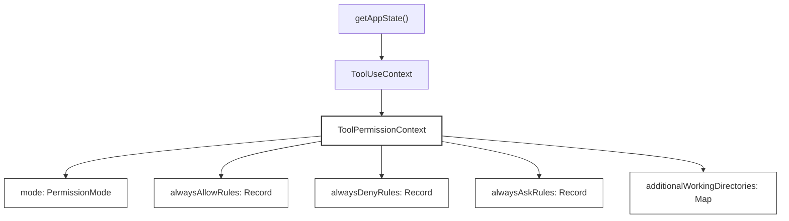
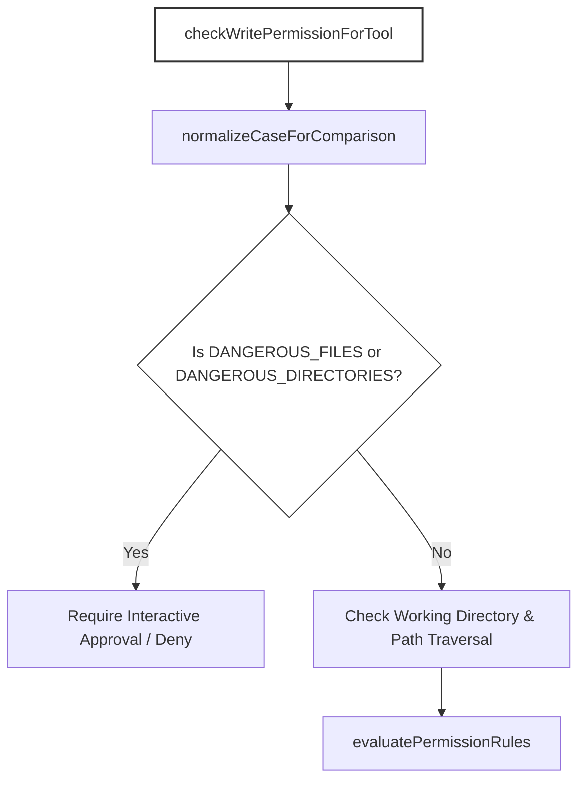
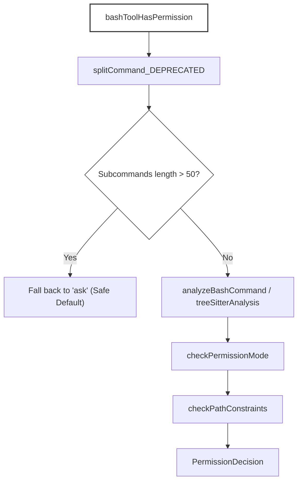
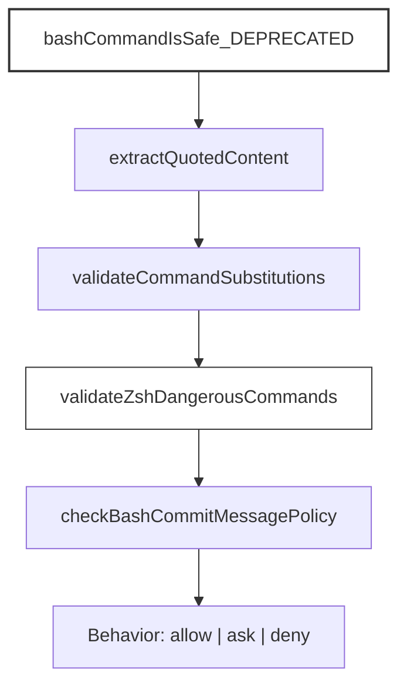
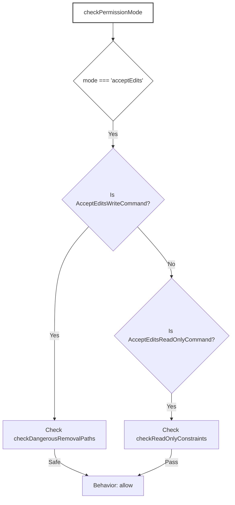

# Permissions & Safety

Relevant source files

The following files were used as context for generating this wiki page:

- [src/components/messages/UserToolResultMessage/RejectedPlanMessage.tsx](src/components/messages/UserToolResultMessage/RejectedPlanMessage.tsx)
- [src/components/permissions/BashPermissionRequest/BashPermissionRequest.tsx](src/components/permissions/BashPermissionRequest/BashPermissionRequest.tsx)
- [src/components/permissions/MonitorPermissionRequest/MonitorPermissionRequest.test.tsx](src/components/permissions/MonitorPermissionRequest/MonitorPermissionRequest.test.tsx)
- [src/components/permissions/MonitorPermissionRequest/MonitorPermissionRequest.tsx](src/components/permissions/MonitorPermissionRequest/MonitorPermissionRequest.tsx)
- [src/components/permissions/PermissionRequest.tsx](src/components/permissions/PermissionRequest.tsx)
- [src/constants/cyberRiskInstruction.ts](src/constants/cyberRiskInstruction.ts)
- [src/hooks/toolPermission/PermissionContext.ts](src/hooks/toolPermission/PermissionContext.ts)
- [src/hooks/toolPermission/handlers/interactiveHandler.test.ts](src/hooks/toolPermission/handlers/interactiveHandler.test.ts)
- [src/hooks/toolPermission/handlers/interactiveHandler.ts](src/hooks/toolPermission/handlers/interactiveHandler.ts)
- [src/hooks/useCancelRequest.test.tsx](src/hooks/useCancelRequest.test.tsx)
- [src/hooks/useCancelRequest.ts](src/hooks/useCancelRequest.ts)
- [src/services/PromptSuggestion/speculation.test.ts](src/services/PromptSuggestion/speculation.test.ts)
- [src/services/tools/toolOrchestration.test.ts](src/services/tools/toolOrchestration.test.ts)
- [src/services/tools/toolOrchestration.ts](src/services/tools/toolOrchestration.ts)
- [src/tasks/MonitorMcpTask/MonitorMcpTask.ts](src/tasks/MonitorMcpTask/MonitorMcpTask.ts)
- [src/test/safetyLevelTestHelpers.ts](src/test/safetyLevelTestHelpers.ts)
- [src/tools/BashTool/BashTool.sandboxAnalysis.test.ts](src/tools/BashTool/BashTool.sandboxAnalysis.test.ts)
- [src/tools/BashTool/bashCommandAnalysis.test.ts](src/tools/BashTool/bashCommandAnalysis.test.ts)
- [src/tools/BashTool/bashCommandAnalysis.ts](src/tools/BashTool/bashCommandAnalysis.ts)
- [src/tools/BashTool/bashPermissions.test.ts](src/tools/BashTool/bashPermissions.test.ts)
- [src/tools/BashTool/bashPermissions.ts](src/tools/BashTool/bashPermissions.ts)
- [src/tools/BashTool/bashSecurity.safety.test.ts](src/tools/BashTool/bashSecurity.safety.test.ts)
- [src/tools/BashTool/bashSecurity.test.ts](src/tools/BashTool/bashSecurity.test.ts)
- [src/tools/BashTool/bashSecurity.ts](src/tools/BashTool/bashSecurity.ts)
- [src/tools/BashTool/modeValidation.test.ts](src/tools/BashTool/modeValidation.test.ts)
- [src/tools/BashTool/modeValidation.ts](src/tools/BashTool/modeValidation.ts)
- [src/tools/BashTool/pathValidation.ts](src/tools/BashTool/pathValidation.ts)
- [src/tools/BashTool/readOnlyValidation.test.ts](src/tools/BashTool/readOnlyValidation.test.ts)
- [src/tools/BashTool/readOnlyValidation.ts](src/tools/BashTool/readOnlyValidation.ts)
- [src/tools/BashTool/shouldUseSandbox.test.ts](src/tools/BashTool/shouldUseSandbox.test.ts)
- [src/tools/BashTool/shouldUseSandbox.ts](src/tools/BashTool/shouldUseSandbox.ts)
- [src/tools/ExitPlanModeTool/UI.tsx](src/tools/ExitPlanModeTool/UI.tsx)
- [src/tools/MonitorTool/MonitorTool.ts](src/tools/MonitorTool/MonitorTool.ts)
- [src/utils/permissions/PermissionPromptToolResultSchema.ts](src/utils/permissions/PermissionPromptToolResultSchema.ts)
- [src/utils/permissions/PermissionUpdate.test.ts](src/utils/permissions/PermissionUpdate.test.ts)
- [src/utils/permissions/PermissionUpdate.ts](src/utils/permissions/PermissionUpdate.ts)
- [src/utils/permissions/filesystem.test.ts](src/utils/permissions/filesystem.test.ts)
- [src/utils/permissions/filesystem.ts](src/utils/permissions/filesystem.ts)
- [src/utils/permissions/permissionSetup.test.ts](src/utils/permissions/permissionSetup.test.ts)
- [src/utils/permissions/permissions.headlessPlanHooks.test.ts](src/utils/permissions/permissions.headlessPlanHooks.test.ts)
- [src/utils/permissions/permissions.ts](src/utils/permissions/permissions.ts)
- [src/utils/permissions/planFilePath.test.ts](src/utils/permissions/planFilePath.test.ts)
- [src/utils/plans.ts](src/utils/plans.ts)

## Purpose & Scope
This page details the permission and safety architecture of OpenClaude. It covers the core permission model, filesystem path validation, bash command security analysis, YOLO/classifier checks, dangerous pattern blocking, interactive permission dialogs, and plan mode isolation.

---

## 6.6.1 Permission Model & Context State

OpenClaude gates potentially destructive tool operations (such as filesystem edits, shell command execution, and MCP calls) using a structured permission model. The central permission container is `ToolPermissionContext`, which governs session behavior, permission modes (`default`, `acceptEdits`, `bypassPermissions`, `fullAccess`, `dontAsk`), and rule registries.

Diagram: Permission Model Code Entities (`ToolPermissionContext`)

Sources: `[src/Tool.ts:140-165]()`

The `ToolPermissionContext` type and its default initializer are defined in `src/Tool.ts`:
- `ToolPermissionContext`: `[src/Tool.ts:140-155]()`
- `getEmptyToolPermissionContext`: `[src/Tool.ts:157-165]()`

Sources: `[src/Tool.ts:140-165]()`

---

## 6.6.2 Filesystem & Path Validation

Filesystem write and read operations are intercepted to prevent tampering with system files, repositories, version control metadata, and OpenClaude internal configuration paths.

Diagram: Filesystem Validation Flow (`checkWritePermissionForTool`)

Sources: `[src/utils/permissions/filesystem.ts:73-110]()`

Key security mechanisms implemented in `src/utils/permissions/filesystem.ts`:
- **Protected Files**: `DANGEROUS_FILES` includes `.gitconfig`, `.gitmodules`, `.bashrc`, `.openclaude.json`, `.mcp.json`, etc. `[src/utils/permissions/filesystem.ts:73-85]()`
- **Protected Directories**: `DANGEROUS_DIRECTORIES` blocks edits within `.git`, `.vscode`, `.idea`, `.openclaude`, and `.claude`. `[src/utils/permissions/filesystem.ts:91-97]()`
- **Case-Insensitive Normalization**: `normalizeCaseForComparison()` defends against bypasses on case-insensitive filesystems (macOS/Windows) by lowercasing paths. `[src/utils/permissions/filesystem.ts:108-110]()`
- **Skill Scoping**: `getClaudeSkillScope()` isolates skill modifications to specific `.openclaude/skills/{name}/` directories, avoiding broad session permissions. `[src/utils/permissions/filesystem.ts:120-176]()`

Sources: `[src/utils/permissions/filesystem.ts:73-176]()`, `[src/utils/permissions/filesystem.test.ts:1-205]()`

---

## 6.6.3 Bash Permissions & Analysis

The `BashTool` execution pipeline runs strict AST and regex analysis on command strings before granting permissions via `bashToolHasPermission`. 

To prevent ReDoS attacks and event-loop starvation during compound command evaluation, subcommands are capped:
- `MAX_SUBCOMMANDS_FOR_SECURITY_CHECK = 50`: `[src/tools/BashTool/bashPermissions.ts:106-106]()`
- `MAX_SUGGESTED_RULES_FOR_COMPOUND = 5`: `[src/tools/BashTool/bashPermissions.ts:113-113]()`

Diagram: Bash Permission Pipeline (`bashToolHasPermission`)

Sources: `[src/tools/BashTool/bashPermissions.ts:94-114]()`, `[src/tools/BashTool/bashPermissions.test.ts:104-180]()`

Sources: `[src/tools/BashTool/bashPermissions.ts:94-114]()`, `[src/tools/BashTool/bashPermissions.test.ts:104-180]()`

---

## 6.6.4 YOLO Classifier & Dangerous Patterns

Bash commands are subjected to command injection checks, heredoc strip safeguards, and evaluation against dangerous Zsh commands and substitutions.

Diagram: Security Validation Flow (`bashCommandIsSafe_DEPRECATED`)

Sources: `[src/tools/BashTool/bashSecurity.ts:22-80]()`

Key validations in `src/tools/BashTool/bashSecurity.ts`:
- **Zsh Dangerous Commands**: `ZSH_DANGEROUS_COMMANDS` blocks module-loading and low-level socket utilities (`zmodload`, `sysopen`, `ztcp`, `zpty`, `mapfile`) that bypass binary checks. `[src/tools/BashTool/bashSecurity.ts:49-80]()`
- **Command Substitutions**: Regex checks capture process substitutions (`<()`, `>()`), parameter expansions (`${}`), and arithmetic expansions (`$[]`). `[src/tools/BashTool/bashSecurity.ts:22-47]()`
- **Commit Message Governance**: `checkBashCommitMessagePolicy` inspects `git commit` payloads for forbidden patterns or disabled AI attribution. `[src/tools/BashTool/bashSecurity.test.ts:123-186]()`

Sources: `[src/tools/BashTool/bashSecurity.ts:22-80]()`, `[src/tools/BashTool/bashSecurity.test.ts:79-186]()`

---

## 6.6.5 Permission Modes & Plan Mode

OpenClaude supports alternative execution modes that modify how tools are gated:
- **Accept Edits Mode (`acceptEdits`)**: Automatically allows safe filesystem writes (`mkdir`, `touch`, `rm`, `mv`, `cp`, `sed`) and read-only commands (`cat`, `grep`, `ls`, `find`), provided they pass path removal and redirection guards. `[src/tools/BashTool/modeValidation.ts:12-40, 111-133]()`
- **Plan Mode & Directory Isolation**: Plan mode restricts agent workspace writes to designated directories (`plansDirectory`), ensuring agent plans are isolated.
  - `getDefaultPlansDirectory()`: Resolves plan locations under `.openclaude/plans`. `[src/utils/plans.ts:43-57]()`
  - `getPlansDirectory()`: Memoized path validation ensuring resolved paths stay within the project root. `[src/utils/plans.ts:111-143]()`
  - `encodeAgentIdForPlanFile()` / `decodeAgentIdForPlanFile()`: Sanitizes teammate agent IDs for safe filesystem representation. `[src/utils/plans.ts:158-177]()`

Diagram: Mode Validation Pipeline (`checkPermissionMode`)

Sources: `[src/tools/BashTool/modeValidation.ts:12-171]()`, `[src/utils/plans.ts:43-177]()`

Sources: `[src/tools/BashTool/modeValidation.ts:12-171]()`, `[src/utils/plans.ts:43-177]()`

---

## 6.6.6 Interactive Permission Dialogs & Handling

When automated rules or classifiers result in an `'ask'` decision, interactive UI components present a confirmation prompt to the user via Ink.

- **Permission Context Creation**: `createPermissionContext()` coordinates tool requests, permission sessions, and state updates. `[src/components/permissions/MonitorPermissionRequest/MonitorPermissionRequest.test.tsx:190-224]()`
- **Interactive Handlers**: `handleInteractivePermission()` manages user input streams, rendering allow/deny prompts and caching persistent rule updates (`alwaysAllowRules`, `alwaysDenyRules`).

Sources: `[src/components/permissions/MonitorPermissionRequest/MonitorPermissionRequest.test.tsx:1-225]()`