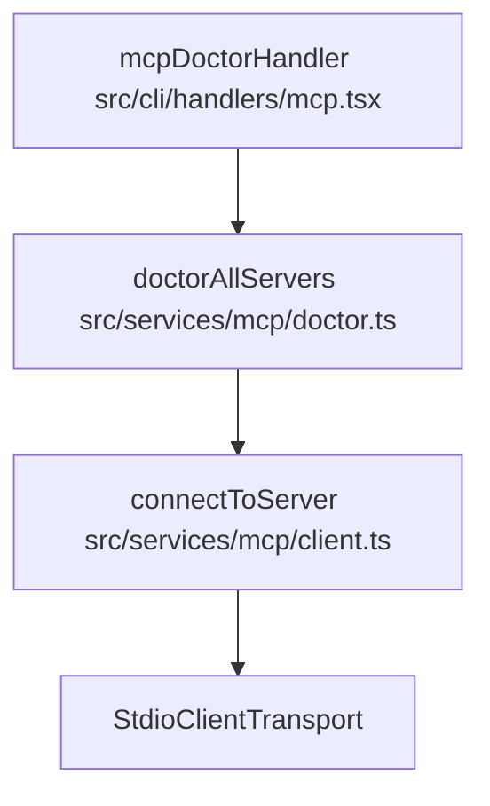
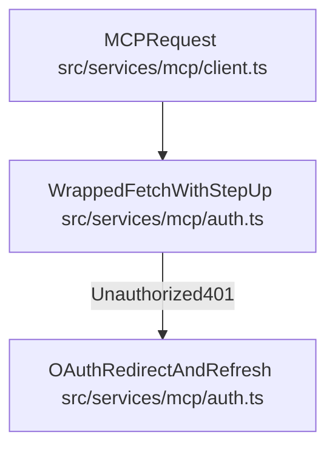
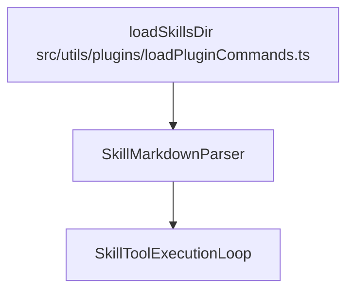
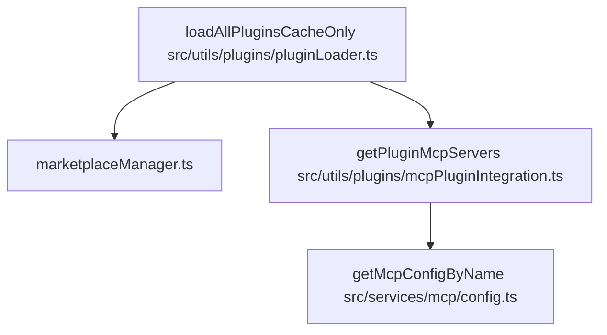
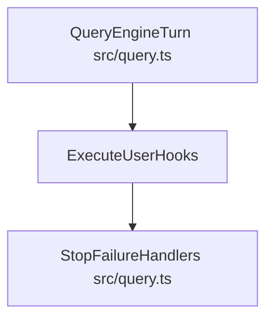

# MCP, Skills & Plugins

Relevant source files

The following files were used as context for generating this wiki page:

- [src/cli/handlers/mcp.tsx](src/cli/handlers/mcp.tsx)
- [src/services/mcp/config.persistence.test.ts](src/services/mcp/config.persistence.test.ts)
- [src/services/mcp/config.protoName.test.ts](src/services/mcp/config.protoName.test.ts)
- [src/services/mcp/config.test.ts](src/services/mcp/config.test.ts)
- [src/services/mcp/config.ts](src/services/mcp/config.ts)
- [src/services/mcp/doctor.test.ts](src/services/mcp/doctor.test.ts)
- [src/services/mcp/doctor.ts](src/services/mcp/doctor.ts)
- [src/services/mcp/enterpriseMcpBoundary.test.ts](src/services/mcp/enterpriseMcpBoundary.test.ts)
- [src/services/mcp/enterpriseMcpErrors.test.ts](src/services/mcp/enterpriseMcpErrors.test.ts)
- [src/services/mcp/headlessErrors.test.ts](src/services/mcp/headlessErrors.test.ts)
- [src/services/mcp/headlessErrors.ts](src/services/mcp/headlessErrors.ts)
- [src/utils/settings/allErrors.ts](src/utils/settings/allErrors.ts)

## Purpose & Scope

This page provides a high-level overview of the extensibility surfaces available in OpenClaude. The system allows users and developers to extend the agent's capabilities beyond its built-in toolset and prompts using three primary integration mechanisms:
1. **Model Context Protocol (MCP)**: Connecting external servers to provide tools, resources, and prompts dynamically via standard transport protocols.
2. **Skills System**: Bundling specialized guidance, prompt snippets, and task instructions (`SKILL.md`) that the agent can discover and invoke.
3. **Plugins & Marketplace**: Packaging modular collections of commands, agents, hooks, and configurations via a marketplace or local/session plugin directories.

These surfaces are coordinated alongside a robust **Hooks System** that intercepts agent turns, tool executions, and stop events.

---

## 7.1 MCP Client & Server Management

For details, see [MCP Client & Server Management](#7.1).

OpenClaude implements an MCP client subsystem that bridges external MCP servers into the agent's tool registry. Transports include standard I/O (`StdioClientTransport`), Server-Sent Events (`SSEClientTransport`), and Streamable HTTP (`StreamableHTTPClientTransport`) `[src/services/mcp/client.ts:7-16]()`. Configuration is managed across scopes (user, project, local, and enterprise managed paths via `getEnterpriseMcpFilePath`) `[src/services/mcp/config.ts:62-64]()`. The client handles tool discovery, pagination, progress heartbeats, and diagnostics via subcommand handlers like `mcpDoctorHandler` `[src/cli/handlers/mcp.tsx:100-127]()` and `doctorAllServers` `[src/services/mcp/doctor.ts:64-72]()`.

Sources: `[src/cli/handlers/mcp.tsx:100-127]`, `[src/services/mcp/doctor.ts:64-72]`, `[src/services/mcp/client.ts:7-21]`, `[src/services/mcp/config.ts:62-64]`

---

## 7.2 MCP Authentication

For details, see [MCP Authentication](#7.2).

Secure connections to authenticated MCP endpoints are managed through OAuth flows and step-up detection mechanisms `[src/services/mcp/auth.ts:15-19]()`. When an MCP server responds with a `401` status, the client coordinates token refresh, authorization redirects, and step-up authentication states using secure storage backends.

Sources: `[src/services/mcp/auth.ts:15-19]`, `[src/services/mcp/client.ts:130-136]`

---

## 7.3 Skills System

For details, see [Skills System](#7.3).

The Skills system enables localized task expertise through markdown files named `SKILL.md` `[src/utils/plugins/loadPluginCommands.ts:54-58]()`. Skills can be bundled or loaded from directories (`loadSkillsDir`), featuring automatic change detection, command namespacing, and integration into the `SkillTool` execution loop.

Sources: `[src/utils/plugins/loadPluginCommands.ts:54-100]`

---

## 7.4 Plugins & Marketplace

For details, see [Plugins & Marketplace](#7.4).

Plugins provide packaging for commands, custom agents, and hook definitions. The plugin loader `[src/utils/plugins/pluginLoader.ts:23-26]()` handles discovery from marketplace registries or session directories (via `--plugin-dir`), validates manifests against Zod schemas, manages versioned caches, and integrates plugin-defined MCP servers via `getPluginMcpServers` `[src/utils/plugins/mcpPluginIntegration.ts]()`.

Sources: `[src/services/mcp/config.ts:22-26]`, `[src/utils/plugins/pluginLoader.ts:23-26]`

---

## 7.5 Hooks System

For details, see [Hooks System](#7.5).

The Hooks system allows per-event interception of agent actions. Hooks are configured via user settings or plugin manifests (e.g., `PreToolUse`, `PostToolUse`) and support matcher expressions. They execute shell commands or internal routines during query lifecycles, supporting post-sampling hooks and stop failure handlers `[src/query.ts:120-121]()`.

Sources: `[src/query.ts:120-121]`