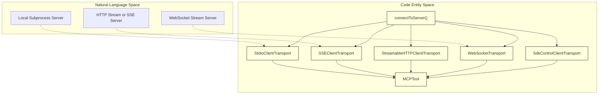
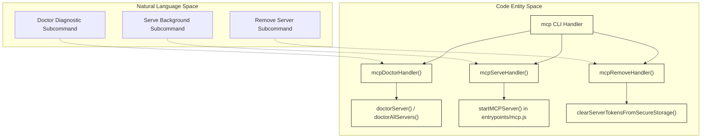

# MCP Client & Server Management

Relevant source files

The following files were used as context for generating this wiki page:

- [src/__tests__/security-hardening.test.ts](src/__tests__/security-hardening.test.ts)
- [src/cli/handlers/mcp.tsx](src/cli/handlers/mcp.tsx)
- [src/commands/set-context-window/set-context-window.test.ts](src/commands/set-context-window/set-context-window.test.ts)
- [src/hooks/useSwarmPermissionPoller.ts](src/hooks/useSwarmPermissionPoller.ts)
- [src/query.ts](src/query.ts)
- [src/query/autoCompactCooldown.test.ts](src/query/autoCompactCooldown.test.ts)
- [src/query/providerMaxTokensCapRetry.test.ts](src/query/providerMaxTokensCapRetry.test.ts)
- [src/services/compact/autoCompact.test.ts](src/services/compact/autoCompact.test.ts)
- [src/services/compact/autoCompact.ts](src/services/compact/autoCompact.ts)
- [src/services/mcp/client.activity.test.ts](src/services/mcp/client.activity.test.ts)
- [src/services/mcp/client.pagination.test.ts](src/services/mcp/client.pagination.test.ts)
- [src/services/mcp/client.test.ts](src/services/mcp/client.test.ts)
- [src/services/mcp/client.ts](src/services/mcp/client.ts)
- [src/services/mcp/config.persistence.test.ts](src/services/mcp/config.persistence.test.ts)
- [src/services/mcp/config.protoName.test.ts](src/services/mcp/config.protoName.test.ts)
- [src/services/mcp/config.test.ts](src/services/mcp/config.test.ts)
- [src/services/mcp/config.ts](src/services/mcp/config.ts)
- [src/services/mcp/doctor.test.ts](src/services/mcp/doctor.test.ts)
- [src/services/mcp/doctor.ts](src/services/mcp/doctor.ts)
- [src/services/mcp/enterpriseMcpBoundary.test.ts](src/services/mcp/enterpriseMcpBoundary.test.ts)
- [src/services/mcp/enterpriseMcpErrors.test.ts](src/services/mcp/enterpriseMcpErrors.test.ts)
- [src/services/mcp/headlessErrors.test.ts](src/services/mcp/headlessErrors.test.ts)
- [src/services/mcp/headlessErrors.ts](src/services/mcp/headlessErrors.ts)
- [src/services/mcp/pagination.ts](src/services/mcp/pagination.ts)
- [src/services/mcp/useManageMCPConnections.ts](src/services/mcp/useManageMCPConnections.ts)
- [src/skills/mcpSkills.test.ts](src/skills/mcpSkills.test.ts)
- [src/skills/mcpSkills.ts](src/skills/mcpSkills.ts)
- [src/tools/TaskOutputTool/TaskOutputTool.activity.test.ts](src/tools/TaskOutputTool/TaskOutputTool.activity.test.ts)
- [src/tools/TaskOutputTool/TaskOutputTool.tsx](src/tools/TaskOutputTool/TaskOutputTool.tsx)
- [src/utils/processUserInput/processSlashCommand.test.ts](src/utils/processUserInput/processSlashCommand.test.ts)
- [src/utils/sandbox/sandbox-adapter.ts](src/utils/sandbox/sandbox-adapter.ts)
- [src/utils/settings/allErrors.ts](src/utils/settings/allErrors.ts)
- [src/utils/swarm/permissionSync.ts](src/utils/swarm/permissionSync.ts)

## Purpose & Scope
This page details the implementation of Model Context Protocol (MCP) client lifecycle management, transport negotiation, configuration resolution, diagnostics (`doctor`), pagination utilities, headless error handling, and command-line entrypoints within OpenClaude. It covers how external and internal MCP servers are discovered, authenticated, connected via various transports, and exposed as tool execution targets.

---

## 1. MCP Client & Connection Architecture (`connectToServer`)

OpenClaude manages communication with MCP servers using multiple transport layers implemented over the Model Context Protocol SDK. The core entry point for establishing a connection to an MCP server is `connectToServer`, located alongside transport adapters in `[src/services/mcp/client.ts:7-147]()`.

### Transports Supported
- **Stdio (`StdioClientTransport`)**: Spawns local subprocesses using command configurations (`[src/services/mcp/client.ts:12-12]()`).
- **Server-Sent Events (`SSEClientTransport`)**: Connects via HTTP SSE endpoints with support for bearer authentication and step-up detection (`[src/services/mcp/client.ts:9-11]()`).
- **Streamable HTTP (`StreamableHTTPClientTransport`)**: Uses streaming HTTP connections for RPC payloads (`[src/services/mcp/client.ts:14-16]()`).
- **WebSockets (`WebSocketTransport`)**: Communicates over persistent WebSocket channels with proxy and TLS options (`[src/services/mcp/client.ts:89-89]()`).
- **SDK Control Transport (`SdkControlClientTransport`)**: Internal transport for programmatic SDK hosting (`[src/services/mcp/client.ts:139-139]()`).

Sources: `[src/services/mcp/client.ts:7-147]`, `[src/tools/MCPTool/MCPTool.ts:82-182]()`

---

## 2. Configuration & Scopes

MCP server definitions are parsed from multiple configuration tiers (`local`, `project`, `user`, `enterprise`) managed by `[src/services/mcp/config.ts:1-250]()`. 

Key helper functions include:
- `getAllMcpConfigs()`: Aggregates server definitions across all scopes, respecting overrides and disabled statuses (`[src/services/mcp/client.ts:137-137]()`).
- `getMcpConfigByName(name)`: Retrieves a specific server configuration block (`[src/cli/handlers/mcp.tsx:180-180]()`).
- `isMcpServerDisabled(name)`: Evaluates toggle flags or skip criteria (`[src/services/mcp/client.ts:137-137]()`).

Sources: `[src/services/mcp/config.ts:1-250]`, `[src/cli/handlers/mcp.tsx:180-185]()`

---

## 3. Diagnostics & Doctor (`doctor.ts`)

The doctor subsystem provides comprehensive health checks and configuration validation for all registered MCP servers. It inspects local configuration files, environment variable presence, and live transport responsiveness.

### Core Diagnostics Functions
- `doctorServer(name, options)`: Inspects a single named MCP server configuration and executes a live connection test (`[src/services/mcp/doctor.ts:109-109]()`).
- `doctorAllServers(options)`: Iterates across all configured servers, compiling aggregate health summaries (`[src/services/mcp/doctor.ts:110-110]()`).
- `findingsFromValidationErrors(validationErrors)`: Maps schema or environment variable errors into structured `McpDoctorFinding` objects (`[src/services/mcp/doctor.ts:147-163]()`).

Sources: `[src/services/mcp/doctor.ts:1-238]`, `[src/cli/handlers/mcp.tsx:33-127]()`

---

## 4. Pagination & Resource Handling

To prevent memory exhaustion and payload bloat when interacting with servers returning extensive resource catalogs or prompt inventories, OpenClaude implements dedicated pagination helpers.

- `paginateMcpList()`: Handles token- or cursor-based pagination for MCP resource and prompt lists (`[src/services/mcp/client.ts:115-115]()`).
- `listAllMcpResources()`: Enumerates accessible resources across a connected client session (`[src/services/mcp/client.ts:115-115]()`).

Sources: `[src/services/mcp/pagination.ts:1-120]`, `[src/services/mcp/client.ts:115-115]()`

---

## 5. CLI Handlers & Headless Errors

Command-line interactions for MCP operations are coordinated via `[src/cli/handlers/mcp.tsx:1-186]()`, which handles lazy loading of subcommands like `mcp doctor`, `mcp serve`, and `mcp remove`.

Sources: `[src/cli/handlers/mcp.tsx:1-186]`, `[src/services/mcp/headlessErrors.ts:1-21]()`