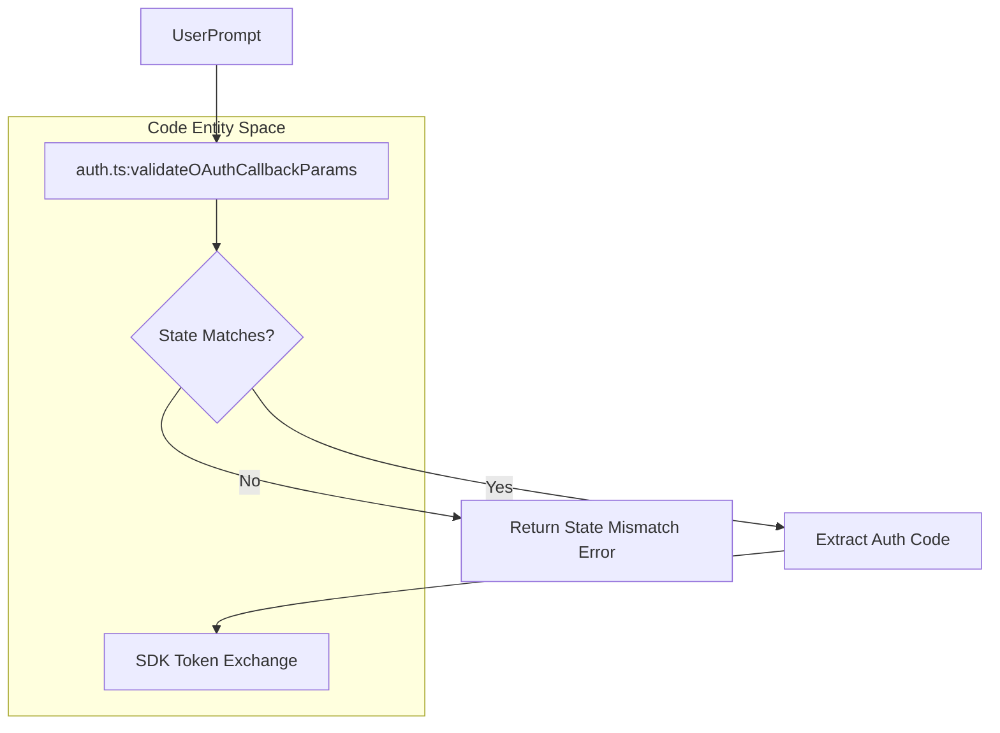
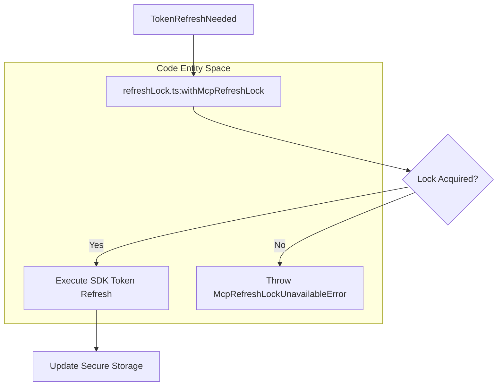

# MCP Authentication

Relevant source files

The following files were used as context for generating this wiki page:

- [bin/import-specifier.mjs](bin/import-specifier.mjs)
- [bin/import-specifier.test.mjs](bin/import-specifier.test.mjs)
- [scripts/render-coverage-heatmap.ts](scripts/render-coverage-heatmap.ts)
- [src/bridge/trustedDevice.ts](src/bridge/trustedDevice.ts)
- [src/components/TextInput.tsx](src/components/TextInput.tsx)
- [src/keybindings/loadUserBindings.ts](src/keybindings/loadUserBindings.ts)
- [src/services/mcp/auth.refreshLock.test.ts](src/services/mcp/auth.refreshLock.test.ts)
- [src/services/mcp/auth.test.ts](src/services/mcp/auth.test.ts)
- [src/services/mcp/auth.ts](src/services/mcp/auth.ts)
- [src/services/mcp/officialRegistry.test.ts](src/services/mcp/officialRegistry.test.ts)
- [src/services/mcp/officialRegistry.ts](src/services/mcp/officialRegistry.ts)
- [src/services/mcp/refreshLock.ts](src/services/mcp/refreshLock.ts)
- [src/services/mcp/xaa.test.ts](src/services/mcp/xaa.test.ts)
- [src/services/mcp/xaa.ts](src/services/mcp/xaa.ts)
- [src/services/mcp/xaaIdpCallback.ts](src/services/mcp/xaaIdpCallback.ts)
- [src/services/mcp/xaaIdpLogin.test.ts](src/services/mcp/xaaIdpLogin.test.ts)
- [src/services/mcp/xaaIdpLogin.ts](src/services/mcp/xaaIdpLogin.ts)
- [src/tools/WebFetchTool/applyPromptFallback.test.ts](src/tools/WebFetchTool/applyPromptFallback.test.ts)
- [src/tools/WebFetchTool/domainCheck.test.ts](src/tools/WebFetchTool/domainCheck.test.ts)
- [src/tools/WebFetchTool/utils.ts](src/tools/WebFetchTool/utils.ts)
- [src/utils/messages/planMode.test.ts](src/utils/messages/planMode.test.ts)
- [src/utils/messages/planMode.ts](src/utils/messages/planMode.ts)
- [src/utils/secureStorage/index.ts](src/utils/secureStorage/index.ts)

## Purpose and Scope
This page documents the authentication and authorization subsystems for Model Context Protocol (MCP) servers within OpenClaude. It covers standard OAuth 2.0/PKCE flows for third-party MCP servers, Enterprise Cross-App Access (XAA / SEP-990) for single-browser enterprise IdP login, concurrency-safe token refresh locking, and validation against the official Anthropic MCP registry.

---

## 1. Standard OAuth Flow for MCP Servers
OpenClaude supports standard OAuth 2.0 authorization code flows with PKCE for authenticating against remote MCP servers. The core logic resides in `src/services/mcp/auth.ts`, which wraps the Model Context Protocol TypeScript SDK authentication helpers.

### Callback Validation & Security
When an OAuth redirect hits the local loopback callback server, OpenClaude verifies the authorization parameters against the expected state to prevent CSRF and session fixation attacks.

- **State Verification:** `validateOAuthCallbackParams()` evaluates the returned `state` parameter against the generated `oauthState` [src/services/mcp/auth.ts:153-171]().
- **Error Handling:** Provider errors and descriptions are parsed safely, while sensitive parameters (`state`, `nonce`, `code_challenge`, `code_verifier`, `code`) are stripped or masked via `redactSensitiveUrlParams()` before logging [src/services/mcp/auth.ts:102-127]().

*Diagram 1: OAuth Callback Validation Flow using code entities from `src/services/mcp/auth.ts`.*

Sources: `src/services/mcp/auth.ts:1-207`

---

## 2. Cross-App Access (XAA) & Enterprise Identity Provider Login
Cross-App Access (XAA), implementing SEP-990, provides a "one browser pop" enterprise experience: a single login to an enterprise OIDC Identity Provider (IdP) yields cached tokens capable of authenticating multiple downstream MCP servers without redundant browser consent screens.

### IdP Session Caching & Key Management
- **Issuer Normalization:** `issuerKey()` standardizes issuer URLs by stripping trailing slashes and lowercasing hosts to ensure consistent cache lookups [src/services/mcp/xaaIdpLogin.ts:88-97]().
- **Token Storage:** `getCachedIdpIdToken()` and `saveIdpIdToken()` interface with secure storage backends to store and retrieve enterprise `id_token` entries while enforcing an expiration buffer (`ID_TOKEN_EXPIRY_BUFFER_S`) [src/services/mcp/xaaIdpLogin.ts:103-127]().

### Token Exchange Pipeline (SEP-990)
The XAA orchestration layer in `src/services/mcp/xaa.ts` chains two distinct protocol exchanges:
1. **RFC 8693 Token Exchange:** Exchanges the enterprise OIDC `id_token` at the IdP token endpoint for an Identity Assertion Grant (ID-JAG) [src/services/mcp/xaa.ts:31-34]().
2. **RFC 7523 JWT Bearer Grant:** Exchanges the ID-JAG at the MCP Authorization Server (AS) for a scoped MCP `access_token` [src/services/mcp/xaa.ts:32-35]().

Protected Resource Metadata (PRM) discovery (`discoverProtectedResource()`) and Authorization Server metadata discovery (`discoverAuthorizationServer()`) enforce strict issuer and resource matching to protect against mix-up attacks [src/services/mcp/xaa.ts:121-180]().

Sources: `src/services/mcp/xaaIdpLogin.ts:1-194`, `src/services/mcp/xaa.ts:1-183`

---

## 3. Refresh Locks & Token Management
To prevent race conditions when multiple concurrent tool invocations attempt to refresh expired MCP OAuth tokens simultaneously, OpenClaude employs an exclusive refresh locking mechanism (`withMcpRefreshLock`) [src/services/mcp/auth.ts:51-55]().

- **Freshness Window:** Tokens within `MCP_REFRESH_FRESHNESS_SECONDS` trigger lock acquisition [src/services/mcp/auth.ts:52]().
- **Concurrency Guard:** If a refresh lock is already held, `McpRefreshLockUnavailableError` is thrown, causing concurrent callers to await or reuse the newly refreshed token state instead of firing duplicate token refresh requests [src/services/mcp/auth.ts:53-55]().

*Diagram 2: Refresh Lock Concurrency Control referencing functions in `src/services/mcp/auth.ts` and associated refresh modules.*

Sources: `src/services/mcp/auth.ts:1-207`, `src/services/mcp/refreshLock.ts:1-50`

---

## 4. Official MCP Registry Integration
OpenClaude verifies and catalogs trusted commercial MCP servers via the official Anthropic MCP registry module (`src/services/mcp/officialRegistry.ts`) [src/services/mcp/officialRegistry.ts:1-86]().

- **Prefetching:** `prefetchOfficialMcpUrls()` fetches commercial server definitions from `https://api.anthropic.com/mcp-registry/v0/servers` during first-party initialization, populating an in-memory normalized `Set` of URLs [src/services/mcp/officialRegistry.ts:37-64]().
- **Validation Check:** `isOfficialMcpUrl()` evaluates whether a target MCP base URL is present in the prefetched registry cache, enforcing fail-closed security semantics [src/services/mcp/officialRegistry.ts:72-82]().

Sources: `src/services/mcp/officialRegistry.ts:1-87`