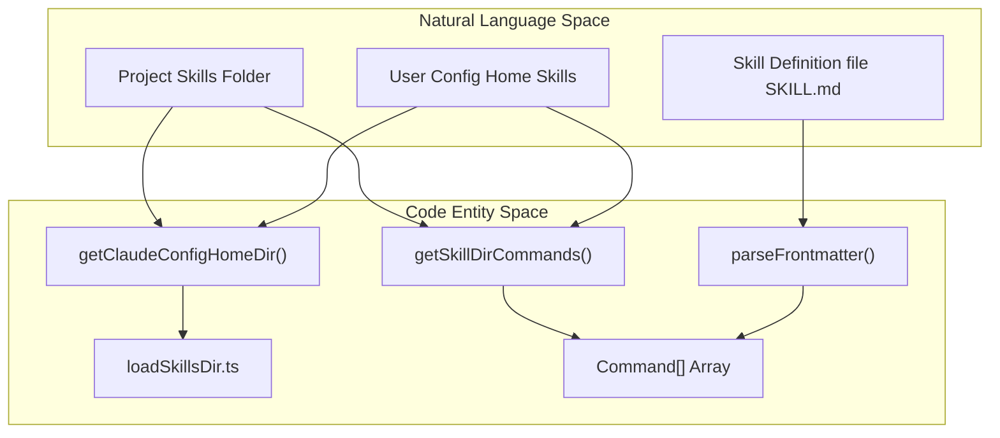
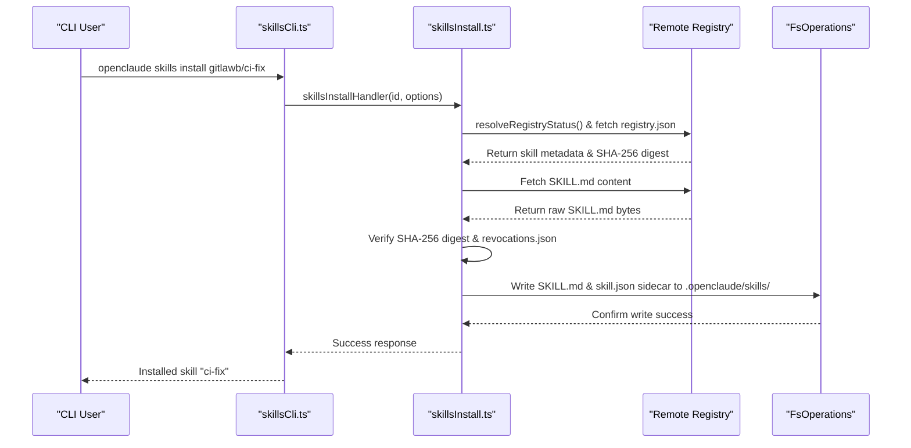
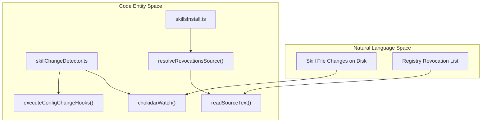

# Skills System

Relevant source files

The following files were used as context for generating this wiki page:

- [docs/skills.md](docs/skills.md)
- [src/cli/handlers/skills.test.ts](src/cli/handlers/skills.test.ts)
- [src/cli/handlers/skills.ts](src/cli/handlers/skills.ts)
- [src/cli/handlers/skillsCli.ts](src/cli/handlers/skillsCli.ts)
- [src/cli/handlers/skillsInstall.ts](src/cli/handlers/skillsInstall.ts)
- [src/cli/handlers/skillsListFormat.ts](src/cli/handlers/skillsListFormat.ts)
- [src/cli/handlers/skillsRemoveMessage.ts](src/cli/handlers/skillsRemoveMessage.ts)
- [src/cli/handlers/skillsVerify.test.ts](src/cli/handlers/skillsVerify.test.ts)
- [src/cli/handlers/skillsVerify.ts](src/cli/handlers/skillsVerify.ts)
- [src/components/skills/SkillsMenu.tsx](src/components/skills/SkillsMenu.tsx)
- [src/entrypoints/cli.skills.test.ts](src/entrypoints/cli.skills.test.ts)
- [src/integrations/aimlapi/config.test.ts](src/integrations/aimlapi/config.test.ts)
- [src/integrations/aimlapi/config.ts](src/integrations/aimlapi/config.ts)
- [src/integrations/aimlapi/topup.test.ts](src/integrations/aimlapi/topup.test.ts)
- [src/integrations/aimlapi/topupState.test.ts](src/integrations/aimlapi/topupState.test.ts)
- [src/integrations/aimlapi/topupState.ts](src/integrations/aimlapi/topupState.ts)
- [src/integrations/gateways/aimlapi.ts](src/integrations/gateways/aimlapi.ts)
- [src/skills/loadSkillsDir.test.ts](src/skills/loadSkillsDir.test.ts)
- [src/skills/loadSkillsDir.ts](src/skills/loadSkillsDir.ts)
- [src/utils/fsOperations.mkdir.test.ts](src/utils/fsOperations.mkdir.test.ts)
- [src/utils/fsOperations.ts](src/utils/fsOperations.ts)
- [src/utils/skills/skillChangeDetector.test.ts](src/utils/skills/skillChangeDetector.test.ts)
- [src/utils/skills/skillChangeDetector.ts](src/utils/skills/skillChangeDetector.ts)
- [web/src/pages/docs/skills.astro](web/src/pages/docs/skills.astro)

## Purpose and Scope
The Skills System in OpenClaude enables modular, reusable prompt-based capabilities ("skills") defined by folder structures containing a `SKILL.md` markdown file and frontmatter metadata. OpenClaude discovers these skills across user configurations, project repositories, bundled packages, plugins, and MCP servers. This page covers the underlying directory scanner (`loadSkillsDir`), the `openclaude skills` CLI suite (`install`, `verify`, `list`, `show`, `validate`, `remove`), registry integrity checks, change detection, and TUI representations like `SkillsMenu`.

---

## 1. Skill Structure & Discovery (`loadSkillsDir`)

A skill is encapsulated within a directory containing a `SKILL.md` file. Frontmatter parsing extracts metadata such as description, version, trust tiers, and argument schemas. Nested folders are automatically converted into colon-delimited namespaces (e.g., `frontend/react/form` maps to the skill name `frontend:react:form`) [src/skills/loadSkillsDir.test.ts:160-198]().

The system resolves installation paths relative to the project (`.openclaude/skills/`) and the global configuration home (`~/.openclaude/skills/`), reading sibling directories like `~/.agents/skills` and `~/.claude/skills` when enabled [docs/skills.md:3-76]().

*Sources: [docs/skills.md:3-76](), [src/skills/loadSkillsDir.test.ts:160-198](), [src/utils/fsOperations.ts:1-190]()*

---

## 2. The `openclaude skills` CLI Suite

The CLI provides comprehensive management subcommands via `src/cli/handlers/skillsCli.ts`, `src/cli/handlers/skillsInstall.ts`, and `src/cli/handlers/skills.ts`:

- `list [--json]`: Lists all active skills across project, user, bundled, plugin, and MCP sources [docs/skills.md:8-78]().
- `show <name>`: Displays deep metadata (Source, Trust, Version, Location, Description, and full `SKILL.md` content) [docs/skills.md:9-57]().
- `validate <path>`: Evaluates frontmatter fields, namespace naming rules, and file size restrictions locally [docs/skills.md:10-57]().
- `install <idOrUrlOrPath> [options]`: Installs skills from a registry hub, raw HTTPS URL (requiring `--sha256`), or a local path [docs/skills.md:11-53]().
- `remove <name> [--global]`: Deletes local or project skills safely with path traversal protection [docs/skills.md:12-75]().
- `verify [options]`: Evaluates installed skills against registry revocations (`revocations.json`) and optional workspace drift verifiers like `eyebrow` [docs/skills.md:13-94]().

*Sources: [src/cli/handlers/skillsCli.ts:83-194](), [src/cli/handlers/skillsInstall.ts:170-224](), [docs/skills.md:7-14]() *

---

## 3. Security, Integrity & Change Detection

To ensure installed skills remain secure and untampered:
1. **Registry Pinning**: Registry installs enforce a mandatory `sha256` digest check matching the published entry [docs/skills.md:27-33]().
2. **Revocation Lists**: The installer and `verify` subcommand inspect `revocations.json` (found adjacent to `registry.json` or overridden via `OPENCLAUDE_SKILLS_REVOCATIONS_URL`) to block vulnerable or malicious skill versions [src/cli/handlers/skillsInstall.ts:217-224]().
3. **Change Detection**: Utility modules such as `skillChangeDetector` monitor file states via `chokidar` or polling under Bun to determine when locally modified skills deviate from their initial deployment state, triggering debounced reloads (`RELOD_DEBOUNCE_MS`) [src/utils/skills/skillChangeDetector.ts:38-88]().

*Sources: [src/utils/skills/skillChangeDetector.ts:1-120](), [src/cli/handlers/skillsInstall.ts:217-224]()*

---

## 4. Skill Execution & TUI Integration

Loaded skills are exposed inside the terminal user interface via components like `SkillsMenu` [src/components/skills/SkillsMenu.tsx:125-152](). The menu categorizes skills by source (project settings, user settings, policy settings, plugins, or MCP servers) and presents them within dialog containers [src/components/skills/SkillsMenu.tsx:35-108]().

When invoked, skill instructions are dynamically injected into the agent query flow, granting the model structured, contextual domain guidance without requiring manual prompt repetition.

*Sources: [src/components/skills/SkillsMenu.tsx:1-152]()*