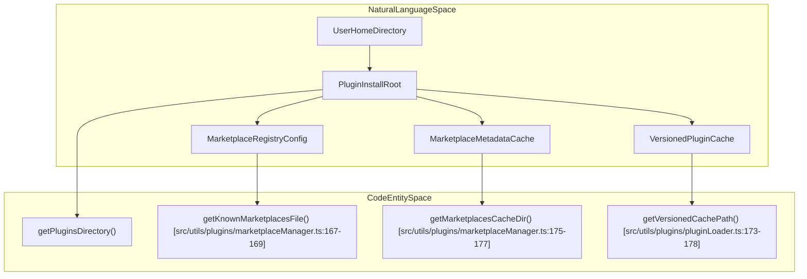
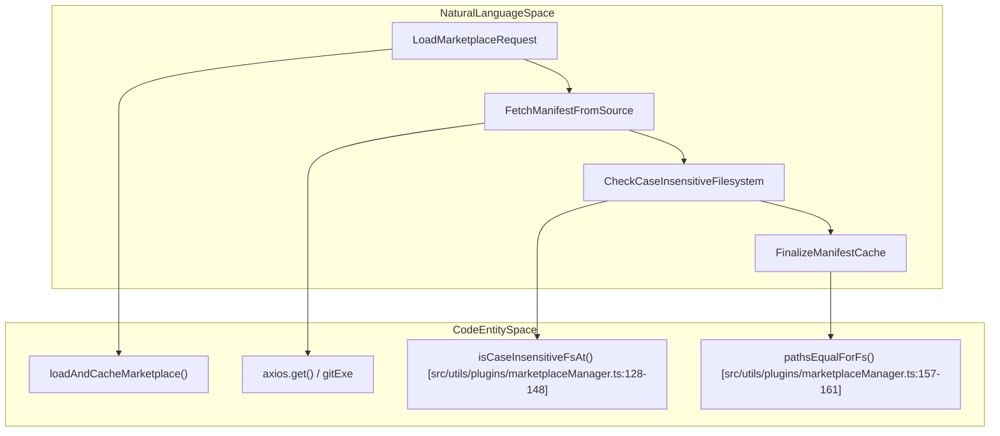
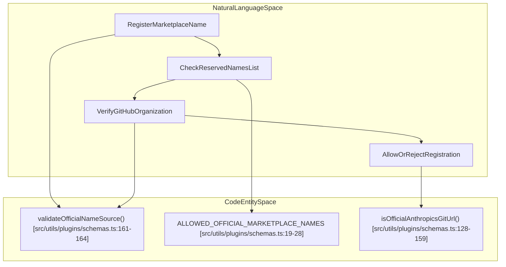

# Plugins & Marketplace

<details>
<summary>Relevant source files</summary>

The following files were used as context for generating this wiki page:

- [src/services/plugins/pluginOperations.installLocation.test.ts](src/services/plugins/pluginOperations.installLocation.test.ts)
- [src/services/plugins/pluginOperations.ts](src/services/plugins/pluginOperations.ts)
- [src/utils/permissions/pathValidation.expandTilde.test.ts](src/utils/permissions/pathValidation.expandTilde.test.ts)
- [src/utils/permissions/pathValidation.ts](src/utils/permissions/pathValidation.ts)
- [src/utils/plugins/gitEnv.test.ts](src/utils/plugins/gitEnv.test.ts)
- [src/utils/plugins/gitEnv.ts](src/utils/plugins/gitEnv.ts)
- [src/utils/plugins/loadPluginCommands.ts](src/utils/plugins/loadPluginCommands.ts)
- [src/utils/plugins/marketplaceHelpers.ts](src/utils/plugins/marketplaceHelpers.ts)
- [src/utils/plugins/marketplaceHostPattern.test.ts](src/utils/plugins/marketplaceHostPattern.test.ts)
- [src/utils/plugins/marketplaceManager.test.ts](src/utils/plugins/marketplaceManager.test.ts)
- [src/utils/plugins/marketplaceManager.ts](src/utils/plugins/marketplaceManager.ts)
- [src/utils/plugins/pluginLoader.test.ts](src/utils/plugins/pluginLoader.test.ts)
- [src/utils/plugins/pluginLoader.ts](src/utils/plugins/pluginLoader.ts)
- [src/utils/plugins/schemas.ts](src/utils/plugins/schemas.ts)
- [src/utils/plugins/validateOfficialNameSource.test.ts](src/utils/plugins/validateOfficialNameSource.test.ts)

</details>


## Purpose & Scope

This wiki page documents Section 7.4 of the OpenClaude codebase, covering the extensibility subsystem. This includes plugin discovery, marketplace management, manifest and schema validation, security guards against marketplace impersonation, versioned caching, command/skill loading, and core plugin lifecycle operations (`install`, `uninstall`, `enable`, `disable`, `update`).

---

## 1. Plugin Install Locations & File Structure

OpenClaude manages all local plugins, marketplace configurations, and cached manifests under a designated directory (defaulting to `~/.claude/plugins/`). Path resolution utilizes robust tilde expansion via `expandTilde` to ensure cross-platform compatibility without corrupting leading path segments [src/utils/permissions/pathValidation.ts:89-100]().

The directory layout on disk is organized as follows:

```
~/.claude/
  └── plugins/
      ├── known_marketplaces.json    # Configuration of all known marketplaces
      ├── marketplaces/              # Cache directory for marketplace metadata manifests
      │   ├── my-marketplace.json    # Cached marketplace from URL source
      │   └── github-marketplace/    # Cloned repository for GitHub source
      │       └── .claude-plugin/
      │           └── marketplace.json
      └── cache/                     # Versioned code and asset cache for installed plugins
          └── {marketplace}/
              └── {plugin}/
                  └── {version}/     # Extracted/cached plugin directory
```

### File Structure & Code Mapping


Sources: [src/utils/plugins/marketplaceManager.ts:10-19](), [src/utils/plugins/marketplaceManager.ts:167-177](), [src/utils/plugins/pluginLoader.ts:125-178]()

---

## 2. Marketplace Manager & Source Resolution

The marketplace manager module (`src/utils/plugins/marketplaceManager.ts`) handles fetching, caching, and updating remote and local marketplace registries [src/utils/plugins/marketplaceManager.ts:1-19]().

### Key Responsibilities

- **Source Tracking**: Maintains known marketplace definitions (URLs, GitHub repos, npm packages, local files, and settings sources) inside `known_marketplaces.json` [src/utils/plugins/marketplaceManager.ts:5-8]().
- **Case-Insensitive Filesystem Handling**: On filesystems like Windows NTFS or case-insensitive APFS volumes, temporary cache directories and final destination paths may differ only in case. The manager implements filesystem probing (`isCaseInsensitiveFsAt`) and path equality checks (`pathsEqualForFs`) to prevent destructive `rm` calls during cache finalization [src/utils/plugins/marketplaceManager.ts:128-161]().
- **Policy Enforcement**: Integrates with enterprise policy checks (`getStrictKnownMarketplaces` and `getBlockedMarketplaces`) to filter out unauthorized marketplace sources [src/utils/plugins/marketplaceHelpers.ts:159-177]().


Sources: [src/utils/plugins/marketplaceManager.ts:1-20](), [src/utils/plugins/marketplaceManager.ts:128-161]()

---

## 3. Schemas, Security & Anti-Impersonation

To prevent malicious plugins from impersonating official Anthropic or Claude offerings, OpenClaude enforces strict validation rules on marketplace names and repository origins.

### Official Name Restrictions

- **Reserved Names**: Certain marketplace identifiers (e.g., `claude-code-marketplace`, `claude-code-plugins`, `claude-plugins-official`, `anthropic-marketplace`, `agent-skills`) are strictly reserved (`ALLOWED_OFFICIAL_MARKETPLACE_NAMES`) [src/utils/plugins/schemas.ts:19-28]().
- **Homograph & Pattern Blocking**: `isBlockedOfficialName` applies regular expression checks (`BLOCKED_OFFICIAL_NAME_PATTERN`) and non-ASCII filters to block lookalike spoofing attempts [src/utils/plugins/schemas.ts:71-101]().
- **Origin Verification**: `validateOfficialNameSource` asserts that any marketplace using a reserved name originates from the official GitHub organization (`anthropics`) via `isOfficialAnthropicsGitUrl` or matches verified official git URLs [src/utils/plugins/schemas.ts:128-182]().


Sources: [src/utils/plugins/schemas.ts:1-182]()

---

## 4. Plugin Loader & Component Discovery

The plugin loader (`src/utils/plugins/pluginLoader.ts`) discovers, validates, and loads plugins from marketplace registrations, git repositories, and session-only overrides [src/utils/plugins/pluginLoader.ts:1-33]().

### Versioned Caching & Seeds

- **Cache Paths**: Installed plugins are isolated by version in cache directories constructed via `getVersionedCachePath` [src/utils/plugins/pluginLoader.ts:173-178]().
- **Seed Probing**: Before hitting network or remote sources, `probeSeedCache` scans pre-configured seed directories in precedence order to locate pre-packaged plugin versions offline [src/utils/plugins/pluginLoader.ts:196-210]().
- **Manifest Validation**: Plugin manifests (`plugin.json`) are parsed against strict Zod schemas (`PluginManifestSchema`) to extract custom components like hooks, agents, and tool definitions [src/utils/plugins/pluginLoader.ts:112-116]().

Sources: [src/utils/plugins/pluginLoader.ts:1-212]()

---

## 5. Slash Commands, Skills & Frontmatter Parsing

The command loading module (`src/utils/plugins/loadPluginCommands.ts`) traverses plugin directories to ingest markdown-defined slash commands and agent skills [src/utils/plugins/loadPluginCommands.ts:1-39]().

### Key Mechanisms

- **Recursive Markdown Collection**: `collectMarkdownFiles` walks plugin directories using `walkPluginMarkdown` while filtering out duplicate paths [src/utils/plugins/loadPluginCommands.ts:105-133]().
- **Skill Transformation**: `transformPluginSkillFiles` detects `SKILL.md` files within subdirectories, normalizing skill namespaces and collapsing redundant markdown entries per directory [src/utils/plugins/loadPluginCommands.ts:138-170]().
- **Namespacing**: `getCommandNameFromFile` constructs qualified command identifiers using the format `pluginName:namespace:commandBaseName` [src/utils/plugins/loadPluginCommands.ts:63-100]().

Sources: [src/utils/plugins/loadPluginCommands.ts:1-170]()

---

## 6. Core Plugin Operations

Plugin lifecycle actions (`install`, `uninstall`, `enable`, `disable`, `update`) are implemented as pure library functions inside `src/services/plugins/pluginOperations.ts` [src/services/plugins/pluginOperations.ts:1-13]().

### Design Principles

- **Pure Library Functions**: Functions such as `installPluginOp` do not write directly to `console` or invoke `process.exit()`, making them safely shareable between the CLI command handlers and the Ink TUI (`ManagePlugins.tsx`) [src/services/plugins/pluginOperations.ts:8-13]().
- **Scope Management**: Operations validate installable scopes against `VALID_INSTALLABLE_SCOPES` (`user`, `project`, `local`) while distinguishing between installation source records and active enablement states in settings files [src/services/plugins/pluginOperations.ts:71-132]().

Sources: [src/services/plugins/pluginOperations.ts:1-132]()