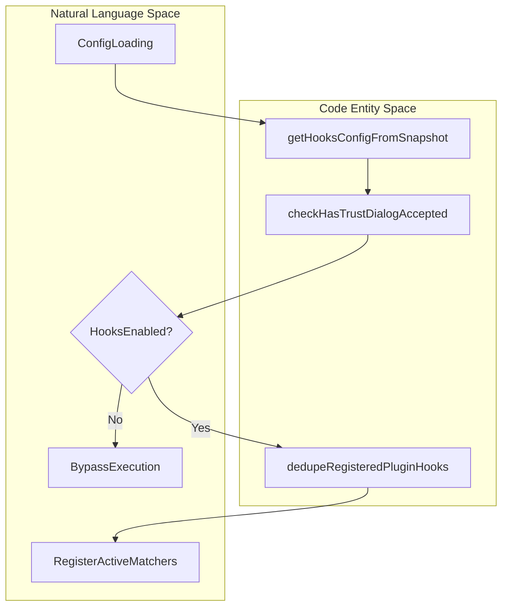
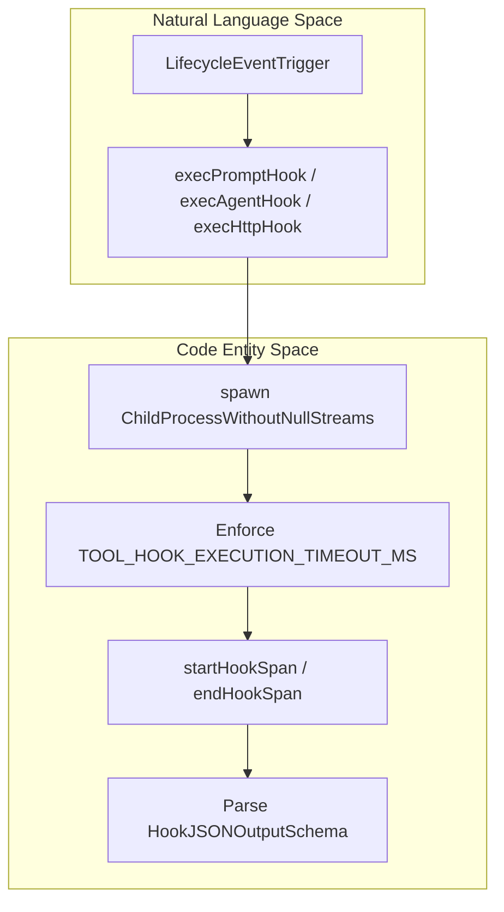

# Hooks System

Relevant source files

The following files were used as context for generating this wiki page:

- [src/hooks/useReplBridge.tsx](src/hooks/useReplBridge.tsx)
- [src/query/stopHooks.goal.test.ts](src/query/stopHooks.goal.test.ts)
- [src/query/stopHooks.ts](src/query/stopHooks.ts)
- [src/tools/AgentTool/AgentTool.schema.test.ts](src/tools/AgentTool/AgentTool.schema.test.ts)
- [src/tools/AgentTool/prompt.test.ts](src/tools/AgentTool/prompt.test.ts)
- [src/tools/FileReadTool/constants.ts](src/tools/FileReadTool/constants.ts)
- [src/tools/FileReadTool/prompt.ts](src/tools/FileReadTool/prompt.ts)
- [src/tools/REPLTool/constants.ts](src/tools/REPLTool/constants.ts)
- [src/utils/Shell.ts](src/utils/Shell.ts)
- [src/utils/ShellCommand.test.ts](src/utils/ShellCommand.test.ts)
- [src/utils/ShellCommand.ts](src/utils/ShellCommand.ts)
- [src/utils/errors.ts](src/utils/errors.ts)
- [src/utils/hooks.ts](src/utils/hooks.ts)
- [src/utils/hooks/windowsBashCommand.test.ts](src/utils/hooks/windowsBashCommand.test.ts)
- [src/utils/hooks/windowsBashCommand.ts](src/utils/hooks/windowsBashCommand.ts)
- [src/utils/messageFilters.ts](src/utils/messageFilters.ts)
- [src/utils/settings/mdm/settings.ts](src/utils/settings/mdm/settings.ts)
- [src/utils/toolErrors.test.ts](src/utils/toolErrors.test.ts)
- [src/utils/toolErrors.ts](src/utils/toolErrors.ts)
- [src/utils/user.test.ts](src/utils/user.test.ts)
- [src/utils/validation.ts](src/utils/validation.ts)
- [src/utils/worktree.multiRepoParent.fixture.ts](src/utils/worktree.multiRepoParent.fixture.ts)
- [src/utils/worktree.multiRepoParent.test.ts](src/utils/worktree.multiRepoParent.test.ts)
- [tests/sdk/helpers/query-test-doubles.ts](tests/sdk/helpers/query-test-doubles.ts)
- [tests/sdk/query-lifecycle.test.ts](tests/sdk/query-lifecycle.test.ts)

## Purpose and Scope

The Hooks System provides an extensibility mechanism in OpenClaude that allows user-defined shell commands, HTTP endpoints, or programmatic callbacks to execute at critical lifecycle milestones (e.g., session initialization, pre/post tool use, prompt submission, compaction, and session termination). This page details user configuration loading, the process execution pipeline, Windows-specific bash command transformations, and stop-hook orchestration.

Sources: `src/utils/hooks.ts` [src/utils/hooks.ts:1-177](), `src/query/stopHooks.ts` [src/query/stopHooks.ts:1-108]()

---

## 1. User Hooks Configuration & Snapshot

Hooks are defined in user configuration files and managed via configuration snapshots (`src/utils/hooks/hooksConfigSnapshot.ts`). The hooks system verifies trust dialog acceptance [src/utils/hooks.ts:40-40] and evaluates runtime flags that can disable managed hooks or all hooks entirely [src/utils/hooks.ts:42-45].

Registered hooks map specific events (`SessionStart`, `PreToolUse`, `PostToolUse`, `Stop`, etc.) to lists of command matchers or plugin hook matchers [src/utils/hooks.ts:180-185]. The function `dedupeRegisteredPluginHooks()` deduplicates plugin hook matchers using stable JSON stringification to prevent duplicate executions across reload cycles [src/utils/hooks.ts:180-200].

*Diagram 1: Hook Configuration Loading and Deduplication Pipeline bridging natural language concepts to code entities like `getHooksConfigFromSnapshot` and `dedupeRegisteredPluginHooks`.*

Sources: `src/utils/hooks.ts` [src/utils/hooks.ts:40-45](), [src/utils/hooks.ts:180-200]()

---

## 2. Hook Execution Pipeline

When a lifecycle event fires, OpenClaude invokes the hook execution engine. Shell hooks are spawned using Node's `child_process.spawn` wrapped via `wrapSpawn()` [src/utils/hooks.ts:7-9]. 

Key implementation details of the execution pipeline include:
* **Environment Provisioning**: Hooks inherit the session environment via `getHookEnvFilePath()`, `subprocessEnv`, and session-specific variable injection [src/utils/hooks.ts:15-19].
* **Timeouts**: Tool hook execution enforces a strict timeout (`TOOL_HOOK_EXECUTION_TIMEOUT_MS = 10 * 60 * 1000`) [src/utils/hooks.ts:178].
* **Tracing & Telemetry**: Spans are recorded using `startHookSpan()` and `endHookSpan()` when beta tracing is enabled [src/utils/hooks.ts:62-65], alongside structured analytics logging (`logEvent`) [src/utils/hooks.ts:56-58].
* **Asynchronous Registry**: Non-blocking asynchronous hooks register with `registerPendingAsyncHook()` [src/utils/hooks.ts:135].

*Diagram 2: Hook Execution and Process Spawning Pipeline illustrating the transition from lifecycle triggers to process invocation (`spawn`) and telemetry (`startHookSpan`).*

Sources: `src/utils/hooks.ts` [src/utils/hooks.ts:7-19](), [src/utils/hooks.ts:56-65](), [src/utils/hooks.ts:135-155](), [src/utils/hooks.ts:178-178]()

---

## 3. Windows Bash Command Handling

On Windows platforms, direct execution of shell scripts lacking executable bit headers or proper associations can fail silently. OpenClaude provides `getWindowsBashHookCommand()` in `src/utils/hooks/windowsBashCommand.ts` to inspect hook command strings and inject an explicit `bash` interpreter prefix when a `.sh` script is directly invoked [src/utils/hooks/windowsBashCommand.ts:1-37].

The command parser inspects word tokens, skips environment variable assignments (unless they contain expansions), preserves original quoting, and validates file extensions case-insensitively (`.sh`, `.SH`, `.Sh`) [src/utils/hooks/windowsBashCommand.ts:1-37]. Tested edge cases include compound commands, inline comments, function declarations, and parameter expansions [src/utils/hooks/windowsBashCommand.test.ts:7-41].

| Input Command Type | Example String | Transformation Result |
| :--- | :--- | :--- |
| **Direct Script** | `./hook.sh argument` | `bash ./hook.sh argument` |
| **Quoted Script** | `"/c/Program Files/hooks/hook.sh"` | `bash "/c/Program Files/hooks/hook.sh"` |
| **Assignment Prefix** | `FOO=bar ./hook.sh` | `FOO=bar bash ./hook.sh` |
| **Compound Command** | `if [ -f ./hook.sh ]; then ... fi` | *Unchanged* (`if [ -f ./hook.sh ]; then ... fi`) |

Sources: `src/utils/hooks/windowsBashCommand.ts` [src/utils/hooks/windowsBashCommand.ts:1-37](), `src/utils/hooks/windowsBashCommand.test.ts` [src/utils/hooks/windowsBashCommand.test.ts:7-181]()

---

## 4. Stop Hooks & Lifecycle Termination

Stop hooks are executed at the conclusion of agent query turns via `handleStopHooks()` in `src/query/stopHooks.ts` [src/query/stopHooks.ts:90-108]. They coordinate multiple termination responsibilities:
1. **Cache-Safe Parameter Snapshotting**: Saves state parameters via `saveCacheSafeParams()` for main session queries [src/query/stopHooks.ts:135-137].
2. **Template Job Classification**: Classifies and writes job states when `CLAUDE_JOB_DIR` is present [src/query/stopHooks.ts:147-171].
3. **Stop Hook Execution**: Invokes `executeStopHooks()`, `executeTaskCompletedHooks()`, and `executeTeammateIdleHooks()` [src/query/stopHooks.ts:110-119].
4. **Goal Evaluation Precedence**: Evaluates whether user-configured Stop hooks block continuation or request termination prior to running automated goal evaluators [src/query/stopHooks.ts:90-108].

Sources: `src/query/stopHooks.ts` [src/query/stopHooks.ts:90-175](), `src/query/stopHooks.goal.test.ts` [src/query/stopHooks.goal.test.ts:55-100]()