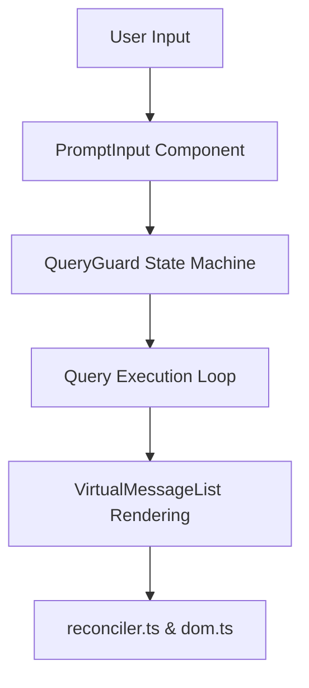
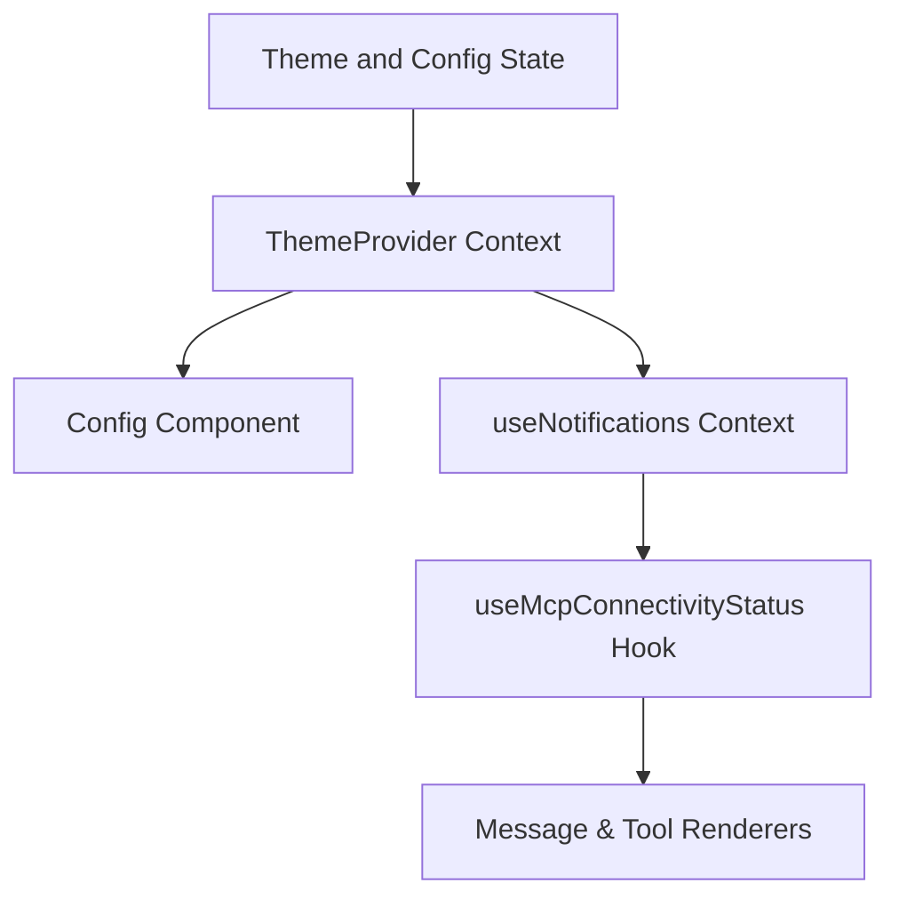

# Terminal UI (Ink)

Relevant source files

The following files were used as context for generating this wiki page:

- [src/context/notifications.tsx](src/context/notifications.tsx)
- [src/hooks/notifs/useMcpConnectivityStatus.tsx](src/hooks/notifs/useMcpConnectivityStatus.tsx)
- [src/ink/dom.ts](src/ink/dom.ts)
- [src/ink/reconciler.test.ts](src/ink/reconciler.test.ts)
- [src/ink/reconciler.ts](src/ink/reconciler.ts)
- [src/utils/staticRender.tsx](src/utils/staticRender.tsx)

## Purpose and Scope
This page provides a high-level overview of OpenClaude's custom terminal user interface subsystem. Built on a heavily customized fork of `react-ink` integrated with a Yoga layout engine [src/ink/reconciler.ts:229-234](), `src/ink/dom.ts:31-91](), OpenClaude renders a responsive, high-performance command-line interface with custom virtual DOM diffing, real-time input handling, and a complete design system.

As a **PARENT** page, this document outlines the overarching architecture of the terminal UI and links to detailed child pages for deep technical dives.

---

## 8.1 Ink Renderer Internals
The rendering pipeline relies on a custom React reconciler (`[src/ink/reconciler.ts:229-234]`) that bridges React elements to a bespoke terminal virtual DOM (`[src/ink/dom.ts:31-91]`). Rather than using standard browser DOM primitives, elements such as `ink-box`, `ink-text`, and `ink-virtual-text` map directly to Yoga layout nodes for flexbox-based terminal formatting. Input parsing, keybindings, and low-level terminal I/O (`termio`) are managed through specialized event dispatchers. Static rendering utilities (`[src/utils/staticRender.tsx:74-111]`) also allow rendering components directly to ANSI or plain text strings for exports and background processing.

For full implementation details, including the custom reconciler loop, tree mutation handling, Yoga layout measurements, and keyboard event hooks, see [Ink Renderer Internals](#8.1).

*Sources:* `[src/ink/reconciler.ts:229-234]`, `[src/ink/dom.ts:31-91]`, `[src/utils/staticRender.tsx:74-111]`

---

## 8.2 REPL Screen & Prompt Input
The main interactive shell session coordinates user input streams, command parsing, streaming assistant output, and execution state machines. The `PromptInput` component handles multi-line editing, history navigation, vim keybindings, and pasted media attachments, routing inputs through state managers and query engines.

*Diagram: REPL Coordination and Query Lifecycle Flow.*  
*Sources:* `[src/ink/reconciler.ts:229-234]`, `[src/ink/dom.ts:31-91]`

For details on session coordination, prompt submit handlers, queued commands, and text/vim input modes, see [REPL Screen & Prompt Input](#8.2).

---

## 8.3 Components, Theming & Status Display
OpenClaude features a terminal design system that includes spinners, progress bars, dynamic status lines, and notification systems (`[src/context/notifications.tsx:39-42]`). Connectivity monitors like `useMcpConnectivityStatus` (`[src/hooks/notifs/useMcpConnectivityStatus.tsx:14-22]`) feed dynamic alerts into the UI. The theme engine supports customizable palettes and runtime switching, ensuring that messages, code blocks, tool calls, and formatting markers render cleanly across diverse terminal emulators.

*Diagram: Theming and Notification System Hierarchy.*  
*Sources:* `[src/context/notifications.tsx:39-42]`, `[src/hooks/notifs/useMcpConnectivityStatus.tsx:14-22]`

For specifics on design tokens, custom spinners, markdown formatting, and branding, see [Components, Theming & Status Display](#8.3).

---

## 8.4 Other Screens & Dialogs
Beyond the primary REPL view, the UI hosts various modal overlays and auxiliary screens. These include session resume pickers, log selectors, global search dialogs, interactive help panels, and configuration interfaces (`[src/components/Settings/Config.tsx:90-96]`). These dialogs render above the main view stack using modal contexts and isolated keyboard focus management.

For details on secondary screens, dialog overlays, and interactive helper menus, see [Other Screens & Dialogs](#8.4).

*Sources:* `[src/components/Settings/Config.tsx:90-96]`