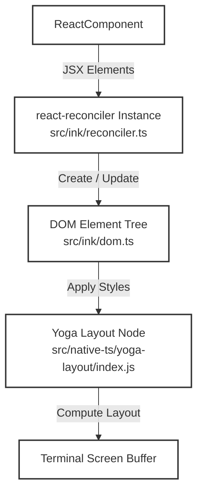
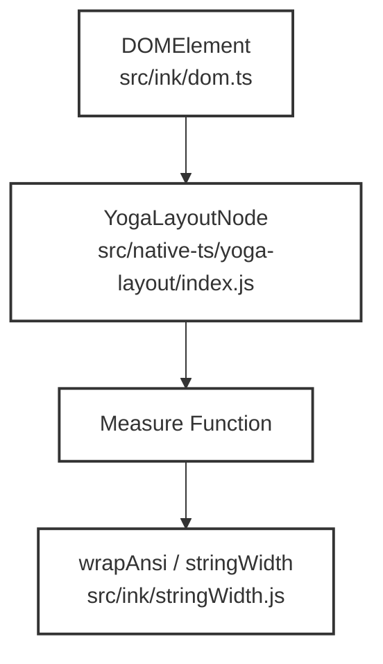
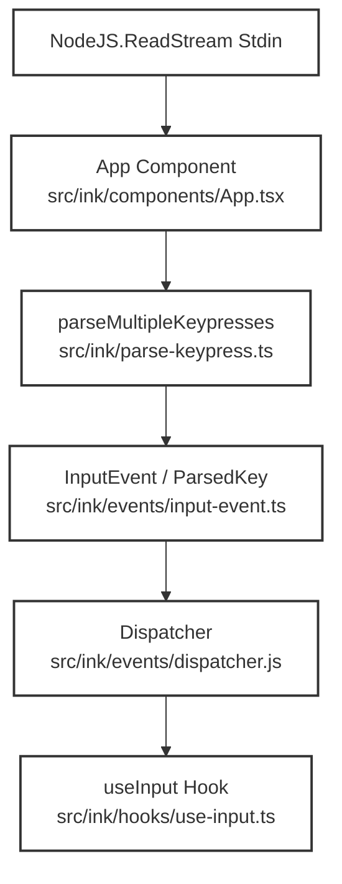

# Ink Renderer Internals

Relevant source files

The following files were used as context for generating this wiki page:

- [src/components/PromptInput/PromptInput.tsx](src/components/PromptInput/PromptInput.tsx)
- [src/components/PromptInput/useSwarmBanner.ts](src/components/PromptInput/useSwarmBanner.ts)
- [src/components/PromptInput/utils.test.ts](src/components/PromptInput/utils.test.ts)
- [src/components/PromptInput/utils.ts](src/components/PromptInput/utils.ts)
- [src/components/TextInput.test.tsx](src/components/TextInput.test.tsx)
- [src/context/notifications.tsx](src/context/notifications.tsx)
- [src/hooks/notifs/useMcpConnectivityStatus.tsx](src/hooks/notifs/useMcpConnectivityStatus.tsx)
- [src/hooks/useTextInput.test.ts](src/hooks/useTextInput.test.ts)
- [src/hooks/useTextInput.ts](src/hooks/useTextInput.ts)
- [src/hooks/useVimInput.ts](src/hooks/useVimInput.ts)
- [src/ink/components/App.test.tsx](src/ink/components/App.test.tsx)
- [src/ink/components/App.tsx](src/ink/components/App.tsx)
- [src/ink/dom.ts](src/ink/dom.ts)
- [src/ink/events/input-event.ts](src/ink/events/input-event.ts)
- [src/ink/parse-keypress.test.ts](src/ink/parse-keypress.test.ts)
- [src/ink/parse-keypress.ts](src/ink/parse-keypress.ts)
- [src/ink/reconciler.test.ts](src/ink/reconciler.test.ts)
- [src/ink/reconciler.ts](src/ink/reconciler.ts)
- [src/types/textInputTypes.ts](src/types/textInputTypes.ts)
- [src/utils/Cursor.nfc.test.ts](src/utils/Cursor.nfc.test.ts)
- [src/utils/Cursor.ts](src/utils/Cursor.ts)
- [src/utils/staticRender.tsx](src/utils/staticRender.tsx)

## Purpose and Scope
This page details the implementation of OpenClaude's custom terminal user interface (TUI) rendering engine, built on top of `react-reconciler` [src/ink/reconciler.ts:4-4] and Yoga layout. It covers the custom React reconciler, virtual DOM node management, Yoga layout integration, terminal keypress parsing (including CSI-u and multi-byte sequences), input event routing, the `useInput` hook, and low-level terminal I/O (`termio`).

---

## 1. Custom Reconciler & React Integration

OpenClaude implements a custom React reconciler using `react-reconciler` [src/ink/reconciler.ts:4-4] to bridge React component trees with terminal render targets. The reconciler manages host instances (nodes and text nodes), computes layout differences, and coordinates paint commits.

*Diagram 1: Natural Language Space to Code Entity Space mapping for the reconciliation pipeline.*

Sources: `[src/ink/reconciler.ts:1-234]`, `[src/ink/dom.ts:1-100]()`

---

## 2. DOM & Yoga Layout Subsystem

The TUI DOM layer (`src/ink/dom.ts`) constructs internal node representations mirroring DOM elements (`DOMElement`) and text nodes (`TextNode`). Each element retains a reference to its corresponding Yoga layout node (`yogaNode`), enabling flexbox layout computations inside the terminal viewport.

*Diagram 2: Code Entity relationships between DOM elements, Yoga layout nodes, and measurement functions.*

Sources: `[src/ink/dom.ts:1-150]()`, `[src/ink/reconciler.ts:100-110]()`

---

## 3. Terminal Input Pipeline & Keypress Parsing

Terminal byte streams are read from stdin, processed by escape-sequence tokenizers, and parsed into structured key events (`ParsedKey`) and terminal responses (`TerminalResponse`) via `parseMultipleKeypresses` in `src/ink/parse-keypress.ts`.

### Key Functions and Regular Expressions
- `CSI_U_RE`: Parses Kitty keyboard protocol sequences (`ESC [ codepoint [; modifier] u`) [src/ink/parse-keypress.ts:23-23].
- `MODIFY_OTHER_KEYS_RE`: Parses `xterm modifyOtherKeys` sequences (`ESC [ 27 ; modifier ; keycode ~`) [src/ink/parse-keypress.ts:31-31].
- `parseTerminalResponse`: Distinguishes terminal control responses (DECRPM, DA1, DA2, cursor position) from user keypresses [src/ink/parse-keypress.ts:122-175].

Sources: `[src/ink/parse-keypress.ts:1-186]`, `[src/ink/parse-keypress.test.ts:1-151]()`

---

## 4. Input Events, Dispatch, and `useInput` Hooks

Input events flow from the root `<App>` component [src/ink/components/App.tsx:85-87] through a central `Dispatcher` to hook-level listeners like `useInput`.

*Diagram 3: Data flow for terminal input processing from raw streams to React input hooks.*

Sources: `[src/ink/components/App.tsx:80-88]`, `[src/ink/parse-keypress.ts:1-50]()`, `[src/ink/hooks/use-input.ts:1-60]()`

---

## 5. Termio Escape Sequences & Terminal Capabilities

Low-level terminal control sequences are partitioned into Control Sequence Introducers (CSI) and DEC private modes under `src/ink/termio/`.
- **CSI sequences (`src/ink/termio/csi.js`)**: Handle features like enabling/disabling Kitty keyboard modes (`ENABLE_KITTY_KEYBOARD`, `DISABLE_KITTY_KEYBOARD`), focus tracking (`FOCUS_IN`, `FOCUS_OUT`), and bracketed paste.
- **DEC private modes (`src/ink/termio/dec.js`)**: Manage cursor visibility (`HIDE_CURSOR`, `SHOW_CURSOR`) and alternate screen buffer toggles.

Sources: `[src/ink/components/App.tsx:17-18]()`