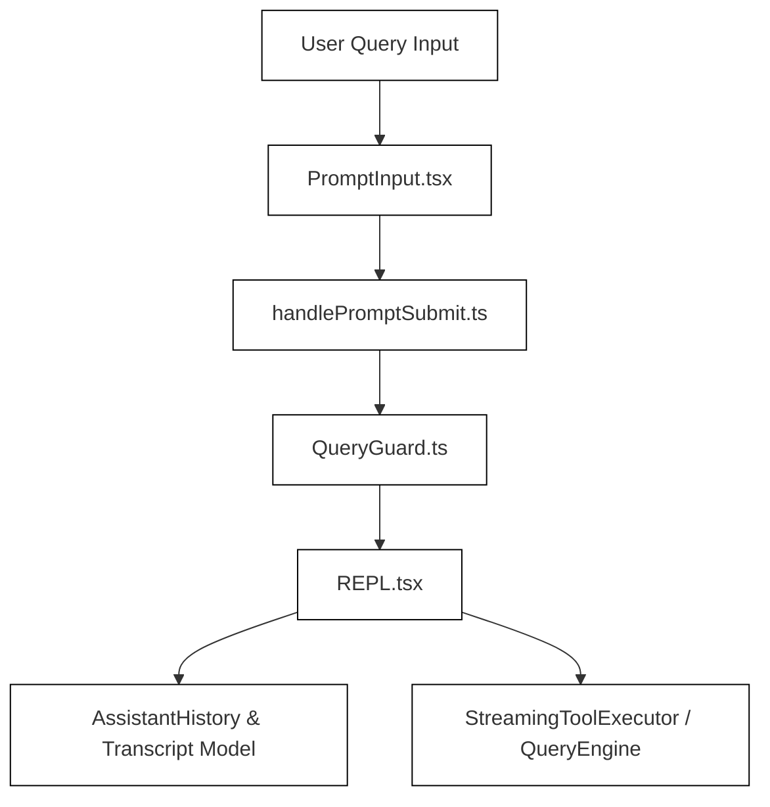
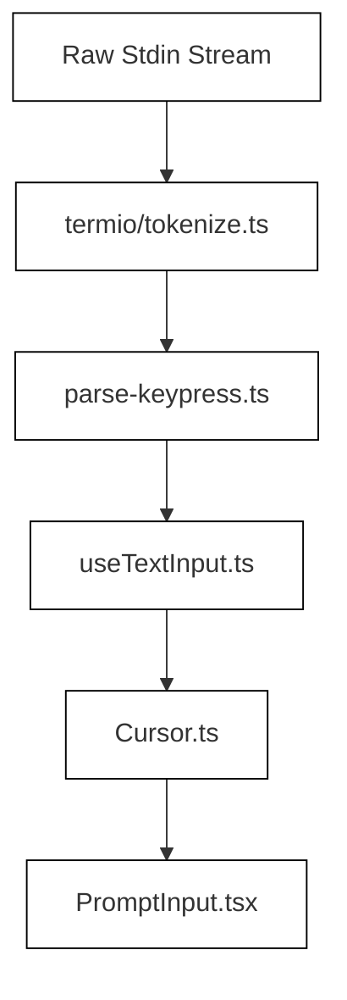

# REPL Screen & Prompt Input

<details>
<summary>Relevant source files</summary>

The following files were used as context for generating this wiki page:

- [src/Tool.ts](src/Tool.ts)
- [src/commands/agents/agents.tsx](src/commands/agents/agents.tsx)
- [src/components/CustomSelect/select.tsx](src/components/CustomSelect/select.tsx)
- [src/components/CustomSelect/use-select-state.ts](src/components/CustomSelect/use-select-state.ts)
- [src/components/PromptInput/HistorySearchInput.test.tsx](src/components/PromptInput/HistorySearchInput.test.tsx)
- [src/components/PromptInput/HistorySearchInput.tsx](src/components/PromptInput/HistorySearchInput.tsx)
- [src/components/PromptInput/KeepMounted.test.tsx](src/components/PromptInput/KeepMounted.test.tsx)
- [src/components/PromptInput/KeepMounted.tsx](src/components/PromptInput/KeepMounted.tsx)
- [src/components/PromptInput/PromptInputFooter.test.tsx](src/components/PromptInput/PromptInputFooter.test.tsx)
- [src/components/PromptInput/PromptInputFooter.tsx](src/components/PromptInput/PromptInputFooter.tsx)
- [src/components/PromptInput/PromptInputFooterLeftSide.test.ts](src/components/PromptInput/PromptInputFooterLeftSide.test.ts)
- [src/components/PromptInput/PromptInputFooterLeftSide.tsx](src/components/PromptInput/PromptInputFooterLeftSide.tsx)
- [src/components/PromptInput/PromptInputFooterSuggestions.test.tsx](src/components/PromptInput/PromptInputFooterSuggestions.test.tsx)
- [src/components/PromptInput/PromptInputFooterSuggestions.tsx](src/components/PromptInput/PromptInputFooterSuggestions.tsx)
- [src/components/PromptInput/PromptInputQueuedCommands.test.tsx](src/components/PromptInput/PromptInputQueuedCommands.test.tsx)
- [src/components/PromptInput/PromptInputQueuedCommands.tsx](src/components/PromptInput/PromptInputQueuedCommands.tsx)
- [src/components/PromptInput/footerVisibility.ts](src/components/PromptInput/footerVisibility.ts)
- [src/components/Settings/Config.tsx](src/components/Settings/Config.tsx)
- [src/components/Settings/queryIdleTimeoutConfig.test.ts](src/components/Settings/queryIdleTimeoutConfig.test.ts)
- [src/components/Settings/queryIdleTimeoutSetting.ts](src/components/Settings/queryIdleTimeoutSetting.ts)
- [src/components/ShowInIDEPrompt.tsx](src/components/ShowInIDEPrompt.tsx)
- [src/components/ThemePicker.test.tsx](src/components/ThemePicker.test.tsx)
- [src/components/ThemePicker.tsx](src/components/ThemePicker.tsx)
- [src/components/agents/AgentsList.test.tsx](src/components/agents/AgentsList.test.tsx)
- [src/components/agents/AgentsList.tsx](src/components/agents/AgentsList.tsx)
- [src/components/permissions/FilePermissionDialog/FilePermissionDialog.tsx](src/components/permissions/FilePermissionDialog/FilePermissionDialog.tsx)
- [src/components/permissions/FilePermissionDialog/useFilePermissionDialog.ts](src/components/permissions/FilePermissionDialog/useFilePermissionDialog.ts)
- [src/components/permissions/PowerShellPermissionRequest/PowerShellPermissionRequest.tsx](src/components/permissions/PowerShellPermissionRequest/PowerShellPermissionRequest.tsx)
- [src/components/permissions/SharedShellPermissionRequest.tsx](src/components/permissions/SharedShellPermissionRequest.tsx)
- [src/components/permissions/baseShellToolUseOptions.tsx](src/components/permissions/baseShellToolUseOptions.tsx)
- [src/components/permissions/useShellPermissionFeedback.ts](src/components/permissions/useShellPermissionFeedback.ts)
- [src/context/promptOverlayContext.tsx](src/context/promptOverlayContext.tsx)
- [src/query/requestOnlyMessages.test.ts](src/query/requestOnlyMessages.test.ts)
- [src/screens/REPL.queryLifecycle.test.ts](src/screens/REPL.queryLifecycle.test.ts)
- [src/screens/REPL.tsx](src/screens/REPL.tsx)
- [src/screens/replActiveAgentModel.test.ts](src/screens/replActiveAgentModel.test.ts)
- [src/services/compact/compact.ts](src/services/compact/compact.ts)
- [src/services/contextCollapse/operations.test.ts](src/services/contextCollapse/operations.test.ts)
- [src/tools/AgentTool/runAgent.routing.test.ts](src/tools/AgentTool/runAgent.routing.test.ts)
- [src/utils/QueryGuard.test.ts](src/utils/QueryGuard.test.ts)
- [src/utils/QueryGuard.ts](src/utils/QueryGuard.ts)
- [src/utils/attachments.ultrathink.test.ts](src/utils/attachments.ultrathink.test.ts)
- [src/utils/config.ts](src/utils/config.ts)
- [src/utils/forkedAgent.ts](src/utils/forkedAgent.ts)
- [src/utils/handlePromptSubmit.test.ts](src/utils/handlePromptSubmit.test.ts)
- [src/utils/handlePromptSubmit.ts](src/utils/handlePromptSubmit.ts)
- [src/utils/interruptionCorrection.test.ts](src/utils/interruptionCorrection.test.ts)
- [src/utils/interruptionCorrection.ts](src/utils/interruptionCorrection.ts)
- [src/utils/queryGuardConfig.test.ts](src/utils/queryGuardConfig.test.ts)
- [src/utils/queryGuardConfig.ts](src/utils/queryGuardConfig.ts)
- [src/utils/queryLifecycle.ts](src/utils/queryLifecycle.ts)

</details>


## Purpose and Scope

This page documents the technical architecture of the main interactive Read-Eval-Print Loop (REPL) screen and prompt input system in OpenClaude. It covers screen orchestration in `src/screens/REPL.tsx`, input buffer management and vim/text modes via `PromptInput.tsx` and text input hooks, queued command processing, typeahead suggestions (`src/components/PromptInput/PromptInputFooterSuggestions.tsx`), and query lifecycle governance (`src/utils/QueryGuard.ts`).

Sources: `[src/screens/REPL.tsx:1-85]`, `[src/components/PromptInput/PromptInput.tsx:1-66]`, `[src/utils/QueryGuard.ts:120-158]`

---

## 1. REPL Screen Architecture & Coordination (`REPL.tsx`)

The REPL screen acts as the primary container for the TUI session. It coordinates message history rendering, background task synchronization, terminal focus, sleep prevention, dialog overlays (such as cost thresholds and idle returns), and query state machine tracking.

State coordination relies heavily on `QueryGuard` (`[src/utils/QueryGuard.ts:120-158]()`) to prevent concurrent turn executions and enforce idle and hard-maximum timeouts. Session identifiers, working directories, and model overrides are managed through state bindings in `[src/bootstrap/state.js:36-37]()`. Furthermore, background session hand-offs and turn budgets are managed via `replMaxTurns.ts` (`[src/screens/replMaxTurns.ts:1-42]()`).

### Diagram: REPL Coordination Map (Natural Language to Code Entity Space)



Sources: `[src/screens/REPL.tsx:30-85]`, `[src/utils/QueryGuard.ts:120-144]`, `[src/screens/replMaxTurns.ts:1-42]`

---

## 2. Prompt Input & Editing (`PromptInput.tsx`, `useTextInput.ts`, `useVimInput.ts`)

The prompt input component (`PromptInput.tsx`) manages multi-line text editing, cursor movement, image/file attachments, drag-and-drop file path extraction, and typeahead triggers for slash commands, file paths, agents, and slack channels (`[src/components/PromptInput/PromptInput.tsx:1-66]()`).

Text mutations and key handling are governed by hooks like `useTextInput.ts` and `useVimInput.ts`, interacting directly with the underlying `Cursor` model. Input normalization handles Unicode normalization (NFC/NFD), Vietnamese/CJK IME composition markers, and line-ending translation.

### Diagram: Input Processing Pipeline



Sources: `[src/components/PromptInput/PromptInput.tsx:1-66]`, `[src/hooks/useTextInput.ts:1-70]`, `[src/ink/parse-keypress.ts:1-112]`

---

## 3. Queued Commands & Prompt Submission

Users can queue commands or messages while a query is actively running. The queue mechanism is managed via command queue utilities and rendered through `PromptInputQueuedCommands.tsx` (`[src/components/PromptInput/PromptInputQueuedCommands.tsx:1-35]()`). 

When a prompt is submitted via `handlePromptSubmit`:
1. `prepareTextInputEvent` strips or preserves terminal control sequences and carriage returns (`[src/hooks/useTextInput.ts:98-126]()`).
2. Input validation checks for empty submissions, active agent states, or modal locks (`[src/utils/handlePromptSubmit.ts:44-60]()`).
3. Submission handlers process attachments, format pasted references (`[src/history.ts:24-24]()`), and delegate execution to the query engine (`[src/utils/handlePromptSubmit.ts:162-189]()`).

Sources: `[src/components/PromptInput/PromptInput.tsx:5-13]`, `[src/utils/handlePromptSubmit.ts:44-189]`, `[src/components/PromptInput/PromptInputQueuedCommands.tsx:1-35]`

---

## 4. Suggestions & Overlays (`PromptInputFooterSuggestions.tsx`)

When typing triggers are matched (e.g., `/` for commands, `@` for files or agents, `#` for Slack channels), `PromptInputFooterSuggestions.tsx` renders a typeahead popup list (`[src/components/PromptInput/PromptInputFooterSuggestions.tsx:168-210]()`).

Key structures:
- `SuggestionItem`: Defines metadata, tags, display texts, and color themes (`[src/components/PromptInput/PromptInputFooterSuggestions.tsx:9-16]()`).
- `OVERLAY_MAX_ITEMS`: Limits visible dropdown entries (`[src/components/PromptInput/PromptInputFooterSuggestions.tsx:28-28]()`).
- Handles truncated path displays via `truncatePathMiddle` and item selection highlighting with indicator prefixes (`[src/components/PromptInput/PromptInputFooterSuggestions.tsx:30-31]()`, `[src/components/PromptInput/PromptInputFooterSuggestions.tsx:86-86]()`).

Sources: `[src/components/PromptInput/PromptInputFooterSuggestions.tsx:1-210]`

---

## 5. Query Lifecycle Governance (`QueryGuard.ts`)

`QueryGuard` implements a synchronous state machine for the query lifecycle designed to integrate with React's `useSyncExternalStore` (`[src/utils/QueryGuard.ts:1-30]()`).

### State Machine States
- `idle`: No active query; safe to dequeue and process new inputs.
- `dispatching`: An item has been dequeued, but the async execution chain has not yet reached `onQuery`.
- `running`: Query execution is underway.

```mermaid
graph TD
    IdleState["idle"] -->|reserve()| DispatchingState["dispatching"]
    DispatchingState -->|tryStart()| RunningState["running"]
    IdleState -->|tryStart()| RunningState
    RunningState -->|end() / timeout| IdleState
    DispatchingState -->|cancelReservation()| IdleState
    
    classDef default fill:#fff,stroke:#000,stroke-width:1px;
    class IdleState,DispatchingState,RunningState default;
```

### Timeouts and Leases
- **Idle Timeout**: Controlled by `DEFAULT_QUERY_IDLE_TIMEOUT_MS` (default 5 minutes, configurable via environment or settings) (`[src/utils/QueryGuard.ts:48-48]()`).
- **Hard Maximum**: Bounded by `DEFAULT_QUERY_HARD_MAX_MS` (default 30 minutes) (`[src/utils/QueryGuard.ts:49-49]()`).
- **Leases**: Subsystems (API calls, tool executions, bash commands) acquire guarded leases via `QueryGuardLeaseInput` to prevent hanging operations from blocking the REPL indefinitely (`[src/utils/QueryGuard.ts:60-81]()`). Lifecycle events and abort reasons are structured through `QueryLifecycleOperationTracker` (`[src/utils/queryLifecycle.ts:155-200]()`).

Sources: `[src/utils/QueryGuard.ts:1-203]`, `[src/utils/QueryGuard.test.ts:1-60]`, `[src/utils/queryLifecycle.ts:155-200]`