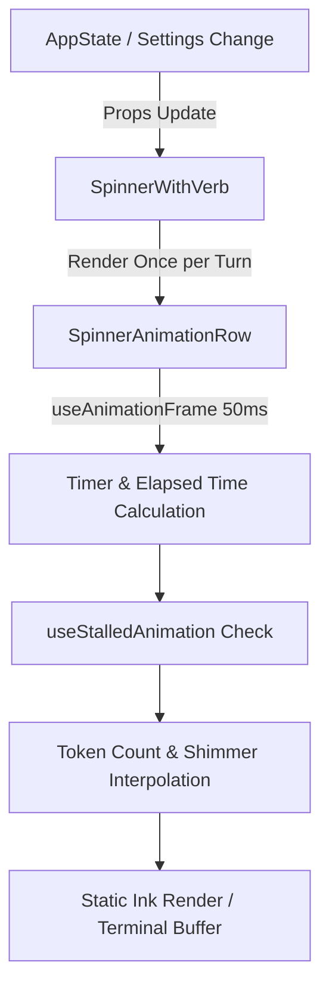
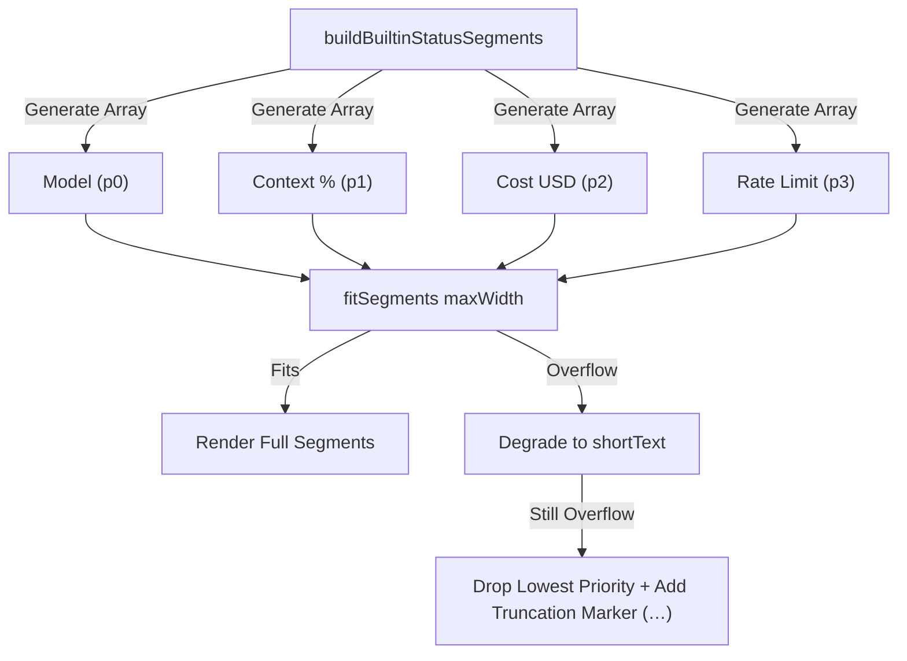
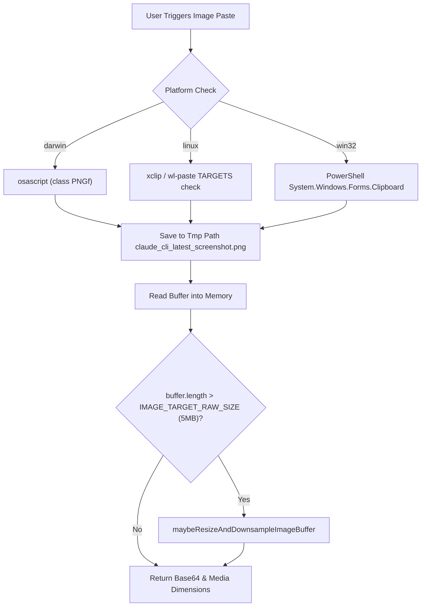

# Components, Theming & Status Display

Relevant source files

The following files were used as context for generating this wiki page:

- [docs/assets/atlas-cloud-banner.png](docs/assets/atlas-cloud-banner.png)
- [src/commands/cost/cost.ts](src/commands/cost/cost.ts)
- [src/commands/release-notes/release-notes.ts](src/commands/release-notes/release-notes.ts)
- [src/components/BuiltinStatusLine.test.tsx](src/components/BuiltinStatusLine.test.tsx)
- [src/components/BuiltinStatusLine.tsx](src/components/BuiltinStatusLine.tsx)
- [src/components/EffortCallout.modelGate.test.ts](src/components/EffortCallout.modelGate.test.ts)
- [src/components/EffortCallout.tsx](src/components/EffortCallout.tsx)
- [src/components/EffortIndicator.ts](src/components/EffortIndicator.ts)
- [src/components/HelpV2/HelpV2.tsx](src/components/HelpV2/HelpV2.tsx)
- [src/components/LogoV2/Clawd.tsx](src/components/LogoV2/Clawd.tsx)
- [src/components/LogoV2/CondensedLogo.tsx](src/components/LogoV2/CondensedLogo.tsx)
- [src/components/LogoV2/LogoV2.tsx](src/components/LogoV2/LogoV2.tsx)
- [src/components/LogoV2/WelcomeV2.tsx](src/components/LogoV2/WelcomeV2.tsx)
- [src/components/LogoV2/WordmarkRow.test.tsx](src/components/LogoV2/WordmarkRow.test.tsx)
- [src/components/LogoV2/WordmarkRow.tsx](src/components/LogoV2/WordmarkRow.tsx)
- [src/components/LogoV2/feedConfigs.tsx](src/components/LogoV2/feedConfigs.tsx)
- [src/components/Spinner.tsx](src/components/Spinner.tsx)
- [src/components/Spinner/SpinnerAnimationRow.test.tsx](src/components/Spinner/SpinnerAnimationRow.test.tsx)
- [src/components/Spinner/SpinnerAnimationRow.tsx](src/components/Spinner/SpinnerAnimationRow.tsx)
- [src/components/StatusLine.active.test.tsx](src/components/StatusLine.active.test.tsx)
- [src/components/StatusLine.test.ts](src/components/StatusLine.test.ts)
- [src/components/StatusLine.tsx](src/components/StatusLine.tsx)
- [src/components/TaskListV2.tsx](src/components/TaskListV2.tsx)
- [src/components/design-system/Dialog.tsx](src/components/design-system/Dialog.tsx)
- [src/components/design-system/FullWidthRow.tsx](src/components/design-system/FullWidthRow.tsx)
- [src/components/mcp/MCPSettings.tsx](src/components/mcp/MCPSettings.tsx)
- [src/components/messages/AttachmentMessage.tsx](src/components/messages/AttachmentMessage.tsx)
- [src/components/messages/SystemAPIErrorMessage.test.tsx](src/components/messages/SystemAPIErrorMessage.test.tsx)
- [src/components/messages/SystemAPIErrorMessage.tsx](src/components/messages/SystemAPIErrorMessage.tsx)
- [src/components/permissions/FilePermissionDialog/permissionOptions.tsx](src/components/permissions/FilePermissionDialog/permissionOptions.tsx)
- [src/components/tasks/RemoteSessionProgress.tsx](src/components/tasks/RemoteSessionProgress.tsx)
- [src/constants/brand.test.ts](src/constants/brand.test.ts)
- [src/constants/brand.ts](src/constants/brand.ts)
- [src/constants/figures.ts](src/constants/figures.ts)
- [src/hooks/notifs/useModelMigrationNotifications.tsx](src/hooks/notifs/useModelMigrationNotifications.tsx)
- [src/integrations/nearai.test.ts](src/integrations/nearai.test.ts)
- [src/services/ads.ts](src/services/ads.ts)
- [src/services/api/errorUtils.ts](src/services/api/errorUtils.ts)
- [src/services/tips/gitlawbEarn.test.ts](src/services/tips/gitlawbEarn.test.ts)
- [src/services/tips/gitlawbEarn.ts](src/services/tips/gitlawbEarn.ts)
- [src/services/tips/sponsoredTips.test.ts](src/services/tips/sponsoredTips.test.ts)
- [src/services/tips/sponsoredTips.ts](src/services/tips/sponsoredTips.ts)
- [src/services/tips/tipHistory.ts](src/services/tips/tipHistory.ts)
- [src/services/tips/tipRegistry.ts](src/services/tips/tipRegistry.ts)
- [src/services/tips/tipScheduler.test.ts](src/services/tips/tipScheduler.test.ts)
- [src/services/tips/tipScheduler.ts](src/services/tips/tipScheduler.ts)
- [src/services/tips/types.ts](src/services/tips/types.ts)
- [src/tools/AgentTool/built-in/statuslineSetup.ts](src/tools/AgentTool/built-in/statuslineSetup.ts)
- [src/tools/BashTool/BashToolResultMessage.tsx](src/tools/BashTool/BashToolResultMessage.tsx)
- [src/tools/FileEditTool/constants.ts](src/tools/FileEditTool/constants.ts)
- [src/types/statusLine.ts](src/types/statusLine.ts)
- [src/utils/env.test.ts](src/utils/env.test.ts)
- [src/utils/env.ts](src/utils/env.ts)
- [src/utils/envUtils.ts](src/utils/envUtils.ts)
- [src/utils/format.test.ts](src/utils/format.test.ts)
- [src/utils/format.ts](src/utils/format.ts)
- [src/utils/hooks/hooksConfigManager.ts](src/utils/hooks/hooksConfigManager.ts)
- [src/utils/ide.ts](src/utils/ide.ts)
- [src/utils/imagePaste.ts](src/utils/imagePaste.ts)
- [src/utils/imagePaste.win32.test.ts](src/utils/imagePaste.win32.test.ts)
- [src/utils/incrementalTokenCounter.test.ts](src/utils/incrementalTokenCounter.test.ts)
- [src/utils/incrementalTokenCounter.ts](src/utils/incrementalTokenCounter.ts)
- [src/utils/logoV2Utils.ts](src/utils/logoV2Utils.ts)
- [src/utils/openclaudePaths.test.ts](src/utils/openclaudePaths.test.ts)
- [src/utils/openclaudeUiSurfaces.test.ts](src/utils/openclaudeUiSurfaces.test.ts)
- [src/utils/theme.ts](src/utils/theme.ts)
- [src/utils/tokens.test.ts](src/utils/tokens.test.ts)
- [src/utils/tokens.ts](src/utils/tokens.ts)

## Purpose and Scope
This page covers OpenClaude's Terminal User Interface (TUI) design system and presentation layers built on React/Ink. It details spinner animations, elapsed-time tracking, and thinking shimmers (`SpinnerAnimationRow`), branding elements (`LogoV2`), status line metrics and adaptive truncation (`BuiltinStatusLine`), message rendering and token counting helpers (`tokens.ts`), the tip registry and sponsored tips system (`tipRegistry.ts`, `sponsoredTips.ts`), core text/duration formatters (`format.ts`), and native clipboard image-paste pipelines across macOS, Linux, and Windows (`imagePaste.ts`).

---

## 1. Spinner Architecture & Animation
The spinner architecture divides presentation into two layers to prevent frame-rate jitter: a stable outer wrapper (`SpinnerWithVerb`) that reacts only to app state or prop updates, and a high-frequency child component (`SpinnerAnimationRow`) that owns the 50ms animation clock via `useAnimationFrame` [src/components/Spinner/SpinnerAnimationRow.tsx:103-112](), [src/components/Spinner.tsx:102-107]().

### Data Flow and Animation Loop

*Sources: [src/components/Spinner/SpinnerAnimationRow.tsx:113-168](), [src/components/Spinner.tsx:63-107]()*

The spinner monitors token throughput via `getCurrentResponseTokenCount`, switching from duration counters to real-time token metrics once responses start streaming [src/components/Spinner/SpinnerAnimationRow.tsx:62-64](), [src/components/Spinner/SpinnerAnimationRow.tsx:71-80](). Thinking shimmers use dynamic color interpolation defined in `getThinkingShimmerColor` supporting ultracode color overrides and ANSI theme fallbacks [src/components/Spinner/SpinnerAnimationRow.tsx:58-60]().

---

## 2. Branding, LogoV2 & Feeds
The startup screen utilizes `LogoV2` (`src/components/LogoV2/LogoV2.tsx`), coordinating terminal width constraints, the mascot (`Clawd.tsx`), changelog inspection, and dynamic information feeds [src/components/LogoV2/LogoV2.tsx:11-14](). 

Depending on terminal width and release note statuses, `LogoV2` switches between full layout mode, a condensed display (`CondensedLogo.tsx`), and onboarding or upsell feeds (`feedConfigs.tsx`) [src/components/LogoV2/LogoV2.tsx:131-136]() via layout utilities in `logoV2Utils.ts`.

---

## 3. Status Line (`BuiltinStatusLine`)
When a user has not configured a custom `/statusline` command, OpenClaude displays an in-process, zero-latency status bar via `BuiltinStatusLine.tsx` [src/components/BuiltinStatusLine.tsx:22-28]().

### Status Segment Data Structure and Adaptive Truncation
Segments are assigned static priorities (`0` for model name up to `3` for rate limit data). If the terminal width is constrained, `fitSegments` degrades long strings to `shortText` alternatives before dropping lower-priority items and appending a truncation marker (`…`) [src/components/BuiltinStatusLine.tsx:37-45](), [src/components/BuiltinStatusLine.tsx:128-161]().

*Sources: [src/components/BuiltinStatusLine.tsx:64-113](), [src/components/BuiltinStatusLine.tsx:128-161]()*

---

## 4. Tip Scheduler & Sponsored Tips
OpenClaude periodically outputs tips during initialization or idle states. The system is managed by `tipScheduler.ts`, `tipRegistry.ts`, and `sponsoredTips.ts`, allowing commercial sponsors (e.g., Atomic Chat, Xiaomi MiMo, Atlas Cloud) to supply contextual prompts under strict cooldown rules and frequency settings (`sponsoredTipsFrequency`) [src/services/tips/sponsoredTips.ts:6-20](), [src/services/tips/sponsoredTips.ts:52-173]().

- **Sponsor Link Rendering**: Integrates OSC 8 ANSI hyperlinks via `renderSponsorLink` with fallbacks for terminals lacking hyperlink support [src/services/tips/sponsoredTips.ts:37-50]().
- **History Tracking**: `tipHistory.ts` tracks `lastShownAt` and counts total impressions to enforce cooldown sessions [src/services/tips/sponsoredTips.test.ts:190-194]().

---

## 5. Formatting Utilities & Token Counting
Leaf-safe formatters in `src/utils/format.ts` and token counters in `src/utils/tokens.ts` handle numerical representations, token summaries, and durations without relying on Ink components:
- `formatFileSize`: Converts raw byte values into human-readable strings (`KB`, `MB`, `GB`) [src/utils/format.ts:9-25]().
- `formatDuration`: Formats milliseconds into compact intervals (`d`, `h`, `m`, `s`), appending one decimal place for sub-second durations (`0.5s`) [src/utils/format.ts:46-64]().
- `formatNumber` / `formatTokenCount`: Uses compact International Number Formatting (`en-US`) to output counts like `1.3k` or `42m` [src/utils/format.ts:138-157]().
- `getCurrentUsage`: Aggregates reported token metrics or estimates active context windows across compaction boundaries [src/utils/tokens.ts:18-40](), [src/utils/tokens.test.ts:51-92]().

---

## 6. Clipboard Image Paste Pipeline
The image-paste mechanism (`src/utils/imagePaste.ts`) reads system clipboards natively, validates media types, and downsamples oversized buffers to meet API limits [src/utils/imagePaste.ts:1-20]().

*Sources: [src/utils/imagePaste.ts:69-121](), [src/utils/imagePaste.ts:175-181]()*

- **Windows Clipboard Handling**: Leverages `System.Windows.Forms.Clipboard.ContainsImage()` to properly detect raw bitmaps (`CF_DIB`) generated by utility snips [src/utils/imagePaste.ts:42-49]() and executes safe string escaping for paths containing apostrophes or backslashes [src/utils/imagePaste.win32.test.ts:107-139]().

---

## Sources
- [src/components/Spinner/SpinnerAnimationRow.tsx]()
- [src/utils/imagePaste.ts]()
- [src/utils/imagePaste.win32.test.ts]()
- [src/components/LogoV2/LogoV2.tsx]()
- [src/components/Spinner/SpinnerAnimationRow.test.tsx]()
- [src/utils/format.ts]()
- [src/services/tips/sponsoredTips.test.ts]()
- [src/services/tips/sponsoredTips.ts]()
- [src/components/Spinner.tsx]()
- [src/components/TaskListV2.tsx]()
- [src/components/BuiltinStatusLine.test.tsx]()
- [src/components/BuiltinStatusLine.tsx]()
- [src/utils/tokens.ts]()
- [src/utils/tokens.test.ts]()
- [src/services/tips/tipRegistry.ts]()