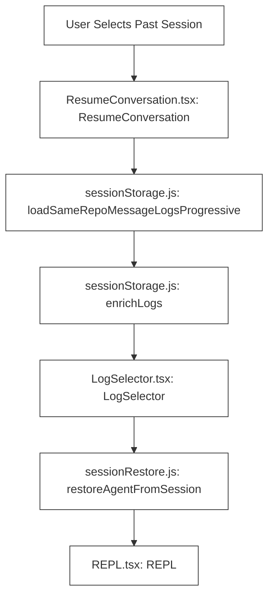
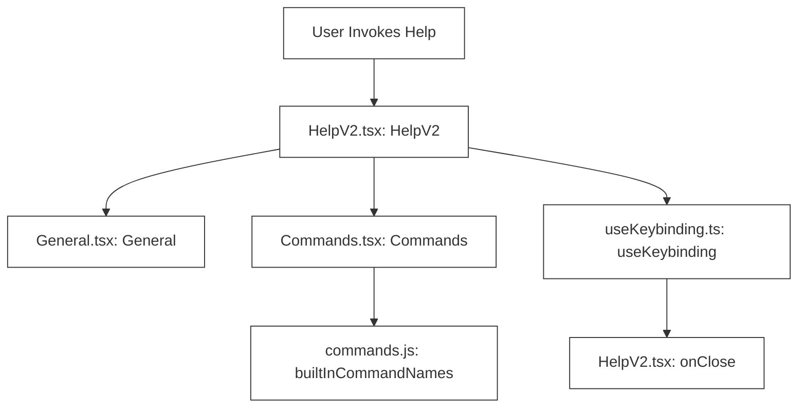

# Other Screens & Dialogs

Relevant source files

The following files were used as context for generating this wiki page:

- [docs/litellm-setup.md](docs/litellm-setup.md)
- [src/__tests__/bugfixes.test.ts](src/__tests__/bugfixes.test.ts)
- [src/commands/branch/branch.test.ts](src/commands/branch/branch.test.ts)
- [src/commands/branch/branch.ts](src/commands/branch/branch.ts)
- [src/components/GlobalSearchDialog.tsx](src/components/GlobalSearchDialog.tsx)
- [src/components/HelpV2/HelpV2.tsx](src/components/HelpV2/HelpV2.tsx)
- [src/components/LogSelector.resumeBranches.test.ts](src/components/LogSelector.resumeBranches.test.ts)
- [src/components/LogSelector.tsx](src/components/LogSelector.tsx)
- [src/components/mcp/MCPSettings.tsx](src/components/mcp/MCPSettings.tsx)
- [src/components/permissions/FilePermissionDialog/permissionOptions.tsx](src/components/permissions/FilePermissionDialog/permissionOptions.tsx)
- [src/integrations/discoveryCache.ts](src/integrations/discoveryCache.ts)
- [src/integrations/gateways/custom.test.ts](src/integrations/gateways/custom.test.ts)
- [src/integrations/gateways/custom.ts](src/integrations/gateways/custom.ts)
- [src/interactiveHelpers.tsx](src/interactiveHelpers.tsx)
- [src/screens/ResumeConversation.tsx](src/screens/ResumeConversation.tsx)
- [src/screens/replFallbackModelProp.test.ts](src/screens/replFallbackModelProp.test.ts)
- [src/screens/resumeFilters.ts](src/screens/resumeFilters.ts)
- [src/services/api/openaiShim/ollamaAdapter.test.ts](src/services/api/openaiShim/ollamaAdapter.test.ts)
- [src/services/api/openaiShim/ollamaAdapter.ts](src/services/api/openaiShim/ollamaAdapter.ts)
- [src/services/api/openaiShim/requestPreparation.test.ts](src/services/api/openaiShim/requestPreparation.test.ts)
- [src/services/api/openaiShim/requestPreparation.ts](src/services/api/openaiShim/requestPreparation.ts)
- [src/services/tips/tipRegistry.ts](src/services/tips/tipRegistry.ts)
- [src/tools/FileEditTool/constants.ts](src/tools/FileEditTool/constants.ts)
- [src/types/logs.ts](src/types/logs.ts)
- [src/utils/env.test.ts](src/utils/env.test.ts)
- [src/utils/env.ts](src/utils/env.ts)
- [src/utils/envProviderOption.ts](src/utils/envProviderOption.ts)
- [src/utils/envUtils.ts](src/utils/envUtils.ts)
- [src/utils/ide.ts](src/utils/ide.ts)
- [src/utils/openclaudePaths.test.ts](src/utils/openclaudePaths.test.ts)
- [src/utils/openclaudeUiSurfaces.test.ts](src/utils/openclaudeUiSurfaces.test.ts)
- [src/utils/setupScreenGates.test.ts](src/utils/setupScreenGates.test.ts)
- [src/utils/setupScreenGates.ts](src/utils/setupScreenGates.ts)

## Purpose & Scope

This leaf page documents auxiliary screens, modal dialogs, and interactive helper routines in OpenClaude. These components manage workflows outside the core command-line REPL loop, including session resumption (`ResumeConversation`), log selection (`LogSelector`), global searching (`GlobalSearchDialog`), the configuration settings panel (`Config`), the help dialog (`HelpV2`), authentication/OAuth flows (`ConsoleOAuthFlow`), and bootstrap interactive helpers (`[src/interactiveHelpers.tsx:36-107]()`).

---

## 1. ResumeConversation & Log Selection Pipeline

The session resumption mechanism allows users to pick past conversations from disk, load historical transcripts progressively, and re-initialize context buffers. This is driven by `ResumeConversation` (`[src/screens/ResumeConversation.tsx:62-155]()`) and delegates log presentation to `LogSelector` (`[src/components/LogSelector.tsx]()`).

### Progressive Log Loading and Enrichment

To handle large histories without blocking the Ink event loop, logs are loaded lazily:
- `loadSameRepoMessageLogsProgressive` and `loadAllProjectsMessageLogsProgressive` scan session files and retrieve headers/metadata (`[src/utils/sessionStorage.js]()`).
- `loadMoreLogs` (`[src/screens/ResumeConversation.tsx:123-141]()`) pages through older entries via `enrichLogs` (`[src/utils/sessionStorage.js]()`) maintaining pure state updates with `logCountRef`.
- Selected logs pass through filters in `resumeFilters.ts` (`[src/screens/resumeFilters.ts]()`) before restoration via `restoreAgentFromSession` and `restoreWorktreeForResume` (`[src/utils/sessionRestore.js:32-32]()`).

### Diagram: Natural Language Space to Code Entity Space — Session Resumption Pipeline

*Sources: `[src/screens/ResumeConversation.tsx:62-155]()`, `[src/components/LogSelector.tsx]()`, `[src/utils/sessionStorage.js]()`, `[src/utils/sessionRestore.js:32-32]()`, `[src/screens/REPL.tsx:1-85]()`*

Sources: `[src/screens/ResumeConversation.tsx:62-155]()`, `[src/components/LogSelector.tsx]()`, `[src/utils/sessionStorage.js]()`, `[src/screens/resumeFilters.ts]()`, `[src/utils/sessionRestore.js:32-32]()`

---

## 2. Settings Panel (`Config` Component)

The global configuration panel (`[src/components/Settings/Config.tsx:90-122]()`) presents an interactive, scrollable UI for editing global and project settings.

### State Management & Submenus

- **State Sync**: The component maintains local state synchronized with global configuration (`getGlobalConfig`, `[src/utils/config.ts]()`) and settings data (`getInitialSettings`, `[src/utils/settings/settings.js]()`).
- **Setting Types**: Settings are categorized as boolean toggles, strict enums, or managed enums handled by dedicated sub-pickers like `ThemePicker`, `ModelPicker`, `OutputStylePicker`, and `LanguagePicker` (`[src/components/Settings/Config.tsx:23-33]()`).
- **Search & Filtering**: `useSearchInput` enables inline filtering of configuration parameters.

Sources: `[src/components/Settings/Config.tsx:90-122]()`, `[src/utils/config.ts]()`, `[src/utils/settings/settings.js]()`

---

## 3. Global Search, Help & Auxiliary Dialogs

### Global Search Dialog

`GlobalSearchDialog` (`[src/components/GlobalSearchDialog.tsx]()`) indexes conversation histories and workspace files, offering an interactive search modal that triggers jumps to specific session locations or code entities.

### Help Dialog (`HelpV2`)

The help screen component `HelpV2` (`[src/components/HelpV2/HelpV2.tsx:21-178]()`) provides categorized tabs (`General`, `commands`, `custom-commands`) for navigating built-in and custom user commands. It registers keybindings via `useKeybinding("help:dismiss", close, ...)` (`[src/components/HelpV2/HelpV2.tsx:53-53]()`) and tracks exit states using `useExitOnCtrlCDWithKeybindings` (`[src/components/HelpV2/HelpV2.tsx:54-54]()`).

### Diagram: Natural Language Space to Code Entity Space — Help & Command Navigation Pipeline

*Sources: `[src/components/HelpV2/HelpV2.tsx:21-178]()`, `[src/commands.js]()`, `[src/keybindings/useKeybinding.js]()`*

### Console OAuth & Provider Flow

The `ConsoleOAuthFlow` component (`[src/components/ConsoleOAuthFlow.tsx:74-116]()`) manages authentication states (`idle`, `platform_setup`, `waiting_for_login`, `success`, `error`) and integrates third-party provider configuration directly into the terminal UI.

Sources: `[src/components/GlobalSearchDialog.tsx]()`, `[src/components/HelpV2/HelpV2.tsx:21-178]()`, `[src/components/ConsoleOAuthFlow.tsx:74-116]()`, `[src/utils/config.ts]()`

---

## 4. Interactive Helpers & Lifecycle Management

Utility functions in `[src/interactiveHelpers.tsx:36-107]()` standardize rendering logic for modal dialogs and bootstrap gates.

### Key Helper Functions

- `showDialog<T>` / `showSetupDialog<T>` (`[src/interactiveHelpers.tsx:43-96]()`): Mounts temporary React/Ink sub-trees inside an `AppStateProvider` and `KeybindingSetup` wrapper, returning a Promise that resolves when the user dismisses the dialog.
- `exitWithError` / `exitWithMessage` (`[src/interactiveHelpers.tsx:56-84]()`): Renders final status text through the React Ink tree (bypassing patched console output wrappers), unmounts the root, and terminates the process with the designated exit code.
- `renderAndRun` (`[src/interactiveHelpers.tsx:102-107]()`): Mounts the primary application element, triggers background prefetches, blocks on `root.waitUntilExit()`, and invokes `gracefulShutdown(0)`.
- `showSetupScreens` (`[src/interactiveHelpers.tsx:108-146]()`): Evaluates setup gates (`getRequiredSetupScreens`, `[src/utils/setupScreenGates.ts]()`) to conditionally launch onboarding screens, trust dialogs, or external include warnings before application boot.

Sources: `[src/interactiveHelpers.tsx:36-107]()`, `[src/utils/setupScreenGates.ts]()`