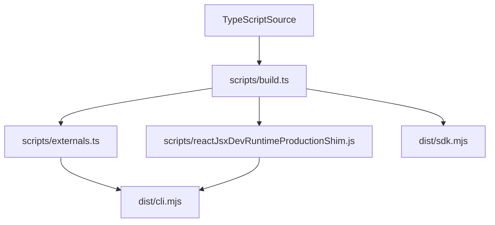
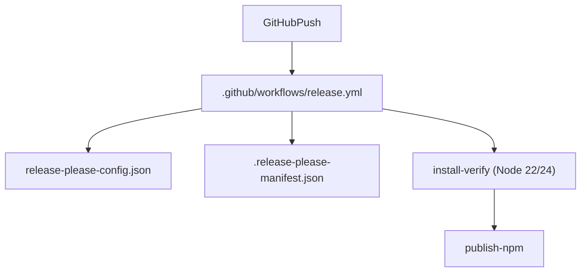
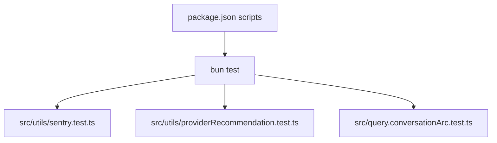
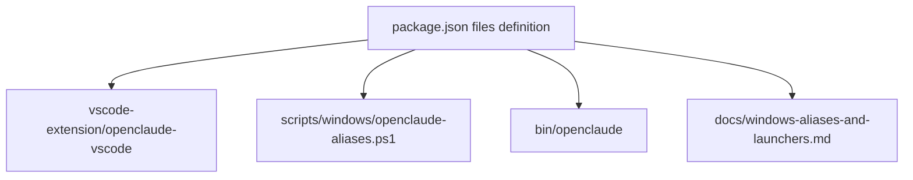

# Build, Release & Project Infrastructure

Relevant source files

The following files were used as context for generating this wiki page:

- [.github/workflows/release.yml](.github/workflows/release.yml)
- [.node-version](.node-version)
- [.nvmrc](.nvmrc)
- [.release-please-manifest.json](.release-please-manifest.json)
- [CHANGELOG.md](CHANGELOG.md)
- [bun.lock](bun.lock)
- [package.json](package.json)
- [release-please-config.json](release-please-config.json)
- [scripts/build.ts](scripts/build.ts)
- [scripts/externals.ts](scripts/externals.ts)
- [src/entrypoints/init.ts](src/entrypoints/init.ts)
- [src/i18n/index.ts](src/i18n/index.ts)
- [src/utils/sentry.test.ts](src/utils/sentry.test.ts)
- [src/utils/sentry.ts](src/utils/sentry.ts)
- [web/public/llms.txt](web/public/llms.txt)

This page provides a high-level overview of the build tooling, CI/CD pipelines, testing strategies, project websites, and companion extensions that support OpenClaude. OpenClaude transforms TypeScript source code into a standalone, secure, high-performance CLI and SDK distribution [package.json:2-16](), [scripts/build.ts:1-10](). 

For comprehensive deep-dives into each sub-topic, refer to the child pages linked below.

---

## 9.1 Build Pipeline & Bundling

The build pipeline leverages Bun's native bundler to compile source entrypoints into highly optimized distribution assets. Handled primarily by `scripts/build.ts`, the compilation process inlines feature flags (`featureFlags`), resolves path aliases, and injects version metadata [package.json:29](), [scripts/build.ts:1-132](). External packages and optional runtime modules are managed via `scripts/externals.ts` to keep default binary sizes small and prevent unwanted static imports [scripts/externals.ts:1-126]().

To ensure absolute privacy and zero unwanted telemetry leakage, the pipeline incorporates telemetry removal plugins, replacing internal analytics stubs with zero-cost no-op implementations at compile time [scripts/build.ts:14](). Additionally, production React modules and custom JSX shims defined in `scripts/build.ts` ensure the Terminal UI renders correctly without runtime dev-transform mismatches [scripts/build.ts:25-79]().

For details, see [Build Pipeline & Bundling](#9.1).

### Build Pipeline Architecture

Sources: `scripts/build.ts` [scripts/build.ts:1-136](), `scripts/externals.ts` [scripts/externals.ts:1-126]()

---

## 9.2 CI/CD & Release Automation

Automated releases and continuous integration are orchestrated through GitHub Actions workflows, prominently `.github/workflows/release.yml` [:.github/workflows/release.yml:1-31](). Version management and changelog generation are driven by Google's `release-please` configured via `release-please-config.json` and `.release-please-manifest.json` [.release-please-manifest.json:1-3](), [release-please-config.json:1-11]().

The release pipeline enforces strict install hygiene by running sandbox global install checks (`install-verify`) across multiple Node.js runtimes prior to publishing to npm with provenance [:.github/workflows/release.yml:36-72]() [:.github/workflows/release.yml:112-140](). Containerized deployments and publication scripts coordinate closely to maintain zero-warning install standards.

For details, see [CI/CD & Release Automation](#9.2).

### CI/CD Workflow Architecture

Sources: `.github/workflows/release.yml` [:.github/workflows/release.yml:1-75](), `release-please-config.json` [release-please-config.json:1-11]()

---

## 9.3 Testing Strategy

OpenClaude utilizes Bun's native test runner (`bun test`) to execute unit, integration, and security regression test suites [package.json:57-61](). Testing covers everything from SDK behavior to complex conversation arc persistence [package.json:58-59]() and optional telemetry validation [src/utils/sentry.test.ts:1-87]().

Specialized regression test scripts actively inspect bundled outputs and runtime shims to verify that security guardrails and core entrypoints are not accidentally stubbed out or corrupted during compilation [package.json:64-71]().

For details, see [Testing Strategy](#9.3).

### Testing & Verification Architecture

Sources: `package.json` [package.json:57-63](), `src/utils/sentry.test.ts` [src/utils/sentry.test.ts:1-87]()

---

## 9.4 Website & Docs Site

The project documentation, landing page, and partner data directories are hosted within the `web/` workspace, powered by Astro [package.json:53-56](). The site structure aggregates command registries, CLI flag documentation, configuration references, and partner ecosystem integrations alongside machine-readable summaries like `web/public/llms.txt` [web/public/llms.txt:1-38](). Distribution verification checks ensure that documentation bundles and site artifacts align precisely with the released package payloads.

For details, see [Website & Docs Site](#9.4).

Sources: `package.json` [package.json:53-56](), `web/public/llms.txt` [web/public/llms.txt:1-38]()

---

## 9.5 VS Code Extension & Platform Launchers

To support diverse developer environments, OpenClaude provides platform-specific integration surfaces. This includes the `vscode-extension/openclaude-vscode` extension codebase for editor integration, Windows PowerShell aliases and launchers, and specialized setup guides for Termux on Android and Chrome environments [package.json:17-27]().

For details, see [VS Code Extension & Platform Launchers](#9.5).

### Ecosystem Integration Map

Sources: `package.json` [package.json:17-27]()