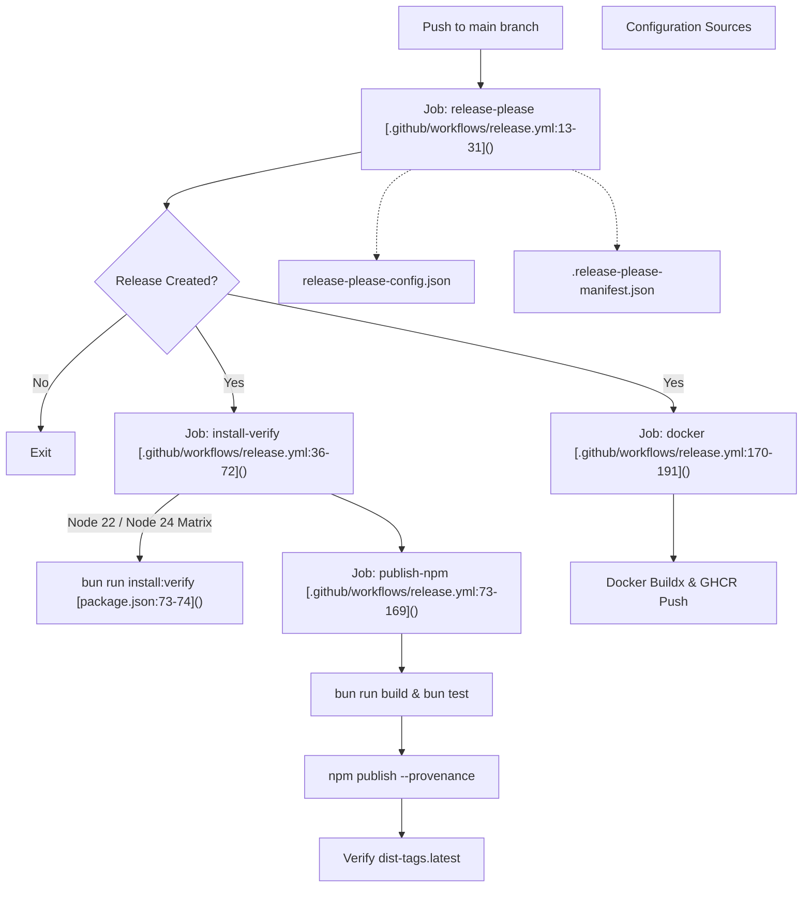
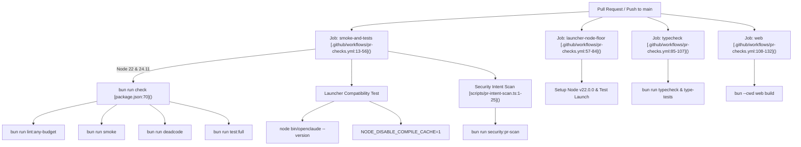
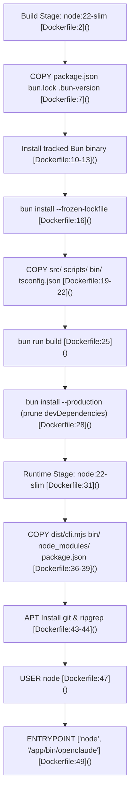

# CI/CD & Release Automation

Relevant source files

The following files were used as context for generating this wiki page:

- [.github/workflows/install-hygiene.yml](.github/workflows/install-hygiene.yml)
- [.github/workflows/pr-checks.yml](.github/workflows/pr-checks.yml)
- [scripts/pr-intent-scan.test.ts](scripts/pr-intent-scan.test.ts)
- [scripts/pr-intent-scan.ts](scripts/pr-intent-scan.ts)
- [scripts/verify-clean-install.test.ts](scripts/verify-clean-install.test.ts)
- [scripts/verify-clean-install.ts](scripts/verify-clean-install.ts)
- [src/assistant/sessionHistory.test.ts](src/assistant/sessionHistory.test.ts)
- [src/assistant/sessionHistory.ts](src/assistant/sessionHistory.ts)
- [src/assistant/sessionHistorySerialization.ts](src/assistant/sessionHistorySerialization.ts)
- [src/cli/update.test.ts](src/cli/update.test.ts)
- [src/cli/update.ts](src/cli/update.ts)
- [src/commands/update/update.test.ts](src/commands/update/update.test.ts)
- [src/commands/update/update.tsx](src/commands/update/update.tsx)
- [src/utils/claudeInChrome/launch.test.ts](src/utils/claudeInChrome/launch.test.ts)
- [src/utils/claudeInChrome/launch.ts](src/utils/claudeInChrome/launch.ts)
- [src/utils/claudeInChrome/setup.ts](src/utils/claudeInChrome/setup.ts)
- [src/utils/claudeInChrome/startup.test.ts](src/utils/claudeInChrome/startup.test.ts)
- [src/utils/cliEntrypoint.ts](src/utils/cliEntrypoint.ts)
- [src/utils/conversationCache.test.ts](src/utils/conversationCache.test.ts)
- [src/utils/conversationCache.ts](src/utils/conversationCache.ts)
- [src/utils/sessionPersistence.test.ts](src/utils/sessionPersistence.test.ts)
- [src/utils/sessionPersistence.ts](src/utils/sessionPersistence.ts)
- [src/utils/statusNoticeDefinitions.safety.test.tsx](src/utils/statusNoticeDefinitions.safety.test.tsx)
- [src/utils/statusNoticeDefinitions.tsx](src/utils/statusNoticeDefinitions.tsx)

This page documents the continuous integration, continuous deployment, release automation pipelines, containerization, and installation hygiene verification systems for OpenClaude (`@twigpine/openclaude`). The infrastructure ensures strict zero-warning installation standards, automated semantic versioning, secure npm publishing with cryptographic provenance, multi-version Node.js matrix validation, and container packaging.

---

## 1. Release Automation & Semantic Versioning (`release-please`)

OpenClaude uses Google's `release-please` action to automate changelog generation, GitHub releases, and semantic version bumping based on Conventional Commits. The configuration is declared in `release-please-config.json` and `.release-please-manifest.json`.

- **Manifest Configuration**: Tracks package versions mapped to the repository root.
- **Release Please Config**: Specifies `release-type: node`, `@twigpine/openclaude` package naming, minor pre-major version bumping rules (`bump-minor-pre-major: true`), and tag formatting (`include-v-in-tag: true`) [release-please-config.json:1-11]().

The automated release workflow is executed via GitHub Actions on every push to `main` [/.github/workflows/release.yml:1-11]().

### Release Workflow Architecture

Sources: `release-please-config.json`, `.release-please-manifest.json`, `.github/workflows/release.yml`, `package.json`

---

## 2. Zero-Warning Install Hygiene & Verification

To prevent regressions in global CLI installation mechanics, warning outputs, or missing package assets, OpenClaude enforces a strict zero-warning install hygiene gate before any release reaches npm [/.github/workflows/release.yml:32-35](). Additionally, a daily scheduled workflow (`install-hygiene.yml`) validates the live published `@twigpine/openclaude@latest` artifact against registry drift [/.github/workflows/install-hygiene.yml:1-19]().

### Verification Execution Path

1. **Matrix Testing**: The `verify-published-install` job evaluates the release package across `ubuntu-latest`, `macos-latest`, and `windows-latest` combined with Node 22 and 24 [/.github/workflows/install-hygiene.yml:24-32]().
2. **Pack & Cold Install**: Executes `bun run scripts/verify-clean-install.ts --published` [/.github/workflows/install-hygiene.yml:51-52](), which simulates clean global installations and upgrade scenarios in sandboxed environments with a cold cache (`scripts/verify-clean-install.ts:15-35`).
3. **Output Whitelisting & Strict Verdicts**: `scripts/verify-clean-install.ts` enforces strict whitelisting where any unexpected `npm warn`, deprecation note, `EBADENGINE`, or funding hint fails the run (`scripts/verify-clean-install.ts:66-73`). Network or registry failures are isolated and retried (`scripts/verify-clean-install.ts:75-79`, `scripts/verify-clean-install.test.ts:39-95`).
4. **Publish Blocking**: If any deprecation warnings, missing bin scripts (`bin/openclaude`, `bin/heap-limit.mjs`), or file manifest violations occur during `npm install -g`, publishing is aborted.

Sources: `scripts/verify-clean-install.ts`, `scripts/verify-clean-install.test.ts`, `.github/workflows/install-hygiene.yml`, `.github/workflows/release.yml`

---

## 3. Pull Request Checks & Code Quality Gates

All incoming pull requests and commits to `main` trigger `.github/workflows/pr-checks.yml`, which runs exhaustive integration tests, type checks, and security scans across a matrix of Node versions [/.github/workflows/pr-checks.yml:1-20]().

### PR Checks Validation Matrix

Sources: `.github/workflows/pr-checks.yml`, `package.json`, `scripts/pr-intent-scan.ts`

### Security Intent Scanning (`pr-intent-scan.ts`)
The `security:pr-scan` script analyzes PR diffs to flag suspicious changes [scripts/pr-intent-scan.ts:1-25](). It checks for:
- Added shortened URLs (e.g., `bit.ly`, `tinyurl.com`)
- External file-hosting or direct binary download links (`dropbox.com`, `mega.nz`)
- Sensitive path modifications (`.github/workflows/`, `scripts/`, `bin/`) combined with execution commands like `curl`, `wget`, or `bash`

Sources: `scripts/pr-intent-scan.ts`, `.github/workflows/pr-checks.yml`

---

## 4. npm Publishing & Cryptographic Provenance

Once `release-please` creates a release and `install-verify` passes across all Node versions, the `publish-npm` job executes publishing to the public registry [/.github/workflows/release.yml:73-126]().

- **Trusted Publishing**: Clears legacy `NODE_AUTH_TOKEN` environment variables to rely on GitHub Actions OIDC trusted publishing [/.github/workflows/release.yml:119-122]().
- **Provenance Flags**: Publishes with cryptographic attestation using `npm publish --access public --provenance` [/.github/workflows/release.yml:125]().
- **Registry Synchronization Verification**: Enters a polling loop checking `npm view @twigpine/openclaude` to verify that `published_version`, `dist-tags.latest`, and `@latest` correctly resolve to the expected release version before marking the workflow successful [/.github/workflows/release.yml:127-160]().

Sources: `.github/workflows/release.yml`, `package.json`

---

## 5. Containerization (`Dockerfile`)

OpenClaude provides a multi-stage Docker build workflow optimized for containerized deployments, MCP server hosts, and agent swarms [Dockerfile:1-49]().

### Multi-Stage Build Structure

Sources: `Dockerfile`

---

## 6. Performance Benchmarking

OpenClaude maintains startup performance regression testing through dedicated benchmark scripts invoked via npm scripts [package.json:30]().

- **Startup Benchmark**: Executed via `node scripts/benchmark-openclaude-startup.mjs` [package.json:30](), tracking bootstrap latency, memory consumption, and compile cache effectiveness under Node.js runtime flags.

Sources: `package.json`