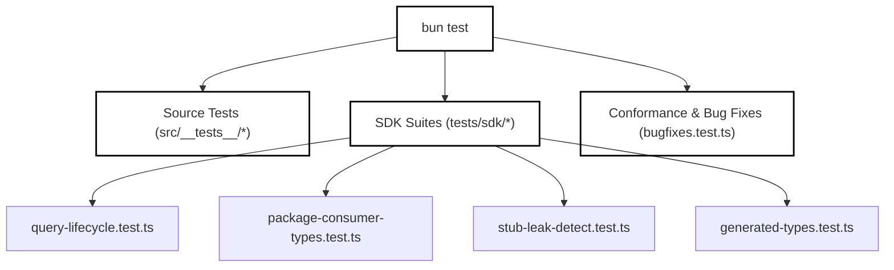
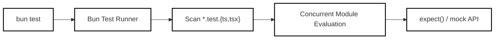
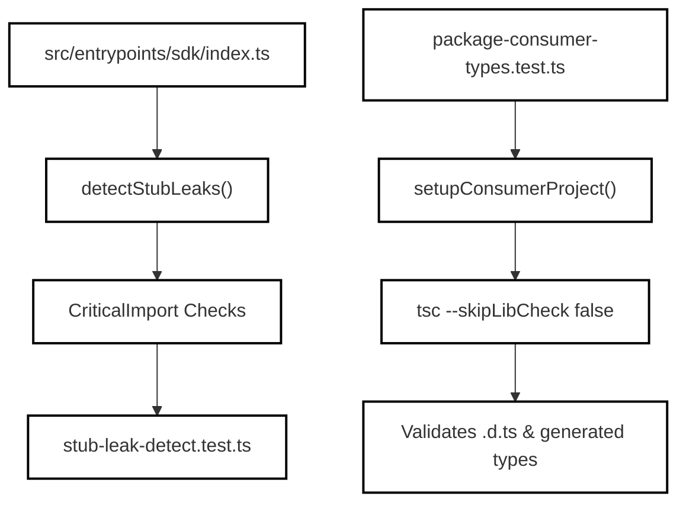
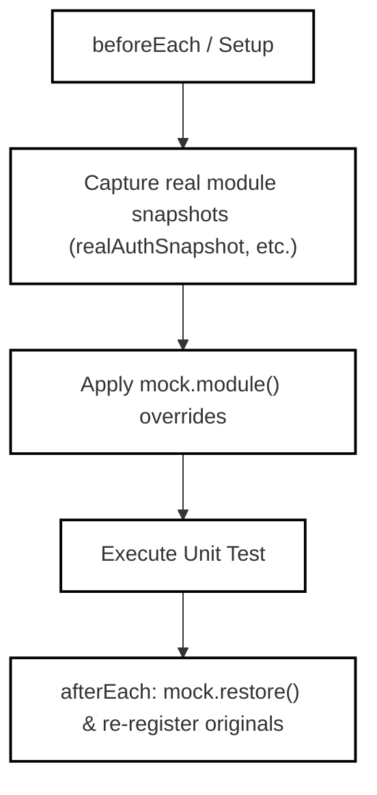

# Testing Strategy

<details>
<summary>Relevant source files</summary>

The following files were used as context for generating this wiki page:

- [docs/litellm-setup.md](docs/litellm-setup.md)
- [scripts/generate-sdk-types.ts](scripts/generate-sdk-types.ts)
- [src/__tests__/bugfixes.test.ts](src/__tests__/bugfixes.test.ts)
- [src/cli/headlessHeartbeat.test.ts](src/cli/headlessHeartbeat.test.ts)
- [src/cli/headlessHeartbeat.ts](src/cli/headlessHeartbeat.ts)
- [src/cli/printHeartbeat.test.ts](src/cli/printHeartbeat.test.ts)
- [src/entrypoints/sdk.d.ts](src/entrypoints/sdk.d.ts)
- [src/entrypoints/sdk/coreSchemas.ts](src/entrypoints/sdk/coreSchemas.ts)
- [src/entrypoints/sdk/coreTypes.generated.ts](src/entrypoints/sdk/coreTypes.generated.ts)
- [src/hooks/useReplBridge.tsx](src/hooks/useReplBridge.tsx)
- [src/ink/hooks/use-input.test.ts](src/ink/hooks/use-input.test.ts)
- [src/ink/hooks/use-input.ts](src/ink/hooks/use-input.ts)
- [src/integrations/discoveryCache.ts](src/integrations/discoveryCache.ts)
- [src/integrations/gateways/custom.test.ts](src/integrations/gateways/custom.test.ts)
- [src/integrations/gateways/custom.ts](src/integrations/gateways/custom.ts)
- [src/interactiveHelpers.tsx](src/interactiveHelpers.tsx)
- [src/query/stopHooks.goal.test.ts](src/query/stopHooks.goal.test.ts)
- [src/query/stopHooks.ts](src/query/stopHooks.ts)
- [src/services/api/openaiShim/ollamaAdapter.test.ts](src/services/api/openaiShim/ollamaAdapter.test.ts)
- [src/services/api/openaiShim/ollamaAdapter.ts](src/services/api/openaiShim/ollamaAdapter.ts)
- [src/services/api/openaiShim/requestPreparation.test.ts](src/services/api/openaiShim/requestPreparation.test.ts)
- [src/services/api/openaiShim/requestPreparation.ts](src/services/api/openaiShim/requestPreparation.ts)
- [src/tools/FileReadTool/constants.ts](src/tools/FileReadTool/constants.ts)
- [src/tools/FileReadTool/prompt.ts](src/tools/FileReadTool/prompt.ts)
- [src/tools/REPLTool/constants.ts](src/tools/REPLTool/constants.ts)
- [src/utils/envProviderOption.ts](src/utils/envProviderOption.ts)
- [src/utils/messageFilters.ts](src/utils/messageFilters.ts)
- [src/utils/settings/mdm/settings.ts](src/utils/settings/mdm/settings.ts)
- [src/utils/setupScreenGates.test.ts](src/utils/setupScreenGates.test.ts)
- [src/utils/setupScreenGates.ts](src/utils/setupScreenGates.ts)
- [src/utils/user.test.ts](src/utils/user.test.ts)
- [src/utils/validation.ts](src/utils/validation.ts)
- [tests/sdk/generated-types.test.ts](tests/sdk/generated-types.test.ts)
- [tests/sdk/helpers/query-test-doubles.ts](tests/sdk/helpers/query-test-doubles.ts)
- [tests/sdk/package-consumer-types.test.ts](tests/sdk/package-consumer-types.test.ts)
- [tests/sdk/query-lifecycle.test.ts](tests/sdk/query-lifecycle.test.ts)

</details>


## Overview and Scope

OpenClaude uses **Bun's native test runner (`bun test`)** for its entire testing strategy, covering unit tests, integration test suites, SDK lifecycle validation, and package consumer conformance. The repository layout segregates standard source tests alongside implementation files (e.g., `src/__tests__/bugfixes.test.ts`, `src/utils/user.test.ts`), while dedicated public contracts and consumer test suites reside under `tests/sdk/`.

This document details the layout of test suites, the mechanisms used for module isolation, test fixtures, helpers, and how coverage and build verification are enforced.


*Sources: `src/__tests__/bugfixes.test.ts`, `tests/sdk/query-lifecycle.test.ts`, `tests/sdk/package-consumer-types.test.ts`*

---

## 1. Bun Test Layout & Execution

Bun's test runner provides ultra-fast execution speeds by leveraging its internal TypeScript and JSX loader. Tests are organized into two primary domains within the repository:

1. **Collocated Source Tests:** Located next to production code under `src/` using suffixes like `.test.ts` or `.test.tsx` (e.g., `src/utils/user.test.ts` [src/utils/user.test.ts:1-129](), `src/services/api/openaiShim/requestPreparation.test.ts` [src/services/api/openaiShim/requestPreparation.test.ts:1-56]()).
2. **Dedicated SDK and Integration Suites:** Located in the top-level `tests/sdk/` directory [tests/sdk/query-lifecycle.test.ts:1-77](), verifying end-to-end behaviors, public interface stability, type definitions, and package consumers.

Execution is typically invoked via package manager scripts targeting specific scopes, running in parallel or sequentially with shared mutation guards.


*Sources: `src/utils/user.test.ts`, `tests/sdk/query-lifecycle.test.ts`*

---

## 2. SDK Suites & Public Contract Validation

The SDK test suites under `tests/sdk/` ensure that the public API (`dist/sdk.mjs` and type definitions in `src/entrypoints/sdk.d.ts`) remains clean, functional, and devoid of internal CLI or React/Ink leaks.

### Key SDK Test Files
- **`tests/sdk/query-lifecycle.test.ts`**: Verifies query creation, session ID guarantees [tests/sdk/query-lifecycle.test.ts:79-120](), lazy-initialization engine guards [tests/sdk/query-lifecycle.test.ts:122-154](), and graceful interruption/drain cycles [tests/sdk/query-lifecycle.test.ts:186-208]().
- **`tests/sdk/package-consumer-types.test.ts`**: Simulates an external TypeScript consumer using `npm pack`-like structures, executing `tsc` with `skipLibCheck: false` to catch drift or broken declarations in `.d.ts` files [tests/sdk/package-consumer-types.test.ts:1-182]().
- **`tests/sdk/stub-leak-detect.test.ts`**: Asserts that internal TUI stubs do not pollute core SDK entrypoints [src/entrypoints/sdk/index.ts:26-63]().


*Sources: `src/entrypoints/sdk/index.ts`, `tests/sdk/package-consumer-types.test.ts`, `src/entrypoints/sdk/stubLeakDetection.ts`*

---

## 3. Fixtures and Test Helpers

To maintain clean and deterministic assertions across asynchronous routines, OpenClaude relies on robust test helpers and double frameworks.

- **Query Test Doubles (`tests/sdk/helpers/query-test-doubles.ts`)**: Provides utilities like `drainQuery`, `withTempDir`, and stub conversation factories to exercise stream consumption without hitting real network sockets [tests/sdk/query-lifecycle.test.ts:11-20]().
- **Shared Mutation Locking (`src/test/sharedMutationLock.ts`)**: Coordinates environment variable modifications (`process.env`) and global state overrides across concurrent test files [tests/sdk/query-lifecycle.test.ts:21-23]().

```typescript
// Example pattern from query-lifecycle.test.ts managing environment stubs
beforeAll(async () => {
  await acquireSharedMutationLock('tests/sdk/query-lifecycle.test.ts')
  savedApiKey = process.env['ANTHROPIC_API_KEY']
  if (!savedApiKey) {
    process.env['ANTHROPIC_API_KEY'] = 'sk-test-lifecycle-stub'
  }
})
```
*Sources: `tests/sdk/query-lifecycle.test.ts`, `src/test/sharedMutationLock.ts`*

---

## 4. Module Isolation & Mocking Strategy

Because Bun's `mock.module()` is process-global and persists for the lifecycle of the test runner execution, test suites that mock modules must carefully snapshot and restore states to prevent pollution across test files.

As demonstrated in `src/utils/user.test.ts`, live namespace snapshots are captured before applying module mocks [src/utils/user.test.ts:12-23](), and cleaned up in `afterEach` hooks using `mock.restore()` alongside re-applying original module definitions [src/utils/user.test.ts:112-129]():


*Sources: `src/utils/user.test.ts`*

---

## 5. Coverage and Verification Tooling

Quality gates and pre-release checks depend on automated validation pipelines:
1. **Type Generation & Drift Prevention**: `scripts/generate-sdk-types.ts` automatically generates TypeScript interfaces from Zod schemas (`src/entrypoints/sdk/coreSchemas.ts`) [src/entrypoints/sdk/coreSchemas.ts:1-8](). Drift between manually maintained declarations (`src/entrypoints/sdk.d.ts`) and generated sources is verified via CI checks [src/entrypoints/sdk.d.ts:1-4]().
2. **External Validation**: Scripts check that externals and entrypoints correctly separate SDK runtime requirements from CLI/TUI dependencies.

Sources: `src/__tests__/bugfixes.test.ts`, `src/utils/user.test.ts`, `tests/sdk/query-lifecycle.test.ts`, `tests/sdk/package-consumer-types.test.ts`, `src/entrypoints/sdk/index.ts`, `src/entrypoints/sdk/coreSchemas.ts`, `src/entrypoints/sdk.d.ts`, `src/services/api/openaiShim/requestPreparation.test.ts`