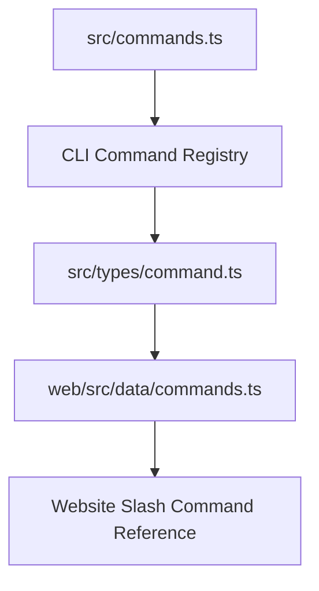
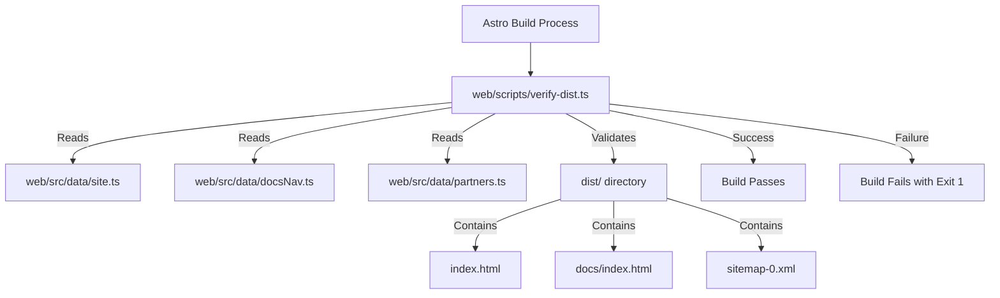

# Website & Docs Site

<details>
<summary>Relevant source files</summary>

The following files were used as context for generating this wiki page:

- [.env.example](.env.example)
- [.github/ISSUE_TEMPLATE/config.yml](.github/ISSUE_TEMPLATE/config.yml)
- [.github/pull_request_template.md](.github/pull_request_template.md)
- [AGENTS.md](AGENTS.md)
- [ANDROID_INSTALL.md](ANDROID_INSTALL.md)
- [CONTRIBUTING.md](CONTRIBUTING.md)
- [README.md](README.md)
- [docs/advanced-setup.md](docs/advanced-setup.md)
- [src/components/ProviderManager.test.tsx](src/components/ProviderManager.test.tsx)
- [src/components/ProviderManager.tsx](src/components/ProviderManager.tsx)
- [src/integrations/compatibility.test.ts](src/integrations/compatibility.test.ts)
- [src/integrations/generated/integrationArtifacts.generated.ts](src/integrations/generated/integrationArtifacts.generated.ts)
- [src/integrations/generated/integrationManifest.generated.ts](src/integrations/generated/integrationManifest.generated.ts)
- [src/integrations/routeMetadata.test.ts](src/integrations/routeMetadata.test.ts)
- [src/integrations/routeMetadata.ts](src/integrations/routeMetadata.ts)
- [src/utils/envFile.test.ts](src/utils/envFile.test.ts)
- [src/utils/envFile.ts](src/utils/envFile.ts)
- [src/utils/providerFlag.test.ts](src/utils/providerFlag.test.ts)
- [src/utils/providerFlag.ts](src/utils/providerFlag.ts)
- [src/utils/providerProfile.test.ts](src/utils/providerProfile.test.ts)
- [src/utils/providerProfile.ts](src/utils/providerProfile.ts)
- [src/utils/providerProfiles.test.ts](src/utils/providerProfiles.test.ts)
- [src/utils/providerProfiles.ts](src/utils/providerProfiles.ts)
- [web/astro.config.mjs](web/astro.config.mjs)
- [web/public/robots.txt](web/public/robots.txt)
- [web/scripts/verify-dist.test.ts](web/scripts/verify-dist.test.ts)
- [web/scripts/verify-dist.ts](web/scripts/verify-dist.ts)
- [web/src/components/DocsSidebar.astro](web/src/components/DocsSidebar.astro)
- [web/src/components/Footer.astro](web/src/components/Footer.astro)
- [web/src/components/Nav.astro](web/src/components/Nav.astro)
- [web/src/data/commands.ts](web/src/data/commands.ts)
- [web/src/data/configuration.ts](web/src/data/configuration.ts)
- [web/src/data/docsNav.ts](web/src/data/docsNav.ts)
- [web/src/data/partners.ts](web/src/data/partners.ts)
- [web/src/data/providers.ts](web/src/data/providers.ts)
- [web/src/data/site.ts](web/src/data/site.ts)
- [web/src/pages/docs/index.astro](web/src/pages/docs/index.astro)
- [web/src/pages/index.astro](web/src/pages/index.astro)
- [web/vercel.json](web/vercel.json)

</details>


This page details the structure and content of the OpenClaude website and documentation, which is built using Astro. It covers the organization of the site, how typed data files drive content, the `verify-dist` script for build integrity, and the content within the `docs/` directory.

## Astro Site Structure

The OpenClaude website is an Astro project located in the `web/` directory. Astro is a static site builder that allows for component-based development and efficient content delivery. The core structure includes:
- `web/src/pages/`: Contains the main pages of the website, such as the landing page (`index.astro`) and the documentation index (`docs/index.astro`) [web/src/pages/index.astro:1-4]().
- `web/src/layouts/`: Defines common layouts used across different pages, like `BaseLayout.astro`.
- `web/src/components/`: Houses reusable UI components, such as `CopyCommand.astro`, `Terminal.astro`, `Nav.astro`, `Footer.astro`, and `DocsSidebar.astro`.
- `web/src/data/`: Stores various data files that populate the website's content, including site metadata, navigation links, partner information, command lists, and provider configs.
- `web/public/`: Contains static assets like images and partner logos.

Sources: [web/src/pages/index.astro:1-4](), [README.md:1-27]()

## Data Files

The website's content is heavily driven by typed data files located in `web/src/data/`. These files provide structured information that is then rendered by Astro components.

### Site Metadata (`site.ts`)

The `web/src/data/site.ts` file defines global site-wide metadata, including the URL, name, title, description, installation command, and links to external resources like npm and GitHub. This data is used across various pages and for SEO purposes.

```typescript
export const SITE = {
  url: 'https://openclaude.twigpine.com',
  name: 'openclaude',
  title: 'openclaude — open-source coding agent CLI for any model',
  description:
    'Open-source coding agent that runs in your terminal and talks to any model: OpenAI, Gemini, Ollama, GitHub Models, and 200+ more. One install, every provider.',
  installCommand: 'npm install -g @twigpine/openclaude@latest',
  npmUrl: 'https://www.npmjs.com/package/@twigpine/openclaude',
  github: 'https://github.com/Twigpine/openclaude',
  releasesUrl: 'https://github.com/Twigpine/openclaude/releases',
  ogDefault: '/og/default.png',
  ogDocs: '/og/docs.png',
} as const
```
Sources: [README.md:1-22](), [web/src/data/site.ts:1-15]()

### Documentation Navigation (`docsNav.ts`)

The `web/src/data/docsNav.ts` file defines the structure of the documentation sidebar. It's an array of objects, each representing a section or a page within the documentation. This data is used by the `DocsSidebar.astro` component to render the navigation.

Sources: [web/src/data/docsNav.ts:1-50]()

### Commands (`commands.ts`)

The `web/src/data/commands.ts` file lists the available slash commands in the OpenClaude CLI. This data is seeded from the CLI's internal command definitions (`src/commands.ts`) and internationalization files, excluding internal-only or feature-gated commands. Each command includes a `name`, `description`, `category`, and optional `args` hint. This information is used to generate the command reference section on the website.

```typescript
export type CommandCategory =
  | 'session'
  | 'context'
  | 'models'
  | 'workflow'
  | 'tools'
  | 'customization'
  | 'diagnostics'

export interface SlashCommand {
  name: string
  description: string
  category: CommandCategory
  /** argument hint, mirrors the CLI's autocomplete hint */
  args?: string
}

export const commands: SlashCommand[] = [
  { name: 'clear', description: 'Clear conversation history and free up context', category: 'session' },
  { name: 'compact', description: 'Clear conversation history but keep a summary in context', category: 'session', args: '<optional custom summarization instructions>' },
]
```
Sources: [web/src/data/commands.ts:1-109](), [src/commands.ts:1-152]()

The `src/commands.ts` file in the main codebase is the source of truth for all CLI commands. It imports individual command implementations and conditionally includes others based on feature flags or environment variables.

#### Command Data Flow
The following diagram illustrates how command definitions flow from the core CLI codebase to the website's documentation, bridging the natural language documentation space to code entities.


**Diagram 1: Command Data Flow**
Sources: [src/commands.ts:1-152](), [src/types/command.ts:1-197](), [web/src/data/commands.ts:1-109]()

### Partners (`partners.ts`)

The `web/src/data/partners.ts` file lists official partners and community links matching those showcased in the project README. This data is used to display partner logos and links on the landing page [README.md:29-131](). Each partner entry includes a `name`, `url`, `logo` path, and `height` for rendering.

```typescript
export interface Partner {
  name: string
  url: string
  logo: string
  /** dark-theme variant, when the primary logo doesn't read on dark */
  logoDark?: string
  /** rendered logo height in px */
  height: number
}

export const partners: Partner[] = [
  { name: 'Twigpine', url: 'https://twigpine.com', logo: '/partners/twigpine.png', height: 44 },
]
```
Sources: [README.md:29-131](), [web/src/data/partners.ts:1-63]()

## `verify-dist` Script

The `web/scripts/verify-dist.ts` script is a post-build guard that runs after `astro build`. Its purpose is to assert that the typed data files (`site.ts`, `docsNav.ts`, `partners.ts`) correctly drive the rendered output of the website. It checks for:
- Existence of all pages defined in `docsNav.ts`.
- Correct navigation links in the docs sidebar and landing page.
- Proper rendering of partner and community links on the landing page.
- Correct redirects and `noindex` meta tags for legacy pages.
- Inclusion of new routes in the sitemap.

The script defines helper functions `page()`, `expect()`, and `expectReleaseLinks()` to perform these checks. If any assertion fails, it logs the failures and exits with an error code.

```typescript
export function verifyDist(dist: string): string[] {
  const failures: string[] = []
  // ... checks for docs pages, partners, sitemap ...
  return [...new Set(failures)]
}

if (import.meta.main) {
  const failures = verifyDist(join(import.meta.dir, '..', 'dist'))
  if (failures.length > 0) {
    console.error(`verify-dist: ${failures.length} failure(s)`)
    for (const f of failures) console.error(`  ✗ ${f}`)
    process.exit(1)
  }
  console.log('verify-dist: ok — navigation and partners verified')
}
```
Sources: [web/scripts/verify-dist.ts:1-98]()

The `web/scripts/verify-dist.test.ts` file contains unit tests for the `verifyDist` function, ensuring its robustness by testing various failure scenarios and a complete valid fixture [web/scripts/verify-dist.test.ts:1-148]().

### `verify-dist` Workflow

**Diagram 2: `verify-dist` Script Workflow**
Sources: [web/scripts/verify-dist.ts:1-98](), [web/src/data/site.ts:1-15](), [web/src/data/docsNav.ts:1-50](), [web/src/data/partners.ts:1-63]()

## `docs/` Content

The `docs/` directory within the `web/src/pages/` structure contains the documentation pages. These pages are written in Markdown (`.md`) or Astro (`.astro`) and leverage `BaseLayout.astro` and `DocsSidebar.astro` components for consistent styling and navigation. The content is organized to provide comprehensive technical guides on OpenClaude's installation, configuration, and advanced setup options.

Sources: [web/src/pages/docs/index.astro:1-30](), [docs/advanced-setup.md:1-50]()