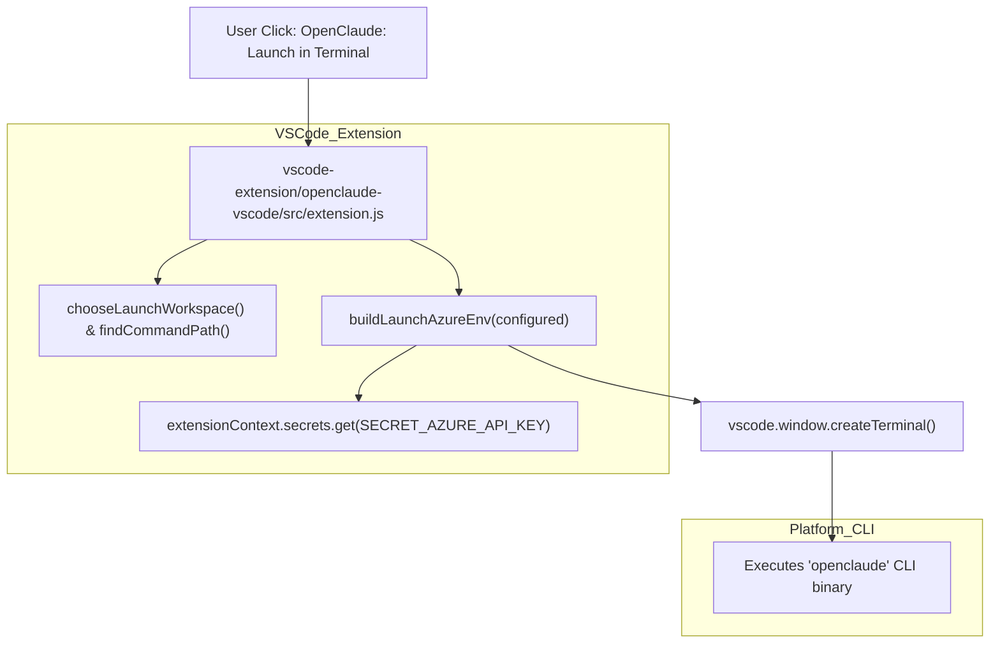
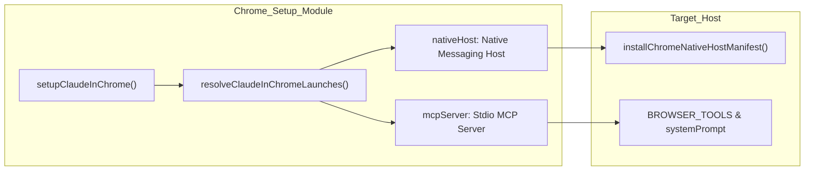

# VS Code Extension & Platform Launchers

<details>
<summary>Relevant source files</summary>

The following files were used as context for generating this wiki page:

- [.github/workflows/install-hygiene.yml](.github/workflows/install-hygiene.yml)
- [SECURITY.md](SECURITY.md)
- [docs/non-technical-setup.md](docs/non-technical-setup.md)
- [docs/quick-start-mac-linux.md](docs/quick-start-mac-linux.md)
- [docs/quick-start-windows.md](docs/quick-start-windows.md)
- [docs/windows-aliases-and-launchers.md](docs/windows-aliases-and-launchers.md)
- [scripts/verify-clean-install.test.ts](scripts/verify-clean-install.test.ts)
- [scripts/verify-clean-install.ts](scripts/verify-clean-install.ts)
- [scripts/windows/openclaude-aliases.ps1](scripts/windows/openclaude-aliases.ps1)
- [src/commands/bughunter-perf/index.ts](src/commands/bughunter-perf/index.ts)
- [src/commands/bughunter-security/index.ts](src/commands/bughunter-security/index.ts)
- [src/commands/bughunter/index.ts](src/commands/bughunter/index.ts)
- [src/commands/createMovedToPluginCommand.ts](src/commands/createMovedToPluginCommand.ts)
- [src/grpc/server.ts](src/grpc/server.ts)
- [src/utils/claudeInChrome/launch.test.ts](src/utils/claudeInChrome/launch.test.ts)
- [src/utils/claudeInChrome/launch.ts](src/utils/claudeInChrome/launch.ts)
- [src/utils/claudeInChrome/setup.ts](src/utils/claudeInChrome/setup.ts)
- [src/utils/claudeInChrome/startup.test.ts](src/utils/claudeInChrome/startup.test.ts)
- [src/utils/cliEntrypoint.ts](src/utils/cliEntrypoint.ts)
- [src/utils/dragDropPaths.test.ts](src/utils/dragDropPaths.test.ts)
- [src/utils/promptShellExecution.test.ts](src/utils/promptShellExecution.test.ts)
- [src/utils/promptShellExecution.ts](src/utils/promptShellExecution.ts)
- [vscode-extension/openclaude-vscode/.vscode/launch.json](vscode-extension/openclaude-vscode/.vscode/launch.json)
- [vscode-extension/openclaude-vscode/README.md](vscode-extension/openclaude-vscode/README.md)
- [vscode-extension/openclaude-vscode/media/openclaude.svg](vscode-extension/openclaude-vscode/media/openclaude.svg)
- [vscode-extension/openclaude-vscode/package.json](vscode-extension/openclaude-vscode/package.json)
- [vscode-extension/openclaude-vscode/src/extension.js](vscode-extension/openclaude-vscode/src/extension.js)

</details>


This page covers the internal workings of the OpenClaude VS Code extension (`openclaude-vscode`), the Windows platform launchers and aliases for CLI convenience, setup guidance for Android/Termux, and integration aspects with Chrome. It details implementation, data flow, and key functions/classes, providing a comprehensive understanding of these platform-specific components.

---

## 9.5.1 Purpose and Scope

OpenClaude supports multiple platforms and usage modes, including a Visual Studio Code extension that acts as a companion to the CLI agent, Windows shell launchers/aliases for user convenience, Android/Termux usage, and "Claude in Chrome" integration. This page explains:

- The structure and internals of the VS Code extension, focusing on launch behavior, configuration, environment injection (notably for Azure), and UI components.
- The role of the Windows aliases and launchers, simplifying terminal startup and environment configuration.
- The basics of Android/Termux setup for running OpenClaude.
- The Chrome integration bootstrapping and configuration.

This is a leaf page, with no subpages. For CLI internals, see section 2; for provider and environment setup, see section 1.

Sources: `docs/quick-start-windows.md:1-209](), [docs/quick-start-mac-linux.md:1-200]()`

---

## 9.5.2 VS Code Extension Internals (`openclaude-vscode`)

### 9.5.2.1 Overview

The VS Code extension named `openclaude-vscode` provides a project-aware control center, terminal launch commands, and chat UI integration tailored to OpenClaude. It facilitates easy launching of OpenClaude sessions in VS Code’s integrated terminal with proper environment variables, Azure OpenAI / Microsoft Foundry environment injection, and status detection based on the workspace profile or environment.

Key components and modules:
- Command registrations and activation events in `vscode-extension/openclaude-vscode/package.json:14-115]()`.
- Main extension logic, environment builder, and wizard commands in `vscode-extension/openclaude-vscode/src/extension.js:1-212()`.

Sources: `vscode-extension/openclaude-vscode/package.json:1-115](), [vscode-extension/openclaude-vscode/src/extension.js:1-212()`

---

### 9.5.2.2 Key Modules & Command Registration

The extension is driven by several key files:
- `vscode-extension/openclaude-vscode/src/extension.js`: Main extension entry point, command bindings, and environment injection [vscode-extension/openclaude-vscode/src/extension.js:1-18]()
- `vscode-extension/openclaude-vscode/src/state.js`: Workspace profile discovery, command path resolution, and path checks [vscode-extension/openclaude-vscode/src/state.js:1-13]()
- `vscode-extension/openclaude-vscode/src/presentation.js`: Control Center view model generator [vscode-extension/openclaude-vscode/src/presentation.js:1-14]()
- `vscode-extension/openclaude-vscode/src/chat/chatProvider.js`: WebView chat provider and controller classes [vscode-extension/openclaude-vscode/src/chat/chatProvider.js:1-18]()

Sources: `vscode-extension/openclaude-vscode/src/extension.js:1-18](), [vscode-extension/openclaude-vscode/package.json:1-43()`

---

### 9.5.2.3 Launch Command & Azure Environment Injection

The extension allows launching OpenClaude sessions in the integrated terminal with a configured launch command (`openclaude.launchCommand`) [vscode-extension/openclaude-vscode/package.json:149-153](). When Microsoft Foundry or Azure OpenAI integration is enabled via configuration, `buildLaunchAzureEnv(configured)` constructs the required environment variables:

```javascript
env.CLAUDE_CODE_USE_OPENAI = '1';
env.OPENAI_BASE_URL = endpoint;
env.OPENAI_API_KEY = apiKey;
env.OPENAI_MODEL = deployment;
env.AZURE_OPENAI_API_VERSION = apiVersion || '2024-12-01-preview';
if (forceStyle) {
  env.OPENAI_AZURE_STYLE = '1';
}
```

This logic is implemented in `vscode-extension/openclaude-vscode/src/extension.js` [vscode-extension/openclaude-vscode/src/extension.js:94-134]().

Sources: `vscode-extension/openclaude-vscode/src/extension.js:94-134](), [vscode-extension/openclaude-vscode/package.json:149-188()`

---

### 9.5.2.4 Secret Storage & Azure Wizard

API keys for Azure are stored securely using VS Code's `SecretStorage` API (`context.secrets`) under the secret key `openclaude.azure.apiKey` [vscode-extension/openclaude-vscode/src/extension.js:22-88](). 

The wizard command `openclaude.configureAzureChat` guides users through input boxes to configure the endpoint, API version, deployment, and API key interactively [vscode-extension/openclaude-vscode/src/extension.js:165-212](). Helper functions `setAzureApiKey` and `clearAzureApiKey` manage individual updates to the secret store [vscode-extension/openclaude-vscode/src/extension.js:139-160]().

Sources: `vscode-extension/openclaude-vscode/src/extension.js:22-160]()`

---

### 9.5.2.5 Status Detection & Profile Awareness

The Control Center view reports workspace health and provider connectivity. It inspects whether `.openclaude-profile.json` exists in the workspace root [vscode-extension/openclaude-vscode/src/extension.js:21-23]() and evaluates command availability via `isCommandAvailable` [vscode-extension/openclaude-vscode/src/extension.js:36-38]().

Sources: `vscode-extension/openclaude-vscode/src/extension.js:21-38]()`

---

### 9.5.2.6 Chat Panel Integration

Chat functionality is provided through webview views (`openclaude.chat`) registered in `package.json` [vscode-extension/openclaude-vscode/package.json:125-131](). It delegates session lifecycle management to `SessionManager` and rendering to `ChatController` and `OpenClaudeChatViewProvider` [vscode-extension/openclaude-vscode/src/extension.js:15-16]().

Sources: `vscode-extension/openclaude-vscode/package.json:125-131](), [vscode-extension/openclaude-vscode/src/extension.js:15-16()`

---

## 9.5.3 Windows Aliases & Launchers

On Windows, OpenClaude provides helper PowerShell aliases and launcher shortcuts (such as `oc`, `oc-init`, `oc-local`, `oc-provider`, and `oc-check`) to abstract environment variable setup (`CLAUDE_CODE_USE_OPENAI`, `OPENAI_API_KEY`, etc.) [docs/quick-start-windows.md:40-61]().

Users install the global npm package and can configure path variables automatically if the global npm bin directory is missing from user PATH variables [docs/quick-start-windows.md:145-160]().

Sources: `docs/quick-start-windows.md:40-160]()`

---

## 9.5.4 Android & Termux Setup

Running OpenClaude on Android via Termux requires Node.js installed inside the Termux environment, followed by global installation via npm:

```bash
npm install -g @twigpine/openclaude@latest
```

Environment variables are passed directly in the Termux shell or loaded via `--provider-env-file` to establish provider connectivity without interactive setup gates.

Sources: `docs/quick-start-mac-linux.md:1-40]()`

---

## 9.5.5 Chrome Integration (`claudeInChrome`)

OpenClaude supports browser integration via the `claudeInChrome` utility package. The setup routine `setupClaudeInChrome()` resolves native host paths, builds execution descriptors (`nativeHost` and `mcpServer`), and registers native messaging host manifests with browser directories [src/utils/claudeInChrome/setup.ts:94-148]().

```typescript
export function setupClaudeInChrome(): {
  mcpConfig: Record<string, ScopedMcpServerConfig>
  allowedTools: string[]
  systemPrompt: string
}
```

The install verification test suite (`scripts/verify-clean-install.ts`) parses these configuration entries to ensure proper native messaging host hookups [scripts/verify-clean-install.ts:82-122]().

Sources: `src/utils/claudeInChrome/setup.ts:94-148](), [scripts/verify-clean-install.ts:82-122()`

---

## 9.5.6 The `openclaude` CLI Launcher Script & Heap Control

The global CLI entry point `bin/openclaude` handles Node.js process bootstrapping, memory heap limits via `bin/heap-limit.mjs`, and garbage collection exposure (`--expose-gc`) before loading the compiled CLI bundle (`dist/cli.mjs`).

Sources: `scripts/verify-clean-install.test.ts:143-152]()`

---

## 9.5.7 Mermaid Diagrams

### Diagram 1: VS Code Launch Workflow to Code Entities
Title: "VS Code Extension Launch Execution Flow"



Sources: `vscode-extension/openclaude-vscode/src/extension.js:36-134]()`

---

### Diagram 2: Chrome Integration Setup and Native Host Routing
Title: "Chrome Integration Setup and Transport Configuration"



Sources: `src/utils/claudeInChrome/setup.ts:94-148]()`

---

## Summary Table: Platform Launchers and Integration Points

| Platform / Component          | Entry Script / Command         | Main Files / Classes                       | Key Features                                    |
|------------------------------|-------------------------------|-------------------------------------------|-------------------------------------------------|
| VS Code Extension            | Activates via `src/extension.js` | `extension.js`, `state.js`, `presentation.js`, chat folder | Control Center, Azure env injection, secret storage, chat UI integration |
| Windows Aliases / Launchers  | PowerShell aliases (`oc`, etc.) | `docs/quick-start-windows.md`             | Simplify CLI launch, env vars setup, helper commands |
| Android / Termux Setup        | Shell environment              | CLI launcher script `bin/openclaude`                            | Node.js runtime setup, CLI launch in Termux    |
| Chrome Integration           | Native host / MCP server       | `src/utils/claudeInChrome/setup.ts`       | Launch config validation, native host / MCP protocol support |
| CLI Launcher Script          | `bin/openclaude`               | Main: `bin/openclaude`, `bin/heap-limit.mjs`                  | Heap size relaunch guard, `--expose-gc` flag, CLI bundle import     |

Sources: `vscode-extension/openclaude-vscode/src/extension.js:1-18](), [src/utils/claudeInChrome/setup.ts:94-148]()`

---

## References & Sources

- VS Code extension internals and commands: `vscode-extension/openclaude-vscode/src/extension.js:1-212`, `package.json:1-198`
- Windows aliases and launchers: `docs/quick-start-windows.md:1-209`
- Chrome integration & setup: `src/utils/claudeInChrome/setup.ts:1-148`, `scripts/verify-clean-install.ts:1-187`
- CLI launcher script and heap relaunch: `scripts/verify-clean-install.test.ts:143-152`