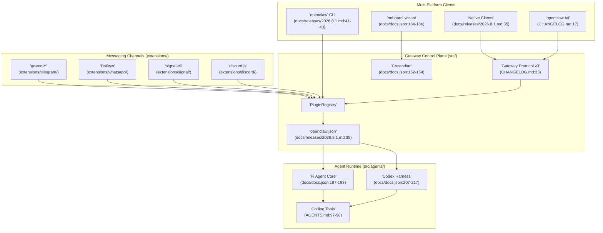
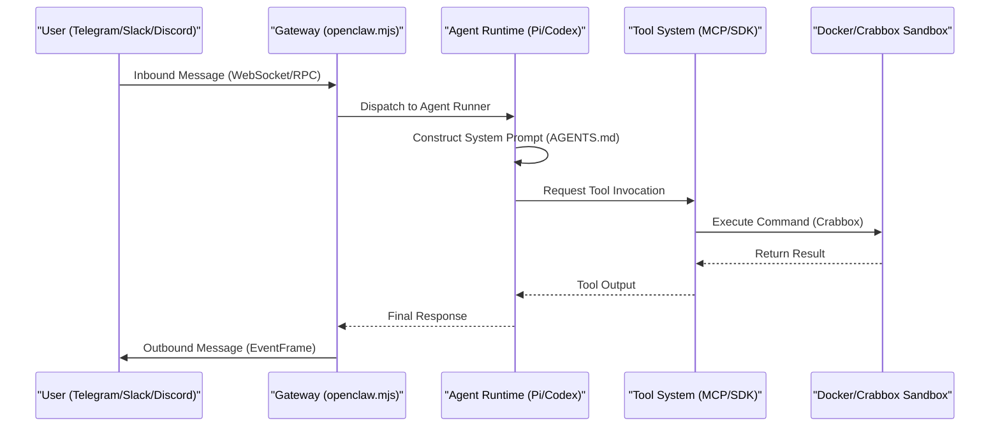

# Overview

<details>
<summary>Relevant source files</summary>

The following files were used as context for generating this wiki page:

- [.agents/skills/auto-qa/SKILL.md](.agents/skills/auto-qa/SKILL.md)
- [.agents/skills/auto-qa/references/live-proof-routing.md](.agents/skills/auto-qa/references/live-proof-routing.md)
- [.agents/skills/control-ui-e2e/SKILL.md](.agents/skills/control-ui-e2e/SKILL.md)
- [.agents/skills/crabbox/SKILL.md](.agents/skills/crabbox/SKILL.md)
- [.agents/skills/openclaw-debugging/SKILL.md](.agents/skills/openclaw-debugging/SKILL.md)
- [.agents/skills/openclaw-pr-maintainer/SKILL.md](.agents/skills/openclaw-pr-maintainer/SKILL.md)
- [.agents/skills/openclaw-pr-maintainer/scripts/github-activity.sh](.agents/skills/openclaw-pr-maintainer/scripts/github-activity.sh)
- [.agents/skills/openclaw-repair-sweep/SKILL.md](.agents/skills/openclaw-repair-sweep/SKILL.md)
- [.agents/skills/openclaw-test-performance/SKILL.md](.agents/skills/openclaw-test-performance/SKILL.md)
- [.agents/skills/openclaw-testing/SKILL.md](.agents/skills/openclaw-testing/SKILL.md)
- [.agents/skills/openclaw-update/SKILL.md](.agents/skills/openclaw-update/SKILL.md)
- [.agents/skills/openclaw-update/agents/openai.yaml](.agents/skills/openclaw-update/agents/openai.yaml)
- [.agents/skills/release-openclaw-plugin-testing/SKILL.md](.agents/skills/release-openclaw-plugin-testing/SKILL.md)
- [.agents/skills/test-audit/SKILL.md](.agents/skills/test-audit/SKILL.md)
- [.agents/skills/update-team-server/SKILL.md](.agents/skills/update-team-server/SKILL.md)
- [.github/CODEOWNERS](.github/CODEOWNERS)
- [.github/labeler.yml](.github/labeler.yml)
- [AGENTS.md](AGENTS.md)
- [CHANGELOG.md](CHANGELOG.md)
- [CONTRIBUTING.md](CONTRIBUTING.md)
- [appcast.xml](appcast.xml)
- [docs/.i18n/glossary.zh-CN.json](docs/.i18n/glossary.zh-CN.json)
- [docs/.i18n/zh-Hans-navigation.json](docs/.i18n/zh-Hans-navigation.json)
- [docs/concepts/memory-architecture.md](docs/concepts/memory-architecture.md)
- [docs/docs.json](docs/docs.json)
- [docs/releases/2026.8.1.md](docs/releases/2026.8.1.md)
- [docs/releases/2026.8.2.md](docs/releases/2026.8.2.md)
- [docs/releases/2026.9.1.md](docs/releases/2026.9.1.md)
- [docs/releases/index.md](docs/releases/index.md)
- [extensions/memory-wiki/skills/wiki-maintainer/SKILL.md](extensions/memory-wiki/skills/wiki-maintainer/SKILL.md)
- [git-hooks/pre-commit](git-hooks/pre-commit)
- [scripts/README.md](scripts/README.md)
- [scripts/github/barnacle-auto-response.mjs](scripts/github/barnacle-auto-response.mjs)
- [scripts/github/dependency-guard.mjs](scripts/github/dependency-guard.mjs)
- [scripts/github/guard-shared.mjs](scripts/github/guard-shared.mjs)
- [scripts/github/security-sensitive-guard.mjs](scripts/github/security-sensitive-guard.mjs)
- [src/agents/internal-runtime-context.test.ts](src/agents/internal-runtime-context.test.ts)
- [src/agents/internal-runtime-context.ts](src/agents/internal-runtime-context.ts)
- [src/auto-reply/tokens.test.ts](src/auto-reply/tokens.test.ts)
- [src/auto-reply/tokens.ts](src/auto-reply/tokens.ts)
- [src/infra/restart-handoff.test.ts](src/infra/restart-handoff.test.ts)
- [test/scripts/barnacle-auto-response.test.ts](test/scripts/barnacle-auto-response.test.ts)
- [test/scripts/dependency-guard-script.test.ts](test/scripts/dependency-guard-script.test.ts)
- [test/scripts/dependency-guard-workflow.test.ts](test/scripts/dependency-guard-workflow.test.ts)
- [test/scripts/docs-sync-publish.test.ts](test/scripts/docs-sync-publish.test.ts)
- [test/scripts/github-activity-helper.test.ts](test/scripts/github-activity-helper.test.ts)
- [test/scripts/security-sensitive-guard-script.test.ts](test/scripts/security-sensitive-guard-script.test.ts)
- [test/scripts/security-sensitive-guard-workflow.test.ts](test/scripts/security-sensitive-guard-workflow.test.ts)

</details>


OpenClaw is a **multi-platform AI gateway** and personal assistant system that orchestrates conversations between messaging channels and AI agents [docs/docs.json:4](). It acts as a central control plane, connecting messaging platforms like WhatsApp, Telegram, Slack, and Discord to advanced AI models, providing a unified interface for AI interaction [docs/docs.json:4]().

The system is powered by the **Pi Agent Core** and includes the **Codex** app-server harness for specialized coding and tool-use workloads [CHANGELOG.md:18-19](). It is designed around a **Personal Assistant Trust Model**, assuming a single trusted operator boundary [AGENTS.md:14](). It enables agents to perform real-world tasks through a rich tool ecosystem, including browser automation, filesystem access, and media understanding [docs/releases/2026.8.1.md:19]().

For installation and first-time setup, see [Getting Started](#1.1). For fundamental mental models, see [Core Concepts](#1.2). For technical details on the build system and cross-platform clients, see [Platform Architecture](#1.3).

Sources: [docs/docs.json:4](), [CHANGELOG.md:18-19](), [AGENTS.md:14](), [docs/releases/2026.8.1.md:19]()

## Core Architecture

OpenClaw is organized as a monorepo using `pnpm` workspaces [CONTRIBUTING.md:50-53](). The Gateway is the central engine that manages the lifecycle of the assistant, configuration validation, and agent execution. The system uses a multi-package structure to separate core logic from platform-specific extensions.

### System Mapping: Natural Language to Code Entities


Sources: [CONTRIBUTING.md:50-53](), [CHANGELOG.md:17-33](), [docs/docs.json:152-217](), [docs/releases/2026.8.1.md:35-43](), [AGENTS.md:97-98]()

## Core Concepts

### Gateway & Agents
The **Gateway** is the always-on control plane. It manages **Agents**, which are execution contexts configured with specific models and workspace defaults. The system maintains a synchronized model catalog for discovery, including support for providers like Anthropic, OpenAI, and Google Gemini [CHANGELOG.md:18-19](). Root rules for agent behavior and repository-wide standing orders are defined in `AGENTS.md` [AGENTS.md:1-5]().

### Sessions & Channels
A **Session** represents a specific conversation thread, now stored in SQLite for continuity [docs/releases/2026.8.1.md:30-32](). **Channels** are transport layers that route messages to the Gateway. OpenClaw supports a wide array of channels including iMessage, Matrix, and Signal [docs/docs.json:4]().

### Skills & Tools
**Tools** are functional capabilities (like shell execution, web search, or browser automation) that the agent can invoke. **Skills** are modular extensions that teach agents how to use these tools for specific domains, defined via `SKILL.md` files [.agents/skills/openclaw-pr-maintainer/SKILL.md:1-4](). The system supports automated tool invocation via the Model Context Protocol (MCP) bridge [docs/docs.json:196-198]().

For a deeper dive into these primitives, see [Core Concepts](#1.2).

Sources: [AGENTS.md:1-5](), [docs/docs.json:4](), [docs/docs.json:196-198](), [docs/releases/2026.8.1.md:30-32](), [CHANGELOG.md:18-19](), [.agents/skills/openclaw-pr-maintainer/SKILL.md:1-4]()

## Multi-Platform Architecture

OpenClaw is built for high portability across desktop, server, and mobile environments. It leverages a shared TypeScript core and native UI components.

| Platform | Role | Technology |
| :--- | :--- | :--- |
| **Server / Desktop** | Core Gateway | Node.js 22.22.2+ [docs/releases/2026.8.1.md:73]() |
| **Web** | Control UI | React / Vite [CHANGELOG.md:21-31]() |
| **Native Clients** | iOS / Android / macOS / Linux | Swift / Kotlin / Tauri [CHANGELOG.md:10-22]() |
| **Container** | Deployment | Docker Multi-arch manifests [docs/releases/2026.8.1.md:51]() |

### Data Flow: Message to Tool Execution


Sources: [docs/releases/2026.8.1.md:51-73](), [CHANGELOG.md:10-31](), [AGENTS.md:1-5](), [.agents/skills/crabbox/SKILL.md:1-5]()

For details on the build system and native integrations, see [Platform Architecture](#1.3).

## Security & Trust

OpenClaw operates on a **Personal Assistant Trust Model**. Because the assistant has access to sensitive local tools (like shell execution), it includes several safety boundaries:
- **Sandboxing**: Docker-based isolation or unprivileged cloud sandboxes like Crabbox [CHANGELOG.md:13]().
- **Audit System**: Diagnostic repair and security hardening via the `doctor` command, which validates configurations and connectivity [CHANGELOG.md:38-48]().
- **Dependency Guard**: Automated security gates that detect and block unauthorized dependency changes in PRs [scripts/github/dependency-guard.mjs:3-25]().

Sources: [CHANGELOG.md:13-48](), [scripts/github/dependency-guard.mjs:3-25]()

## Getting Started

The recommended way to set up OpenClaw is via the interactive onboarding wizard.

```bash
openclaw onboard
```

This command guides you through:
1. **Model Providers**: Configuring API keys for providers like Anthropic, OpenAI, or Google Gemini [CHANGELOG.md:18-19]().
2. **Messaging Channels**: Linking accounts for Telegram, WhatsApp, Discord, or Slack [docs/docs.json:4]().
3. **Workspace Setup**: Initializing the configuration (`openclaw.json`) and agent workspaces [docs/releases/2026.8.1.md:35]().

For a full walkthrough, see [Getting Started](#1.1).

Sources: [CHANGELOG.md:18-19](), [docs/docs.json:4](), [docs/releases/2026.8.1.md:35]()