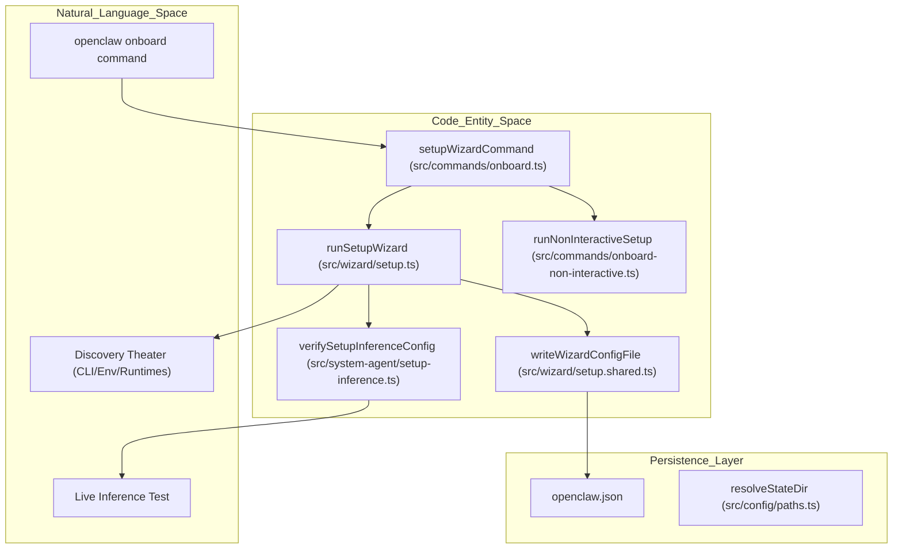
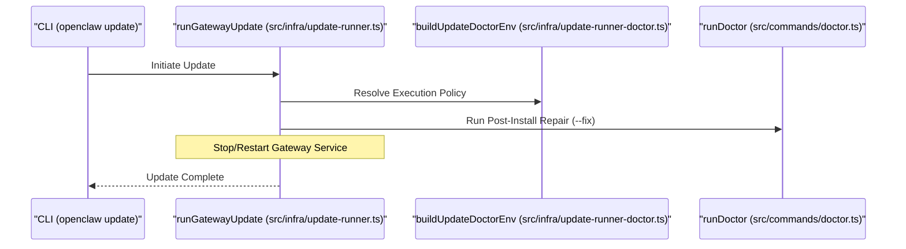

# Getting Started

<details>
<summary>Relevant source files</summary>

The following files were used as context for generating this wiki page:

- [.github/workflows/install-smoke-reusable.yml](.github/workflows/install-smoke-reusable.yml)
- [.github/workflows/install-smoke.yml](.github/workflows/install-smoke.yml)
- [docs/cli/onboard.md](docs/cli/onboard.md)
- [docs/cli/setup.md](docs/cli/setup.md)
- [docs/gateway/remote.md](docs/gateway/remote.md)
- [docs/help/faq-first-run.md](docs/help/faq-first-run.md)
- [docs/install/installer.md](docs/install/installer.md)
- [docs/install/updating.md](docs/install/updating.md)
- [docs/reference/templates/BOOTSTRAP.md](docs/reference/templates/BOOTSTRAP.md)
- [docs/start/onboarding-overview.md](docs/start/onboarding-overview.md)
- [docs/start/wizard-cli-automation.md](docs/start/wizard-cli-automation.md)
- [docs/start/wizard-cli-reference.md](docs/start/wizard-cli-reference.md)
- [docs/start/wizard.md](docs/start/wizard.md)
- [packages/memory-host-sdk/src/host/session-files.test.ts](packages/memory-host-sdk/src/host/session-files.test.ts)
- [packages/memory-host-sdk/src/host/session-files.windows-ownership.test.ts](packages/memory-host-sdk/src/host/session-files.windows-ownership.test.ts)
- [scripts/docker/install-sh-nonroot/run.sh](scripts/docker/install-sh-nonroot/run.sh)
- [scripts/e2e/bun-global-install-smoke.sh](scripts/e2e/bun-global-install-smoke.sh)
- [scripts/e2e/lib/bun-global-install/assertions.mjs](scripts/e2e/lib/bun-global-install/assertions.mjs)
- [scripts/install-cli.sh](scripts/install-cli.sh)
- [scripts/install-smoke-candidate-payload.d.mts](scripts/install-smoke-candidate-payload.d.mts)
- [scripts/install-smoke-candidate-payload.mts](scripts/install-smoke-candidate-payload.mts)
- [scripts/install.ps1](scripts/install.ps1)
- [scripts/install.sh](scripts/install.sh)
- [scripts/test-install-sh-docker.sh](scripts/test-install-sh-docker.sh)
- [src/channels/plugins/setup-wizard-types.ts](src/channels/plugins/setup-wizard-types.ts)
- [src/cli/command-options.test.ts](src/cli/command-options.test.ts)
- [src/cli/command-options.ts](src/cli/command-options.ts)
- [src/cli/program/preaction-agent-owner.test.ts](src/cli/program/preaction-agent-owner.test.ts)
- [src/cli/program/register.onboard.test.ts](src/cli/program/register.onboard.test.ts)
- [src/cli/program/register.onboard.ts](src/cli/program/register.onboard.ts)
- [src/cli/program/register.setup.test.ts](src/cli/program/register.setup.test.ts)
- [src/cli/program/register.setup.ts](src/cli/program/register.setup.ts)
- [src/cli/update-cli/status.ts](src/cli/update-cli/status.ts)
- [src/cli/update-cli/update-command-triage.ts](src/cli/update-cli/update-command-triage.ts)
- [src/commands/auth-choice.apply.api-providers.test.ts](src/commands/auth-choice.apply.api-providers.test.ts)
- [src/commands/auth-choice.apply.ts](src/commands/auth-choice.apply.ts)
- [src/commands/auth-choice.apply.types.ts](src/commands/auth-choice.apply.types.ts)
- [src/commands/auth-choice.model-check.test.ts](src/commands/auth-choice.model-check.test.ts)
- [src/commands/auth-choice.model-check.ts](src/commands/auth-choice.model-check.ts)
- [src/commands/configure.wizard.default-agent.test.ts](src/commands/configure.wizard.default-agent.test.ts)
- [src/commands/configure.wizard.gateway.test.ts](src/commands/configure.wizard.gateway.test.ts)
- [src/commands/configure.wizard.persistence.test.ts](src/commands/configure.wizard.persistence.test.ts)
- [src/commands/configure.wizard.test-support.ts](src/commands/configure.wizard.test-support.ts)
- [src/commands/configure.wizard.test.ts](src/commands/configure.wizard.test.ts)
- [src/commands/configure.wizard.ts](src/commands/configure.wizard.ts)
- [src/commands/dashboard.links.test.ts](src/commands/dashboard.links.test.ts)
- [src/commands/dashboard.ts](src/commands/dashboard.ts)
- [src/commands/doctor-update.test.ts](src/commands/doctor-update.test.ts)
- [src/commands/doctor-update.ts](src/commands/doctor-update.ts)
- [src/commands/gateway-startup-timing.ts](src/commands/gateway-startup-timing.ts)
- [src/commands/onboard-agent-target.test.ts](src/commands/onboard-agent-target.test.ts)
- [src/commands/onboard-agent-target.ts](src/commands/onboard-agent-target.ts)
- [src/commands/onboard-browser-handoff.test.ts](src/commands/onboard-browser-handoff.test.ts)
- [src/commands/onboard-browser-handoff.ts](src/commands/onboard-browser-handoff.ts)
- [src/commands/onboard-custom-config.test.ts](src/commands/onboard-custom-config.test.ts)
- [src/commands/onboard-custom-config.ts](src/commands/onboard-custom-config.ts)
- [src/commands/onboard-custom.test.ts](src/commands/onboard-custom.test.ts)
- [src/commands/onboard-custom.ts](src/commands/onboard-custom.ts)
- [src/commands/onboard-guided-consent.ts](src/commands/onboard-guided-consent.ts)
- [src/commands/onboard-guided.custodian.test-support.ts](src/commands/onboard-guided.custodian.test-support.ts)
- [src/commands/onboard-guided.custom-provider.e2e.test.ts](src/commands/onboard-guided.custom-provider.e2e.test.ts)
- [src/commands/onboard-guided.quickstart.test.ts](src/commands/onboard-guided.quickstart.test.ts)
- [src/commands/onboard-helpers.remote-probe.test.ts](src/commands/onboard-helpers.remote-probe.test.ts)
- [src/commands/onboard-helpers.test.ts](src/commands/onboard-helpers.test.ts)
- [src/commands/onboard-helpers.ts](src/commands/onboard-helpers.ts)
- [src/commands/onboard-helpers.wizard-metadata.test.ts](src/commands/onboard-helpers.wizard-metadata.test.ts)
- [src/commands/onboard-non-interactive.gateway.test-mocks.ts](src/commands/onboard-non-interactive.gateway.test-mocks.ts)
- [src/commands/onboard-non-interactive.gateway.test.ts](src/commands/onboard-non-interactive.gateway.test.ts)
- [src/commands/onboard-non-interactive.ts](src/commands/onboard-non-interactive.ts)
- [src/commands/onboard-non-interactive/api-keys.test.ts](src/commands/onboard-non-interactive/api-keys.test.ts)
- [src/commands/onboard-non-interactive/api-keys.ts](src/commands/onboard-non-interactive/api-keys.ts)
- [src/commands/onboard-non-interactive/local.default-agent.test.ts](src/commands/onboard-non-interactive/local.default-agent.test.ts)
- [src/commands/onboard-non-interactive/local.test-support.ts](src/commands/onboard-non-interactive/local.test-support.ts)
- [src/commands/onboard-non-interactive/local.ts](src/commands/onboard-non-interactive/local.ts)
- [src/commands/onboard-non-interactive/local/auth-choice.test.ts](src/commands/onboard-non-interactive/local/auth-choice.test.ts)
- [src/commands/onboard-non-interactive/local/auth-choice.ts](src/commands/onboard-non-interactive/local/auth-choice.ts)
- [src/commands/onboard-non-interactive/local/daemon-install.ts](src/commands/onboard-non-interactive/local/daemon-install.ts)
- [src/commands/onboard-non-interactive/local/gateway-config.test.ts](src/commands/onboard-non-interactive/local/gateway-config.test.ts)
- [src/commands/onboard-non-interactive/local/gateway-config.ts](src/commands/onboard-non-interactive/local/gateway-config.ts)
- [src/commands/onboard-non-interactive/local/output.ts](src/commands/onboard-non-interactive/local/output.ts)
- [src/commands/onboard-non-interactive/remote.test.ts](src/commands/onboard-non-interactive/remote.test.ts)
- [src/commands/onboard-non-interactive/remote.ts](src/commands/onboard-non-interactive/remote.ts)
- [src/commands/onboard-options.ts](src/commands/onboard-options.ts)
- [src/commands/onboard-types.ts](src/commands/onboard-types.ts)
- [src/commands/onboard.test.ts](src/commands/onboard.test.ts)
- [src/commands/onboard.ts](src/commands/onboard.ts)
- [src/commands/sessions-compact.test.ts](src/commands/sessions-compact.test.ts)
- [src/commands/sessions-compact.ts](src/commands/sessions-compact.ts)
- [src/commands/status.update-channel.test.ts](src/commands/status.update-channel.test.ts)
- [src/commands/status.update.ts](src/commands/status.update.ts)
- [src/config/sessions/artifacts.test.ts](src/config/sessions/artifacts.test.ts)
- [src/config/sessions/artifacts.ts](src/config/sessions/artifacts.ts)
- [src/flows/channel-setup.status.test.ts](src/flows/channel-setup.status.test.ts)
- [src/flows/channel-setup.status.ts](src/flows/channel-setup.status.ts)
- [src/flows/channel-setup.test.ts](src/flows/channel-setup.test.ts)
- [src/flows/channel-setup.ts](src/flows/channel-setup.ts)
- [src/infra/browser-open.test.ts](src/infra/browser-open.test.ts)
- [src/infra/browser-open.ts](src/infra/browser-open.ts)
- [src/infra/package-update-steps.test.ts](src/infra/package-update-steps.test.ts)
- [src/infra/package-update-steps.ts](src/infra/package-update-steps.ts)
- [src/infra/update-channels.test.ts](src/infra/update-channels.test.ts)
- [src/infra/update-channels.ts](src/infra/update-channels.ts)
- [src/infra/update-check-status.test.ts](src/infra/update-check-status.test.ts)
- [src/infra/update-check.test.ts](src/infra/update-check.test.ts)
- [src/infra/update-check.ts](src/infra/update-check.ts)
- [src/infra/update-global.test.ts](src/infra/update-global.test.ts)
- [src/infra/update-global.ts](src/infra/update-global.ts)
- [src/infra/update-runner-git-commands.ts](src/infra/update-runner-git-commands.ts)
- [src/infra/update-runner-git-preflight.ts](src/infra/update-runner-git-preflight.ts)
- [src/infra/update-runner-git-recovery.ts](src/infra/update-runner-git-recovery.ts)
- [src/infra/update-runner-git.ts](src/infra/update-runner-git.ts)
- [src/infra/update-runner.test.ts](src/infra/update-runner.test.ts)
- [src/infra/wsl.ts](src/infra/wsl.ts)
- [src/secrets/ref-contract.ts](src/secrets/ref-contract.ts)
- [src/system-agent/setup-apply.test-harness.ts](src/system-agent/setup-apply.test-harness.ts)
- [src/system-agent/setup-apply.test.ts](src/system-agent/setup-apply.test.ts)
- [src/system-agent/setup-apply.ts](src/system-agent/setup-apply.ts)
- [src/wizard/setup.gateway-config.test.ts](src/wizard/setup.gateway-config.test.ts)
- [src/wizard/setup.gateway-config.ts](src/wizard/setup.gateway-config.ts)
- [src/wizard/setup.migration-import.test.ts](src/wizard/setup.migration-import.test.ts)
- [src/wizard/setup.migration-import.ts](src/wizard/setup.migration-import.ts)
- [src/wizard/setup.migration-promotion.ts](src/wizard/setup.migration-promotion.ts)
- [src/wizard/setup.migration-snapshot.ts](src/wizard/setup.migration-snapshot.ts)
- [src/wizard/setup.migration-stage.test.ts](src/wizard/setup.migration-stage.test.ts)
- [src/wizard/setup.migration-stage.ts](src/wizard/setup.migration-stage.ts)
- [src/wizard/setup.migration-transaction.test.ts](src/wizard/setup.migration-transaction.test.ts)
- [src/wizard/setup.model-auth.test.ts](src/wizard/setup.model-auth.test.ts)
- [src/wizard/setup.model-auth.ts](src/wizard/setup.model-auth.ts)
- [src/wizard/setup.test.ts](src/wizard/setup.test.ts)
- [src/wizard/setup.ts](src/wizard/setup.ts)
- [test/scripts/install-cli.test.ts](test/scripts/install-cli.test.ts)
- [test/scripts/install-npm-fixtures.ts](test/scripts/install-npm-fixtures.ts)
- [test/scripts/install-ps1.test.ts](test/scripts/install-ps1.test.ts)
- [test/scripts/install-sh.test.ts](test/scripts/install-sh.test.ts)
- [test/scripts/install-smoke-candidate-payload.test.ts](test/scripts/install-smoke-candidate-payload.test.ts)
- [test/scripts/install-smoke-no-push-workflow.test.ts](test/scripts/install-smoke-no-push-workflow.test.ts)
- [test/scripts/test-install-sh-docker.test.ts](test/scripts/test-install-sh-docker.test.ts)

</details>


OpenClaw is a personal AI assistant system that runs on your own hardware, serving as a multi-platform AI gateway between your messaging apps and AI agents. This page guides you through installing OpenClaw and performing your initial configuration using the onboarding wizard and diagnostic tools.

---

## Prerequisites

OpenClaw requires **Node.js 24 (recommended)** or **Node.js 22.22.3+** [scripts/install.sh:19-33](). The system is designed to run on **macOS, Linux, and Windows**. The installer verifies the environment and ensures dependencies like `tar` and `curl`/`wget` are available for bootstrapping [scripts/install.sh:109-121]().

On Linux, the installer handles various package managers and ensures the environment is set up for non-interactive repository configuration [scripts/install-cli.sh:74-84](). On Windows, the installer checks for a compatible `node.exe` and can automatically download a portable Node.js runtime if a system-wide installation is missing or outdated [scripts/install.ps1:66-110]().

**Sources:** [scripts/install.sh:19-33](), [scripts/install.sh:109-121](), [scripts/install-cli.sh:74-84](), [scripts/install.ps1:66-110]()

---

## Installation

The primary distribution method is via a shell installer (macOS/Linux) or PowerShell script (Windows). These scripts install the `openclaw` CLI, which serves as the entry point for all management tasks [scripts/install.sh:4-6]().

### macOS and Linux
```bash
# Recommended: Shell installer
curl -fsSL https://openclaw.ai/install.sh | bash
```
The `install.sh` script performs OS detection, bootstraps the `gum` UI tool for an interactive experience, and ensures a supported Node.js binary is active in the shell [scripts/install.sh:187-201](). It includes robust validation for downloaded scripts to ensure they contain a proper shebang (`#!`) before execution to prevent executing malformed responses [scripts/install.sh:154-169]().

For automated environments, `install-cli.sh` provides a non-interactive path that can emit NDJSON events for integration with other provisioning tools [scripts/install-cli.sh:101-112]().

### Windows
```powershell
# PowerShell installer
powershell -c "irm https://openclaw.ai/install.ps1 | iex"
```
The `install.ps1` script handles Windows-specific setup, including resolving a usable temporary directory for extraction while handling long path limitations [scripts/install.ps1:124-189](). It configures the environment for global installs and supports parameters for dry runs or specific release tags [scripts/install.ps1:5-15]().

**Sources:** [scripts/install.sh:4-6](), [scripts/install.sh:154-169](), [scripts/install.sh:187-201](), [scripts/install-cli.sh:101-112](), [scripts/install.ps1:5-15](), [scripts/install.ps1:124-189]()

---

## Onboarding Wizard & Configuration

The recommended setup path is the onboarding flow, which is triggered automatically if no configuration is detected or via `openclaw onboard` [src/commands/onboard.ts:2-6](). The wizard populates `openclaw.json` through the `runSetupWizard` function [src/wizard/setup.ts:58-67]().

### Guided Onboarding & Inference Discovery
The onboarding system attempts to discover existing AI access automatically. It looks for local runtimes (like Ollama or LM Studio), API keys in environment variables, and supported CLIs. The `setupWizardCommand` validates flags and routes to either `runInteractiveSetup` or `runNonInteractiveSetup` based on the `--non-interactive` flag [src/commands/onboard.ts:195-204]().

**Onboarding Logic & Inference Discovery Flow**


**Sources:** [src/commands/onboard.ts:2-6](), [src/wizard/setup.ts:58-67](), [src/commands/onboard.ts:195-204](), [src/config/paths.ts:10]()

---

## Workspace Setup & Gateway Health

OpenClaw configures a workspace directory (defaulting to `~/.openclaw/workspace`) to house agent memory, skills, and session data [src/commands/onboard.ts:45]().

### Gateway Health Verification
In non-interactive modes, OpenClaw performs a post-setup health check to ensure the gateway is reachable and responding with the configured authentication [src/commands/onboard-non-interactive.gateway.test.ts:48-54](). If the health check fails, the system provides specific "Fix" hints, such as suggesting `openclaw gateway restart` [src/commands/onboard-non-interactive.gateway.test.ts:141-153]().

### Update Runner & Lifecycle
The `runGatewayUpdate` function handles system updates, ensuring that the gateway service is stopped, the environment is preflighted, and the service is restarted following an install [src/infra/update-runner.ts:17-21](). It utilizes `resolveUpdateDoctorExecutionPolicy` to determine if auto-repair should be attempted during the update lifecycle [src/infra/update-runner.ts:58-66]().

**Gateway Update & Lifecycle Management**


**Sources:** [src/commands/onboard-non-interactive.gateway.test.ts:48-54](), [src/commands/onboard-non-interactive.gateway.test.ts:141-153](), [src/commands/onboard.ts:45](), [src/infra/update-runner.ts:17-21](), [src/infra/update-runner.ts:58-66]()

---

## First Interaction

### 1. Verify Installation
Confirm the CLI is correctly installed and accessible:
```bash
openclaw --version
```

### 2. Start the Gateway
Run the gateway to start the central control plane.
```bash
openclaw gateway run
```

### 3. Interactive Setup
If you skipped onboarding during installation, trigger it manually to configure your first agent and model provider.
```bash
openclaw onboard
```

### 4. Testing Capabilities
Test specific AI capabilities directly from the CLI using the Terminal UI (TUI).
```bash
# Start the Terminal UI
openclaw chat
```

**Sources:** [src/commands/onboard.ts:47](), [src/cli/program/register.onboard.ts:1-10]()