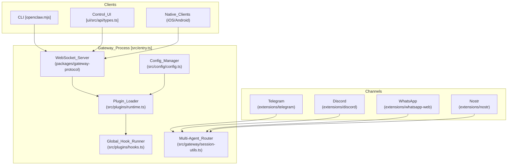
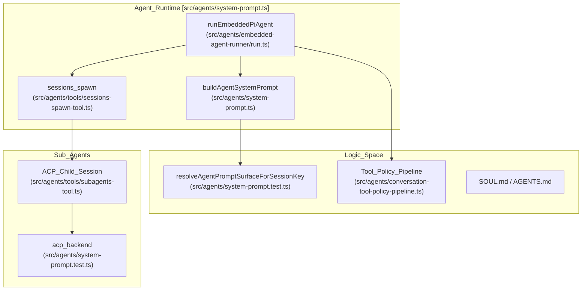

# Core Concepts

Relevant source files

The following files were used as context for generating this wiki page:

- [.agents/skills/openclaw-update/SKILL.md](.agents/skills/openclaw-update/SKILL.md)
- [.agents/skills/openclaw-update/agents/openai.yaml](.agents/skills/openclaw-update/agents/openai.yaml)
- [.agents/skills/update-team-server/SKILL.md](.agents/skills/update-team-server/SKILL.md)
- [.github/labeler.yml](.github/labeler.yml)
- [CHANGELOG.md](CHANGELOG.md)
- [appcast.xml](appcast.xml)
- [custodian-skills/add-model-provider/SKILL.md](custodian-skills/add-model-provider/SKILL.md)
- [custodian-skills/cloud-image-bake/SKILL.md](custodian-skills/cloud-image-bake/SKILL.md)
- [custodian-skills/configure-channel/SKILL.md](custodian-skills/configure-channel/SKILL.md)
- [custodian-skills/diagnose-gateway/SKILL.md](custodian-skills/diagnose-gateway/SKILL.md)
- [docs/.i18n/glossary.zh-CN.json](docs/.i18n/glossary.zh-CN.json)
- [docs/.i18n/zh-Hans-navigation.json](docs/.i18n/zh-Hans-navigation.json)
- [docs/channels/telegram.md](docs/channels/telegram.md)
- [docs/cli/channels.md](docs/cli/channels.md)
- [docs/cli/daemon.md](docs/cli/daemon.md)
- [docs/cli/dashboard.md](docs/cli/dashboard.md)
- [docs/cli/doctor.md](docs/cli/doctor.md)
- [docs/cli/gateway.md](docs/cli/gateway.md)
- [docs/concepts/memory-architecture.md](docs/concepts/memory-architecture.md)
- [docs/docs.json](docs/docs.json)
- [docs/releases/2026.8.1.md](docs/releases/2026.8.1.md)
- [docs/releases/2026.8.2.md](docs/releases/2026.8.2.md)
- [docs/releases/2026.9.1.md](docs/releases/2026.9.1.md)
- [docs/releases/index.md](docs/releases/index.md)
- [docs/tools/custodian-skills.md](docs/tools/custodian-skills.md)
- [packages/normalization-core/src/error-coercion.test.ts](packages/normalization-core/src/error-coercion.test.ts)
- [packages/normalization-core/src/error-coercion.ts](packages/normalization-core/src/error-coercion.ts)
- [scripts/github/barnacle-auto-response.mjs](scripts/github/barnacle-auto-response.mjs)
- [skills/healthcheck/SKILL.md](skills/healthcheck/SKILL.md)
- [src/agents/internal-runtime-context.test.ts](src/agents/internal-runtime-context.test.ts)
- [src/agents/internal-runtime-context.ts](src/agents/internal-runtime-context.ts)
- [src/agents/live-model-errors.test.ts](src/agents/live-model-errors.test.ts)
- [src/auto-reply/tokens.test.ts](src/auto-reply/tokens.test.ts)
- [src/auto-reply/tokens.ts](src/auto-reply/tokens.ts)
- [src/cli/daemon-cli/probe.reachability.test.ts](src/cli/daemon-cli/probe.reachability.test.ts)
- [src/cli/daemon-cli/probe.test.ts](src/cli/daemon-cli/probe.test.ts)
- [src/cli/daemon-cli/probe.ts](src/cli/daemon-cli/probe.ts)
- [src/cli/daemon-cli/register-service-commands.test.ts](src/cli/daemon-cli/register-service-commands.test.ts)
- [src/cli/daemon-cli/register-service-commands.ts](src/cli/daemon-cli/register-service-commands.ts)
- [src/cli/daemon-cli/types.ts](src/cli/daemon-cli/types.ts)
- [src/cli/dns-cli.test.ts](src/cli/dns-cli.test.ts)
- [src/cli/dns-cli.ts](src/cli/dns-cli.ts)
- [src/cli/gateway-cli.coverage.test.ts](src/cli/gateway-cli.coverage.test.ts)
- [src/cli/gateway-cli/register.option-collisions.test.ts](src/cli/gateway-cli/register.option-collisions.test.ts)
- [src/cli/gateway-cli/register.ts](src/cli/gateway-cli/register.ts)
- [src/cli/gateway-cli/suspend-cli.test.ts](src/cli/gateway-cli/suspend-cli.test.ts)
- [src/cli/gateway-cli/suspend-cli.ts](src/cli/gateway-cli/suspend-cli.ts)
- [src/cli/program/routed-command-definitions.ts](src/cli/program/routed-command-definitions.ts)
- [src/commands/gateway-health-auth-diagnostic.ts](src/commands/gateway-health-auth-diagnostic.ts)
- [src/commands/gateway-readiness.test.ts](src/commands/gateway-readiness.test.ts)
- [src/commands/gateway-readiness.ts](src/commands/gateway-readiness.ts)
- [src/commands/gateway-status.test.ts](src/commands/gateway-status.test.ts)
- [src/commands/gateway-status.ts](src/commands/gateway-status.ts)
- [src/commands/gateway-status/helpers.ts](src/commands/gateway-status/helpers.ts)
- [src/commands/gateway-status/probe-run.ts](src/commands/gateway-status/probe-run.ts)
- [src/gateway/call.test.ts](src/gateway/call.test.ts)
- [src/gateway/call.ts](src/gateway/call.ts)
- [src/gateway/client.ts](src/gateway/client.ts)
- [src/gateway/connection-details.ts](src/gateway/connection-details.ts)
- [src/gateway/probe.test.ts](src/gateway/probe.test.ts)
- [src/gateway/probe.ts](src/gateway/probe.ts)
- [src/infra/restart-handoff.test.ts](src/infra/restart-handoff.test.ts)
- [src/infra/sqlite-user-version.ts](src/infra/sqlite-user-version.ts)
- [src/infra/state-migrations.exec-approvals.test.ts](src/infra/state-migrations.exec-approvals.test.ts)
- [src/infra/state-migrations.exec-approvals.ts](src/infra/state-migrations.exec-approvals.ts)
- [src/infra/widearea-dns.boundary.test.ts](src/infra/widearea-dns.boundary.test.ts)
- [src/infra/widearea-dns.test.ts](src/infra/widearea-dns.test.ts)
- [src/infra/widearea-dns.ts](src/infra/widearea-dns.ts)
- [test/scripts/barnacle-auto-response.test.ts](test/scripts/barnacle-auto-response.test.ts)
- [test/scripts/docs-sync-publish.test.ts](test/scripts/docs-sync-publish.test.ts)
- [ui/src/components/channel-avatar.ts](ui/src/components/channel-avatar.ts)

This page explains the fundamental building blocks of OpenClaw: the Gateway, Agents, Sessions, Channels, Tools, Skills, and the personal assistant trust model. Understanding these concepts is essential for configuring and operating OpenClaw effectively.

---

## Gateway

The Gateway is OpenClaw's central control plane—a Node.js server that coordinates all communication between clients, channels, agents, and tools. It serves as the single point of entry for managing configuration, sessions, and multi-platform messaging.

### Gateway Architecture

The Gateway acts as the traffic controller, routing inbound messages from various platform adapters to the appropriate agent runtime. It is responsible for loading plugins, managing the configuration lifecycle, and maintaining the global hook runner.

Title: "Gateway Entity Mapping"

**Key Gateway responsibilities:**

| Responsibility | Implementation | File Reference |
|----------------|----------------|-------------|
| Plugin Loading | Manifest discovery and runtime registration | [src/plugins/runtime.ts:11-11]() |
| Multi-agent Routing | Mapping channel peers to specific agent instances | [src/gateway/session-utils.ts:22-22]() |
| Session Management | Loading and migrating session store keys | [src/gateway/session-utils.ts:21-21]() |
| RPC Invocation | Auth-resolved request handling via `GatewayClient` | [src/gateway/call.ts:1-65]() |
| Health Monitoring | Live `probeAccount` and `auditAccount` checks | [docs/cli/channels.md:62-64]() |

**Crestodian & Delegate Architecture**
OpenClaw handles "configless-safe" setups via the **Crestodian** helper (aliased to the `openclaw` CLI), which assists with initial pairing and repair [docs/docs.json:152-154](). For organizational deployments, the **delegate architecture** allows agents to act on behalf of humans. The **Doctor** system provides health-check and auto-repair capabilities for gateway daemons and state integrity, supporting postures like `--fix` and `--lint` [docs/cli/doctor.md:9-42]().

**Sources:** [src/gateway/session-utils.ts:1-33](), [src/gateway/call.ts:1-114](), [docs/cli/doctor.md:1-61](), [docs/cli/channels.md:33-68]()

---

## Agents

An agent is an isolated runtime context. OpenClaw supports multiple agent runtimes, primarily the high-performance **Pi (Embedded)** runtime and the **Codex** engine.

Title: "Agent Execution and ACP Flow"

**Agent Execution Lifecycle:**
1. **Pre-flight:** The system resolves the appropriate agent ID and workspace directory.
2. **System Prompt Construction:** The `buildAgentSystemPrompt` function assembles runtime, workspace, tooling, and cache-boundary sections [src/agents/system-prompt.ts:1-5]().
3. **Execution:** The execution pipeline handles model selection, provider authentication rotation, and tool calls. Runtime switching supports models like `muse-spark-1.1` across OpenClaw and Codex engines [CHANGELOG.md:18-19]().
4. **Sub-agents:** Agents can spawn child agents for specialized tasks using the **Agent Control Protocol (ACP)** via the `sessions_spawn` tool [src/agents/system-prompt.ts:129-144]().

**Repair Doctrine:**
Agents follow a "Root-cause repair" doctrine, defined in `AGENTS.md`. This mandates that agents personally inspect source code before rendering verdicts or proposing fixes.

**Sources:** [src/agents/system-prompt.ts:1-176](), [CHANGELOG.md:18-19](), [docs/docs.json:200-222]()

---

## Sessions

A session is the conversation state boundary. OpenClaw uses a flexible session scoping model, persisting state as transcripts and metadata.

### Session Scoping
OpenClaw supports several session scoping modes:
- **`per-channel-peer`**: The default scope where each user has a private conversation.
- **`shared`**: A session shared across multiple participants in a channel.
- **`global`**: A system-wide session context.

**Session State Management:**
The configuration system manages session lifecycle and compaction.
- **SQLite Storage:** In v2026.8.1+, sessions and transcripts are stored in SQLite for improved continuity and performance [docs/releases/2026.8.1.md:30-32]().
- **Compaction:** Context window management that summarizes history to prevent token overflow.
- **Dead Letters:** Failed inbound channel events are retained in the shared state database for inspection and resubmission via `openclaw channels dead-letters` [docs/cli/channels.md:72-89]().

**Sources:** [docs/releases/2026.8.1.md:27-33](), [docs/cli/channels.md:70-98](), [src/gateway/session-utils.ts:1-33]()

---

## Channels

Channels are the messaging surfaces that connect to the Gateway. OpenClaw supports a wide array of platforms including Telegram, Discord, Slack, Signal, and WhatsApp.

**Channel Architecture:**
Channels are implemented as extensions that handle platform-specific events and route them to the Gateway. Recent updates introduced a shared plugin SDK monitor for durable admission, polling, and shutdown lifecycle management [CHANGELOG.md:16-16]().

**Message Flow:**
1. **Ingress:** Platform events (DMs, mentions) are normalized. Telegram, for example, supports both long polling and webhook modes [docs/channels/telegram.md:8-9]().
2. **Resolution:** The Gateway resolves the target agent and session key based on `dmPolicy` (e.g., `pairing`, `allowlist`, or `open`) [docs/channels/telegram.md:155-164]().
3. **Egress:** Replies are delivered back to the source channel. Slack now utilizes native assistant thread status and rotating loading messages [CHANGELOG.md:23-23]().

**Sources:** [docs/channels/telegram.md:1-165](), [CHANGELOG.md:16-23](), [docs/cli/channels.md:1-56]()

---

## Tools & Skills

**Tools:**
Tools allow agents to interact with the system.
- **Coding Tools:** Core tools provide file system access and shell execution.
- **Skill Workshop:** The `skill_workshop` tool allows agents to learn from experience, creating or updating skills based on successful interactions [src/agents/system-prompt.ts:62-64]().
- **Browser Automation:** Agents use tools for web search and fetching, including a browser audio input caret in the Control UI [CHANGELOG.md:24-24]().

**Skills:**
Skills are modular capability definitions stored in `SKILL.md` format.
- **Managed Skills:** OpenClaw includes bundled skills for gateway diagnostics, channel configuration, and model provider management [docs/tools/custodian-skills.md:1-6]().
- **Logbook:** A specialized plugin turns node screen snapshots into a private timeline for daily standups and grounded Q&A [CHANGELOG.md:27-27]().

**Sources:** [src/agents/system-prompt.ts:62-64](), [CHANGELOG.md:24-27](), [docs/tools/custodian-skills.md:1-6]()

---

## Trust Model

OpenClaw is designed as a **personal AI assistant**, operating under a "One trust boundary per gateway" model.

1. **Single Operator:** The system assumes the person running the Gateway is the authorized administrator.
2. **Conservative Defaults:** Binding beyond loopback without authentication is blocked by default [docs/cli/gateway.md:39-39]().
3. **Authorization Scopes:** Access is governed by operator scopes (e.g., `ADMIN_SCOPE`, `WRITE_SCOPE`) to enforce least privilege [src/gateway/call.ts:90-96]().
4. **Pairing:** Telegram and other channels use a pairing flow to approve new direct message interactions [docs/channels/telegram.md:53-63]().
5. **Secret Integrity:** The `SecretRef` system handles credentials, and the Doctor reports degradation when owners are cold or stale [docs/cli/doctor.md:15-15]().

**Sources:** [src/gateway/call.ts:90-186](), [docs/cli/gateway.md:33-43](), [docs/cli/doctor.md:13-17](), [docs/channels/telegram.md:53-63]()