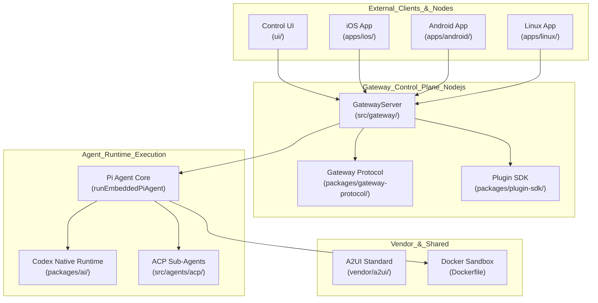
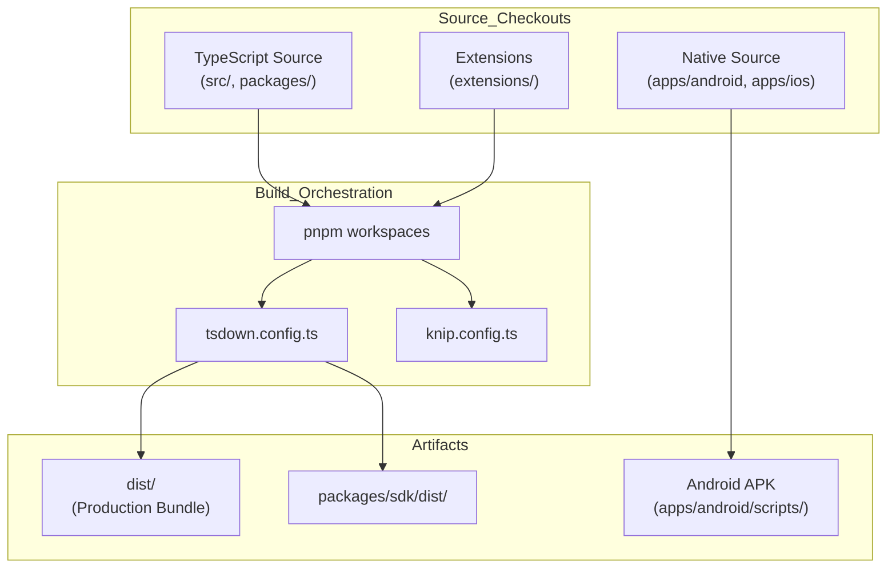

# Platform Architecture

Relevant source files

The following files were used as context for generating this wiki page:

- [.github/release/vercel-cli/package-lock.json](.github/release/vercel-cli/package-lock.json)
- [.github/release/vercel-cli/package.json](.github/release/vercel-cli/package.json)
- [.github/workflows/authorized-beta-focused-validation.yml](.github/workflows/authorized-beta-focused-validation.yml)
- [.github/workflows/docker-image-refresh.yml](.github/workflows/docker-image-refresh.yml)
- [.github/workflows/docker-release.yml](.github/workflows/docker-release.yml)
- [.github/workflows/vercel-container-registry-publish.yml](.github/workflows/vercel-container-registry-publish.yml)
- [Dockerfile](Dockerfile)
- [apps/.i18n/native-source.json](apps/.i18n/native-source.json)
- [apps/android/README.md](apps/android/README.md)
- [apps/android/THIRD_PARTY_LICENSES/openclaw/licenses/AndroidX Room.txt](apps/android/THIRD_PARTY_LICENSES/openclaw/licenses/AndroidX Room.txt)
- [apps/android/THIRD_PARTY_LICENSES/openclaw/licenses/AndroidX SQLite.txt](apps/android/THIRD_PARTY_LICENSES/openclaw/licenses/AndroidX SQLite.txt)
- [apps/android/app/src/main/assets/katex/README.md](apps/android/app/src/main/assets/katex/README.md)
- [apps/android/app/src/main/assets/katex/katex.min.css](apps/android/app/src/main/assets/katex/katex.min.css)
- [apps/android/app/src/main/assets/katex/katex.min.js](apps/android/app/src/main/assets/katex/katex.min.js)
- [apps/android/app/src/main/java/ai/openclaw/app/AndroidScreenshotFixture.kt](apps/android/app/src/main/java/ai/openclaw/app/AndroidScreenshotFixture.kt)
- [apps/android/app/src/main/java/ai/openclaw/app/MainViewModel.kt](apps/android/app/src/main/java/ai/openclaw/app/MainViewModel.kt)
- [apps/android/app/src/main/java/ai/openclaw/app/NodeRuntime.kt](apps/android/app/src/main/java/ai/openclaw/app/NodeRuntime.kt)
- [apps/android/app/src/main/java/ai/openclaw/app/PermissionRequester.kt](apps/android/app/src/main/java/ai/openclaw/app/PermissionRequester.kt)
- [apps/android/app/src/main/java/ai/openclaw/app/chat/ChatCommandOutbox.kt](apps/android/app/src/main/java/ai/openclaw/app/chat/ChatCommandOutbox.kt)
- [apps/android/app/src/main/java/ai/openclaw/app/chat/ChatController.kt](apps/android/app/src/main/java/ai/openclaw/app/chat/ChatController.kt)
- [apps/android/app/src/main/java/ai/openclaw/app/chat/ChatModels.kt](apps/android/app/src/main/java/ai/openclaw/app/chat/ChatModels.kt)
- [apps/android/app/src/main/java/ai/openclaw/app/chat/ChatQuestion.kt](apps/android/app/src/main/java/ai/openclaw/app/chat/ChatQuestion.kt)
- [apps/android/app/src/main/java/ai/openclaw/app/chat/ChatTranscriptCache.kt](apps/android/app/src/main/java/ai/openclaw/app/chat/ChatTranscriptCache.kt)
- [apps/android/app/src/main/java/ai/openclaw/app/chat/ClientDatabases.kt](apps/android/app/src/main/java/ai/openclaw/app/chat/ClientDatabases.kt)
- [apps/android/app/src/main/java/ai/openclaw/app/node/ConnectionManager.kt](apps/android/app/src/main/java/ai/openclaw/app/node/ConnectionManager.kt)
- [apps/android/app/src/main/java/ai/openclaw/app/node/InvokeDispatcher.kt](apps/android/app/src/main/java/ai/openclaw/app/node/InvokeDispatcher.kt)
- [apps/android/app/src/main/java/ai/openclaw/app/node/NotificationsHandler.kt](apps/android/app/src/main/java/ai/openclaw/app/node/NotificationsHandler.kt)
- [apps/android/app/src/main/java/ai/openclaw/app/node/SystemHandler.kt](apps/android/app/src/main/java/ai/openclaw/app/node/SystemHandler.kt)
- [apps/android/app/src/main/java/ai/openclaw/app/ui/AgentPicker.kt](apps/android/app/src/main/java/ai/openclaw/app/ui/AgentPicker.kt)
- [apps/android/app/src/main/java/ai/openclaw/app/ui/OnboardingFlow.kt](apps/android/app/src/main/java/ai/openclaw/app/ui/OnboardingFlow.kt)
- [apps/android/app/src/main/java/ai/openclaw/app/ui/SessionsScreen.kt](apps/android/app/src/main/java/ai/openclaw/app/ui/SessionsScreen.kt)
- [apps/android/app/src/main/java/ai/openclaw/app/ui/SettingsScreens.kt](apps/android/app/src/main/java/ai/openclaw/app/ui/SettingsScreens.kt)
- [apps/android/app/src/main/java/ai/openclaw/app/ui/ShellNavigation.kt](apps/android/app/src/main/java/ai/openclaw/app/ui/ShellNavigation.kt)
- [apps/android/app/src/main/java/ai/openclaw/app/ui/ShellScreen.kt](apps/android/app/src/main/java/ai/openclaw/app/ui/ShellScreen.kt)
- [apps/android/app/src/main/java/ai/openclaw/app/ui/SidebarComponents.kt](apps/android/app/src/main/java/ai/openclaw/app/ui/SidebarComponents.kt)
- [apps/android/app/src/main/java/ai/openclaw/app/ui/SidebarContent.kt](apps/android/app/src/main/java/ai/openclaw/app/ui/SidebarContent.kt)
- [apps/android/app/src/main/java/ai/openclaw/app/ui/SystemAgentSettingsScreen.kt](apps/android/app/src/main/java/ai/openclaw/app/ui/SystemAgentSettingsScreen.kt)
- [apps/android/app/src/main/java/ai/openclaw/app/ui/WorkspaceFilesScreen.kt](apps/android/app/src/main/java/ai/openclaw/app/ui/WorkspaceFilesScreen.kt)
- [apps/android/app/src/main/java/ai/openclaw/app/ui/chat/ChatDictation.kt](apps/android/app/src/main/java/ai/openclaw/app/ui/chat/ChatDictation.kt)
- [apps/android/app/src/main/java/ai/openclaw/app/ui/chat/ChatMessageActions.kt](apps/android/app/src/main/java/ai/openclaw/app/ui/chat/ChatMessageActions.kt)
- [apps/android/app/src/main/java/ai/openclaw/app/ui/chat/ChatMessageDisclosure.kt](apps/android/app/src/main/java/ai/openclaw/app/ui/chat/ChatMessageDisclosure.kt)
- [apps/android/app/src/main/java/ai/openclaw/app/ui/chat/ChatQuestionCard.kt](apps/android/app/src/main/java/ai/openclaw/app/ui/chat/ChatQuestionCard.kt)
- [apps/android/app/src/main/java/ai/openclaw/app/ui/chat/ChatScreen.kt](apps/android/app/src/main/java/ai/openclaw/app/ui/chat/ChatScreen.kt)
- [apps/android/app/src/main/java/ai/openclaw/app/ui/chat/ChatSystemRows.kt](apps/android/app/src/main/java/ai/openclaw/app/ui/chat/ChatSystemRows.kt)
- [apps/android/app/src/main/java/ai/openclaw/app/ui/chat/ChatTimeline.kt](apps/android/app/src/main/java/ai/openclaw/app/ui/chat/ChatTimeline.kt)
- [apps/android/app/src/main/java/ai/openclaw/app/ui/design/ClawComponents.kt](apps/android/app/src/main/java/ai/openclaw/app/ui/design/ClawComponents.kt)
- [apps/android/app/src/main/java/ai/openclaw/app/ui/design/MascotAnimator.kt](apps/android/app/src/main/java/ai/openclaw/app/ui/design/MascotAnimator.kt)
- [apps/android/app/src/test/java/ai/openclaw/app/AndroidLicenseNoticesTest.kt](apps/android/app/src/test/java/ai/openclaw/app/AndroidLicenseNoticesTest.kt)
- [apps/android/app/src/test/java/ai/openclaw/app/AndroidScreenshotFixtureRuntimeTest.kt](apps/android/app/src/test/java/ai/openclaw/app/AndroidScreenshotFixtureRuntimeTest.kt)
- [apps/android/app/src/test/java/ai/openclaw/app/AndroidScreenshotFixtureTest.kt](apps/android/app/src/test/java/ai/openclaw/app/AndroidScreenshotFixtureTest.kt)
- [apps/android/app/src/test/java/ai/openclaw/app/AppLanguageTest.kt](apps/android/app/src/test/java/ai/openclaw/app/AppLanguageTest.kt)
- [apps/android/app/src/test/java/ai/openclaw/app/PermissionRequesterTest.kt](apps/android/app/src/test/java/ai/openclaw/app/PermissionRequesterTest.kt)
- [apps/android/app/src/test/java/ai/openclaw/app/chat/ChatControllerBranchCoordinationTest.kt](apps/android/app/src/test/java/ai/openclaw/app/chat/ChatControllerBranchCoordinationTest.kt)
- [apps/android/app/src/test/java/ai/openclaw/app/chat/ChatControllerCommandControlsTest.kt](apps/android/app/src/test/java/ai/openclaw/app/chat/ChatControllerCommandControlsTest.kt)
- [apps/android/app/src/test/java/ai/openclaw/app/chat/ChatControllerMessageIdentityTest.kt](apps/android/app/src/test/java/ai/openclaw/app/chat/ChatControllerMessageIdentityTest.kt)
- [apps/android/app/src/test/java/ai/openclaw/app/chat/ChatControllerOutboxTest.kt](apps/android/app/src/test/java/ai/openclaw/app/chat/ChatControllerOutboxTest.kt)
- [apps/android/app/src/test/java/ai/openclaw/app/chat/ChatControllerProgressCardTest.kt](apps/android/app/src/test/java/ai/openclaw/app/chat/ChatControllerProgressCardTest.kt)
- [apps/android/app/src/test/java/ai/openclaw/app/chat/ChatControllerReconnectRestoreTest.kt](apps/android/app/src/test/java/ai/openclaw/app/chat/ChatControllerReconnectRestoreTest.kt)
- [apps/android/app/src/test/java/ai/openclaw/app/chat/ChatControllerSessionActionsTest.kt](apps/android/app/src/test/java/ai/openclaw/app/chat/ChatControllerSessionActionsTest.kt)
- [apps/android/app/src/test/java/ai/openclaw/app/chat/ChatControllerTranscriptCacheTest.kt](apps/android/app/src/test/java/ai/openclaw/app/chat/ChatControllerTranscriptCacheTest.kt)
- [apps/android/app/src/test/java/ai/openclaw/app/chat/ChatMessageContentParsingTest.kt](apps/android/app/src/test/java/ai/openclaw/app/chat/ChatMessageContentParsingTest.kt)
- [apps/android/app/src/test/java/ai/openclaw/app/chat/ChatQuestionTest.kt](apps/android/app/src/test/java/ai/openclaw/app/chat/ChatQuestionTest.kt)
- [apps/android/app/src/test/java/ai/openclaw/app/chat/ChatReplayHarness.kt](apps/android/app/src/test/java/ai/openclaw/app/chat/ChatReplayHarness.kt)
- [apps/android/app/src/test/java/ai/openclaw/app/chat/ClientDatabasesTest.kt](apps/android/app/src/test/java/ai/openclaw/app/chat/ClientDatabasesTest.kt)
- [apps/android/app/src/test/java/ai/openclaw/app/chat/RoomChatCommandOutboxTest.kt](apps/android/app/src/test/java/ai/openclaw/app/chat/RoomChatCommandOutboxTest.kt)
- [apps/android/app/src/test/java/ai/openclaw/app/chat/RoomChatTranscriptCacheTest.kt](apps/android/app/src/test/java/ai/openclaw/app/chat/RoomChatTranscriptCacheTest.kt)
- [apps/android/app/src/test/java/ai/openclaw/app/node/ConnectionManagerTest.kt](apps/android/app/src/test/java/ai/openclaw/app/node/ConnectionManagerTest.kt)
- [apps/android/app/src/test/java/ai/openclaw/app/node/InvokeDispatcherTest.kt](apps/android/app/src/test/java/ai/openclaw/app/node/InvokeDispatcherTest.kt)
- [apps/android/app/src/test/java/ai/openclaw/app/node/SystemHandlerTest.kt](apps/android/app/src/test/java/ai/openclaw/app/node/SystemHandlerTest.kt)
- [apps/android/app/src/test/java/ai/openclaw/app/ui/AgentPickerTest.kt](apps/android/app/src/test/java/ai/openclaw/app/ui/AgentPickerTest.kt)
- [apps/android/app/src/test/java/ai/openclaw/app/ui/InitialOnboardingLayoutTest.kt](apps/android/app/src/test/java/ai/openclaw/app/ui/InitialOnboardingLayoutTest.kt)
- [apps/android/app/src/test/java/ai/openclaw/app/ui/OnboardingFlowLogicTest.kt](apps/android/app/src/test/java/ai/openclaw/app/ui/OnboardingFlowLogicTest.kt)
- [apps/android/app/src/test/java/ai/openclaw/app/ui/SessionsScreenDescendantSignalsTest.kt](apps/android/app/src/test/java/ai/openclaw/app/ui/SessionsScreenDescendantSignalsTest.kt)
- [apps/android/app/src/test/java/ai/openclaw/app/ui/SessionsScreenGroupingTest.kt](apps/android/app/src/test/java/ai/openclaw/app/ui/SessionsScreenGroupingTest.kt)
- [apps/android/app/src/test/java/ai/openclaw/app/ui/SettingsDetailInsetsTest.kt](apps/android/app/src/test/java/ai/openclaw/app/ui/SettingsDetailInsetsTest.kt)
- [apps/android/app/src/test/java/ai/openclaw/app/ui/ShellScreenLogicTest.kt](apps/android/app/src/test/java/ai/openclaw/app/ui/ShellScreenLogicTest.kt)
- [apps/android/app/src/test/java/ai/openclaw/app/ui/SidebarShellLogicTest.kt](apps/android/app/src/test/java/ai/openclaw/app/ui/SidebarShellLogicTest.kt)
- [apps/android/app/src/test/java/ai/openclaw/app/ui/SystemAnimationsTest.kt](apps/android/app/src/test/java/ai/openclaw/app/ui/SystemAnimationsTest.kt)
- [apps/android/app/src/test/java/ai/openclaw/app/ui/chat/ChatComposerLayoutTest.kt](apps/android/app/src/test/java/ai/openclaw/app/ui/chat/ChatComposerLayoutTest.kt)
- [apps/android/app/src/test/java/ai/openclaw/app/ui/chat/ChatContextMeterTest.kt](apps/android/app/src/test/java/ai/openclaw/app/ui/chat/ChatContextMeterTest.kt)
- [apps/android/app/src/test/java/ai/openclaw/app/ui/chat/ChatMessageViewsTest.kt](apps/android/app/src/test/java/ai/openclaw/app/ui/chat/ChatMessageViewsTest.kt)
- [apps/android/app/src/test/java/ai/openclaw/app/ui/chat/ChatQuestionDraftLayoutTest.kt](apps/android/app/src/test/java/ai/openclaw/app/ui/chat/ChatQuestionDraftLayoutTest.kt)
- [apps/android/app/src/test/java/ai/openclaw/app/ui/chat/ChatScreenTest.kt](apps/android/app/src/test/java/ai/openclaw/app/ui/chat/ChatScreenTest.kt)
- [apps/android/app/src/test/java/ai/openclaw/app/ui/chat/ChatTimelineTest.kt](apps/android/app/src/test/java/ai/openclaw/app/ui/chat/ChatTimelineTest.kt)
- [config/knip.config.ts](config/knip.config.ts)
- [config/knip.scripts-exports.config.ts](config/knip.scripts-exports.config.ts)
- [docs/gateway/security/secure-file-operations.md](docs/gateway/security/secure-file-operations.md)
- [docs/platforms/android.md](docs/platforms/android.md)
- [extensions/canvas/openclaw.plugin.json](extensions/canvas/openclaw.plugin.json)
- [extensions/canvas/src/config.test.ts](extensions/canvas/src/config.test.ts)
- [extensions/canvas/src/config.ts](extensions/canvas/src/config.ts)
- [extensions/google-meet/index.create.test.ts](extensions/google-meet/index.create.test.ts)
- [extensions/google-meet/index.test.ts](extensions/google-meet/index.test.ts)
- [extensions/google-meet/src/plugin-schema.ts](extensions/google-meet/src/plugin-schema.ts)
- [extensions/google-meet/src/runtime.owner-selection.test.ts](extensions/google-meet/src/runtime.owner-selection.test.ts)
- [extensions/google-meet/src/runtime.ts](extensions/google-meet/src/runtime.ts)
- [extensions/google-meet/src/test-support/fixtures.test-helpers.ts](extensions/google-meet/src/test-support/fixtures.test-helpers.ts)
- [extensions/google-meet/src/transports/chrome.test.ts](extensions/google-meet/src/transports/chrome.test.ts)
- [extensions/google-meet/src/transports/chrome.ts](extensions/google-meet/src/transports/chrome.ts)
- [extensions/google-meet/test-api.ts](extensions/google-meet/test-api.ts)
- [extensions/linux-node/src/config.test.ts](extensions/linux-node/src/config.test.ts)
- [extensions/linux-node/src/config.ts](extensions/linux-node/src/config.ts)
- [extensions/matrix/src/matrix/send.test.ts](extensions/matrix/src/matrix/send.test.ts)
- [extensions/matrix/src/matrix/send/client.ts](extensions/matrix/src/matrix/send/client.ts)
- [extensions/memory-lancedb/config.test.ts](extensions/memory-lancedb/config.test.ts)
- [extensions/openai/test-support/provider-catalog.contract-test-support.ts](extensions/openai/test-support/provider-catalog.contract-test-support.ts)
- [extensions/qa-lab/package.json](extensions/qa-lab/package.json)
- [extensions/synology-chat/src/test-http-utils.ts](extensions/synology-chat/src/test-http-utils.ts)
- [pnpm-lock.yaml](pnpm-lock.yaml)
- [pnpm-workspace.yaml](pnpm-workspace.yaml)
- [scripts/authorized-beta-focused-policy.json](scripts/authorized-beta-focused-policy.json)
- [scripts/docker-channel-promote.mjs](scripts/docker-channel-promote.mjs)
- [scripts/lib/docker-manifest-error.mjs](scripts/lib/docker-manifest-error.mjs)
- [scripts/lib/docker-release-policy.mjs](scripts/lib/docker-release-policy.mjs)
- [scripts/lib/state-schema-inline-plugin.mts](scripts/lib/state-schema-inline-plugin.mts)
- [scripts/lib/tsdown-declaration-generator-inputs.mts](scripts/lib/tsdown-declaration-generator-inputs.mts)
- [scripts/lib/tsdown-declaration-inputs.mts](scripts/lib/tsdown-declaration-inputs.mts)
- [scripts/lib/vitest-resource-reporter.mts](scripts/lib/vitest-resource-reporter.mts)
- [scripts/lib/windows-cmd-helpers-runtime.mts](scripts/lib/windows-cmd-helpers-runtime.mts)
- [scripts/lib/worker-deploy-build-plugin.mts](scripts/lib/worker-deploy-build-plugin.mts)
- [scripts/materialize-vercel-cli.sh](scripts/materialize-vercel-cli.sh)
- [scripts/prune-docker-plugin-dist.mjs](scripts/prune-docker-plugin-dist.mjs)
- [scripts/validate-authorized-beta-focused-evidence.d.mts](scripts/validate-authorized-beta-focused-evidence.d.mts)
- [scripts/validate-authorized-beta-focused-evidence.mts](scripts/validate-authorized-beta-focused-evidence.mts)
- [scripts/vercel-container-registry-publish.mjs](scripts/vercel-container-registry-publish.mjs)
- [scripts/verify-authorized-beta-focused-candidate.mjs](scripts/verify-authorized-beta-focused-candidate.mjs)
- [scripts/write-unified-entry-dts.ts](scripts/write-unified-entry-dts.ts)
- [src/agents/embedded-agent-runner/model-resolution.ts](src/agents/embedded-agent-runner/model-resolution.ts)
- [src/agents/embedded-agent-runner/run/model-setup.ts](src/agents/embedded-agent-runner/run/model-setup.ts)
- [src/agents/mcp-tool-metadata.test.ts](src/agents/mcp-tool-metadata.test.ts)
- [src/agents/mcp-tool-metadata.ts](src/agents/mcp-tool-metadata.ts)
- [src/agents/tools-effective-inventory.cold-provider.test.ts](src/agents/tools-effective-inventory.cold-provider.test.ts)
- [src/agents/tools-effective-inventory.runtime-model.test.ts](src/agents/tools-effective-inventory.runtime-model.test.ts)
- [src/agents/tools-effective-inventory.ts](src/agents/tools-effective-inventory.ts)
- [src/dockerfile.test.ts](src/dockerfile.test.ts)
- [src/node-host/invoke-mcp-result.test.ts](src/node-host/invoke-mcp-result.test.ts)
- [src/node-host/invoke-mcp-result.ts](src/node-host/invoke-mcp-result.ts)
- [src/node-host/invoke.test-support.ts](src/node-host/invoke.test-support.ts)
- [src/plugins/prune-docker-plugin-dist.test.ts](src/plugins/prune-docker-plugin-dist.test.ts)
- [src/shared/json-schema-defaults.test.ts](src/shared/json-schema-defaults.test.ts)
- [src/shared/json-schema-defaults.ts](src/shared/json-schema-defaults.ts)
- [test/scripts/authorized-beta-focused-evidence.test.ts](test/scripts/authorized-beta-focused-evidence.test.ts)
- [test/scripts/check-deadcode-exports.test.ts](test/scripts/check-deadcode-exports.test.ts)
- [test/scripts/declaration-stage.test.ts](test/scripts/declaration-stage.test.ts)
- [test/scripts/docker-channel-promote.test.ts](test/scripts/docker-channel-promote.test.ts)
- [test/scripts/docker-release-policy.test.ts](test/scripts/docker-release-policy.test.ts)
- [test/scripts/tsdown-config.test.ts](test/scripts/tsdown-config.test.ts)
- [test/scripts/tsdown-declaration-fixture.ts](test/scripts/tsdown-declaration-fixture.ts)
- [test/scripts/vercel-container-registry-publish.test.ts](test/scripts/vercel-container-registry-publish.test.ts)
- [test/scripts/worker-deploy-build-plugin.test.ts](test/scripts/worker-deploy-build-plugin.test.ts)
- [test/tsconfig/tsconfig.core.test.ui-e2e.json](test/tsconfig/tsconfig.core.test.ui-e2e.json)
- [test/tsconfig/tsconfig.core.test.ui-pages.json](test/tsconfig/tsconfig.core.test.ui-pages.json)
- [tsdown.config.ts](tsdown.config.ts)
- [ui/package.json](ui/package.json)

## Purpose and Scope

This document provides a high-level architectural overview of OpenClaw, explaining how the major subsystems interact to deliver a self-hosted multi-platform AI gateway. It covers the core Node.js gateway, native clients (iOS/Android/macOS/Linux), Docker-based sandboxing, and the cross-platform build system.

OpenClaw is designed as a **hub-and-spoke** system where the central Gateway coordinates agent execution, messaging channels, and native device nodes.

---

## Architectural Overview

The architecture is centered around the **Gateway Control Plane**, which manages state, routing, and communication between various clients and the agent runtime.

### System Components Diagram

The following diagram maps high-level system components to their corresponding entities in the codebase.

**Sources:** [pnpm-workspace.yaml:1-6](), [apps/android/app/src/main/java/ai/openclaw/app/NodeRuntime.kt:42-53](), [tsdown.config.ts:180-184]()

---

## Core Platform Subsystems

### 1. Gateway Control Plane
The Gateway is a Node.js-based server, serving as the central orchestration point.

*   **Entry Point:** The production entry point for the unified worker is managed via `tsdown` configuration, targeting `src/worker/worker-deploy-entry.ts` [tsdown.config.ts:180-184]().
*   **Protocol:** Communication is governed by a unified protocol. The `protocol-gen.ts` script generates the checked-in native protocol models from core descriptor metadata to ensure cross-platform parity [config/knip.config.ts:106-107]().
*   **Plugin SDK:** Extensibility is provided via the Plugin SDK, which defines entrypoints for public and production-grade extensions [tsdown.config.ts:13-18]().
*   **Lifecycle Management:** The system includes a dedicated `docker-healthcheck.js` to monitor the Gateway service within containerized environments [src/dockerfile.test.ts:40-44]().

**Sources:** [tsdown.config.ts:13-18](), [tsdown.config.ts:180-184](), [config/knip.config.ts:106-107](), [src/dockerfile.test.ts:40-44]()

### 2. Native Clients and Device Nodes
Native applications provide the primary user interface and local device integration. They act as "Device Nodes" that can contribute capabilities back to the gateway.

*   **Android Companion:** A Jetpack Compose application [apps/android/app/src/main/java/ai/openclaw/app/ui/chat/ChatScreen.kt:106-112](). It coordinates gateway interaction via `GatewaySession` and manages local device capabilities through handlers like `CameraHandler`, `LocationHandler`, and `SmsHandler` within the `NodeRuntime` [apps/android/app/src/main/java/ai/openclaw/app/NodeRuntime.kt:53-53](), [apps/android/app/src/main/java/ai/openclaw/app/NodeRuntime.kt:75-91]().
*   **Wear OS:** A companion that uses the paired phone's authenticated connection. It supports realtime Talk streaming microphone audio over the Wear OS Data Layer [docs/platforms/android.md:41-43]().
*   **Cross-Platform Localization:** Native apps share a common i18n pipeline. Localization strings are extracted from Kotlin and Swift sources into `apps/.i18n/native-source.json`, which tracks entries by surface and source file path [apps/.i18n/native-source.json:1-9]().

**Sources:** [apps/android/app/src/main/java/ai/openclaw/app/NodeRuntime.kt:53-53](), [apps/android/app/src/main/java/ai/openclaw/app/NodeRuntime.kt:75-91](), [apps/android/app/src/main/java/ai/openclaw/app/ui/chat/ChatScreen.kt:106-112](), [apps/.i18n/native-source.json:1-9](), [docs/platforms/android.md:41-43]()

### 3. Agent Runtime and Execution
The runtime environment supports multiple execution backends and tool execution environments.

*   **Pi Agent Core:** The primary execution pipeline. The `ChatController` on clients coordinates with the Gateway to handle session mutations like rewinding or forking [apps/android/app/src/test/java/ai/openclaw/app/chat/ChatControllerBranchCoordinationTest.kt:104-127]().
*   **Codex:** A native harness for coding tasks. The system manages specific version overrides for Codex and OpenAI SDKs to maintain stability [pnpm-lock.yaml:108-111]().
*   **Tool Execution:** Tools can interact with the physical environment. On Android, the `InvokeDispatcher` routes these requests to specific native handlers [apps/android/app/src/main/java/ai/openclaw/app/NodeRuntime.kt:72-81]().
*   **Sandboxing:** Secure execution is provided via a multi-stage Docker build. The runtime image uses `bookworm-slim` and includes `tini` as an init process to manage signal forwarding and zombie reaping [Dockerfile:10-17](), [src/dockerfile.test.ts:117-132]().

**Sources:** [pnpm-lock.yaml:108-111](), [apps/android/app/src/main/java/ai/openclaw/app/NodeRuntime.kt:72-81](), [apps/android/app/src/test/java/ai/openclaw/app/chat/ChatControllerBranchCoordinationTest.kt:104-127](), [Dockerfile:10-17](), [src/dockerfile.test.ts:117-132]()

---

## Build and Release Architecture

OpenClaw employs a cross-platform build system centered around `tsdown` for Node.js and platform-specific orchestrators for native apps.

### Build Pipeline Diagram

*   **Orchestration:** `pnpm workspaces` manages the monorepo dependencies and build order [pnpm-workspace.yaml:1-6]().
*   **Dependency Hygiene:** `knip` is used to audit production dependencies and ensure that repository scripts and build entries are correctly tracked [config/knip.config.ts:1-16]().
*   **Containerization:** The `Dockerfile` uses a multi-stage approach to separate dependency installation from the final build, optimizing layer caching. It supports building specific extensions via `OPENCLAW_EXTENSIONS` build arguments [Dockerfile:1-11]().
*   **Versioning:** The system uses CalVer for releases. The `worker-deploy-entry` embeds the version string directly into the build [tsdown.config.ts:62-64](), [tsdown.config.ts:187-190]().

**Sources:** [pnpm-workspace.yaml:1-6](), [config/knip.config.ts:1-16](), [tsdown.config.ts:62-64](), [tsdown.config.ts:187-190](), [Dockerfile:1-11]()

---

## Asset Management and Extensions

### Bundled Assets
*   **Vendor Components:** The system includes a script `bundle-a2ui.mts` to consume and bundle the A2UI open standard for rich UI rendering [config/knip.config.ts:22-22]().
*   **Native UI Artifacts:** Localization data for native apps is stored in `apps/.i18n/` and processed into the `native-source.json` manifest [apps/.i18n/native-source.json:1-3]().
*   **Chrome Extension:** Assets for browser integration are bundled and consumed by the Gateway's browser automation services.

### Extension Consumption
*   **Plugins:** Manifest-driven and located in `extensions/`. The build system uses `collectBundledPluginBuildEntries` to dynamically discover and build these packages [tsdown.config.ts:6-11]().
*   **Plugin Discovery:** The `docker-plugin-selection.mjs` script manages which plugins are included in a specific Docker build, allowing for modular runtime images [Dockerfile:38-39](), [Dockerfile:51-56]().
*   **QA Lab:** Scenario packs and QA assets are stored under `extensions/qa-lab/` for automated platform validation [pnpm-workspace.yaml:5-5]().

**Sources:** [tsdown.config.ts:6-11](), [config/knip.config.ts:22-22](), [apps/.i18n/native-source.json:1-3](), [Dockerfile:38-39](), [Dockerfile:51-56](), [pnpm-workspace.yaml:5-5]()