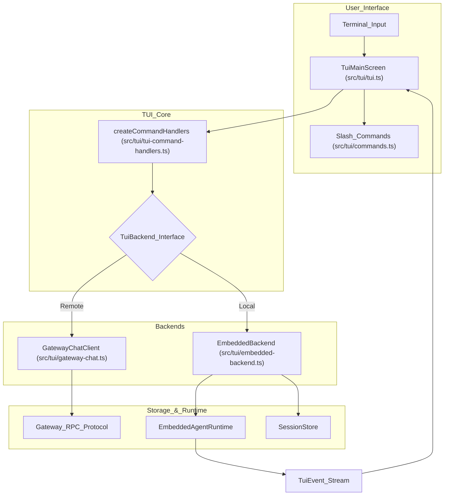
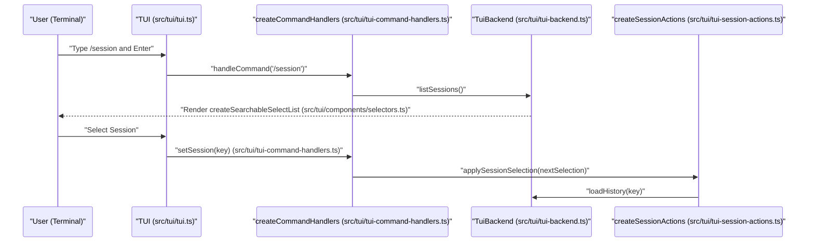

# Terminal UI (TUI)

Relevant source files

The following files were used as context for generating this wiki page:

- [docs/web/tui.md](docs/web/tui.md)
- [packages/terminal-core/src/ansi-sequences.ts](packages/terminal-core/src/ansi-sequences.ts)
- [packages/terminal-core/src/ansi.test.ts](packages/terminal-core/src/ansi.test.ts)
- [packages/terminal-core/src/ansi.ts](packages/terminal-core/src/ansi.ts)
- [packages/terminal-core/src/display-string.test.ts](packages/terminal-core/src/display-string.test.ts)
- [packages/terminal-core/src/display-string.ts](packages/terminal-core/src/display-string.ts)
- [packages/terminal-core/src/safe-text.test.ts](packages/terminal-core/src/safe-text.test.ts)
- [packages/terminal-core/src/safe-text.ts](packages/terminal-core/src/safe-text.ts)
- [packages/terminal-core/src/stream-writer.test.ts](packages/terminal-core/src/stream-writer.test.ts)
- [packages/terminal-core/src/table.test.ts](packages/terminal-core/src/table.test.ts)
- [packages/terminal-core/src/table.ts](packages/terminal-core/src/table.ts)
- [src/agents/sandbox/fs-paths.test.ts](src/agents/sandbox/fs-paths.test.ts)
- [src/agents/sandbox/fs-paths.ts](src/agents/sandbox/fs-paths.ts)
- [src/infra/home-display.ts](src/infra/home-display.ts)
- [src/infra/vitest-e2e-config.test.ts](src/infra/vitest-e2e-config.test.ts)
- [src/tui/commands.test.ts](src/tui/commands.test.ts)
- [src/tui/commands.ts](src/tui/commands.ts)
- [src/tui/components/filterable-select-list.test.ts](src/tui/components/filterable-select-list.test.ts)
- [src/tui/components/filterable-select-list.ts](src/tui/components/filterable-select-list.ts)
- [src/tui/components/hyperlink-markdown.test.ts](src/tui/components/hyperlink-markdown.test.ts)
- [src/tui/components/hyperlink-markdown.ts](src/tui/components/hyperlink-markdown.ts)
- [src/tui/components/searchable-select-list.test.ts](src/tui/components/searchable-select-list.test.ts)
- [src/tui/components/searchable-select-list.ts](src/tui/components/searchable-select-list.ts)
- [src/tui/components/tool-execution.test.ts](src/tui/components/tool-execution.test.ts)
- [src/tui/components/tool-execution.ts](src/tui/components/tool-execution.ts)
- [src/tui/osc8-hyperlinks.test.ts](src/tui/osc8-hyperlinks.test.ts)
- [src/tui/osc8-hyperlinks.ts](src/tui/osc8-hyperlinks.ts)
- [src/tui/tui-command-handlers.test.ts](src/tui/tui-command-handlers.test.ts)
- [src/tui/tui-command-handlers.ts](src/tui/tui-command-handlers.ts)
- [src/tui/tui-event-handlers.test.ts](src/tui/tui-event-handlers.test.ts)
- [src/tui/tui-event-handlers.ts](src/tui/tui-event-handlers.ts)
- [src/tui/tui-hyperlinks-pty.e2e.test.ts](src/tui/tui-hyperlinks-pty.e2e.test.ts)
- [src/tui/tui-picker-cancel-pty.e2e.test.ts](src/tui/tui-picker-cancel-pty.e2e.test.ts)
- [src/tui/tui-pty-command-surfaces-test-support.ts](src/tui/tui-pty-command-surfaces-test-support.ts)
- [src/tui/tui-pty-harness-assertion-test-support.ts](src/tui/tui-pty-harness-assertion-test-support.ts)
- [src/tui/tui-pty-harness-fixture-test-support.ts](src/tui/tui-pty-harness-fixture-test-support.ts)
- [src/tui/tui-pty-harness.e2e.test.ts](src/tui/tui-pty-harness.e2e.test.ts)
- [src/tui/tui-pty-reconnect-fixture-test-support.ts](src/tui/tui-pty-reconnect-fixture-test-support.ts)
- [src/tui/tui-pty-reconnect-test-support.ts](src/tui/tui-pty-reconnect-test-support.ts)
- [src/tui/tui-pty-rendering-test-support.ts](src/tui/tui-pty-rendering-test-support.ts)
- [src/tui/tui-run-lifecycle.ts](src/tui/tui-run-lifecycle.ts)
- [src/tui/tui-session-actions.test.ts](src/tui/tui-session-actions.test.ts)
- [src/tui/tui-session-actions.ts](src/tui/tui-session-actions.ts)
- [src/tui/tui-session-identity-pty.e2e.test.ts](src/tui/tui-session-identity-pty.e2e.test.ts)
- [src/tui/tui-session-run-coordinator.test.ts](src/tui/tui-session-run-coordinator.test.ts)
- [src/tui/tui-session-run-coordinator.ts](src/tui/tui-session-run-coordinator.ts)
- [src/tui/tui-types.ts](src/tui/tui-types.ts)
- [src/tui/tui.ts](src/tui/tui.ts)
- [test/vitest/vitest.test-shards.d.mts](test/vitest/vitest.test-shards.d.mts)
- [test/vitest/vitest.test-shards.mjs](test/vitest/vitest.test-shards.mjs)
- [test/vitest/vitest.tui-pty.config.ts](test/vitest/vitest.tui-pty.config.ts)

The OpenClaw Terminal UI (TUI) provides a high-performance, terminal-native interface for interacting with AI agents. It serves as a lightweight alternative to the browser-based Control UI, supporting both remote Gateway connections and a local "embedded" mode for configless operation.

## Overview

The TUI is invoked via the CLI using `openclaw tui` or its alias `openclaw chat` [docs/web/tui.md:22-45](). It supports real-time streaming, slash commands, session navigation, and advanced terminal features like PTY (Pseudo-Terminal) integration for interactive tool execution. The core loop and coordination between the backend, input, and rendering are managed in `src/tui/tui.ts` [src/tui/tui.ts:1-11]().

### Key Capabilities
*   **Dual Modes**: Operates as a remote client to an `openclaw serve` instance or as a standalone local environment using the `EmbeddedBackend` [docs/web/tui.md:11-43]().
*   **Session Navigation**: Quick switching between agent sessions and historical transcripts, leveraging session key resolution and last-session memory [src/tui/tui.ts:67-72]().
*   **Command Palette**: A keyboard-driven interface for system commands and agent configuration, implemented via `createCommandHandlers` [src/tui/tui-command-handlers.ts:115-142]().
*   **Rich Rendering**: Support for markdown, tool call expansion, and progress indicators within terminal constraints using the `@earendil-works/pi-tui` library [src/tui/tui.ts:4-11]().
*   **PTY Support**: Native integration for terminal-based tools, allowing agents to execute commands in a managed pseudo-terminal environment [src/tui/tui.ts:8]().

## Architecture & Backend

The TUI implementation follows a decoupled architecture where the UI logic is separated from the communication backend. The TUI logic is primarily housed in `src/tui/`.

### TUI Backend Architecture
The TUI interacts with a `TuiBackend` interface [src/tui/tui-backend.ts:36](), which abstracts the underlying communication layer.

1.  **Gateway Backend**: Represented by `GatewayChatClient`, this backend connects via WebSocket to a running OpenClaw Gateway using the standard Gateway Protocol v3.
2.  **Embedded Backend**: Implements the backend for local sessions, bootstrapping an agent runtime directly within the TUI process. It interacts with local session storage via `loadSessionEntry` and `listSessionsFromStoreAsync`.

### Data Flow Diagram: TUI Execution

**Sources:** [src/tui/tui.ts:1-12](), [src/tui/tui-backend.ts:36](), [src/tui/tui-command-handlers.ts:115-120](), [docs/web/tui.md:11-47]()

## Interface Components

### Command Palette & Slash Commands
The TUI implements a registry of slash commands in `src/tui/commands.ts` [src/tui/commands.ts:51](). These commands are handled by `createCommandHandlers`, which dispatches actions to the backend [src/tui/tui-command-handlers.ts:115]().

*   **Model Selection**: The `/model` command triggers a model selector overlay, fetching available models via `client.listModels()` [src/tui/tui-command-handlers.ts:138]().
*   **Session Management**: Commands like `/reset` or `/new` invoke `client.resetSession()` or `client.createSession()` [src/tui/tui-command-handlers.ts:140-146]().
*   **Auth Flow**: In local mode, `/auth` allows users to log into model providers using `resolveLocalAuthSpawnInvocation` [src/tui/tui.ts:160-170]().
*   **Thinking Level**: Users can adjust agent reasoning depth using commands like `/think`, which update the session state [src/tui/tui-command-handlers.ts:11-14]().

### PTY & Local Shell Support
The TUI supports interactive terminal sessions (PTY) for tools that require shell access. This is exercised by the TUI PTY harness which validates terminal output and rendering [src/tui/tui-pty-harness.e2e.test.ts:1-4]().

*   **Local Shell Runner**: Managed by `createLocalShellRunner`, allowing the agent to execute commands in the user's local environment [src/tui/tui.ts:73]().
*   **PTY Testing**: Real-world PTY paths against local and Gateway backends are exercised in `src/tui/tui-pty-local.e2e.test.ts`. It uses `startPty` [src/tui/tui-pty-harness-fixture-test-support.ts:20-40]() to verify terminal behavior.

### Diagram: TUI Message Flow (Code Entity Mapping)

This diagram maps terminal interactions to the specific functions and classes in the codebase that handle them.

**Sources:** [src/tui/tui.ts:52-85](), [src/tui/tui-command-handlers.ts:115-141](), [src/tui/tui-session-actions.ts:91-123](), [src/tui/tui-backend.ts:36](), [src/tui/tui-command-handlers.ts:33-35]()

## TUI vs. Control UI

While both interfaces utilize the same Gateway methods, the TUI is optimized for terminal-specific workflows and local-first execution. The TUI utilizes `packages/terminal-core/src/table.ts` for structured data display [packages/terminal-core/src/table.ts:8-23]().

| Feature | Terminal UI (TUI) | Control UI (Browser) |
| :--- | :--- | :--- |
| **Backend** | Supports local mode via embedded runtime [docs/web/tui.md:35-47]() | Requires `openclaw serve` |
| **Input Mode** | Optimized for `stdin` and slash commands [src/tui/commands.ts:51-52]() | Web-based rich text input |
| **Auth Flow** | Uses `resolveLocalAuthSpawnInvocation` [src/tui/tui.ts:160]() | Uses browser-based OAuth flows |
| **Shell Access** | Native PTY support via `createLocalShellRunner` [src/tui/tui.ts:73]() | Web-based terminal emulator |

### Implementation Detail: Session Key Resolution
The TUI resolves session keys based on the current agent and workspace context. It uses `resolveRememberedTuiSessionKey` to determine if a session should be restored from a previous run [src/tui/tui.ts:70]().

Key functions in `src/tui/tui.ts` for session state:
*   `readTuiLastSessionKey`: Recalls the last used session key from the state directory [src/tui/tui.ts:69]().
*   `writeTuiLastSessionKey`: Persists the current session key for future TUI invocations [src/tui/tui.ts:71]().
*   `resolveAgentIdByWorkspacePath`: Infers the agent from the current working directory (CWD) [src/tui/tui.ts:16]().

**Sources:**
- `src/tui/tui.ts` [src/tui/tui.ts:1-170]()
- `src/tui/tui-command-handlers.ts` [src/tui/tui-command-handlers.ts:1-192]()
- `src/tui/tui-session-actions.ts` [src/tui/tui-session-actions.ts:1-185]()
- `packages/terminal-core/src/table.ts` [packages/terminal-core/src/table.ts:1-202]()
- `docs/web/tui.md` [docs/web/tui.md:1-152]()