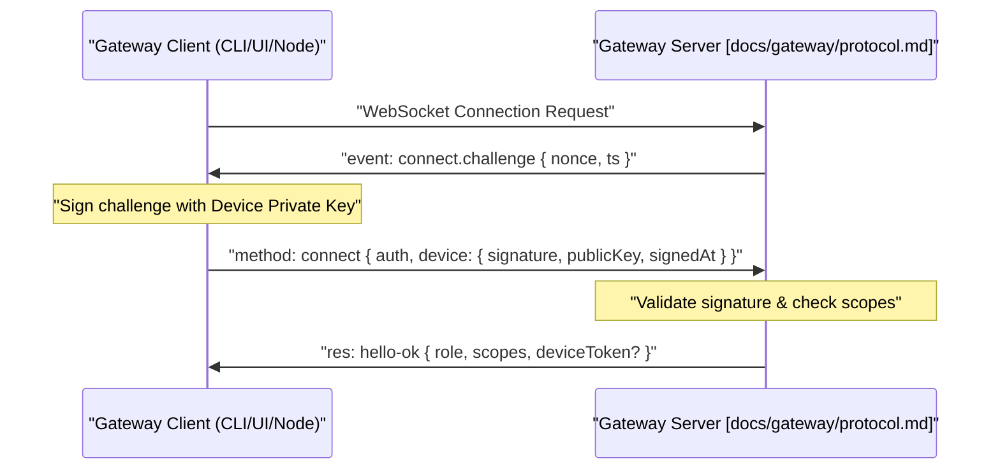

# Authentication & Authorization

<details>
<summary>Relevant source files</summary>

The following files were used as context for generating this wiki page:

- [apps/android/app/src/main/java/ai/openclaw/app/gateway/GatewayProtocol.kt](apps/android/app/src/main/java/ai/openclaw/app/gateway/GatewayProtocol.kt)
- [apps/android/app/src/main/java/ai/openclaw/app/gateway/GatewaySession.kt](apps/android/app/src/main/java/ai/openclaw/app/gateway/GatewaySession.kt)
- [apps/android/app/src/test/java/ai/openclaw/app/gateway/GatewaySessionInvokeTest.kt](apps/android/app/src/test/java/ai/openclaw/app/gateway/GatewaySessionInvokeTest.kt)
- [apps/android/app/src/test/java/ai/openclaw/app/gateway/GatewaySessionReconnectTest.kt](apps/android/app/src/test/java/ai/openclaw/app/gateway/GatewaySessionReconnectTest.kt)
- [apps/shared/OpenClawKit/Sources/OpenClawKit/GatewayConnectionProblem.swift](apps/shared/OpenClawKit/Sources/OpenClawKit/GatewayConnectionProblem.swift)
- [apps/shared/OpenClawKit/Sources/OpenClawKit/GatewayErrors.swift](apps/shared/OpenClawKit/Sources/OpenClawKit/GatewayErrors.swift)
- [apps/shared/OpenClawKit/Sources/OpenClawProtocol/GatewayModels.swift](apps/shared/OpenClawKit/Sources/OpenClawProtocol/GatewayModels.swift)
- [apps/shared/OpenClawKit/Tests/OpenClawKitTests/GatewayErrorsTests.swift](apps/shared/OpenClawKit/Tests/OpenClawKitTests/GatewayErrorsTests.swift)
- [docs/gateway/operator-scopes.md](docs/gateway/operator-scopes.md)
- [docs/gateway/protocol.md](docs/gateway/protocol.md)
- [docs/web/dashboard.md](docs/web/dashboard.md)
- [extensions/discord/src/monitor/thread-title.generate.test.ts](extensions/discord/src/monitor/thread-title.generate.test.ts)
- [extensions/discord/src/monitor/thread-title.ts](extensions/discord/src/monitor/thread-title.ts)
- [extensions/telegram/src/auto-topic-label-config.ts](extensions/telegram/src/auto-topic-label-config.ts)
- [extensions/telegram/src/auto-topic-label.test.ts](extensions/telegram/src/auto-topic-label.test.ts)
- [packages/gateway-client/src/reconnect-policy.test.ts](packages/gateway-client/src/reconnect-policy.test.ts)
- [packages/gateway-client/src/reconnect-policy.ts](packages/gateway-client/src/reconnect-policy.ts)
- [packages/gateway-protocol/src/connect-error-details.ts](packages/gateway-protocol/src/connect-error-details.ts)
- [packages/gateway-protocol/src/error-details.ts](packages/gateway-protocol/src/error-details.ts)
- [packages/gateway-protocol/src/gateway-error-details.ts](packages/gateway-protocol/src/gateway-error-details.ts)
- [packages/gateway-protocol/src/index.test.ts](packages/gateway-protocol/src/index.test.ts)
- [packages/gateway-protocol/src/index.ts](packages/gateway-protocol/src/index.ts)
- [packages/gateway-protocol/src/schema/devices.test.ts](packages/gateway-protocol/src/schema/devices.test.ts)
- [packages/gateway-protocol/src/schema/error-codes.test.ts](packages/gateway-protocol/src/schema/error-codes.test.ts)
- [packages/gateway-protocol/src/schema/error-codes.ts](packages/gateway-protocol/src/schema/error-codes.ts)
- [packages/gateway-protocol/src/schema/logs-chat.test.ts](packages/gateway-protocol/src/schema/logs-chat.test.ts)
- [packages/gateway-protocol/src/schema/logs-chat.ts](packages/gateway-protocol/src/schema/logs-chat.ts)
- [packages/gateway-protocol/src/schema/protocol-schema-fragment-transport.ts](packages/gateway-protocol/src/schema/protocol-schema-fragment-transport.ts)
- [packages/gateway-protocol/src/validator-registry.ts](packages/gateway-protocol/src/validator-registry.ts)
- [src/agents/code-mode.bridge.host-denial.test.ts](src/agents/code-mode.bridge.host-denial.test.ts)
- [src/agents/tools/message-tool-execution.test.ts](src/agents/tools/message-tool-execution.test.ts)
- [src/auto-reply/reply/commands-session-cost.runtime.ts](src/auto-reply/reply/commands-session-cost.runtime.ts)
- [src/auto-reply/reply/commands-session-restart.test.ts](src/auto-reply/reply/commands-session-restart.test.ts)
- [src/auto-reply/reply/commands-session.ts](src/auto-reply/reply/commands-session.ts)
- [src/auto-reply/reply/session-fork.ts](src/auto-reply/reply/session-fork.ts)
- [src/config/sessions/session-accessor.lifecycle.ts](src/config/sessions/session-accessor.lifecycle.ts)
- [src/config/sessions/session-accessor.parent-fork.test.ts](src/config/sessions/session-accessor.parent-fork.test.ts)
- [src/config/sessions/session-accessor.recovery.test.ts](src/config/sessions/session-accessor.recovery.test.ts)
- [src/config/sessions/session-accessor.sqlite-batch-projection.ts](src/config/sessions/session-accessor.sqlite-batch-projection.ts)
- [src/config/sessions/session-accessor.sqlite-parent-fork.ts](src/config/sessions/session-accessor.sqlite-parent-fork.ts)
- [src/config/sessions/session-accessor.sqlite-parent-session.ts](src/config/sessions/session-accessor.sqlite-parent-session.ts)
- [src/config/sessions/session-accessor.sqlite-recovery.ts](src/config/sessions/session-accessor.sqlite-recovery.ts)
- [src/config/sessions/session-accessor.sqlite-replacement-projection.test.ts](src/config/sessions/session-accessor.sqlite-replacement-projection.test.ts)
- [src/config/sessions/session-accessor.sqlite-replacement-projection.ts](src/config/sessions/session-accessor.sqlite-replacement-projection.ts)
- [src/gateway/chat-abort.test.ts](src/gateway/chat-abort.test.ts)
- [src/gateway/chat-abort.ts](src/gateway/chat-abort.ts)
- [src/gateway/dashboard-session-title.test.ts](src/gateway/dashboard-session-title.test.ts)
- [src/gateway/dashboard-session-title.ts](src/gateway/dashboard-session-title.ts)
- [src/gateway/live-chat-projector.ts](src/gateway/live-chat-projector.ts)
- [src/gateway/method-scopes.test.ts](src/gateway/method-scopes.test.ts)
- [src/gateway/method-scopes.ts](src/gateway/method-scopes.ts)
- [src/gateway/methods/core-descriptors.since.test.ts](src/gateway/methods/core-descriptors.since.test.ts)
- [src/gateway/methods/core-descriptors.ts](src/gateway/methods/core-descriptors.ts)
- [src/gateway/server-methods-list.test.ts](src/gateway/server-methods-list.test.ts)
- [src/gateway/server-methods.authorization.test.ts](src/gateway/server-methods.authorization.test.ts)
- [src/gateway/server-methods/chat-broadcast.test.ts](src/gateway/server-methods/chat-broadcast.test.ts)
- [src/gateway/server-methods/chat-broadcast.ts](src/gateway/server-methods/chat-broadcast.ts)
- [src/gateway/server-methods/chat-send-request.test.ts](src/gateway/server-methods/chat-send-request.test.ts)
- [src/gateway/server-methods/chat-send-request.ts](src/gateway/server-methods/chat-send-request.ts)
- [src/gateway/server-methods/chat-send-session.ts](src/gateway/server-methods/chat-send-session.ts)
- [src/gateway/server-methods/plugin-host-hooks.ts](src/gateway/server-methods/plugin-host-hooks.ts)
- [src/gateway/server-methods/session-create-root.test.ts](src/gateway/server-methods/session-create-root.test.ts)
- [src/gateway/server-methods/session-create-root.ts](src/gateway/server-methods/session-create-root.ts)
- [src/gateway/server-methods/sessions-create.ts](src/gateway/server-methods/sessions-create.ts)
- [src/gateway/server-methods/sessions-delete.ts](src/gateway/server-methods/sessions-delete.ts)
- [src/gateway/server-methods/sessions-lifecycle-drain.ts](src/gateway/server-methods/sessions-lifecycle-drain.ts)
- [src/gateway/server-methods/sessions-mutations.archive-attribution.test.ts](src/gateway/server-methods/sessions-mutations.archive-attribution.test.ts)
- [src/gateway/server-methods/sessions-mutations.owner.test.ts](src/gateway/server-methods/sessions-mutations.owner.test.ts)
- [src/gateway/server-methods/sessions-mutations.perf.test.ts](src/gateway/server-methods/sessions-mutations.perf.test.ts)
- [src/gateway/server-methods/sessions-patch-archive.ts](src/gateway/server-methods/sessions-patch-archive.ts)
- [src/gateway/server-methods/sessions-patch-engine.ts](src/gateway/server-methods/sessions-patch-engine.ts)
- [src/gateway/server-methods/sessions-recover.ts](src/gateway/server-methods/sessions-recover.ts)
- [src/gateway/server-methods/sessions-subscriptions.ts](src/gateway/server-methods/sessions-subscriptions.ts)
- [src/gateway/server-methods/sessions-suggestions.test.ts](src/gateway/server-methods/sessions-suggestions.test.ts)
- [src/gateway/server-methods/sessions-suggestions.ts](src/gateway/server-methods/sessions-suggestions.ts)
- [src/gateway/server-methods/sessions-typing.test.ts](src/gateway/server-methods/sessions-typing.test.ts)
- [src/gateway/server.node-chat-subscriptions.test.ts](src/gateway/server.node-chat-subscriptions.test.ts)
- [src/gateway/server.sessions.archive-lifecycle.test.ts](src/gateway/server.sessions.archive-lifecycle.test.ts)
- [src/gateway/server.sessions.archive-worker-placement.test.ts](src/gateway/server.sessions.archive-worker-placement.test.ts)
- [src/gateway/server.sessions.create.projects.test.ts](src/gateway/server.sessions.create.projects.test.ts)
- [src/gateway/server.sessions.create.test.ts](src/gateway/server.sessions.create.test.ts)
- [src/gateway/server.sessions.delete-lifecycle.test.ts](src/gateway/server.sessions.delete-lifecycle.test.ts)
- [src/gateway/server.sessions.delete-worktree-lifecycle.test.ts](src/gateway/server.sessions.delete-worktree-lifecycle.test.ts)
- [src/gateway/server.sessions.exec-binding-rpc.test.ts](src/gateway/server.sessions.exec-binding-rpc.test.ts)
- [src/gateway/server.sessions.permission-root.test.ts](src/gateway/server.sessions.permission-root.test.ts)
- [src/gateway/server.sessions.recover.test.ts](src/gateway/server.sessions.recover.test.ts)
- [src/gateway/server.sessions.recovery-order.test.ts](src/gateway/server.sessions.recovery-order.test.ts)
- [src/gateway/server.sessions.worker-placement-order.test.ts](src/gateway/server.sessions.worker-placement-order.test.ts)
- [src/gateway/server/ws-connection/connect-device-pairing.test.ts](src/gateway/server/ws-connection/connect-device-pairing.test.ts)
- [src/gateway/server/ws-connection/connect-device-pairing.ts](src/gateway/server/ws-connection/connect-device-pairing.ts)
- [src/gateway/server/ws-connection/connect-existing-device.ts](src/gateway/server/ws-connection/connect-existing-device.ts)
- [src/gateway/server/ws-connection/connect-pairing-approval-plan.ts](src/gateway/server/ws-connection/connect-pairing-approval-plan.ts)
- [src/gateway/session-create-service.ts](src/gateway/session-create-service.ts)
- [src/gateway/session-recovery-service.ts](src/gateway/session-recovery-service.ts)
- [src/gateway/sessions-patch.test.ts](src/gateway/sessions-patch.test.ts)
- [src/gateway/sessions-patch.ts](src/gateway/sessions-patch.ts)
- [src/gateway/test/server-sessions.test-helpers.ts](src/gateway/test/server-sessions.test-helpers.ts)
- [src/gateway/worker-environments/live-chat.test-support.ts](src/gateway/worker-environments/live-chat.test-support.ts)
- [src/gateway/worker-environments/placement-dispatch-authority.test.ts](src/gateway/worker-environments/placement-dispatch-authority.test.ts)
- [src/plugins/contracts/session-actions.contract.test.ts](src/plugins/contracts/session-actions.contract.test.ts)
- [src/tui/embedded-backend.test.ts](src/tui/embedded-backend.test.ts)
- [src/tui/embedded-backend.ts](src/tui/embedded-backend.ts)
- [src/tui/embedded-prepared-runtime.test.ts](src/tui/embedded-prepared-runtime.test.ts)
- [src/tui/embedded-prepared-runtime.ts](src/tui/embedded-prepared-runtime.ts)
- [src/tui/tui-backend.ts](src/tui/tui-backend.ts)
- [ui/src/app/app-host.gateway-lineage.test.ts](ui/src/app/app-host.gateway-lineage.test.ts)
- [ui/src/app/app-root.ts](ui/src/app/app-root.ts)
- [ui/src/app/gateway-store.auth.test.ts](ui/src/app/gateway-store.auth.test.ts)
- [ui/src/app/gateway-store.test.ts](ui/src/app/gateway-store.test.ts)
- [ui/src/app/gateway-store.ts](ui/src/app/gateway-store.ts)
- [ui/src/app/gateway.ts](ui/src/app/gateway.ts)
- [ui/src/app/overlays-access.test-support.ts](ui/src/app/overlays-access.test-support.ts)
- [ui/src/app/settings.layout.node.test.ts](ui/src/app/settings.layout.node.test.ts)
- [ui/src/app/settings.node.test.ts](ui/src/app/settings.node.test.ts)
- [ui/src/app/settings.sidebar-prefs.node.test.ts](ui/src/app/settings.sidebar-prefs.node.test.ts)
- [ui/src/app/startup-settings.ts](ui/src/app/startup-settings.ts)
- [ui/src/components/login-gate.test.ts](ui/src/components/login-gate.test.ts)
- [ui/src/components/login-gate.ts](ui/src/components/login-gate.ts)
- [ui/src/e2e/chat-outbox-payloads.e2e.test.ts](ui/src/e2e/chat-outbox-payloads.e2e.test.ts)
- [ui/src/e2e/control-ui-auth-transports.e2e.test.ts](ui/src/e2e/control-ui-auth-transports.e2e.test.ts)
- [ui/src/e2e/login-gate.e2e.test.ts](ui/src/e2e/login-gate.e2e.test.ts)
- [ui/src/e2e/mobile-pairing.e2e.test.ts](ui/src/e2e/mobile-pairing.e2e.test.ts)
- [ui/src/e2e/new-session-page.connect-machine.e2e.test.ts](ui/src/e2e/new-session-page.connect-machine.e2e.test.ts)
- [ui/src/lib/connection-hints.node.test.ts](ui/src/lib/connection-hints.node.test.ts)
- [ui/src/lib/device-pair-setup.test.ts](ui/src/lib/device-pair-setup.test.ts)
- [ui/src/lib/device-pair-setup.ts](ui/src/lib/device-pair-setup.ts)
- [ui/src/test-helpers/settings-node.ts](ui/src/test-helpers/settings-node.ts)

</details>


This page explains how the OpenClaw Gateway authenticates clients and authorizes access to RPC methods and HTTP surfaces. The system implements a multi-layered security model centered around a single trusted operator managing a personal AI assistant infrastructure.

---

## Overview

OpenClaw security guidance assumes a **personal assistant** deployment: one trusted operator boundary, potentially many agents [docs/gateway/operator-scopes.md:10-13]().

1.  **Transport Authentication**: Proving identity to the Gateway (token, password, device signature, or none) during the WebSocket handshake [docs/gateway/protocol.md:126-159]().
2.  **Protocol Handshake**: Validating client identity, protocol version, and requested scopes during the connection exchange [docs/gateway/protocol.md:108-169]().
3.  **Method Authorization**: Controlling RPC access via granular scopes (`operator.read`, `operator.write`, `operator.admin`, etc.) defined in the core method descriptors [src/gateway/methods/core-descriptors.ts:39-124]().
4.  **Rate Limiting & Admission**: Protecting the control plane via write budgets and admission control during high load or session mutations [src/gateway/server.sessions.create.test.ts:49-54]().
5.  **Sensitive Data Redaction**: Scrubbing of identifiers and secrets from logs and transport payloads, ensuring that diagnostics like oversized frame events never leak tokens or cookies [docs/gateway/protocol.md:41-47]().

Sources: [docs/gateway/operator-scopes.md:10-13](), [docs/gateway/protocol.md:12-169](), [src/gateway/methods/core-descriptors.ts:39-124](), [src/gateway/server.sessions.create.test.ts:49-54]()

---

## Authentication Modes

The Gateway supports several authentication modes resolved during the connection handshake. The negotiated role and scopes are returned in the `hello-ok` frame [docs/gateway/protocol.md:161-169]().

| Mode | Description | Implementation Detail |
| :--- | :--- | :--- |
| **Token** | Static bearer token authentication | Passed in `connect.params.auth.token` [docs/gateway/protocol.md:147-147](). |
| **Password** | Shared password authentication | Handled by the Control UI login gate [ui/src/app/app-root.ts:72-73](). |
| **Device Identity** | Public-key based identity | Uses a signed nonce and public key to track hardware [docs/gateway/protocol.md:150-156](). |
| **None** | Unauthenticated access | Typically restricted to local loopback or initial onboarding. |

### WebSocket Handshake and Device Identity

When a client connects, the Gateway sends a `connect.challenge` containing a `nonce` and `ts` [docs/gateway/protocol.md:110-118](). The client must sign this payload to prove device identity.

#### Gateway Connection Auth Flow

Sources: [docs/gateway/protocol.md:108-169](), [apps/android/app/src/main/java/ai/openclaw/app/gateway/GatewaySession.kt:154-162]()

---

## Authorization Scopes

OpenClaw enforces scope-based access control for Gateway RPC methods. Scopes are defined in a canonical spec table [src/gateway/methods/core-descriptors.ts:39-124]().

| Scope | Purpose | Examples |
| :--- | :--- | :--- |
| `operator.read` | Read-only status, lists, catalog, and logs [docs/gateway/operator-scopes.md:34-34](). | `health`, `config.get`, `status` |
| `operator.write` | Mutating actions: sending messages, invoking tools [docs/gateway/operator-scopes.md:35-35](). | `sessions.create`, `tts.convert` |
| `operator.admin` | Full administrative access; satisfies all `operator.*` scopes [docs/gateway/operator-scopes.md:36-36](). | `config.set`, `channels.start` |
| `operator.pairing` | Device and node pairing management [docs/gateway/operator-scopes.md:37-37](). | `devices.list`, `devices.approve` |
| `operator.approvals` | Exec and plugin approval APIs [docs/gateway/operator-scopes.md:38-38](). | `exec.approval.resolve` |
| `operator.questions` | Interactive question/answer flow [docs/gateway/operator-scopes.md:39-39](). | `question.resolve` |

### Scope Enforcement

Authorization is verified by checking the requested scopes against the `GatewayMethodScope` defined for each RPC handler [src/gateway/methods/core-descriptors.ts:15-15](). If a client lacks the required scope, the Gateway returns a `FORBIDDEN` error with `code: "MISSING_SCOPE"` [docs/gateway/protocol.md:72-76]().

#### Authorization Entity Mapping
```mermaid
classDiagram
    class "CoreGatewayMethodSpecs"["src/gateway/methods/core-descriptors.ts"] {
        +name: string
        +scope: GatewayMethodScope
        +controlPlaneWrite: boolean
    }
    class "GatewayConnectOptions"["apps/android/app/src/main/java/ai/openclaw/app/gateway/GatewaySession.kt"] {
        +role: String
        +scopes: List~String~
    }
    class "SessionMutationAuthorization"["src/gateway/server.sessions.create.test.ts"] {
        +assertCurrent()
    }
    
    "GatewayConnectOptions" ..> "CoreGatewayMethodSpecs" : "validated against"
    "CoreGatewayMethodSpecs" --> "SessionMutationAuthorization" : "triggers check for writes"
```
Sources: [src/gateway/methods/core-descriptors.ts:39-124](), [docs/gateway/operator-scopes.md:32-41](), [docs/gateway/protocol.md:72-87]()

---

## Named Operator Roles

For multi-user or team deployments, the Gateway can bind authenticated user profiles to named roles [docs/gateway/operator-scopes.md:55-57]().

- **Role Definitions**: Roles combine policies for session access (`none`, `view`, `suggest`, `write`), agent availability, and scope ceilings [docs/gateway/operator-scopes.md:62-83]().
- **Ceiling Enforcement**: Reconnecting applies the current role's scope ceiling. If roles are configured, identity-authenticated connections are rejected if they attempt to use non-bound tokens (like bootstrap tokens) [docs/gateway/operator-scopes.md:87-98]().
- **Sandbox Policy**: Roles can enforce `sandbox: "required"`, forcing host execution to be disabled for specific users regardless of agent settings [docs/gateway/operator-scopes.md:122-126]().

Sources: [docs/gateway/operator-scopes.md:55-128]()

---

## Device Pairing and Token Rotation

### Device Pairing
Nodes (iOS/Android/macOS) establish trust through a pairing flow. Identity advertised during `connect` becomes the device row that users must approve [apps/android/app/src/main/java/ai/openclaw/app/gateway/GatewaySession.kt:53-64]().

### Token Rotation
The Gateway issues a `deviceToken` upon successful pairing or connection.
- **Rotation**: Clients should store and provide the most recent `deviceToken` to maintain the session across IP changes or restarts [apps/android/app/src/main/java/ai/openclaw/app/gateway/GatewaySession.kt:176-177]().
- **Invalidation**: Revoking a device in the CLI or Control UI immediately invalidates its tokens, requiring a new pairing flow [docs/gateway/operator-scopes.md:37-37]().

Sources: [apps/android/app/src/main/java/ai/openclaw/app/gateway/GatewaySession.kt:53-64](), [docs/gateway/protocol.md:161-169]()

---

## Rate Limiting and Admission Control

The Gateway protects its control plane using several mechanisms:

- **RPC Concurrency**: Authenticated operator requests share a bounded queue. When exhausted, the Gateway returns a retryable `UNAVAILABLE` error [docs/gateway/protocol.md:65-68]().
- **Admission Control**: The `SessionWorkAdmission` system gates session lifecycle mutations (creation, archiving, etc.) to ensure state consistency during high load [src/gateway/server.sessions.create.test.ts:49-54]().
- **Write Throttling**: Methods marked with `controlPlaneWrite: true` (e.g., `config.apply`) are subject to stricter throttling to prevent configuration corruption [src/gateway/methods/core-descriptors.ts:19-19]().

Sources: [docs/gateway/protocol.md:65-69](), [src/gateway/server.sessions.create.test.ts:49-54](), [src/gateway/methods/core-descriptors.ts:67-68]()

---

## Approvals & Authorization Flow

For high-risk operations, the Gateway requires explicit operator intervention.

1.  **Request**: An agent or tool triggers an approval request (e.g., `exec.approval.request`) [src/gateway/methods/core-descriptors.ts:77-77]().
2.  **Notification**: The Gateway emits events to clients holding the `operator.approvals` scope [docs/gateway/operator-scopes.md:38-38]().
3.  **Resolution**: An authorized operator resolves the request via `exec.approval.resolve` [src/gateway/methods/core-descriptors.ts:79-79]().
4.  **Session Mutation Guard**: Mutating session state (like changing models or archiving) requires a `sessionMutationAuthorization` check [src/gateway/server-methods/sessions-create.ts:109-110]().

#### Approval System Entity Mapping
```mermaid
classDiagram
    class "GatewayRequestHandlers"["src/gateway/server-methods/sessions-create.ts"] {
        +sessionMutationAuthorization
        +sessionMutationCommitGuard
    }
    class "OperatorScopes"["docs/gateway/operator-scopes.md"] {
        +operator.approvals
        +operator.questions
    }
    class "ExecApprovalHandlers"["src/gateway/methods/core-descriptors.ts"] {
        +exec.approval.request
        +exec.approval.resolve
    }
    
    "GatewayRequestHandlers" ..> "OperatorScopes" : "requires for resolution"
    "ExecApprovalHandlers" --> "GatewayRequestHandlers" : "implements handlers"
```

Sources: [src/gateway/server-methods/sessions-create.ts:101-142](), [src/gateway/methods/core-descriptors.ts:71-90](), [docs/gateway/operator-scopes.md:38-39]()