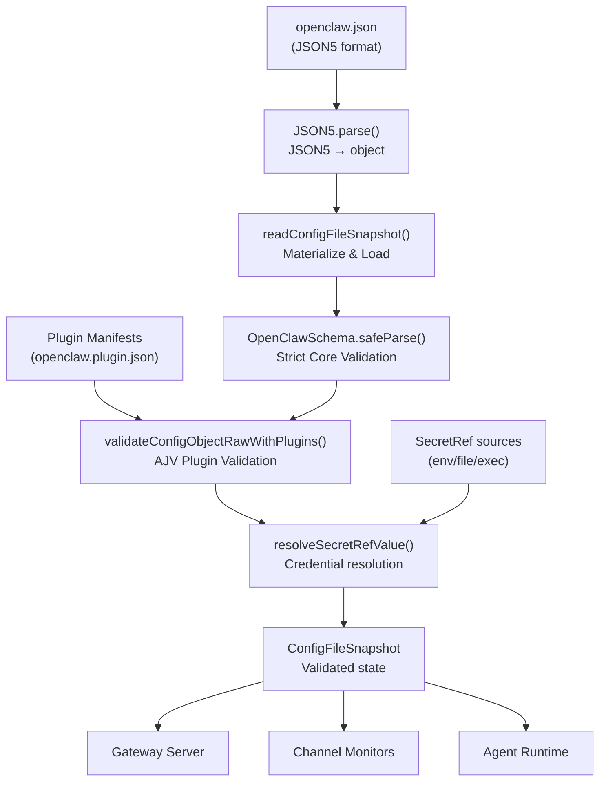
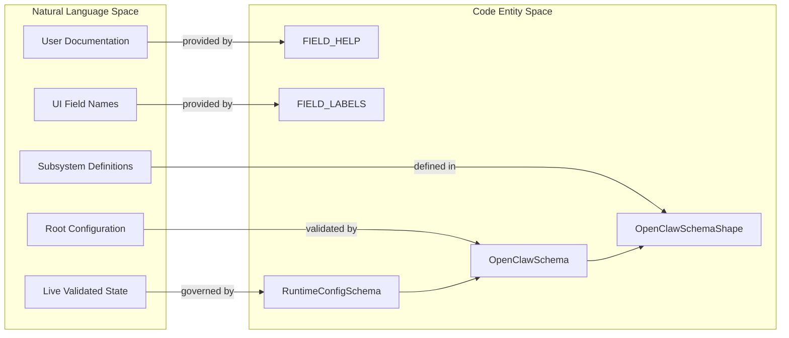

# Configuration System

Relevant source files

The following files were used as context for generating this wiki page:

- [docs/.generated/config-baseline.counts.json](docs/.generated/config-baseline.counts.json)
- [docs/.generated/config-baseline.sha256](docs/.generated/config-baseline.sha256)
- [docs/cli/config.md](docs/cli/config.md)
- [docs/gateway/config-agents.md](docs/gateway/config-agents.md)
- [docs/gateway/config-tools.md](docs/gateway/config-tools.md)
- [docs/gateway/configuration-reference.md](docs/gateway/configuration-reference.md)
- [docs/gateway/configuration.md](docs/gateway/configuration.md)
- [docs/help/environment.md](docs/help/environment.md)
- [docs/reference/session-management-compaction.md](docs/reference/session-management-compaction.md)
- [docs/security/network-proxy.md](docs/security/network-proxy.md)
- [extensions/codex/index.test.ts](extensions/codex/index.test.ts)
- [extensions/codex/index.ts](extensions/codex/index.ts)
- [extensions/codex/src/command-plugins-management.test.ts](extensions/codex/src/command-plugins-management.test.ts)
- [extensions/codex/src/command-plugins-management.ts](extensions/codex/src/command-plugins-management.ts)
- [extensions/qa-lab/src/hook-agent-account-routing.e2e.test.ts](extensions/qa-lab/src/hook-agent-account-routing.e2e.test.ts)
- [extensions/qa-lab/src/live-transports/matrix/substrate/harness.runtime-internals.ts](extensions/qa-lab/src/live-transports/matrix/substrate/harness.runtime-internals.ts)
- [extensions/qa-lab/src/live-transports/matrix/substrate/harness.runtime.test.ts](extensions/qa-lab/src/live-transports/matrix/substrate/harness.runtime.test.ts)
- [src/agents/code-mode.config.test.ts](src/agents/code-mode.config.test.ts)
- [src/cli/config-cli-input.test.ts](src/cli/config-cli-input.test.ts)
- [src/cli/config-cli-input.ts](src/cli/config-cli-input.ts)
- [src/cli/config-cli-path.test.ts](src/cli/config-cli-path.test.ts)
- [src/cli/config-cli-path.ts](src/cli/config-cli-path.ts)
- [src/cli/config-cli-runner.ts](src/cli/config-cli-runner.ts)
- [src/cli/config-cli-validation.ts](src/cli/config-cli-validation.ts)
- [src/cli/config-cli.integration.test-harness.ts](src/cli/config-cli.integration.test-harness.ts)
- [src/cli/config-cli.integration.test.ts](src/cli/config-cli.integration.test.ts)
- [src/cli/config-cli.roster.integration.test.ts](src/cli/config-cli.roster.integration.test.ts)
- [src/cli/config-cli.secrets.integration.test.ts](src/cli/config-cli.secrets.integration.test.ts)
- [src/cli/config-cli.test.ts](src/cli/config-cli.test.ts)
- [src/cli/config-cli.ts](src/cli/config-cli.ts)
- [src/cli/config-model-validation.runtime.test.ts](src/cli/config-model-validation.runtime.test.ts)
- [src/cli/config-model-validation.ts](src/cli/config-model-validation.ts)
- [src/cli/config-set-dryrun.ts](src/cli/config-set-dryrun.ts)
- [src/cli/config-set-input.test.ts](src/cli/config-set-input.test.ts)
- [src/cli/config-set-input.ts](src/cli/config-set-input.ts)
- [src/cli/gateway-cli/pre-bootstrap.ts](src/cli/gateway-cli/pre-bootstrap.ts)
- [src/commands/doctor-startup-migration-refusal.ts](src/commands/doctor-startup-migration-refusal.ts)
- [src/commands/onboard-interactive.test.ts](src/commands/onboard-interactive.test.ts)
- [src/config/__snapshots__/schema.help.quality.test.ts.snap](src/config/__snapshots__/schema.help.quality.test.ts.snap)
- [src/config/bundled-channel-config-metadata.generated.ts](src/config/bundled-channel-config-metadata.generated.ts)
- [src/config/io.read-helpers.ts](src/config/io.read-helpers.ts)
- [src/config/io.write-topology.ts](src/config/io.write-topology.ts)
- [src/config/io.write.ts](src/config/io.write.ts)
- [src/config/legacy.roster.ts](src/config/legacy.roster.ts)
- [src/config/runtime-write-application.ts](src/config/runtime-write-application.ts)
- [src/config/schema.help.agents.ts](src/config/schema.help.agents.ts)
- [src/config/schema.help.automation.ts](src/config/schema.help.automation.ts)
- [src/config/schema.help.core.ts](src/config/schema.help.core.ts)
- [src/config/schema.help.quality.test-fixtures.ts](src/config/schema.help.quality.test-fixtures.ts)
- [src/config/schema.help.runtime.ts](src/config/schema.help.runtime.ts)
- [src/config/schema.hints.test.ts](src/config/schema.hints.test.ts)
- [src/config/schema.hints.ts](src/config/schema.hints.ts)
- [src/config/schema.labels.ts](src/config/schema.labels.ts)
- [src/config/schema.tiers.ts](src/config/schema.tiers.ts)
- [src/config/types.agent-defaults.ts](src/config/types.agent-defaults.ts)
- [src/config/types.base.ts](src/config/types.base.ts)
- [src/config/types.gateway.ts](src/config/types.gateway.ts)
- [src/config/types.openclaw.ts](src/config/types.openclaw.ts)
- [src/config/types.secrets.test.ts](src/config/types.secrets.test.ts)
- [src/config/types.tools.ts](src/config/types.tools.ts)
- [src/config/zod-schema.agent-defaults.test.ts](src/config/zod-schema.agent-defaults.test.ts)
- [src/config/zod-schema.agent-defaults.ts](src/config/zod-schema.agent-defaults.ts)
- [src/config/zod-schema.gateway-auth.test.ts](src/config/zod-schema.gateway-auth.test.ts)
- [src/config/zod-schema.gateway.ts](src/config/zod-schema.gateway.ts)
- [src/config/zod-schema.root-shape.ts](src/config/zod-schema.root-shape.ts)
- [src/daemon/service-managed-env.ts](src/daemon/service-managed-env.ts)
- [src/gateway/auth-rate-limit.ts](src/gateway/auth-rate-limit.ts)
- [src/gateway/config-diff.ts](src/gateway/config-diff.ts)
- [src/gateway/config-reload-plan.ts](src/gateway/config-reload-plan.ts)
- [src/gateway/config-reload.test.ts](src/gateway/config-reload.test.ts)
- [src/gateway/config-reload.ts](src/gateway/config-reload.ts)
- [src/gateway/control-ui-http-utils.ts](src/gateway/control-ui-http-utils.ts)
- [src/gateway/control-ui-routing.test.ts](src/gateway/control-ui-routing.test.ts)
- [src/gateway/control-ui-routing.ts](src/gateway/control-ui-routing.ts)
- [src/gateway/gateway-http-route-contracts.ts](src/gateway/gateway-http-route-contracts.ts)
- [src/gateway/http-media-range.ts](src/gateway/http-media-range.ts)
- [src/gateway/server-http.openai-compat.test.ts](src/gateway/server-http.openai-compat.test.ts)
- [src/gateway/server-http.probe.test.ts](src/gateway/server-http.probe.test.ts)
- [src/gateway/server-http.ts](src/gateway/server-http.ts)
- [src/gateway/server-kernel.test.ts](src/gateway/server-kernel.test.ts)
- [src/gateway/server-methods/config-write-flow.ts](src/gateway/server-methods/config-write-flow.ts)
- [src/gateway/server-methods/config.test.ts](src/gateway/server-methods/config.test.ts)
- [src/gateway/server-methods/config.ts](src/gateway/server-methods/config.ts)
- [src/gateway/server-methods/models-auth-status.types.ts](src/gateway/server-methods/models-auth-status.types.ts)
- [src/gateway/server-runtime-config.ts](src/gateway/server-runtime-config.ts)
- [src/gateway/server-runtime-state-prepare.ts](src/gateway/server-runtime-state-prepare.ts)
- [src/gateway/server-runtime-state.ts](src/gateway/server-runtime-state.ts)
- [src/gateway/server-start.ts](src/gateway/server-start.ts)
- [src/gateway/server.channels-start-outcomes.test.ts](src/gateway/server.channels-start-outcomes.test.ts)
- [src/gateway/server/public-worker-ingress-context.ts](src/gateway/server/public-worker-ingress-context.ts)
- [src/gateway/server/ws-connection-diagnostics.ts](src/gateway/server/ws-connection-diagnostics.ts)
- [src/gateway/system-ca-warmup.test.ts](src/gateway/system-ca-warmup.test.ts)
- [src/gateway/system-ca-warmup.ts](src/gateway/system-ca-warmup.ts)
- [src/infra/dotenv-global.ts](src/infra/dotenv-global.ts)
- [src/infra/shell-env.test.ts](src/infra/shell-env.test.ts)
- [src/infra/shell-env.ts](src/infra/shell-env.ts)
- [ui/src/pages/labs/labs-registry.ts](ui/src/pages/labs/labs-registry.ts)

The Configuration System provides runtime configuration loading, validation, hot-reload, and management for the OpenClaw gateway and all its subsystems (channels, agents, tools, models, etc.). It reads configuration from `~/.openclaw/openclaw.json` in **JSON5** format [docs/gateway/configuration-reference.md:9-12](), validates it against a strict **Zod schema** [src/config/zod-schema.root-shape.ts:1-50](), resolves secrets, and exposes a runtime snapshot to all gateway components. The system supports programmatic updates via transactional mutations [src/gateway/server-methods/config-write-flow.ts:64-64]() and automatic migration from legacy formats through the `doctor` utility.

For channel-specific configuration patterns, see [Messaging Channels](#4). For agent and model configuration, see [Agent Runtime](#3). For the complete field reference, see [Configuration Reference](#2.3.1).

---

## Architecture Overview

The configuration system operates as a multi-stage pipeline that transforms raw JSON5 files into a validated, resolved runtime snapshot. It integrates core configuration with plugin-provided schemas to create a unified state.

### Configuration Pipeline

Title: Configuration Pipeline

Sources: [docs/gateway/configuration.md:10-12](), [docs/gateway/configuration-reference.md:12-19](), [src/gateway/config-reload.ts:60-63]()

---

## Core Configuration Modules

### Config I/O and Validation

The primary validation engine ensures that every field in the configuration file matches the expected structure. The system uses a hierarchical schema approach where `OpenClawSchema` composes shapes for specific domains like `agents`, `bindings`, and `mcp` [src/cli/config-cli.test.ts:133-172]().

Validation includes strict checks for model catalog behavior, provider definitions, and MCP server configurations [docs/gateway/configuration-reference.md:79-112](). Programmatic mutations via `openclaw config set` or `patch` trigger a `buildGatewayReloadPlan` to determine if a hot-reload or full restart is required [src/gateway/config-reload-plan.ts:51-57]().

### Config Schema Entity Mapping

Title: Config Schema Entity Mapping

| Function / Variable | Purpose | Location |
|----------|---------|-------------------|
| `OpenClawSchema` | Root Zod schema for the entire core system | [src/cli/config-cli.test.ts:133-134]() |
| `FIELD_HELP` | Composed user-facing help text from subsystem help modules | [src/config/schema.help.runtime.ts:1-10]() |
| `FIELD_LABELS` | User-friendly display names for config keys | [src/config/schema.labels.ts:8-14]() |
| `readConfigFileSnapshotForRuntimeTransaction` | Reads a snapshot of the config file for atomic updates | [src/config/io.ts:21-21]() |
| `buildGatewayReloadPlan` | Analyzes changed paths to determine reload impact | [src/gateway/config-reload-plan.ts:51-53]() |
| `diffConfigPaths` | Compares two config objects to find modified paths | [src/gateway/config-diff.ts:1-20]() |

Sources: [src/config/schema.help.runtime.ts:1-10](), [src/config/schema.labels.ts:1-14](), [src/gateway/config-reload-plan.ts:51-57](), [src/cli/config-cli.test.ts:133-172]()

---

## Configuration Health and Migrations

The configuration system is tightly integrated with the `doctor` subsystem to handle legacy state and environment readiness.

*   **State Migration**: The system automatically migrates legacy formats, such as converting `agent:main:*` session history to named agents during onboarding [docs/gateway/config-agents.md:14-21]().
*   **Session Maintenance**: The system enforces disk budgets (`maxDiskBytes`) and prunes stale session entries based on `pruneAfter` or `maxEntries` limits [docs/reference/session-management-compaction.md:47-56]().
*   **Catalog Refresh**: The `catalogRefresh` utility ensures that model metadata and pricing are kept up-to-date from hosted catalogs [docs/gateway/configuration-reference.md:83-89]().
*   **Secret Auditing**: The system tracks secret references (`SecretRef`) and validates provider/source compatibility during `config validate` [src/cli/config-cli.md:123-128]().

For details on all available config keys, see [Configuration Reference](#2.3.1).

Sources: [docs/gateway/config-agents.md:14-29](), [docs/reference/session-management-compaction.md:45-66](), [docs/gateway/configuration-reference.md:83-106](), [src/cli/config-cli.md:123-128]()

---

## Plugin Configuration Integration

OpenClaw allows plugins to extend the configuration schema. During validation, the system merges core schemas with plugin-provided schemas and metadata.

*   **UI Integration**: Field metadata such as `uiHints` [docs/gateway/configuration-reference.md:20-25]() and presentation tiers [docs/gateway/configuration.md:91-96]() are used by the Control UI to generate dynamic settings forms.
*   **Dynamic Schema Lookup**: The gateway provides `config.schema.lookup` RPC methods for clients to fetch path-scoped schema nodes plus child summaries [docs/gateway/configuration.md:63-65]().
*   **Baseline Validation**: Documentation accuracy is tracked using generated SHA256 baselines of core, channel, and plugin schemas [docs/.generated/config-baseline.sha256:1-4]().

For details on how plugin schemas are built and used by the Control UI, see [Schema Generation & UI Integration](#2.3.2).

Sources: [docs/gateway/configuration-reference.md:16-25](), [docs/gateway/configuration.md:61-72](), [docs/gateway/configuration.md:91-96](), [docs/.generated/config-baseline.sha256:1-4]()

---

## Key Configuration Files

| File | Purpose |
|------|---------|
| `openclaw.json` | Main system configuration (Gateway, Agents, Channels) [docs/gateway/configuration-reference.md:10-10]() |
| `models.json` | Provider definitions and global model-catalog behavior [docs/gateway/configuration-reference.md:75-77]() |
| `auth-profiles.json` | Storage for provider authentication and credentials [docs/gateway/configuration-reference.md:67-67]() |
| `config-baseline.sha256` | Checksum baseline for validating schema surface documentation [docs/.generated/config-baseline.sha256:1-4]() |

Sources: [docs/gateway/configuration-reference.md:9-112](), [docs/.generated/config-baseline.sha256:1-4]()