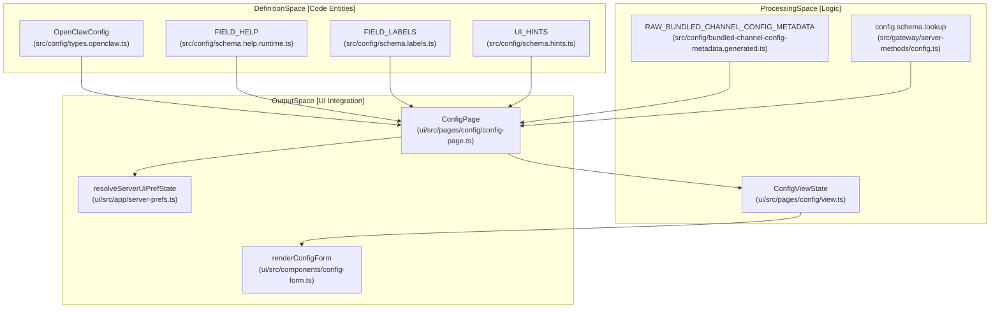
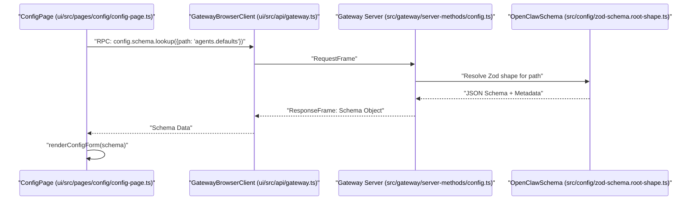

# Schema Generation & UI Integration

Relevant source files

The following files were used as context for generating this wiki page:

- [docs/.generated/config-baseline.counts.json](docs/.generated/config-baseline.counts.json)
- [docs/.generated/config-baseline.sha256](docs/.generated/config-baseline.sha256)
- [docs/gateway/config-agents.md](docs/gateway/config-agents.md)
- [docs/gateway/config-tools.md](docs/gateway/config-tools.md)
- [docs/gateway/configuration-reference.md](docs/gateway/configuration-reference.md)
- [docs/gateway/configuration.md](docs/gateway/configuration.md)
- [docs/help/environment.md](docs/help/environment.md)
- [docs/reference/session-management-compaction.md](docs/reference/session-management-compaction.md)
- [docs/security/network-proxy.md](docs/security/network-proxy.md)
- [extensions/codex/index.test.ts](extensions/codex/index.test.ts)
- [extensions/codex/index.ts](extensions/codex/index.ts)
- [extensions/codex/src/command-plugins-management.test.ts](extensions/codex/src/command-plugins-management.test.ts)
- [extensions/codex/src/command-plugins-management.ts](extensions/codex/src/command-plugins-management.ts)
- [extensions/qa-lab/src/hook-agent-account-routing.e2e.test.ts](extensions/qa-lab/src/hook-agent-account-routing.e2e.test.ts)
- [extensions/qa-lab/src/live-transports/matrix/substrate/harness.runtime-internals.ts](extensions/qa-lab/src/live-transports/matrix/substrate/harness.runtime-internals.ts)
- [extensions/qa-lab/src/live-transports/matrix/substrate/harness.runtime.test.ts](extensions/qa-lab/src/live-transports/matrix/substrate/harness.runtime.test.ts)
- [src/agents/code-mode.config.test.ts](src/agents/code-mode.config.test.ts)
- [src/cli/gateway-cli/pre-bootstrap.ts](src/cli/gateway-cli/pre-bootstrap.ts)
- [src/commands/doctor-startup-migration-refusal.ts](src/commands/doctor-startup-migration-refusal.ts)
- [src/commands/onboard-interactive.test.ts](src/commands/onboard-interactive.test.ts)
- [src/config/__snapshots__/schema.help.quality.test.ts.snap](src/config/__snapshots__/schema.help.quality.test.ts.snap)
- [src/config/bundled-channel-config-metadata.generated.ts](src/config/bundled-channel-config-metadata.generated.ts)
- [src/config/runtime-write-application.ts](src/config/runtime-write-application.ts)
- [src/config/schema.help.agents.ts](src/config/schema.help.agents.ts)
- [src/config/schema.help.automation.ts](src/config/schema.help.automation.ts)
- [src/config/schema.help.core.ts](src/config/schema.help.core.ts)
- [src/config/schema.help.quality.test-fixtures.ts](src/config/schema.help.quality.test-fixtures.ts)
- [src/config/schema.help.runtime.ts](src/config/schema.help.runtime.ts)
- [src/config/schema.hints.test.ts](src/config/schema.hints.test.ts)
- [src/config/schema.hints.ts](src/config/schema.hints.ts)
- [src/config/schema.labels.ts](src/config/schema.labels.ts)
- [src/config/schema.tiers.ts](src/config/schema.tiers.ts)
- [src/config/types.agent-defaults.ts](src/config/types.agent-defaults.ts)
- [src/config/types.base.ts](src/config/types.base.ts)
- [src/config/types.gateway.ts](src/config/types.gateway.ts)
- [src/config/types.openclaw.ts](src/config/types.openclaw.ts)
- [src/config/types.secrets.test.ts](src/config/types.secrets.test.ts)
- [src/config/types.tools.ts](src/config/types.tools.ts)
- [src/config/zod-schema.agent-defaults.test.ts](src/config/zod-schema.agent-defaults.test.ts)
- [src/config/zod-schema.agent-defaults.ts](src/config/zod-schema.agent-defaults.ts)
- [src/config/zod-schema.gateway-auth.test.ts](src/config/zod-schema.gateway-auth.test.ts)
- [src/config/zod-schema.gateway.ts](src/config/zod-schema.gateway.ts)
- [src/config/zod-schema.root-shape.ts](src/config/zod-schema.root-shape.ts)
- [src/daemon/service-managed-env.ts](src/daemon/service-managed-env.ts)
- [src/gateway/auth-rate-limit.ts](src/gateway/auth-rate-limit.ts)
- [src/gateway/config-diff.ts](src/gateway/config-diff.ts)
- [src/gateway/config-reload-plan.ts](src/gateway/config-reload-plan.ts)
- [src/gateway/config-reload.test.ts](src/gateway/config-reload.test.ts)
- [src/gateway/config-reload.ts](src/gateway/config-reload.ts)
- [src/gateway/control-ui-http-utils.ts](src/gateway/control-ui-http-utils.ts)
- [src/gateway/control-ui-routing.test.ts](src/gateway/control-ui-routing.test.ts)
- [src/gateway/control-ui-routing.ts](src/gateway/control-ui-routing.ts)
- [src/gateway/gateway-http-route-contracts.ts](src/gateway/gateway-http-route-contracts.ts)
- [src/gateway/http-media-range.ts](src/gateway/http-media-range.ts)
- [src/gateway/server-http.openai-compat.test.ts](src/gateway/server-http.openai-compat.test.ts)
- [src/gateway/server-http.probe.test.ts](src/gateway/server-http.probe.test.ts)
- [src/gateway/server-http.ts](src/gateway/server-http.ts)
- [src/gateway/server-kernel.test.ts](src/gateway/server-kernel.test.ts)
- [src/gateway/server-methods/config-write-flow.ts](src/gateway/server-methods/config-write-flow.ts)
- [src/gateway/server-methods/config.test.ts](src/gateway/server-methods/config.test.ts)
- [src/gateway/server-methods/config.ts](src/gateway/server-methods/config.ts)
- [src/gateway/server-methods/models-auth-status.types.ts](src/gateway/server-methods/models-auth-status.types.ts)
- [src/gateway/server-methods/optional-model-catalog.ts](src/gateway/server-methods/optional-model-catalog.ts)
- [src/gateway/server-methods/sessions-read.test.ts](src/gateway/server-methods/sessions-read.test.ts)
- [src/gateway/server-runtime-config.ts](src/gateway/server-runtime-config.ts)
- [src/gateway/server-runtime-state-prepare.ts](src/gateway/server-runtime-state-prepare.ts)
- [src/gateway/server-runtime-state.ts](src/gateway/server-runtime-state.ts)
- [src/gateway/server-start.ts](src/gateway/server-start.ts)
- [src/gateway/server.channels-start-outcomes.test.ts](src/gateway/server.channels-start-outcomes.test.ts)
- [src/gateway/server/public-worker-ingress-context.ts](src/gateway/server/public-worker-ingress-context.ts)
- [src/gateway/server/ws-connection-diagnostics.ts](src/gateway/server/ws-connection-diagnostics.ts)
- [src/gateway/system-ca-warmup.test.ts](src/gateway/system-ca-warmup.test.ts)
- [src/gateway/system-ca-warmup.ts](src/gateway/system-ca-warmup.ts)
- [src/infra/dotenv-global.ts](src/infra/dotenv-global.ts)
- [src/infra/shell-env.test.ts](src/infra/shell-env.test.ts)
- [src/infra/shell-env.ts](src/infra/shell-env.ts)
- [ui/src/app/settings.preferences.node.test.ts](ui/src/app/settings.preferences.node.test.ts)
- [ui/src/app/settings.ts](ui/src/app/settings.ts)
- [ui/src/components/settings-ui.ts](ui/src/components/settings-ui.ts)
- [ui/src/e2e/appearance-settings-defaults.e2e.test.ts](ui/src/e2e/appearance-settings-defaults.e2e.test.ts)
- [ui/src/e2e/chat-only-model.e2e.test.ts](ui/src/e2e/chat-only-model.e2e.test.ts)
- [ui/src/e2e/model-providers-progressive.e2e.test.ts](ui/src/e2e/model-providers-progressive.e2e.test.ts)
- [ui/src/e2e/model-providers.e2e.test.ts](ui/src/e2e/model-providers.e2e.test.ts)
- [ui/src/i18n/.i18n/raw-copy-baseline.json](ui/src/i18n/.i18n/raw-copy-baseline.json)
- [ui/src/lib/model-catalog-store.test.ts](ui/src/lib/model-catalog-store.test.ts)
- [ui/src/lib/model-catalog-store.ts](ui/src/lib/model-catalog-store.ts)
- [ui/src/pages/config/config-page.test.ts](ui/src/pages/config/config-page.test.ts)
- [ui/src/pages/config/config-page.ts](ui/src/pages/config/config-page.ts)
- [ui/src/pages/config/config-sections.ts](ui/src/pages/config/config-sections.ts)
- [ui/src/pages/config/settings-search.test.ts](ui/src/pages/config/settings-search.test.ts)
- [ui/src/pages/config/settings-search.ts](ui/src/pages/config/settings-search.ts)
- [ui/src/pages/config/settings-targets.test.ts](ui/src/pages/config/settings-targets.test.ts)
- [ui/src/pages/config/settings-targets.ts](ui/src/pages/config/settings-targets.ts)
- [ui/src/pages/config/setup-schema.ts](ui/src/pages/config/setup-schema.ts)
- [ui/src/pages/config/setup.ts](ui/src/pages/config/setup.ts)
- [ui/src/pages/config/view-appearance-preferences.ts](ui/src/pages/config/view-appearance-preferences.ts)
- [ui/src/pages/config/view-navigation.ts](ui/src/pages/config/view-navigation.ts)
- [ui/src/pages/config/view-types.ts](ui/src/pages/config/view-types.ts)
- [ui/src/pages/config/view.browser.test.ts](ui/src/pages/config/view.browser.test.ts)
- [ui/src/pages/config/view.ts](ui/src/pages/config/view.ts)
- [ui/src/pages/labs/labs-registry.ts](ui/src/pages/labs/labs-registry.ts)
- [ui/src/pages/model-providers/default-models-view.ts](ui/src/pages/model-providers/default-models-view.ts)
- [ui/src/pages/model-providers/load.test.ts](ui/src/pages/model-providers/load.test.ts)
- [ui/src/pages/model-providers/load.ts](ui/src/pages/model-providers/load.ts)
- [ui/src/pages/model-providers/model-providers-page.test-support.ts](ui/src/pages/model-providers/model-providers-page.test-support.ts)
- [ui/src/pages/model-providers/model-providers-page.test.ts](ui/src/pages/model-providers/model-providers-page.test.ts)
- [ui/src/pages/model-providers/model-providers-page.ts](ui/src/pages/model-providers/model-providers-page.ts)
- [ui/src/pages/model-providers/model-providers-page.usage.test.ts](ui/src/pages/model-providers/model-providers-page.usage.test.ts)
- [ui/src/pages/model-providers/probe-results.ts](ui/src/pages/model-providers/probe-results.ts)
- [ui/src/pages/model-providers/route.test.ts](ui/src/pages/model-providers/route.test.ts)
- [ui/src/pages/model-providers/route.ts](ui/src/pages/model-providers/route.ts)
- [ui/src/pages/model-providers/supplemental-load.ts](ui/src/pages/model-providers/supplemental-load.ts)
- [ui/src/pages/model-providers/view.test.ts](ui/src/pages/model-providers/view.test.ts)
- [ui/src/pages/model-providers/view.ts](ui/src/pages/model-providers/view.ts)
- [ui/src/styles/channels.css](ui/src/styles/channels.css)
- [ui/src/styles/model-providers.css](ui/src/styles/model-providers.css)
- [ui/src/styles/settings.css](ui/src/styles/settings.css)

This page explains how OpenClaw builds, caches, and merges configuration schemas with plugin extensions to drive dynamic forms in the Control UI. The system transforms static **Zod** definitions and **TypeBox** schemas into interactive forms with rich metadata for validation and visual rendering.

---

## Schema Generation Pipeline

OpenClaw uses a multi-stage pipeline to convert runtime schemas into structured metadata. This pipeline bridges the gap between static code definitions and the dynamic JSON-based configuration required by the frontend.

### Architecture Overview

The pipeline transforms core configuration definitions (Zod) and plugin-provided schemas into serialized metadata.

**Sources:** [src/config/types.openclaw.ts:1-20](), [src/config/schema.help.runtime.ts:1-15](), [src/config/schema.labels.ts:6-10](), [src/config/schema.hints.ts:1-10](), [ui/src/pages/config/config-page.ts:87-91](), [ui/src/pages/config/view.ts:83-110](), [ui/src/app/server-prefs.ts:23-25](), [src/config/bundled-channel-config-metadata.generated.ts:17-20](), [src/gateway/server-methods/config.ts:1-20]()

---

## JSON Schema & Validation

The core configuration is defined using Zod for runtime validation and strict object enforcement. To ensure performance and cross-platform compatibility, OpenClaw utilizes generated baselines and a unified help registry.

### Base Schema & Field Metadata
The root configuration structure is defined in `src/config/types.openclaw.ts` and validated against the Zod schema [src/config/zod-schema.root-shape.ts:1-10]().

- **Help Text**: The `FIELD_HELP` registry maps configuration paths to user-facing descriptions. Subsystems like `AGENT_FIELD_HELP` and `MODEL_FIELD_HELP` are merged into this runtime registry [src/config/schema.help.runtime.ts:1-15]().
- **Field Labels**: `FIELD_LABELS` provides human-readable titles for configuration keys, ensuring that technical keys like `gateway.port` are presented as "Gateway Port" in the UI [src/config/schema.labels.ts:6-10]().
- **Baselines**: The system maintains SHA-256 hashes of configuration baselines (`core`, `channel`, and `plugin`) in `docs/.generated/config-baseline.sha256` to detect drifts between code and documentation [docs/.generated/config-baseline.sha256:1-4]().
- **Bundled Metadata**: Channel-specific schemas and UI hints are pre-generated into `RAW_BUNDLED_CHANNEL_CONFIG_METADATA` to allow the UI to render forms for offline or non-activated plugins [src/config/bundled-channel-config-metadata.generated.ts:12-17]().

### UI State Management
The Control UI manages configuration state through `ConfigViewState` and the `ConfigPage` controller.
- **View State**: `ConfigViewState` tracks UI-specific metadata like which sensitive paths are revealed, whether the raw JSON view is open, and schema analysis caches [ui/src/pages/config/view.ts:83-91]().
- **Server Preferences**: User-specific UI settings (theme, locale, chat shortcuts) are synchronized via the `ui.prefs` config block. The `resolveServerUiPrefState` function reconciles server-side snapshots with local state [ui/src/app/server-prefs.ts:23-25]().
- **Settings Design**: The UI follows a strict structural pattern: `.settings-page > .settings-section > .settings-group > .settings-row` [ui/src/styles/settings.css:4-10]().

**Sources:** [src/config/schema.help.runtime.ts:1-15](), [src/config/schema.labels.ts:6-10](), [ui/src/pages/config/view.ts:83-91](), [ui/src/app/server-prefs.ts:23-25](), [docs/.generated/config-baseline.sha256:1-4](), [src/config/bundled-channel-config-metadata.generated.ts:12-17](), [ui/src/styles/settings.css:4-10]()

---

## Plugin & UI Integration

Plugins and channels extend the global configuration by providing their own schemas. These are merged into the master schema during the Gateway's startup and reload cycles.

### Advanced Fields & UI Hints
Schema `uiHints` carry a resolved `advanced` boolean for every path [docs/gateway/configuration-reference.md:20-25](). The Control UI uses this to show common fields first and collapse advanced fields per section.
- **UI Control**: The `showAdvancedSettings` property in `UiSettings` toggles the visibility of these fields globally in the interface [ui/src/pages/config/config-page.ts:98-105]().
- **Tier Inheritance**: A path with no declared ancestor is advanced by default [docs/gateway/configuration-reference.md:23-25]().
- **Channel Specifics**: Metadata for bundled channels includes specific `uiHints` and order-based sorting [src/config/bundled-channel-config-metadata.generated.ts:12-15]().

### Dynamic Form Rendering
The Control UI uses a tiered rendering approach:
1. **Specialized Sections**: Pages like `Talk` [ui/src/pages/config/config-page.ts:83-83](), `Memory` [ui/src/pages/config/config-page.ts:75-76](), and `Security` [ui/src/pages/config/config-page.ts:78-78]() use custom renderers for complex interactions.
2. **Config Form**: General configuration is handled by `renderConfigForm`, which builds input controls based on the JSON Schema types [ui/src/pages/config/view.browser.test.ts:6-6]().
3. **Raw Mode**: A JSON5 editor allows direct text-based editing. The UI warms the JSON5 parser via `warmJson5` on page load to ensure responsiveness [ui/src/pages/config/view.browser.test.ts:14-16]().

**Sources:** [docs/gateway/configuration-reference.md:20-25](), [ui/src/pages/config/config-page.ts:75-83](), [ui/src/pages/config/view.browser.test.ts:6-16](), [src/config/bundled-channel-config-metadata.generated.ts:12-15]()

---

## Navigation & Routing

The configuration interface is organized into logical pages defined by `ConfigPageId` [ui/src/pages/config/config-sections.ts:70-70]().

### Section Organization
- **Page Mapping**: `configSectionKeysForPage` maps high-level routes (like `communications` or `infrastructure`) to specific configuration blocks [ui/src/pages/config/config-sections.ts:68-71]().
- **Redirection**: The system handles legacy routes via `MOVED_SECTION_ROUTES`, ensuring old bookmarks for sections like `ai-agents:memory` land on the new `memory` page [ui/src/pages/config/config-page.ts:115-124]().
- **Default Selection**: The `defaultConfigSelection` function ensures that navigating to a top-level settings page activates a sensible default subsection (e.g., `communications` defaults to `messages`) [ui/src/pages/config/config-page.ts:129-149]().

**Sources:** [ui/src/pages/config/config-page.ts:115-149](), [ui/src/pages/config/config-sections.ts:68-71](), [src/gateway/server-methods/config.ts:10-20](), [docs/gateway/configuration-reference.md:16-17]()

---

## Summary of Key Entities

| Entity | Role | Location |
| :--- | :--- | :--- |
| `OpenClawConfig` | Type definition for the entire configuration structure | [src/config/types.openclaw.ts:7]() |
| `FIELD_HELP` | Aggregated registry of user-facing config descriptions | [src/config/schema.help.runtime.ts:8]() |
| `FIELD_LABELS` | Registry of human-readable titles for config keys | [src/config/schema.labels.ts:6]() |
| `ConfigViewState` | UI-side state for tracking form interactions and visibility | [ui/src/pages/config/view.ts:89]() |
| `MOVED_SECTION_ROUTES` | Mapping for handling restructured settings navigation | [ui/src/pages/config/config-page.ts:115]() |
| `configSectionKeysForPage` | Utility to map UI pages to specific config sections | [ui/src/pages/config/config-sections.ts:68]() |
| `RAW_BUNDLED_CHANNEL_CONFIG_METADATA` | Generated JSON schemas for all built-in channel plugins | [src/config/bundled-channel-config-metadata.generated.ts:17]() |

**Sources:** [src/config/types.openclaw.ts:7](), [src/config/schema.help.runtime.ts:8](), [src/config/schema.labels.ts:6](), [ui/src/pages/config/view.ts:89](), [ui/src/pages/config/config-page.ts:115](), [ui/src/pages/config/config-sections.ts:68](), [src/config/bundled-channel-config-metadata.generated.ts:17]()