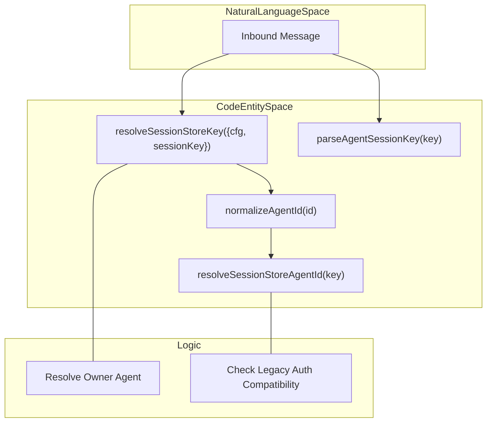
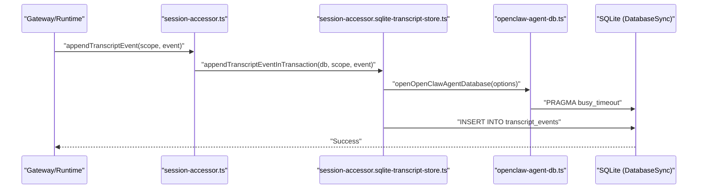

# Session & State Management

<details>
<summary>Relevant source files</summary>

The following files were used as context for generating this wiki page:

- [docs/concepts/session.md](docs/concepts/session.md)
- [docs/reference/database-schemas.md](docs/reference/database-schemas.md)
- [extensions/voice-call/doctor-contract-api.ts](extensions/voice-call/doctor-contract-api.ts)
- [packages/gateway-protocol/src/schema/agents-models-skills.test.ts](packages/gateway-protocol/src/schema/agents-models-skills.test.ts)
- [packages/gateway-protocol/src/schema/agents-models-skills.ts](packages/gateway-protocol/src/schema/agents-models-skills.ts)
- [packages/gateway-protocol/src/schema/sessions-row.test.ts](packages/gateway-protocol/src/schema/sessions-row.test.ts)
- [packages/gateway-protocol/src/schema/sessions-row.ts](packages/gateway-protocol/src/schema/sessions-row.ts)
- [packages/memory-host-sdk/src/host/session-files-reset-revision.test.ts](packages/memory-host-sdk/src/host/session-files-reset-revision.test.ts)
- [packages/memory-host-sdk/src/host/session-files.ts](packages/memory-host-sdk/src/host/session-files.ts)
- [src/agents/embedded-agent-runner/transcript-rewrite.test.ts](src/agents/embedded-agent-runner/transcript-rewrite.test.ts)
- [src/auto-reply/reply/session-fork.test.ts](src/auto-reply/reply/session-fork.test.ts)
- [src/auto-reply/reply/session.init-conflict-retry.test.ts](src/auto-reply/reply/session.init-conflict-retry.test.ts)
- [src/commands/doctor-session-delivery-state.test.ts](src/commands/doctor-session-delivery-state.test.ts)
- [src/commands/doctor-session-delivery-state.ts](src/commands/doctor-session-delivery-state.ts)
- [src/commands/doctor-session-incognito-key-repair.test.ts](src/commands/doctor-session-incognito-key-repair.test.ts)
- [src/commands/doctor-session-incognito-key-repair.ts](src/commands/doctor-session-incognito-key-repair.ts)
- [src/commands/doctor-session-sqlite-artifact.ts](src/commands/doctor-session-sqlite-artifact.ts)
- [src/commands/doctor-session-sqlite-migration-run.ts](src/commands/doctor-session-sqlite-migration-run.ts)
- [src/commands/doctor-session-sqlite-readers.ts](src/commands/doctor-session-sqlite-readers.ts)
- [src/commands/doctor-session-sqlite-recover-report.ts](src/commands/doctor-session-sqlite-recover-report.ts)
- [src/commands/doctor-session-sqlite-restore-report.ts](src/commands/doctor-session-sqlite-restore-report.ts)
- [src/commands/doctor-session-sqlite-restore.ts](src/commands/doctor-session-sqlite-restore.ts)
- [src/commands/doctor-session-sqlite-retirement.ts](src/commands/doctor-session-sqlite-retirement.ts)
- [src/commands/doctor-session-sqlite-transcript-readers.test.ts](src/commands/doctor-session-sqlite-transcript-readers.test.ts)
- [src/commands/doctor-session-sqlite-transcript-readers.ts](src/commands/doctor-session-sqlite-transcript-readers.ts)
- [src/commands/doctor-session-sqlite-types.ts](src/commands/doctor-session-sqlite-types.ts)
- [src/commands/doctor-session-sqlite.memory.test.ts](src/commands/doctor-session-sqlite.memory.test.ts)
- [src/commands/doctor-session-sqlite.test.ts](src/commands/doctor-session-sqlite.test.ts)
- [src/commands/doctor-session-sqlite.ts](src/commands/doctor-session-sqlite.ts)
- [src/commands/doctor-session-transcript-headers.test.ts](src/commands/doctor-session-transcript-headers.test.ts)
- [src/commands/doctor-session-transcript-headers.ts](src/commands/doctor-session-transcript-headers.ts)
- [src/commands/doctor-session-transcript-health.memory.test-support.ts](src/commands/doctor-session-transcript-health.memory.test-support.ts)
- [src/commands/doctor-session-transcript-labels.test.ts](src/commands/doctor-session-transcript-labels.test.ts)
- [src/commands/doctor-session-transcript-labels.ts](src/commands/doctor-session-transcript-labels.ts)
- [src/commands/doctor-session-transcripts.test.ts](src/commands/doctor-session-transcripts.test.ts)
- [src/commands/doctor-session-transcripts.ts](src/commands/doctor-session-transcripts.ts)
- [src/commands/doctor-sqlite-maintenance-lock.ts](src/commands/doctor-sqlite-maintenance-lock.ts)
- [src/commands/doctor-state-migrations.test.ts](src/commands/doctor-state-migrations.test.ts)
- [src/commands/doctor.ts](src/commands/doctor.ts)
- [src/config/io.health-state.test.ts](src/config/io.health-state.test.ts)
- [src/config/io.health-state.ts](src/config/io.health-state.ts)
- [src/config/sessions/cleanup-service.ts](src/config/sessions/cleanup-service.ts)
- [src/config/sessions/disk-budget.test.ts](src/config/sessions/disk-budget.test.ts)
- [src/config/sessions/incognito-session-transcript.test.ts](src/config/sessions/incognito-session-transcript.test.ts)
- [src/config/sessions/legacy-main-session-migration-operations.ts](src/config/sessions/legacy-main-session-migration-operations.ts)
- [src/config/sessions/legacy-main-session-migration.contract.ts](src/config/sessions/legacy-main-session-migration.contract.ts)
- [src/config/sessions/legacy-main-session-migration.ledger.test.ts](src/config/sessions/legacy-main-session-migration.ledger.test.ts)
- [src/config/sessions/legacy-main-session-migration.race.test.ts](src/config/sessions/legacy-main-session-migration.race.test.ts)
- [src/config/sessions/legacy-main-session-migration.startup.test.ts](src/config/sessions/legacy-main-session-migration.startup.test.ts)
- [src/config/sessions/legacy-main-session-migration.test.ts](src/config/sessions/legacy-main-session-migration.test.ts)
- [src/config/sessions/legacy-main-session-migration.ts](src/config/sessions/legacy-main-session-migration.ts)
- [src/config/sessions/paths.ts](src/config/sessions/paths.ts)
- [src/config/sessions/session-accessor.conformance.test.ts](src/config/sessions/session-accessor.conformance.test.ts)
- [src/config/sessions/session-accessor.entry-mutation.ts](src/config/sessions/session-accessor.entry-mutation.ts)
- [src/config/sessions/session-accessor.lifecycle-types.ts](src/config/sessions/session-accessor.lifecycle-types.ts)
- [src/config/sessions/session-accessor.reset-boundary-race.test.ts](src/config/sessions/session-accessor.reset-boundary-race.test.ts)
- [src/config/sessions/session-accessor.reset.ts](src/config/sessions/session-accessor.reset.ts)
- [src/config/sessions/session-accessor.sqlite-canonical-repair.ts](src/config/sessions/session-accessor.sqlite-canonical-repair.ts)
- [src/config/sessions/session-accessor.sqlite-cleanup-race.test.ts](src/config/sessions/session-accessor.sqlite-cleanup-race.test.ts)
- [src/config/sessions/session-accessor.sqlite-doctor-rewrite.ts](src/config/sessions/session-accessor.sqlite-doctor-rewrite.ts)
- [src/config/sessions/session-accessor.sqlite-handle-lifecycle.test.ts](src/config/sessions/session-accessor.sqlite-handle-lifecycle.test.ts)
- [src/config/sessions/session-accessor.sqlite-import-stage.ts](src/config/sessions/session-accessor.sqlite-import-stage.ts)
- [src/config/sessions/session-accessor.sqlite-import.test.ts](src/config/sessions/session-accessor.sqlite-import.test.ts)
- [src/config/sessions/session-accessor.sqlite-import.ts](src/config/sessions/session-accessor.sqlite-import.ts)
- [src/config/sessions/session-accessor.sqlite-lifecycle-state.ts](src/config/sessions/session-accessor.sqlite-lifecycle-state.ts)
- [src/config/sessions/session-accessor.sqlite-lifecycle-types.ts](src/config/sessions/session-accessor.sqlite-lifecycle-types.ts)
- [src/config/sessions/session-accessor.sqlite-lifecycle.ts](src/config/sessions/session-accessor.sqlite-lifecycle.ts)
- [src/config/sessions/session-accessor.sqlite-maintenance-candidates.ts](src/config/sessions/session-accessor.sqlite-maintenance-candidates.ts)
- [src/config/sessions/session-accessor.sqlite-maintenance-kick.ts](src/config/sessions/session-accessor.sqlite-maintenance-kick.ts)
- [src/config/sessions/session-accessor.sqlite-maintenance-writer.test.ts](src/config/sessions/session-accessor.sqlite-maintenance-writer.test.ts)
- [src/config/sessions/session-accessor.sqlite-maintenance.ts](src/config/sessions/session-accessor.sqlite-maintenance.ts)
- [src/config/sessions/session-accessor.sqlite-projection.ts](src/config/sessions/session-accessor.sqlite-projection.ts)
- [src/config/sessions/session-accessor.sqlite-read.ts](src/config/sessions/session-accessor.sqlite-read.ts)
- [src/config/sessions/session-accessor.sqlite-scope.ts](src/config/sessions/session-accessor.sqlite-scope.ts)
- [src/config/sessions/session-accessor.sqlite-session-row.ts](src/config/sessions/session-accessor.sqlite-session-row.ts)
- [src/config/sessions/session-accessor.sqlite-title-probes.ts](src/config/sessions/session-accessor.sqlite-title-probes.ts)
- [src/config/sessions/session-accessor.sqlite-transcript-message-append.ts](src/config/sessions/session-accessor.sqlite-transcript-message-append.ts)
- [src/config/sessions/session-accessor.sqlite-transcript-sequences.ts](src/config/sessions/session-accessor.sqlite-transcript-sequences.ts)
- [src/config/sessions/session-accessor.sqlite-transcript-state.ts](src/config/sessions/session-accessor.sqlite-transcript-state.ts)
- [src/config/sessions/session-accessor.sqlite-transcript-store.ts](src/config/sessions/session-accessor.sqlite-transcript-store.ts)
- [src/config/sessions/session-accessor.sqlite-transcript-watermark.ts](src/config/sessions/session-accessor.sqlite-transcript-watermark.ts)
- [src/config/sessions/session-reset-boundary-event.test.ts](src/config/sessions/session-reset-boundary-event.test.ts)
- [src/config/sessions/session-reset-boundary-event.ts](src/config/sessions/session-reset-boundary-event.ts)
- [src/config/sessions/session-sharing-store.test.ts](src/config/sessions/session-sharing-store.test.ts)
- [src/config/sessions/session-sharing-store.ts](src/config/sessions/session-sharing-store.ts)
- [src/config/sessions/session-transcript-context-eligibility.test.ts](src/config/sessions/session-transcript-context-eligibility.test.ts)
- [src/config/sessions/session-transcript-index.ts](src/config/sessions/session-transcript-index.ts)
- [src/config/sessions/session-transcript-reconcile.ts](src/config/sessions/session-transcript-reconcile.ts)
- [src/config/sessions/session-transcript-search.test.ts](src/config/sessions/session-transcript-search.test.ts)
- [src/config/sessions/session-transcript-search.ts](src/config/sessions/session-transcript-search.ts)
- [src/config/sessions/sessions.test.ts](src/config/sessions/sessions.test.ts)
- [src/config/sessions/store-entry-shape.ts](src/config/sessions/store-entry-shape.ts)
- [src/config/sessions/store-maintenance-operations.ts](src/config/sessions/store-maintenance-operations.ts)
- [src/config/sessions/store-maintenance-recent-preservation.test.ts](src/config/sessions/store-maintenance-recent-preservation.test.ts)
- [src/config/sessions/store-maintenance-warning-parity.test.ts](src/config/sessions/store-maintenance-warning-parity.test.ts)
- [src/config/sessions/store-maintenance.ts](src/config/sessions/store-maintenance.ts)
- [src/config/sessions/store.pruning.test.ts](src/config/sessions/store.pruning.test.ts)
- [src/gateway/server-methods/sessions-list-cache.ts](src/gateway/server-methods/sessions-list-cache.ts)
- [src/gateway/server-methods/sessions-read-cache.test.ts](src/gateway/server-methods/sessions-read-cache.test.ts)
- [src/gateway/server-methods/sessions-read.ts](src/gateway/server-methods/sessions-read.ts)
- [src/gateway/server-methods/sessions.dispatch.abandonment.test.ts](src/gateway/server-methods/sessions.dispatch.abandonment.test.ts)
- [src/gateway/server-worker-placement-change-events.ts](src/gateway/server-worker-placement-change-events.ts)
- [src/gateway/server-worker-placement-reconcile-guard.test.ts](src/gateway/server-worker-placement-reconcile-guard.test.ts)
- [src/gateway/server-worker-placement-reconcile-guard.ts](src/gateway/server-worker-placement-reconcile-guard.ts)
- [src/gateway/server-worker-placement-recovery-events.test.ts](src/gateway/server-worker-placement-recovery-events.test.ts)
- [src/gateway/server-worker-placement-startup-cleanup.test.ts](src/gateway/server-worker-placement-startup-cleanup.test.ts)
- [src/gateway/server-worker-placement-startup-maintenance.test.ts](src/gateway/server-worker-placement-startup-maintenance.test.ts)
- [src/gateway/session-automation-index.ts](src/gateway/session-automation-index.ts)
- [src/gateway/session-lifecycle-state.ts](src/gateway/session-lifecycle-state.ts)
- [src/gateway/session-utils-core.ts](src/gateway/session-utils-core.ts)
- [src/gateway/session-utils-list.ts](src/gateway/session-utils-list.ts)
- [src/gateway/session-utils-model.ts](src/gateway/session-utils-model.ts)
- [src/gateway/session-utils-owners.test.ts](src/gateway/session-utils-owners.test.ts)
- [src/gateway/session-utils-projection.ts](src/gateway/session-utils-projection.ts)
- [src/gateway/session-utils-row.ts](src/gateway/session-utils-row.ts)
- [src/gateway/session-utils-search.ts](src/gateway/session-utils-search.ts)
- [src/gateway/session-utils.child-cache-retention.test-support.ts](src/gateway/session-utils.child-cache-retention.test-support.ts)
- [src/gateway/session-utils.child-cache-retention.test.ts](src/gateway/session-utils.child-cache-retention.test.ts)
- [src/gateway/session-utils.perf.test.ts](src/gateway/session-utils.perf.test.ts)
- [src/gateway/session-utils.telegram-recreate.test.ts](src/gateway/session-utils.telegram-recreate.test.ts)
- [src/gateway/session-utils.test.ts](src/gateway/session-utils.test.ts)
- [src/gateway/session-utils.ts](src/gateway/session-utils.ts)
- [src/gateway/session-utils.types.ts](src/gateway/session-utils.types.ts)
- [src/gateway/sessions-resolve.test.ts](src/gateway/sessions-resolve.test.ts)
- [src/gateway/sessions-resolve.ts](src/gateway/sessions-resolve.ts)
- [src/infra/sqlite-schema-contract.test.ts](src/infra/sqlite-schema-contract.test.ts)
- [src/infra/sqlite-schema-contract.ts](src/infra/sqlite-schema-contract.ts)
- [src/infra/sqlite-schema-sql.ts](src/infra/sqlite-schema-sql.ts)
- [src/infra/state-migrations.doctor.ts](src/infra/state-migrations.doctor.ts)
- [src/infra/state-migrations.state-dir.test.ts](src/infra/state-migrations.state-dir.test.ts)
- [src/infra/state-migrations.state-dir.ts](src/infra/state-migrations.state-dir.ts)
- [src/infra/state-migrations.test.ts](src/infra/state-migrations.test.ts)
- [src/node-host/node-worker-launch-store.test.ts](src/node-host/node-worker-launch-store.test.ts)
- [src/plugin-sdk/session-store-runtime.test.ts](src/plugin-sdk/session-store-runtime.test.ts)
- [src/plugin-state/plugin-state-store.schema.test.ts](src/plugin-state/plugin-state-store.schema.test.ts)
- [src/sessions/session-lifecycle-events.test.ts](src/sessions/session-lifecycle-events.test.ts)
- [src/sessions/session-lifecycle-events.ts](src/sessions/session-lifecycle-events.ts)
- [src/shared/session-types.ts](src/shared/session-types.ts)
- [src/state/openclaw-database-maintenance.test.ts](src/state/openclaw-database-maintenance.test.ts)
- [src/state/openclaw-database-preflight.test.ts](src/state/openclaw-database-preflight.test.ts)
- [src/state/openclaw-database-preflight.ts](src/state/openclaw-database-preflight.ts)
- [src/state/openclaw-state-db-additive-columns.ts](src/state/openclaw-state-db-additive-columns.ts)
- [src/state/openclaw-state-db-contract.ts](src/state/openclaw-state-db-contract.ts)
- [src/state/openclaw-state-db-first-use-column-strict-migration.test.ts](src/state/openclaw-state-db-first-use-column-strict-migration.test.ts)
- [src/state/openclaw-state-db-maintenance.ts](src/state/openclaw-state-db-maintenance.ts)
- [src/state/openclaw-state-db-schema-additive.ts](src/state/openclaw-state-db-schema-additive.ts)
- [src/state/openclaw-state-db-schema-repair.ts](src/state/openclaw-state-db-schema-repair.ts)
- [src/state/openclaw-state-db.generated.d.ts](src/state/openclaw-state-db.generated.d.ts)
- [src/state/openclaw-state-db.paths.ts](src/state/openclaw-state-db.paths.ts)
- [src/state/openclaw-state-db.test.ts](src/state/openclaw-state-db.test.ts)
- [src/state/openclaw-state-db.ts](src/state/openclaw-state-db.ts)
- [src/state/openclaw-state-schema-compatibility.ts](src/state/openclaw-state-schema-compatibility.ts)
- [src/state/openclaw-state-schema.sql](src/state/openclaw-state-schema.sql)
- [src/state/user-profile-events.ts](src/state/user-profile-events.ts)
- [test/scripts/doctor-config-preflight-plugin-index.built-cli.e2e.test.ts](test/scripts/doctor-config-preflight-plugin-index.built-cli.e2e.test.ts)

</details>


OpenClaw implements a multi-layered state management system designed for agent isolation, conversation continuity, and structural durability. It manages state across shared global databases, agent-specific databases, and session-specific transcript files.

---

## Session Scoping Models

OpenClaw supports multiple session scoping strategies to control conversation isolation. The scoping model determines whether conversations are shared across channels or isolated per sender.

### Scoping Modes

| Mode | Behavior | Use Case |
|------|----------|----------|
| `main` | Single shared session across all channels and peers | Single-user, personal assistant |
| `per-sender` | One session per sender, shared across channels | Multi-user, channel-agnostic identity |
| `global` | Shared session across a specific boundary | Organizational shared state |
| `subagent` | Isolated session for sub-agent task execution | Autonomous agent task isolation |

The system identifies sessions using a `sessionKey`. The Gateway distinguishes between persistent user sessions and synthetic runtime sessions like `cron`, `subagent`, or `acp` (Agent Control Protocol). Keys are parsed and categorized using utility functions like `resolveSessionStoreKey` and `resolveSessionStoreAgentId` [src/gateway/session-store-key.ts:3-38]().

### Session Key Resolution
The system resolves a unique `sessionKey` for every inbound message. This key typically follows patterns such as `agent:<agentId>:<id>` or `cron:<agentId>:<jobId>`.

**Code Entity Space: Session Key Resolution**

Sources: [src/gateway/session-store-key.ts:3-38](), [src/routing/session-key.ts:33-34](), [src/gateway/session-utils.test.ts:77-89]()

---

## Session Storage

OpenClaw persists sessions in two distinct layers: a transcript-based file store and a SQLite-based state database.

### 1. Transcript Storage (JSONL & SQLite)
OpenClaw historically stored conversation history in `.jsonl` files but has transitioned to a SQLite-backed transcript system for improved performance and indexing.
- **Metadata Store:** Maps `sessionKey` to a `SessionEntry` containing UUIDs and timestamps [src/gateway/session-utils.test.ts:108-119]().
- **Transcript Events:** conversation history, tool calls, and metadata are stored in the `transcript_events` table within agent-specific databases [src/config/sessions/session-accessor.sqlite-transcript-store.ts:67-80]().
- **Access API:** The `session-accessor.ts` barrel provides a storage-neutral API to interact with these records, including functions like `loadSessionEntry` and `appendTranscriptEvent` [src/config/sessions/session-accessor.conformance.test.ts:28-53]().

### 2. SQLite State Databases
OpenClaw utilizes SQLite for shared and agent-scoped state, managed via `node:sqlite` [src/state/openclaw-state-db.ts:10-12]().
- **Global State (`openclaw.sqlite`):** Manages shared state like `mcp_oauth_stores`, `audit_events`, and `skill_usage` [src/state/openclaw-state-schema.sql:3-183](). It uses a `STRICT` schema for durability [src/state/openclaw-state-db.ts:31-31]().
- **Agent State (`agent.sqlite`):** Each agent has a private SQLite database for agent-scoped runtime state, memory indexes, and session metadata [src/state/openclaw-agent-db.ts:33-37]().
- **Migrations:** Both databases include automated schema migration systems [src/state/openclaw-state-db.ts:59-91](), [src/state/openclaw-agent-db.ts:44-59]().

Sources: [src/config/sessions/session-accessor.sqlite-transcript-store.ts:67-80](), [src/state/openclaw-state-db.ts:1-56](), [src/state/openclaw-state-schema.sql:1-213](), [src/state/openclaw-agent-db.ts:1-96]()

---

## State Directory Organization

OpenClaw organizes state to ensure agent isolation and path predictability.

```text
~/.openclaw/
├── state/
│   └── openclaw.sqlite     # Shared state database [src/state/openclaw-state-db.ts:65-65]()
└── agents/
    └── {agentId}/          # Agent-specific isolation
        ├── agent.sqlite    # Agent-scoped database [src/state/openclaw-agent-db.ts:36-36]()
        └── sessions/       # Session storage directory
            └── {id}.jsonl  # Legacy transcript (if not yet migrated) [src/commands/doctor-session-sqlite-readers.ts:66-77]()
```

Sources: [src/state/openclaw-state-db.ts:65-65](), [src/state/openclaw-agent-db.ts:36-36](), [src/commands/doctor-session-sqlite-readers.ts:66-77]()

---

## Session Lifecycle & Maintenance

### Accessor Boundary & Migration
OpenClaw enforces a strict boundary for session access via `session-accessor.ts`. This allows the system to transition from legacy JSONL files to SQLite without breaking callers.
- **SQLite Projection:** The system uses `applySessionStoreProjection` to apply whole-store changes under a SQLite writer lock [src/config/sessions/session-accessor.sqlite-projection.ts:118-129]().
- **Doctor & Repair:** The `runDoctorSessionSqlite` command handles the complex process of importing legacy `.jsonl` transcripts into the new SQLite schema [src/commands/doctor-session-sqlite.ts:115-151]().

### Initialization & Transactions
When a session is accessed or updated, the system uses specific transaction wrappers to ensure atomicity:
- **State Transactions:** `runOpenClawStateWriteTransaction` handles writes to the shared database [src/state/openclaw-state-db.ts:62-62]().
- **Transcript Appends:** `appendTranscriptEventInTransaction` ensures conversation updates are atomic within the agent database [src/config/sessions/session-accessor.sqlite-transcript-store.ts:108-115]().

**Code Entity Space: Lifecycle Implementation**

Sources: [src/config/sessions/session-accessor.conformance.test.ts:113-113](), [src/config/sessions/session-accessor.sqlite-transcript-store.ts:108-115](), [src/state/openclaw-state-db.ts:51-54](), [src/config/sessions/session-accessor.sqlite-transcript-store.ts:67-79]()

### Maintenance & Health
- **Integrity Checks:** The system performs SQLite integrity scans via `confirmOpenClawStateDatabaseIntegrity` [src/state/openclaw-state-db.ts:124-130]().
- **List Caching:** To maintain performance, session lists are cached and invalidated using a "fence" mechanism that tracks database generations and mutation versions [src/gateway/server-methods/sessions-list-cache.ts:24-40]().
- **Migration Recovery:** The `recoverDoctorSessionSqliteTargets` function identifies and repairs failed migration attempts, ensuring no data is lost during the transition to SQLite [src/commands/doctor-session-sqlite.ts:138-145]().

Sources: [src/state/openclaw-state-db.ts:124-130](), [src/gateway/server-methods/sessions-list-cache.ts:24-40](), [src/commands/doctor-session-sqlite.ts:138-145]()