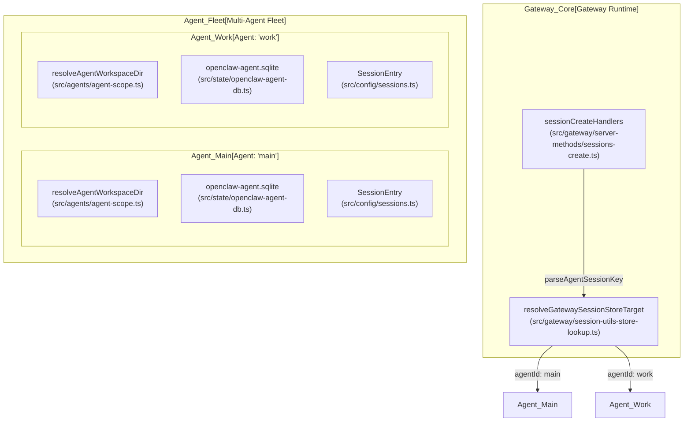
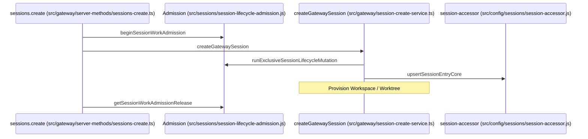

# Multi-Agent Routing

Relevant source files

The following files were used as context for generating this wiki page:

- [docs/concepts/multi-agent.md](docs/concepts/multi-agent.md)
- [docs/gateway/doctor.md](docs/gateway/doctor.md)
- [extensions/discord/src/monitor/thread-title.generate.test.ts](extensions/discord/src/monitor/thread-title.generate.test.ts)
- [extensions/discord/src/monitor/thread-title.ts](extensions/discord/src/monitor/thread-title.ts)
- [extensions/telegram/src/account-selection.ts](extensions/telegram/src/account-selection.ts)
- [extensions/telegram/src/accounts.test.ts](extensions/telegram/src/accounts.test.ts)
- [extensions/telegram/src/auto-topic-label-config.ts](extensions/telegram/src/auto-topic-label-config.ts)
- [extensions/telegram/src/auto-topic-label.test.ts](extensions/telegram/src/auto-topic-label.test.ts)
- [extensions/telegram/src/conversation-route.ts](extensions/telegram/src/conversation-route.ts)
- [packages/gateway-protocol/src/schema/agents-models-skills.test.ts](packages/gateway-protocol/src/schema/agents-models-skills.test.ts)
- [packages/gateway-protocol/src/schema/agents-models-skills.ts](packages/gateway-protocol/src/schema/agents-models-skills.ts)
- [packages/gateway-protocol/src/schema/sessions-row.test.ts](packages/gateway-protocol/src/schema/sessions-row.test.ts)
- [packages/gateway-protocol/src/schema/sessions-row.ts](packages/gateway-protocol/src/schema/sessions-row.ts)
- [src/auto-reply/reply/commands-session-cost.runtime.ts](src/auto-reply/reply/commands-session-cost.runtime.ts)
- [src/auto-reply/reply/commands-session-restart.test.ts](src/auto-reply/reply/commands-session-restart.test.ts)
- [src/auto-reply/reply/commands-session.ts](src/auto-reply/reply/commands-session.ts)
- [src/auto-reply/reply/session-fork.ts](src/auto-reply/reply/session-fork.ts)
- [src/commands/doctor-config-flow.canvas-migration.test.ts](src/commands/doctor-config-flow.canvas-migration.test.ts)
- [src/commands/doctor-config-flow.gateway-bind-persistence.test.ts](src/commands/doctor-config-flow.gateway-bind-persistence.test.ts)
- [src/commands/doctor-config-flow.legacy-composition.test.ts](src/commands/doctor-config-flow.legacy-composition.test.ts)
- [src/commands/doctor-config-flow.missing-default-account-bindings.integration.test.ts](src/commands/doctor-config-flow.missing-default-account-bindings.integration.test.ts)
- [src/commands/doctor-config-flow.test-support.ts](src/commands/doctor-config-flow.test-support.ts)
- [src/commands/doctor-config-flow.test.ts](src/commands/doctor-config-flow.test.ts)
- [src/commands/doctor-config-flow.ts](src/commands/doctor-config-flow.ts)
- [src/commands/doctor-config-flow.validation-refusal.test.ts](src/commands/doctor-config-flow.validation-refusal.test.ts)
- [src/commands/doctor-config-flow.workspace-persistence.test.ts](src/commands/doctor-config-flow.workspace-persistence.test.ts)
- [src/commands/doctor-model-metadata-corruption.persistence.test.ts](src/commands/doctor-model-metadata-corruption.persistence.test.ts)
- [src/commands/doctor/shared/config-flow-steps.test.ts](src/commands/doctor/shared/config-flow-steps.test.ts)
- [src/commands/doctor/shared/config-flow-steps.ts](src/commands/doctor/shared/config-flow-steps.ts)
- [src/commands/doctor/shared/legacy-config-binding-repair.ts](src/commands/doctor/shared/legacy-config-binding-repair.ts)
- [src/commands/doctor/shared/legacy-config-migrations.runtime.models.catalog.ts](src/commands/doctor/shared/legacy-config-migrations.runtime.models.catalog.ts)
- [src/commands/doctor/shared/model-metadata-corruption-repair.test.ts](src/commands/doctor/shared/model-metadata-corruption-repair.test.ts)
- [src/commands/doctor/shared/model-metadata-corruption-repair.ts](src/commands/doctor/shared/model-metadata-corruption-repair.ts)
- [src/config/io.audit.test.ts](src/config/io.audit.test.ts)
- [src/config/io.audit.ts](src/config/io.audit.ts)
- [src/config/io.meta.test.ts](src/config/io.meta.test.ts)
- [src/config/io.meta.ts](src/config/io.meta.ts)
- [src/config/io.types.ts](src/config/io.types.ts)
- [src/config/redact-argv.ts](src/config/redact-argv.ts)
- [src/config/sessions/session-accessor.lifecycle.ts](src/config/sessions/session-accessor.lifecycle.ts)
- [src/config/sessions/session-accessor.parent-fork.test.ts](src/config/sessions/session-accessor.parent-fork.test.ts)
- [src/config/sessions/session-accessor.recovery.test.ts](src/config/sessions/session-accessor.recovery.test.ts)
- [src/config/sessions/session-accessor.sqlite-batch-projection.ts](src/config/sessions/session-accessor.sqlite-batch-projection.ts)
- [src/config/sessions/session-accessor.sqlite-parent-fork.ts](src/config/sessions/session-accessor.sqlite-parent-fork.ts)
- [src/config/sessions/session-accessor.sqlite-parent-session.ts](src/config/sessions/session-accessor.sqlite-parent-session.ts)
- [src/config/sessions/session-accessor.sqlite-recovery.ts](src/config/sessions/session-accessor.sqlite-recovery.ts)
- [src/config/sessions/session-accessor.sqlite-replacement-projection.test.ts](src/config/sessions/session-accessor.sqlite-replacement-projection.test.ts)
- [src/config/sessions/session-accessor.sqlite-replacement-projection.ts](src/config/sessions/session-accessor.sqlite-replacement-projection.ts)
- [src/gateway/dashboard-session-title.test.ts](src/gateway/dashboard-session-title.test.ts)
- [src/gateway/dashboard-session-title.ts](src/gateway/dashboard-session-title.ts)
- [src/gateway/server-methods.authorization.test.ts](src/gateway/server-methods.authorization.test.ts)
- [src/gateway/server-methods/session-create-root.test.ts](src/gateway/server-methods/session-create-root.test.ts)
- [src/gateway/server-methods/session-create-root.ts](src/gateway/server-methods/session-create-root.ts)
- [src/gateway/server-methods/sessions-create.ts](src/gateway/server-methods/sessions-create.ts)
- [src/gateway/server-methods/sessions-delete.ts](src/gateway/server-methods/sessions-delete.ts)
- [src/gateway/server-methods/sessions-lifecycle-drain.ts](src/gateway/server-methods/sessions-lifecycle-drain.ts)
- [src/gateway/server-methods/sessions-list-cache.ts](src/gateway/server-methods/sessions-list-cache.ts)
- [src/gateway/server-methods/sessions-mutations.archive-attribution.test.ts](src/gateway/server-methods/sessions-mutations.archive-attribution.test.ts)
- [src/gateway/server-methods/sessions-mutations.owner.test.ts](src/gateway/server-methods/sessions-mutations.owner.test.ts)
- [src/gateway/server-methods/sessions-mutations.perf.test.ts](src/gateway/server-methods/sessions-mutations.perf.test.ts)
- [src/gateway/server-methods/sessions-patch-archive.ts](src/gateway/server-methods/sessions-patch-archive.ts)
- [src/gateway/server-methods/sessions-patch-engine.ts](src/gateway/server-methods/sessions-patch-engine.ts)
- [src/gateway/server-methods/sessions-read-cache.test.ts](src/gateway/server-methods/sessions-read-cache.test.ts)
- [src/gateway/server-methods/sessions-read.ts](src/gateway/server-methods/sessions-read.ts)
- [src/gateway/server-methods/sessions-recover.ts](src/gateway/server-methods/sessions-recover.ts)
- [src/gateway/server.sessions.archive-lifecycle.test.ts](src/gateway/server.sessions.archive-lifecycle.test.ts)
- [src/gateway/server.sessions.archive-worker-placement.test.ts](src/gateway/server.sessions.archive-worker-placement.test.ts)
- [src/gateway/server.sessions.create.projects.test.ts](src/gateway/server.sessions.create.projects.test.ts)
- [src/gateway/server.sessions.create.test.ts](src/gateway/server.sessions.create.test.ts)
- [src/gateway/server.sessions.delete-lifecycle.test.ts](src/gateway/server.sessions.delete-lifecycle.test.ts)
- [src/gateway/server.sessions.delete-worktree-lifecycle.test.ts](src/gateway/server.sessions.delete-worktree-lifecycle.test.ts)
- [src/gateway/server.sessions.exec-binding-rpc.test.ts](src/gateway/server.sessions.exec-binding-rpc.test.ts)
- [src/gateway/server.sessions.permission-root.test.ts](src/gateway/server.sessions.permission-root.test.ts)
- [src/gateway/server.sessions.recover.test.ts](src/gateway/server.sessions.recover.test.ts)
- [src/gateway/server.sessions.recovery-order.test.ts](src/gateway/server.sessions.recovery-order.test.ts)
- [src/gateway/server.sessions.worker-placement-order.test.ts](src/gateway/server.sessions.worker-placement-order.test.ts)
- [src/gateway/session-automation-index.ts](src/gateway/session-automation-index.ts)
- [src/gateway/session-create-service.ts](src/gateway/session-create-service.ts)
- [src/gateway/session-lifecycle-state.ts](src/gateway/session-lifecycle-state.ts)
- [src/gateway/session-recovery-service.ts](src/gateway/session-recovery-service.ts)
- [src/gateway/session-utils-core.ts](src/gateway/session-utils-core.ts)
- [src/gateway/session-utils-list.ts](src/gateway/session-utils-list.ts)
- [src/gateway/session-utils-model.ts](src/gateway/session-utils-model.ts)
- [src/gateway/session-utils-owners.test.ts](src/gateway/session-utils-owners.test.ts)
- [src/gateway/session-utils-projection.ts](src/gateway/session-utils-projection.ts)
- [src/gateway/session-utils-row.ts](src/gateway/session-utils-row.ts)
- [src/gateway/session-utils-search.ts](src/gateway/session-utils-search.ts)
- [src/gateway/session-utils.child-cache-retention.test-support.ts](src/gateway/session-utils.child-cache-retention.test-support.ts)
- [src/gateway/session-utils.child-cache-retention.test.ts](src/gateway/session-utils.child-cache-retention.test.ts)
- [src/gateway/session-utils.perf.test.ts](src/gateway/session-utils.perf.test.ts)
- [src/gateway/session-utils.telegram-recreate.test.ts](src/gateway/session-utils.telegram-recreate.test.ts)
- [src/gateway/session-utils.test.ts](src/gateway/session-utils.test.ts)
- [src/gateway/session-utils.ts](src/gateway/session-utils.ts)
- [src/gateway/session-utils.types.ts](src/gateway/session-utils.types.ts)
- [src/gateway/sessions-patch.test.ts](src/gateway/sessions-patch.test.ts)
- [src/gateway/sessions-patch.ts](src/gateway/sessions-patch.ts)
- [src/gateway/sessions-resolve.test.ts](src/gateway/sessions-resolve.test.ts)
- [src/gateway/sessions-resolve.ts](src/gateway/sessions-resolve.ts)
- [src/gateway/test/server-sessions.test-helpers.ts](src/gateway/test/server-sessions.test-helpers.ts)
- [src/gateway/worker-environments/placement-dispatch-authority.test.ts](src/gateway/worker-environments/placement-dispatch-authority.test.ts)
- [src/routing/resolve-route.test.ts](src/routing/resolve-route.test.ts)
- [src/routing/resolve-route.ts](src/routing/resolve-route.ts)
- [src/routing/session-key.ts](src/routing/session-key.ts)
- [src/security/audit-channel-dm-policy.test.ts](src/security/audit-channel-dm-policy.test.ts)
- [src/security/audit-channel.ts](src/security/audit-channel.ts)
- [src/sessions/session-lifecycle-events.test.ts](src/sessions/session-lifecycle-events.test.ts)
- [src/sessions/session-lifecycle-events.ts](src/sessions/session-lifecycle-events.ts)
- [src/shared/session-types.ts](src/shared/session-types.ts)
- [src/state/user-profile-events.ts](src/state/user-profile-events.ts)
- [src/tui/embedded-backend.test.ts](src/tui/embedded-backend.test.ts)
- [src/tui/embedded-backend.ts](src/tui/embedded-backend.ts)
- [src/tui/embedded-prepared-runtime.test.ts](src/tui/embedded-prepared-runtime.test.ts)
- [src/tui/embedded-prepared-runtime.ts](src/tui/embedded-prepared-runtime.ts)
- [src/tui/tui-backend.ts](src/tui/tui-backend.ts)

## Purpose and Scope

This document explains the OpenClaw Gateway's multi-agent routing system, which allows a single process to host multiple isolated AI assistants. Each agent operates within its own isolated workspace, maintains independent session history, and utilizes its own set of authentication profiles and model configurations [src/gateway/session-create-service:17-32](). Routing is handled by a deterministic mechanism that maps inbound messages from messaging channels to the appropriate agent based on configurable bindings and session keys [src/routing/session-key:61-71]().

---

## Agent Isolation Model

Each agent in the Gateway is a distinct logical entity with its own filesystem resources. Isolation ensures that tools, memory, and credentials used by one agent do not leak into another.

| Resource | Path Pattern | Purpose |
|----------|-------------|---------|
| **Workspace** | `<state-dir>/workspace/<agentId>` | Filesystem context for tools and local skills. Resolved via `resolveAgentWorkspaceDir` [src/gateway/server-methods/sessions-create:12-12](). |
| **Agent State** | `<state-dir>/agents/<agentId>/` | Agent-specific configuration including `auth-profiles.json` and `models.json`. Resolved via `resolveAgentDir` [src/gateway/session-create-service:18-18](). |
| **Session Store** | `.../agent/openclaw-agent.sqlite` | Per-agent SQLite database containing session metadata and transcript events [src/gateway/server.sessions.create.test:58-62](). |
| **Incognito Store** | `.../incognito/openclaw-agent.sqlite` | Ephemeral or temporary session storage resolved via `resolveIncognitoOpenClawAgentSqlitePath` [src/gateway/server.sessions.create.test:61-61](). |

### Agent Resource Mapping
The diagram below shows how the Gateway maps logical Agent IDs to physical filesystem entities and runtime state via the session creation and routing services.

Title: Agent Isolation and Resource Mapping

**Sources:**
- [src/gateway/server-methods/sessions-create.ts:12-25]()
- [src/gateway/session-create-service.ts:18-43]()
- [src/gateway/session-utils-store-lookup.ts:48-52]()
- [src/state/openclaw-agent-db.ts:58-62]()

---

## Session Key and Routing Logic

Routing information is encoded into session keys. The Gateway uses these keys to track active runs and ensure only one agent is active per session slot.

### Session Key Structure
The system uses a colon-delimited format to encode routing metadata [src/routing/session-key.js:61-74]().

| Format | Example | Purpose |
|--------|---------|---------|
| **Main Agent** | `agent:main:telegram:direct:123` | Default routing for the primary agent on a specific channel [src/gateway/session-utils.test:103-103](). |
| **Named Agent** | `agent:writer:slack:channel:C1` | Routes to the 'writer' agent workspace [src/gateway/session-create-service.ts:70-71](). |
| **Sub-agent** | `agent:main:subagent:child-uuid` | Isolated lane for delegated tasks spawned via ACP [src/gateway/session-create-service.ts:66-66](). |
| **Incognito** | `incognito:main:uuid` | Ephemeral session with isolated state [src/gateway/session-create-service.ts:65-65](). |

### The Creation and List Pipeline
The `sessions.create` handler and the session listing cache manage how agents are accessed [src/gateway/server-methods/sessions-create:101-115]().

1.  **Key Parsing**: `parseAgentSessionKey` extracts the `agentId` from the requested key or defaults to the primary agent [src/gateway/server-methods/sessions-create:25-25]().
2.  **Store Resolution**: `resolveGatewaySessionStoreTarget` determines which SQLite file or JSONL store holds the agent's data [src/gateway/session-utils:38-38]().
3.  **Caching**: `SessionListFence` ensures that list results are invalidated if the agent database or run index changes [src/gateway/server-methods/sessions-list-cache:24-40]().

**Sources:**
- [src/gateway/server-methods/sessions-create.ts:101-159]()
- [src/gateway/server-methods/sessions-list-cache.ts:87-111]()
- [src/routing/session-key.ts:61-71]()

---

## Execution Registry and Concurrency

To prevent transcript corruption and overlapping tool executions, the Gateway maintains strict concurrency controls.

### Lane Management
The system manages concurrency to ensure session stability:
- **Work Admission**: `beginSessionWorkAdmission` ensures that only one process can mutate a session's lifecycle at a time [src/gateway/server.sessions.create.test:49-54]().
- **Exclusive Mutation**: `runExclusiveSessionLifecycleMutation` gates access to session resources during creation or patching [src/gateway/session-create-service:81-82]().
- **Cache Fencing**: The `SessionListFence` tracks `sessionsMutationVersion` and `agentRunIndexVersion` to ensure the Gateway UI reflects current agent activity [src/gateway/server-methods/sessions-list-cache:91-101]().

### Execution Flow
Title: Session Creation and Admission Lifecycle

**Sources:**
- [src/gateway/server.sessions.create.test:49-54]()
- [src/gateway/session-create-service.ts:79-83]()
- [src/gateway/server-methods/sessions-list-cache.ts:91-111]()

---

## Delegate Architecture (Sub-Agents)

OpenClaw implements a delegate architecture where a primary agent acts on behalf of a human by spawning sub-agents. This is managed through the Agent Control Protocol (ACP) and session key isolation.

### Sub-Agent Routing
Sub-agents operate in isolated sessions but maintain a lineage link to their parent [src/gateway/server-methods/sessions-create:16-16]().

- **Isolation**: Sub-agents use distinct session keys (e.g., `isSubagentSessionKey`) to ensure their transcripts do not mix with the user's main conversation [src/gateway/session-create-service:66-66]().
- **Lineage**: The `sessionEntryForkedFromParent` function establishes the connection between the human-facing session and the delegated agent task [src/gateway/server-methods/sessions-create:16-16]().
- **Tool Policy Inheritance**: Sub-agents can inherit tool allowlists/denylists from their parent via `normalizeInheritedToolAllowlist` [src/gateway/session-create-service:22-24]().

**Sources:**
- [src/routing/session-key.ts:63-66]()
- [src/gateway/session-create-service.ts:21-36]()
- [src/gateway/server-methods/sessions-create.ts:63-99]()

---

## Model and Auth Profile Resolution

During routing, the system resolves the specific model and authentication profile to use for the turn based on a resolution hierarchy.

### Resolution Hierarchy
1.  **Explicit Request**: Overrides provided during `sessions.create` params [src/gateway/server-methods/sessions-create:134-134]().
2.  **Session Entry**: Persistent overrides stored in the `SessionEntry` (e.g., `model`, `provider`, `profile`) [src/gateway/sessions-patch:98-120]().
3.  **Agent Defaults**: Fallback values defined in `agents.defaults` resolved via `resolveDefaultModelForAgent` [src/gateway/session-create-service:29-31]().

### Isolated Auth Profiles
Each agent can have specific auth profiles. When creating or patching a session, `resolveSessionPatchModelSelection` determines if a profile override is required based on the agent's configured defaults and the requested model [src/gateway/sessions-patch:89-121]().

**Sources:**
- [src/gateway/server-methods/sessions-create.ts:134-159]()
- [src/gateway/session-create-service.ts:90-97]()
- [src/gateway/sessions-patch.ts:89-121]()