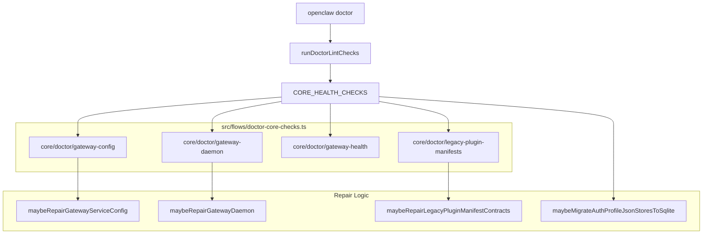
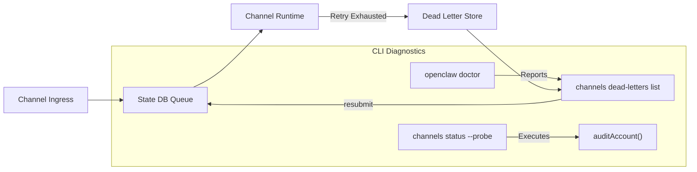

# Service Lifecycle & Diagnostics

Relevant source files

The following files were used as context for generating this wiki page:

- [.github/workflows/update-migration.yml](.github/workflows/update-migration.yml)
- [custodian-skills/add-model-provider/SKILL.md](custodian-skills/add-model-provider/SKILL.md)
- [custodian-skills/cloud-image-bake/SKILL.md](custodian-skills/cloud-image-bake/SKILL.md)
- [custodian-skills/configure-channel/SKILL.md](custodian-skills/configure-channel/SKILL.md)
- [custodian-skills/diagnose-gateway/SKILL.md](custodian-skills/diagnose-gateway/SKILL.md)
- [docs/channels/telegram.md](docs/channels/telegram.md)
- [docs/cli/channels.md](docs/cli/channels.md)
- [docs/cli/doctor.md](docs/cli/doctor.md)
- [docs/concepts/multi-agent.md](docs/concepts/multi-agent.md)
- [docs/gateway/doctor.md](docs/gateway/doctor.md)
- [docs/help/testing-updates-plugins.md](docs/help/testing-updates-plugins.md)
- [docs/help/testing.md](docs/help/testing.md)
- [docs/tools/custodian-skills.md](docs/tools/custodian-skills.md)
- [extensions/telegram/src/account-selection.ts](extensions/telegram/src/account-selection.ts)
- [extensions/telegram/src/accounts.test.ts](extensions/telegram/src/accounts.test.ts)
- [extensions/telegram/src/conversation-route.ts](extensions/telegram/src/conversation-route.ts)
- [scripts/e2e/lib/upgrade-survivor/sqlite-volume.mjs](scripts/e2e/lib/upgrade-survivor/sqlite-volume.mjs)
- [skills/healthcheck/SKILL.md](skills/healthcheck/SKILL.md)
- [src/agents/embedded-agent-runner/effective-tool-policy.ts](src/agents/embedded-agent-runner/effective-tool-policy.ts)
- [src/cli/daemon-cli/lifecycle-safe-restart.test.ts](src/cli/daemon-cli/lifecycle-safe-restart.test.ts)
- [src/cli/daemon-cli/lifecycle-safe-restart.ts](src/cli/daemon-cli/lifecycle-safe-restart.ts)
- [src/cli/daemon-cli/lifecycle.external-supervision.test.ts](src/cli/daemon-cli/lifecycle.external-supervision.test.ts)
- [src/cli/daemon-cli/lifecycle.test.ts](src/cli/daemon-cli/lifecycle.test.ts)
- [src/cli/daemon-cli/status.gather.test.ts](src/cli/daemon-cli/status.gather.test.ts)
- [src/cli/daemon-cli/status.gather.ts](src/cli/daemon-cli/status.gather.ts)
- [src/cli/daemon-cli/status.print.test.ts](src/cli/daemon-cli/status.print.test.ts)
- [src/cli/daemon-cli/status.print.ts](src/cli/daemon-cli/status.print.ts)
- [src/cli/update-cli/update-command-execution.ts](src/cli/update-cli/update-command-execution.ts)
- [src/cli/update-cli/update-command-handoff.ts](src/cli/update-cli/update-command-handoff.ts)
- [src/cli/update-cli/update-command-service-maintenance.test.ts](src/cli/update-cli/update-command-service-maintenance.test.ts)
- [src/cli/update-cli/update-command-service-maintenance.ts](src/cli/update-cli/update-command-service-maintenance.ts)
- [src/commands/doctor-config-flow.canvas-migration.test.ts](src/commands/doctor-config-flow.canvas-migration.test.ts)
- [src/commands/doctor-config-flow.gateway-bind-persistence.test.ts](src/commands/doctor-config-flow.gateway-bind-persistence.test.ts)
- [src/commands/doctor-config-flow.legacy-composition.test.ts](src/commands/doctor-config-flow.legacy-composition.test.ts)
- [src/commands/doctor-config-flow.missing-default-account-bindings.integration.test.ts](src/commands/doctor-config-flow.missing-default-account-bindings.integration.test.ts)
- [src/commands/doctor-config-flow.test-support.ts](src/commands/doctor-config-flow.test-support.ts)
- [src/commands/doctor-config-flow.test.ts](src/commands/doctor-config-flow.test.ts)
- [src/commands/doctor-config-flow.ts](src/commands/doctor-config-flow.ts)
- [src/commands/doctor-config-flow.validation-refusal.test.ts](src/commands/doctor-config-flow.validation-refusal.test.ts)
- [src/commands/doctor-config-flow.workspace-persistence.test.ts](src/commands/doctor-config-flow.workspace-persistence.test.ts)
- [src/commands/doctor-device-pairing.test.ts](src/commands/doctor-device-pairing.test.ts)
- [src/commands/doctor-device-pairing.ts](src/commands/doctor-device-pairing.ts)
- [src/commands/doctor-format.test.ts](src/commands/doctor-format.test.ts)
- [src/commands/doctor-format.ts](src/commands/doctor-format.ts)
- [src/commands/doctor-gateway-daemon-flow.test.ts](src/commands/doctor-gateway-daemon-flow.test.ts)
- [src/commands/doctor-gateway-daemon-flow.ts](src/commands/doctor-gateway-daemon-flow.ts)
- [src/commands/doctor-gateway-services.test.ts](src/commands/doctor-gateway-services.test.ts)
- [src/commands/doctor-gateway-services.ts](src/commands/doctor-gateway-services.ts)
- [src/commands/doctor-lint.state-isolation.test.ts](src/commands/doctor-lint.state-isolation.test.ts)
- [src/commands/doctor-maintenance.ts](src/commands/doctor-maintenance.ts)
- [src/commands/doctor-model-metadata-corruption.persistence.test.ts](src/commands/doctor-model-metadata-corruption.persistence.test.ts)
- [src/commands/doctor-service-repair-policy.ts](src/commands/doctor-service-repair-policy.ts)
- [src/commands/doctor-web-fetch-proxy.ts](src/commands/doctor-web-fetch-proxy.ts)
- [src/commands/doctor-workspace-status.plugin-version-drift.test.ts](src/commands/doctor-workspace-status.plugin-version-drift.test.ts)
- [src/commands/doctor-workspace-status.test.ts](src/commands/doctor-workspace-status.test.ts)
- [src/commands/doctor-workspace-status.ts](src/commands/doctor-workspace-status.ts)
- [src/commands/doctor.refuses-newer-database-schemas.e2e.test.ts](src/commands/doctor.refuses-newer-database-schemas.e2e.test.ts)
- [src/commands/doctor/shared/active-tool-schema-warnings.test.ts](src/commands/doctor/shared/active-tool-schema-warnings.test.ts)
- [src/commands/doctor/shared/active-tool-schema-warnings.ts](src/commands/doctor/shared/active-tool-schema-warnings.ts)
- [src/commands/doctor/shared/codex-route-warnings.ts](src/commands/doctor/shared/codex-route-warnings.ts)
- [src/commands/doctor/shared/config-flow-steps.test.ts](src/commands/doctor/shared/config-flow-steps.test.ts)
- [src/commands/doctor/shared/config-flow-steps.ts](src/commands/doctor/shared/config-flow-steps.ts)
- [src/commands/doctor/shared/legacy-config-binding-repair.ts](src/commands/doctor/shared/legacy-config-binding-repair.ts)
- [src/commands/doctor/shared/legacy-config-migrations.runtime.models.catalog.ts](src/commands/doctor/shared/legacy-config-migrations.runtime.models.catalog.ts)
- [src/commands/doctor/shared/model-metadata-corruption-repair.test.ts](src/commands/doctor/shared/model-metadata-corruption-repair.test.ts)
- [src/commands/doctor/shared/model-metadata-corruption-repair.ts](src/commands/doctor/shared/model-metadata-corruption-repair.ts)
- [src/commands/status.daemon.ts](src/commands/status.daemon.ts)
- [src/config/io.audit.test.ts](src/config/io.audit.test.ts)
- [src/config/io.audit.ts](src/config/io.audit.ts)
- [src/config/io.eacces.test.ts](src/config/io.eacces.test.ts)
- [src/config/io.meta.test.ts](src/config/io.meta.test.ts)
- [src/config/io.meta.ts](src/config/io.meta.ts)
- [src/config/io.types.ts](src/config/io.types.ts)
- [src/config/io.write-prepare.test.ts](src/config/io.write-prepare.test.ts)
- [src/config/io.write-prepare.ts](src/config/io.write-prepare.ts)
- [src/config/redact-argv.ts](src/config/redact-argv.ts)
- [src/daemon/exec-file.ts](src/daemon/exec-file.ts)
- [src/daemon/launchd-exec.ts](src/daemon/launchd-exec.ts)
- [src/daemon/launchd-install.ts](src/daemon/launchd-install.ts)
- [src/daemon/launchd-lifecycle.ts](src/daemon/launchd-lifecycle.ts)
- [src/daemon/launchd-restart-handoff.test.ts](src/daemon/launchd-restart-handoff.test.ts)
- [src/daemon/launchd-runtime.ts](src/daemon/launchd-runtime.ts)
- [src/daemon/launchd-service-files.ts](src/daemon/launchd-service-files.ts)
- [src/daemon/launchd-stop.ts](src/daemon/launchd-stop.ts)
- [src/daemon/launchd-system.test.ts](src/daemon/launchd-system.test.ts)
- [src/daemon/launchd-system.ts](src/daemon/launchd-system.ts)
- [src/daemon/launchd-update-jobs.ts](src/daemon/launchd-update-jobs.ts)
- [src/daemon/launchd.integration.e2e.test.ts](src/daemon/launchd.integration.e2e.test.ts)
- [src/daemon/launchd.test.ts](src/daemon/launchd.test.ts)
- [src/daemon/launchd.ts](src/daemon/launchd.ts)
- [src/daemon/runtime-format.test.ts](src/daemon/runtime-format.test.ts)
- [src/daemon/service-audit.test.ts](src/daemon/service-audit.test.ts)
- [src/daemon/service-audit.ts](src/daemon/service-audit.ts)
- [src/daemon/service-path-policy.ts](src/daemon/service-path-policy.ts)
- [src/daemon/systemd-definition-mutation.test.ts](src/daemon/systemd-definition-mutation.test.ts)
- [src/daemon/systemd-definition-mutation.ts](src/daemon/systemd-definition-mutation.ts)
- [src/daemon/systemd-exec.ts](src/daemon/systemd-exec.ts)
- [src/daemon/systemd-install.ts](src/daemon/systemd-install.ts)
- [src/daemon/systemd-lifecycle.ts](src/daemon/systemd-lifecycle.ts)
- [src/daemon/systemd-runtime.ts](src/daemon/systemd-runtime.ts)
- [src/daemon/systemd-scope.ts](src/daemon/systemd-scope.ts)
- [src/daemon/systemd-service-files.ts](src/daemon/systemd-service-files.ts)
- [src/daemon/systemd-system.test.ts](src/daemon/systemd-system.test.ts)
- [src/daemon/systemd-system.ts](src/daemon/systemd-system.ts)
- [src/daemon/systemd-unavailable.test.ts](src/daemon/systemd-unavailable.test.ts)
- [src/daemon/systemd-unit.ts](src/daemon/systemd-unit.ts)
- [src/daemon/systemd.test.ts](src/daemon/systemd.test.ts)
- [src/daemon/systemd.ts](src/daemon/systemd.ts)
- [src/flows/doctor-core-checks.runtime.test.ts](src/flows/doctor-core-checks.runtime.test.ts)
- [src/flows/doctor-core-checks.runtime.ts](src/flows/doctor-core-checks.runtime.ts)
- [src/flows/doctor-core-checks.test.ts](src/flows/doctor-core-checks.test.ts)
- [src/flows/doctor-core-checks.ts](src/flows/doctor-core-checks.ts)
- [src/flows/doctor-health-contribution-core.ts](src/flows/doctor-health-contribution-core.ts)
- [src/flows/doctor-health-contribution-runners.config.ts](src/flows/doctor-health-contribution-runners.config.ts)
- [src/flows/doctor-health-contribution-runners.gateway.ts](src/flows/doctor-health-contribution-runners.gateway.ts)
- [src/flows/doctor-health-contribution-runners.workspace.ts](src/flows/doctor-health-contribution-runners.workspace.ts)
- [src/flows/doctor-health-contribution-types.ts](src/flows/doctor-health-contribution-types.ts)
- [src/flows/doctor-health-contribution-utils.ts](src/flows/doctor-health-contribution-utils.ts)
- [src/flows/doctor-health-contribution.ts](src/flows/doctor-health-contribution.ts)
- [src/flows/doctor-health-contributions-final.ts](src/flows/doctor-health-contributions-final.ts)
- [src/flows/doctor-health-contributions.test-support.ts](src/flows/doctor-health-contributions.test-support.ts)
- [src/flows/doctor-health-contributions.test.ts](src/flows/doctor-health-contributions.test.ts)
- [src/flows/doctor-health-contributions.ts](src/flows/doctor-health-contributions.ts)
- [src/flows/doctor-health.test-support.ts](src/flows/doctor-health.test-support.ts)
- [src/flows/doctor-health.test.ts](src/flows/doctor-health.test.ts)
- [src/flows/doctor-health.ts](src/flows/doctor-health.ts)
- [src/infra/runtime-status.ts](src/infra/runtime-status.ts)
- [src/infra/state-migrations.exec-approvals.test.ts](src/infra/state-migrations.exec-approvals.test.ts)
- [src/infra/state-migrations.exec-approvals.ts](src/infra/state-migrations.exec-approvals.ts)
- [src/infra/update-managed-service-handoff-command.test.ts](src/infra/update-managed-service-handoff-command.test.ts)
- [src/infra/update-managed-service-handoff-cross-process.test.ts](src/infra/update-managed-service-handoff-cross-process.test.ts)
- [src/infra/update-managed-service-handoff-lifecycle.test-support.ts](src/infra/update-managed-service-handoff-lifecycle.test-support.ts)
- [src/infra/update-managed-service-handoff-lifecycle.test.ts](src/infra/update-managed-service-handoff-lifecycle.test.ts)
- [src/infra/update-managed-service-handoff-ownership.test.ts](src/infra/update-managed-service-handoff-ownership.test.ts)
- [src/infra/update-managed-service-handoff-single-flight.test.ts](src/infra/update-managed-service-handoff-single-flight.test.ts)
- [src/infra/update-managed-service-handoff.ts](src/infra/update-managed-service-handoff.ts)
- [src/plugins/plugin-version-drift.test.ts](src/plugins/plugin-version-drift.test.ts)
- [src/plugins/plugin-version-drift.ts](src/plugins/plugin-version-drift.ts)
- [src/routing/resolve-route.test.ts](src/routing/resolve-route.test.ts)
- [src/routing/resolve-route.ts](src/routing/resolve-route.ts)
- [src/routing/session-key.ts](src/routing/session-key.ts)
- [src/security/audit-channel-dm-policy.test.ts](src/security/audit-channel-dm-policy.test.ts)
- [src/security/audit-channel.ts](src/security/audit-channel.ts)
- [test/e2e/qa-lab/runtime/docker-e2e-lane.fixture.test.ts](test/e2e/qa-lab/runtime/docker-e2e-lane.fixture.test.ts)
- [ui/src/components/channel-avatar.ts](ui/src/components/channel-avatar.ts)

This page details the OpenClaw Gateway’s process lifecycle management, daemon supervision integration, health checks, diagnostic tooling, and automated repair capabilities. It covers Gateway daemon management on macOS (`launchd`), Linux (`systemd`), and Windows (`schtasks`), the real-time status command, and the extensive `doctor` command used for diagnostics and auto-repair.

---

## Gateway Startup & Lifecycle

The Gateway process is designed to run as a long-lived daemon. Lifecycle management ensures that sidecar services, state databases, and plugin runtimes are initialized in sequence and that process handoffs during updates occur safely.

### Daemon Management
OpenClaw integrates with platform-native service supervisors to ensure high availability:

| Platform | Service Manager | Key Features |
| :--- | :--- | :--- |
| **macOS** | `launchd` | Plist generation, environment wrappers, and stale update job cleanup [src/daemon/launchd.test.ts:1-34](). |
| **Linux** | `systemd` | User-unit management, linger status detection, and `sd_notify` integration. Supports "dueling scope" detection to prevent system and user units from conflicting [src/flows/doctor-health-contributions.test.ts:96](). |
| **Windows** | Task Scheduler | XML-based task creation and VBS hidden launchers for background execution. |

### Startup Convergence & Config Preflight
Before the Gateway reports readiness, it executes a "Preflight" sequence. This flow ensures:
- **Legacy Path Migration**: Moves config and state from legacy locations to canonical paths.
- **Startup Migration Guard**: Prevents startup if the gateway is already being managed by a live owner.
- **Plugin Index Refresh**: Ensures the plugin metadata snapshot is current before activation.

### Startup Post-Attach Flow
After the server binds to its port, it enters a `post-attach` phase to warm resources without blocking the initial connection:
- **Provider Auth Warming**: Measures and warms model provider authentication states off-main-thread to avoid event-loop stalls.
- **Restart Sentinel**: Refreshes the sentinel file to detect if a restart is required following an update.
- **Main Session Recovery**: Marks orphaned sessions for recovery after an unexpected shutdown.

Sources: [src/daemon/launchd.test.ts:1-34](), [src/flows/doctor-health-contributions.test.ts:96](), [src/cli/daemon-cli/status.gather.ts:25-31]().

---

## Doctor Command & Auto-Repair

The `openclaw doctor` command is the primary diagnostic engine [docs/cli/doctor.md:9-11](). It provides several "postures": Guided checks, Repair (`--fix`), Lint, and State Maintenance [docs/cli/doctor.md:29-41]().

### Doctor Execution Modes
The doctor flow adapts based on the environment context:
- **Guided checks**: Legacy health flow that can copy config and apply automatic state migrations [docs/cli/doctor.md:35]().
- **Repair (`--fix`)**: Applies supported repairs, using prompts unless non-interactive repair is safe [docs/cli/doctor.md:37]().
- **Lint (`--lint`)**: Read-only findings with threshold-based exit codes for CI gates [docs/cli/doctor.md:38]().
- **Maintenance Window**: Explicit repair stops the managed Gateway before inspecting state and restarts it once finished [docs/cli/doctor.md:53-56]().

### Health Check Registry
Diagnostics are structured as `HealthCheck` contributions. Each check follows a contract to detect issues and provide repair logic.

**Doctor Code Entity Space Mapping**

Sources: [src/flows/doctor-health-contributions.ts:1-25](), [src/flows/doctor-health-contributions.test.ts:13-24](), [docs/gateway/doctor.md:81-109](), [src/flows/doctor-health-contributions.test.ts:112-124]().

---

## State Migrations & Diagnostics

A critical role of the lifecycle system is managing "State Migrations" as the codebase evolves, specifically enforcing the move away from legacy JSON/JSONL files.

### State Migration Flow
The doctor detects legacy state patterns and executes migration plans:
- **Detection**: `detectLegacyStateMigrations` scans for old file-based stores [src/flows/doctor-health-contributions.test.ts:110]().
- **Migration**: `runLegacyStateMigrations` applies changes, such as moving auth profiles to SQLite [src/flows/doctor-health-contributions.test.ts:111]().
- **Approval Repair**: `repairObsoleteGeneratedExecApprovals` removes inactive generated entries after format upgrades [src/flows/doctor-health-contributions.test.ts:112]().

### Key Migration Targets
- **Auth Profiles**: Migrates flat JSON profile stores to SQLite [src/flows/doctor-health-contributions.ts:106-138]().
- **Model Catalogs**: Migrates legacy plugin model catalogs and credentials [src/flows/doctor-health-contributions.ts:148-153]().
- **SQLite Maintenance**: `doctor --state-sqlite compact` checkpoints and verifies the canonical shared state DB [docs/cli/doctor.md:39]().

Sources: [docs/cli/doctor.md:46-51](), [src/flows/doctor-health-contributions.ts:106-154](), [src/flows/doctor-health-contributions.test.ts:110-112]().

---

## Plugin & Channel Diagnostics

Plugins and channels surface diagnostic needs through the doctor system via specific contracts:
- **Legacy Manifests**: The doctor detects plugins using legacy capability keys and suggests repairs [src/flows/doctor-health-contributions.test.ts:113-124]().
- **Channel Status**: `channels status` reports `lifecycle: "blocked"` and plugin errors when accounts fail to load [docs/cli/channels.md:33]().
- **Dead Letters**: Inbound events that exhaust retries are stored in the state DB. `doctor` points to `openclaw channels dead-letters list` for recovery [docs/cli/channels.md:70-91]().
- **Live Probes**: `channels status --probe` runs `probeAccount` and `auditAccount` checks for transport-level health [docs/cli/channels.md:62-68]().

**Channel Health & Dead-Letter Flow**

Sources: [docs/cli/channels.md:30-38](), [docs/cli/channels.md:70-91](), [docs/cli/doctor.md:17]().

---

## Diagnostics for Secrets & Environment

Lifecycle management extends to the security of secrets and environmental readiness.

- **Secret Runtime Degradation**: Doctor reports degraded `SecretRef` owners, affected config paths, and redacted reasons [docs/cli/doctor.md:15]().
- **Gateway Health**: The `checkGatewayHealth` utility verifies that the gateway is authenticated and responding correctly [src/flows/doctor-health-contributions.test.ts:102-106]().
- **Telemetry Exporters**: Doctor reports the latest trusted state and transport for telemetry signals [docs/cli/doctor.md:19-22]().
- **Gateway Status**: `openclaw gateway status --deep` provides broad status probes including port usage, firewall diagnostics, and version drift [src/cli/daemon-cli/status.gather.ts:88-100]().

Sources: [docs/cli/doctor.md:15-22](), [src/flows/doctor-health-contributions.test.ts:102-106](), [src/cli/daemon-cli/status.gather.ts:1-75]().