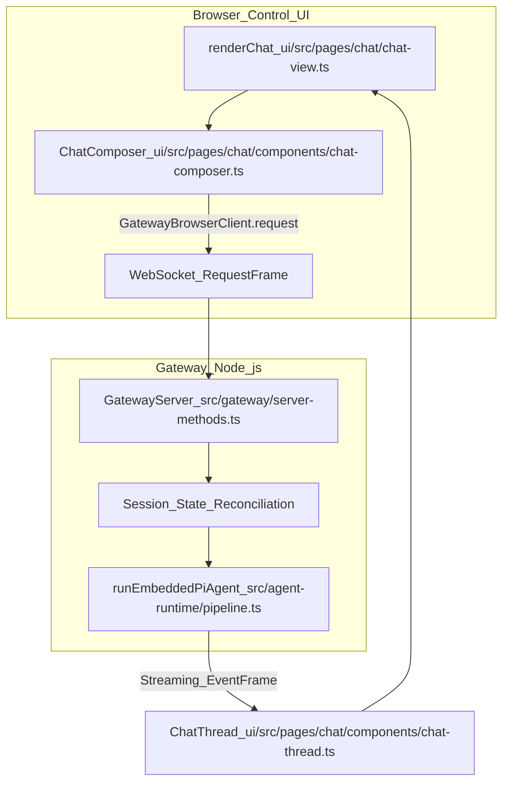
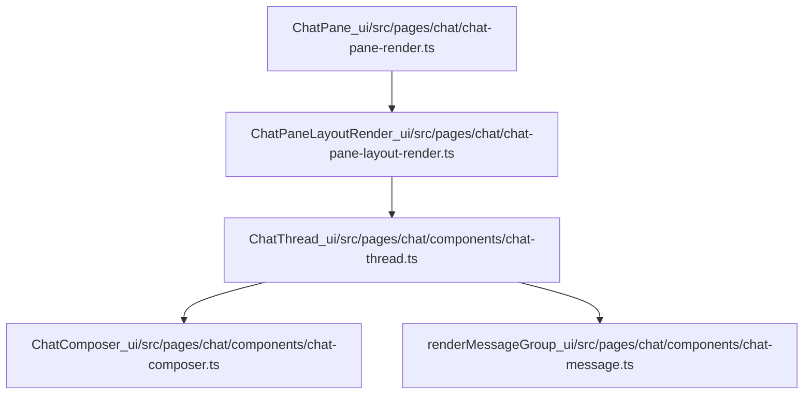

# Control UI & WebChat

Relevant source files

The following files were used as context for generating this wiki page:

- [docs/web/control-ui.md](docs/web/control-ui.md)
- [scripts/control-ui-boot-manifest.mts](scripts/control-ui-boot-manifest.mts)
- [ui/AGENTS.md](ui/AGENTS.md)
- [ui/config/control-ui-boot-modules.json](ui/config/control-ui-boot-modules.json)
- [ui/config/control-ui-chunking.ts](ui/config/control-ui-chunking.ts)
- [ui/src/app-session-path-builder.ts](ui/src/app-session-path-builder.ts)
- [ui/src/app/app-host-native-shell.test.ts](ui/src/app/app-host-native-shell.test.ts)
- [ui/src/app/app-host.chat-metadata.test.ts](ui/src/app/app-host.chat-metadata.test.ts)
- [ui/src/app/app-host.panel-toggles.test.ts](ui/src/app/app-host.panel-toggles.test.ts)
- [ui/src/app/app-host.server-prefs.test.ts](ui/src/app/app-host.server-prefs.test.ts)
- [ui/src/app/app-host.test-support.ts](ui/src/app/app-host.test-support.ts)
- [ui/src/app/app-host.test.ts](ui/src/app/app-host.test.ts)
- [ui/src/app/app-host.ts](ui/src/app/app-host.ts)
- [ui/src/app/app-shell-chrome.ts](ui/src/app/app-shell-chrome.ts)
- [ui/src/app/app-shell-gateway.ts](ui/src/app/app-shell-gateway.ts)
- [ui/src/app/app-shell-navigation.ts](ui/src/app/app-shell-navigation.ts)
- [ui/src/app/app-shell-view.ts](ui/src/app/app-shell-view.ts)
- [ui/src/app/bootstrap-location.test.ts](ui/src/app/bootstrap-location.test.ts)
- [ui/src/app/bootstrap-location.ts](ui/src/app/bootstrap-location.ts)
- [ui/src/app/bootstrap-theme.ts](ui/src/app/bootstrap-theme.ts)
- [ui/src/app/bootstrap.agent-selection.test.ts](ui/src/app/bootstrap.agent-selection.test.ts)
- [ui/src/app/bootstrap.gateway-credentials.test.ts](ui/src/app/bootstrap.gateway-credentials.test.ts)
- [ui/src/app/bootstrap.nav-visibility.test.ts](ui/src/app/bootstrap.nav-visibility.test.ts)
- [ui/src/app/bootstrap.test.ts](ui/src/app/bootstrap.test.ts)
- [ui/src/app/bootstrap.ts](ui/src/app/bootstrap.ts)
- [ui/src/app/chat-attachment-handoff.test.ts](ui/src/app/chat-attachment-handoff.test.ts)
- [ui/src/app/chat-attachment-handoff.ts](ui/src/app/chat-attachment-handoff.ts)
- [ui/src/app/context.ts](ui/src/app/context.ts)
- [ui/src/app/control-ui-chunking.test.ts](ui/src/app/control-ui-chunking.test.ts)
- [ui/src/app/device-scope-upgrade.ts](ui/src/app/device-scope-upgrade.ts)
- [ui/src/app/lazy-custom-element.test.ts](ui/src/app/lazy-custom-element.test.ts)
- [ui/src/app/lazy-custom-element.ts](ui/src/app/lazy-custom-element.ts)
- [ui/src/app/lazy-shell-action.test.ts](ui/src/app/lazy-shell-action.test.ts)
- [ui/src/app/lazy-shell-action.ts](ui/src/app/lazy-shell-action.ts)
- [ui/src/app/navigation-surface.ts](ui/src/app/navigation-surface.ts)
- [ui/src/app/route-transition.ts](ui/src/app/route-transition.ts)
- [ui/src/components/app-sidebar-render.ts](ui/src/components/app-sidebar-render.ts)
- [ui/src/components/icons-tools.ts](ui/src/components/icons-tools.ts)
- [ui/src/components/icons.ts](ui/src/components/icons.ts)
- [ui/src/components/markdown-session-links.test.ts](ui/src/components/markdown-session-links.test.ts)
- [ui/src/components/session-link-titling.test.ts](ui/src/components/session-link-titling.test.ts)
- [ui/src/components/settings-sidebar.test.ts](ui/src/components/settings-sidebar.test.ts)
- [ui/src/components/settings-sidebar.ts](ui/src/components/settings-sidebar.ts)
- [ui/src/components/sidebar-attention-dismissals.ts](ui/src/components/sidebar-attention-dismissals.ts)
- [ui/src/components/sidebar-attention-entries.ts](ui/src/components/sidebar-attention-entries.ts)
- [ui/src/components/sidebar-attention-items.ts](ui/src/components/sidebar-attention-items.ts)
- [ui/src/components/sidebar-attention-layout.browser.test.ts](ui/src/components/sidebar-attention-layout.browser.test.ts)
- [ui/src/components/sidebar-attention-panel.runtime.ts](ui/src/components/sidebar-attention-panel.runtime.ts)
- [ui/src/components/sidebar-attention.test.ts](ui/src/components/sidebar-attention.test.ts)
- [ui/src/components/sidebar-attention.ts](ui/src/components/sidebar-attention.ts)
- [ui/src/components/sidebar-issue-item.test.ts](ui/src/components/sidebar-issue-item.test.ts)
- [ui/src/components/sidebar-issue-item.ts](ui/src/components/sidebar-issue-item.ts)
- [ui/src/components/sidebar-update-card.test.ts](ui/src/components/sidebar-update-card.test.ts)
- [ui/src/components/sidebar-update-card.ts](ui/src/components/sidebar-update-card.ts)
- [ui/src/e2e/agent-config-save.e2e.test.ts](ui/src/e2e/agent-config-save.e2e.test.ts)
- [ui/src/e2e/agent-file-lifecycle.e2e.test.ts](ui/src/e2e/agent-file-lifecycle.e2e.test.ts)
- [ui/src/e2e/agent-file-lifecycle.test-support.ts](ui/src/e2e/agent-file-lifecycle.test-support.ts)
- [ui/src/e2e/agent-model-fallback-ownership.e2e.test.ts](ui/src/e2e/agent-model-fallback-ownership.e2e.test.ts)
- [ui/src/e2e/avatar-initial-emoji.e2e.test.ts](ui/src/e2e/avatar-initial-emoji.e2e.test.ts)
- [ui/src/e2e/chat-composer-redesign.e2e.test.ts](ui/src/e2e/chat-composer-redesign.e2e.test.ts)
- [ui/src/e2e/chat-flow.models-reasoning.e2e.test.ts](ui/src/e2e/chat-flow.models-reasoning.e2e.test.ts)
- [ui/src/e2e/chat-message-actions.e2e.test.ts](ui/src/e2e/chat-message-actions.e2e.test.ts)
- [ui/src/e2e/chat-tool-turn-outcome.e2e.test.ts](ui/src/e2e/chat-tool-turn-outcome.e2e.test.ts)
- [ui/src/e2e/chat-user-bubble-disclosure.e2e.test.ts](ui/src/e2e/chat-user-bubble-disclosure.e2e.test.ts)
- [ui/src/e2e/dashboard-session-retention.e2e.test.ts](ui/src/e2e/dashboard-session-retention.e2e.test.ts)
- [ui/src/e2e/device-scope-upgrade.e2e.test.ts](ui/src/e2e/device-scope-upgrade.e2e.test.ts)
- [ui/src/e2e/lazy-custom-element-recovery.e2e.test.ts](ui/src/e2e/lazy-custom-element-recovery.e2e.test.ts)
- [ui/src/e2e/mobile-inbox-sheet.e2e.test.ts](ui/src/e2e/mobile-inbox-sheet.e2e.test.ts)
- [ui/src/e2e/native-nav-sidebar-toggle.e2e.test.ts](ui/src/e2e/native-nav-sidebar-toggle.e2e.test.ts)
- [ui/src/e2e/new-session-page.model-catalog.e2e.test.ts](ui/src/e2e/new-session-page.model-catalog.e2e.test.ts)
- [ui/src/e2e/operator-admin.e2e.test.ts](ui/src/e2e/operator-admin.e2e.test.ts)
- [ui/src/e2e/session-list-filter.e2e.test.ts](ui/src/e2e/session-list-filter.e2e.test.ts)
- [ui/src/e2e/session-management.account-label.e2e.test.ts](ui/src/e2e/session-management.account-label.e2e.test.ts)
- [ui/src/e2e/session-management.delete.e2e.test.ts](ui/src/e2e/session-management.delete.e2e.test.ts)
- [ui/src/e2e/session-transcript-search.e2e.test.ts](ui/src/e2e/session-transcript-search.e2e.test.ts)
- [ui/src/e2e/settings-prefs-reconnect.e2e.test.ts](ui/src/e2e/settings-prefs-reconnect.e2e.test.ts)
- [ui/src/e2e/update-coalesced.e2e.test.ts](ui/src/e2e/update-coalesced.e2e.test.ts)
- [ui/src/e2e/update-confirmation.e2e.test.ts](ui/src/e2e/update-confirmation.e2e.test.ts)
- [ui/src/i18n/locales/en.ts](ui/src/i18n/locales/en.ts)
- [ui/src/lib/agents/display.test.ts](ui/src/lib/agents/display.test.ts)
- [ui/src/lib/agents/display.ts](ui/src/lib/agents/display.ts)
- [ui/src/lib/agents/index.test.ts](ui/src/lib/agents/index.test.ts)
- [ui/src/lib/agents/index.ts](ui/src/lib/agents/index.ts)
- [ui/src/lib/chat/chat-metadata-store.test.ts](ui/src/lib/chat/chat-metadata-store.test.ts)
- [ui/src/lib/chat/chat-metadata-store.ts](ui/src/lib/chat/chat-metadata-store.ts)
- [ui/src/lib/chat/chat-types.ts](ui/src/lib/chat/chat-types.ts)
- [ui/src/lib/chat/message-normalizer.sender-label.test.ts](ui/src/lib/chat/message-normalizer.sender-label.test.ts)
- [ui/src/lib/chat/outbox-store.test.ts](ui/src/lib/chat/outbox-store.test.ts)
- [ui/src/lib/chat/outbox-store.ts](ui/src/lib/chat/outbox-store.ts)
- [ui/src/lib/keyboard-shortcuts.ts](ui/src/lib/keyboard-shortcuts.ts)
- [ui/src/lib/session-display.test.ts](ui/src/lib/session-display.test.ts)
- [ui/src/lib/session-display.ts](ui/src/lib/session-display.ts)
- [ui/src/lib/sessions/catalog-project-grouping.ts](ui/src/lib/sessions/catalog-project-grouping.ts)
- [ui/src/lib/sessions/grouping.test.ts](ui/src/lib/sessions/grouping.test.ts)
- [ui/src/lib/sessions/grouping.ts](ui/src/lib/sessions/grouping.ts)
- [ui/src/lib/sessions/patch.ts](ui/src/lib/sessions/patch.ts)
- [ui/src/pages/agents/agent-file-lifecycle.test.ts](ui/src/pages/agents/agent-file-lifecycle.test.ts)
- [ui/src/pages/agents/agents-page.test.ts](ui/src/pages/agents/agents-page.test.ts)
- [ui/src/pages/agents/agents-page.ts](ui/src/pages/agents/agents-page.ts)
- [ui/src/pages/agents/files.test.ts](ui/src/pages/agents/files.test.ts)
- [ui/src/pages/agents/files.ts](ui/src/pages/agents/files.ts)
- [ui/src/pages/agents/panels-overview.test.ts](ui/src/pages/agents/panels-overview.test.ts)
- [ui/src/pages/agents/panels-overview.ts](ui/src/pages/agents/panels-overview.ts)
- [ui/src/pages/agents/panels-tools-skills.browser.test.ts](ui/src/pages/agents/panels-tools-skills.browser.test.ts)
- [ui/src/pages/agents/panels-tools-skills.ts](ui/src/pages/agents/panels-tools-skills.ts)
- [ui/src/pages/agents/tool-policy.ts](ui/src/pages/agents/tool-policy.ts)
- [ui/src/pages/chat/attachment-payload-store.ts](ui/src/pages/chat/attachment-payload-store.ts)
- [ui/src/pages/chat/chat-canonical-location.ts](ui/src/pages/chat/chat-canonical-location.ts)
- [ui/src/pages/chat/chat-composer-capability-host.test.ts](ui/src/pages/chat/chat-composer-capability-host.test.ts)
- [ui/src/pages/chat/chat-composer-capability-host.ts](ui/src/pages/chat/chat-composer-capability-host.ts)
- [ui/src/pages/chat/chat-composer-memory-fallback.test.ts](ui/src/pages/chat/chat-composer-memory-fallback.test.ts)
- [ui/src/pages/chat/chat-composer-memory-fallback.ts](ui/src/pages/chat/chat-composer-memory-fallback.ts)
- [ui/src/pages/chat/chat-page-attachment-handoff.test.ts](ui/src/pages/chat/chat-page-attachment-handoff.test.ts)
- [ui/src/pages/chat/chat-page-pane-render.ts](ui/src/pages/chat/chat-page-pane-render.ts)
- [ui/src/pages/chat/chat-page-retained-sessions.test.ts](ui/src/pages/chat/chat-page-retained-sessions.test.ts)
- [ui/src/pages/chat/chat-page-retained-sessions.ts](ui/src/pages/chat/chat-page-retained-sessions.ts)
- [ui/src/pages/chat/chat-page.test.ts](ui/src/pages/chat/chat-page.test.ts)
- [ui/src/pages/chat/chat-page.ts](ui/src/pages/chat/chat-page.ts)
- [ui/src/pages/chat/chat-pane-attachment-handoff.test.ts](ui/src/pages/chat/chat-pane-attachment-handoff.test.ts)
- [ui/src/pages/chat/chat-pane-attachment-handoff.ts](ui/src/pages/chat/chat-pane-attachment-handoff.ts)
- [ui/src/pages/chat/chat-pane-base.ts](ui/src/pages/chat/chat-pane-base.ts)
- [ui/src/pages/chat/chat-pane-browser-annotation-lifecycle.test.ts](ui/src/pages/chat/chat-pane-browser-annotation-lifecycle.test.ts)
- [ui/src/pages/chat/chat-pane-browser-annotation.test.ts](ui/src/pages/chat/chat-pane-browser-annotation.test.ts)
- [ui/src/pages/chat/chat-pane-browser-annotation.ts](ui/src/pages/chat/chat-pane-browser-annotation.ts)
- [ui/src/pages/chat/chat-pane-companion-lifecycle.test.ts](ui/src/pages/chat/chat-pane-companion-lifecycle.test.ts)
- [ui/src/pages/chat/chat-pane-context.ts](ui/src/pages/chat/chat-pane-context.ts)
- [ui/src/pages/chat/chat-pane-lifecycle.test.ts](ui/src/pages/chat/chat-pane-lifecycle.test.ts)
- [ui/src/pages/chat/chat-pane-lifecycle.ts](ui/src/pages/chat/chat-pane-lifecycle.ts)
- [ui/src/pages/chat/chat-pane-render.ts](ui/src/pages/chat/chat-pane-render.ts)
- [ui/src/pages/chat/chat-pane-session-controls.test.ts](ui/src/pages/chat/chat-pane-session-controls.test.ts)
- [ui/src/pages/chat/chat-pane-session-controls.ts](ui/src/pages/chat/chat-pane-session-controls.ts)
- [ui/src/pages/chat/chat-pane-session-menu.ts](ui/src/pages/chat/chat-pane-session-menu.ts)
- [ui/src/pages/chat/chat-pane.test-support.ts](ui/src/pages/chat/chat-pane.test-support.ts)
- [ui/src/pages/chat/chat-pane.test.ts](ui/src/pages/chat/chat-pane.test.ts)
- [ui/src/pages/chat/chat-progress.test.ts](ui/src/pages/chat/chat-progress.test.ts)
- [ui/src/pages/chat/chat-progress.ts](ui/src/pages/chat/chat-progress.ts)
- [ui/src/pages/chat/chat-responsive.browser.test.ts](ui/src/pages/chat/chat-responsive.browser.test.ts)
- [ui/src/pages/chat/chat-settings-patches.ts](ui/src/pages/chat/chat-settings-patches.ts)
- [ui/src/pages/chat/chat-state-host.ts](ui/src/pages/chat/chat-state-host.ts)
- [ui/src/pages/chat/chat-state-page.ts](ui/src/pages/chat/chat-state-page.ts)
- [ui/src/pages/chat/chat-thread-build.ts](ui/src/pages/chat/chat-thread-build.ts)
- [ui/src/pages/chat/chat-thread-grouping.ts](ui/src/pages/chat/chat-thread-grouping.ts)
- [ui/src/pages/chat/chat-thread.test.ts](ui/src/pages/chat/chat-thread.test.ts)
- [ui/src/pages/chat/chat-thread.ts](ui/src/pages/chat/chat-thread.ts)
- [ui/src/pages/chat/chat-view.test.ts](ui/src/pages/chat/chat-view.test.ts)
- [ui/src/pages/chat/chat-view.ts](ui/src/pages/chat/chat-view.ts)
- [ui/src/pages/chat/components/chat-composer-plus-menu.ts](ui/src/pages/chat/components/chat-composer-plus-menu.ts)
- [ui/src/pages/chat/components/chat-effort-picker.ts](ui/src/pages/chat/components/chat-effort-picker.ts)
- [ui/src/pages/chat/components/chat-message-bubble.ts](ui/src/pages/chat/components/chat-message-bubble.ts)
- [ui/src/pages/chat/components/chat-message-group.ts](ui/src/pages/chat/components/chat-message-group.ts)
- [ui/src/pages/chat/components/chat-message-markdown.test.ts](ui/src/pages/chat/components/chat-message-markdown.test.ts)
- [ui/src/pages/chat/components/chat-message-markdown.ts](ui/src/pages/chat/components/chat-message-markdown.ts)
- [ui/src/pages/chat/components/chat-message-stream.ts](ui/src/pages/chat/components/chat-message-stream.ts)
- [ui/src/pages/chat/components/chat-message.test.ts](ui/src/pages/chat/components/chat-message.test.ts)
- [ui/src/pages/chat/components/chat-model-controls.ts](ui/src/pages/chat/components/chat-model-controls.ts)
- [ui/src/pages/chat/components/chat-model-picker-options.ts](ui/src/pages/chat/components/chat-model-picker-options.ts)
- [ui/src/pages/chat/components/chat-model-picker.ts](ui/src/pages/chat/components/chat-model-picker.ts)
- [ui/src/pages/chat/components/chat-permission-picker.ts](ui/src/pages/chat/components/chat-permission-picker.ts)
- [ui/src/pages/chat/components/chat-picker-overlay.test.ts](ui/src/pages/chat/components/chat-picker-overlay.test.ts)
- [ui/src/pages/chat/components/chat-picker-overlay.ts](ui/src/pages/chat/components/chat-picker-overlay.ts)
- [ui/src/pages/chat/components/chat-thread-interactions.ts](ui/src/pages/chat/components/chat-thread-interactions.ts)
- [ui/src/pages/chat/components/chat-thread.ts](ui/src/pages/chat/components/chat-thread.ts)
- [ui/src/pages/chat/components/chat-tool-cards.test.ts](ui/src/pages/chat/components/chat-tool-cards.test.ts)
- [ui/src/pages/chat/components/chat-tool-cards.ts](ui/src/pages/chat/components/chat-tool-cards.ts)
- [ui/src/pages/chat/components/chat-transcript-projection.ts](ui/src/pages/chat/components/chat-transcript-projection.ts)
- [ui/src/pages/chat/route-draft-focus-handoff.ts](ui/src/pages/chat/route-draft-focus-handoff.ts)
- [ui/src/pages/chat/route-draft.ts](ui/src/pages/chat/route-draft.ts)
- [ui/src/pages/gateway-source-replacement.test.ts](ui/src/pages/gateway-source-replacement.test.ts)
- [ui/src/pages/new-session/model-control.catalog-targets.test.ts](ui/src/pages/new-session/model-control.catalog-targets.test.ts)
- [ui/src/pages/new-session/model-control.metadata-lifecycle.test.ts](ui/src/pages/new-session/model-control.metadata-lifecycle.test.ts)
- [ui/src/pages/new-session/model-control.test.ts](ui/src/pages/new-session/model-control.test.ts)
- [ui/src/pages/new-session/model-control.ts](ui/src/pages/new-session/model-control.ts)
- [ui/src/pages/route-provenance.test.ts](ui/src/pages/route-provenance.test.ts)
- [ui/src/pages/sessions/page-state.ts](ui/src/pages/sessions/page-state.ts)
- [ui/src/pages/sessions/route.test.ts](ui/src/pages/sessions/route.test.ts)
- [ui/src/pages/sessions/route.ts](ui/src/pages/sessions/route.ts)
- [ui/src/pages/sessions/sessions-page.roster.test.ts](ui/src/pages/sessions/sessions-page.roster.test.ts)
- [ui/src/pages/sessions/sessions-page.test-support.ts](ui/src/pages/sessions/sessions-page.test-support.ts)
- [ui/src/pages/sessions/sessions-page.test.ts](ui/src/pages/sessions/sessions-page.test.ts)
- [ui/src/pages/sessions/sessions-page.transcript-search.test.ts](ui/src/pages/sessions/sessions-page.transcript-search.test.ts)
- [ui/src/pages/sessions/sessions-page.ts](ui/src/pages/sessions/sessions-page.ts)
- [ui/src/pages/sessions/view.browser.test.ts](ui/src/pages/sessions/view.browser.test.ts)
- [ui/src/pages/sessions/view.test.ts](ui/src/pages/sessions/view.test.ts)
- [ui/src/pages/sessions/view.ts](ui/src/pages/sessions/view.ts)
- [ui/src/styles/base-theme-contrast.node.test.ts](ui/src/styles/base-theme-contrast.node.test.ts)
- [ui/src/styles/base.css](ui/src/styles/base.css)
- [ui/src/styles/chat-file-link-presentation.browser.test.ts](ui/src/styles/chat-file-link-presentation.browser.test.ts)
- [ui/src/styles/chat/grouped.css](ui/src/styles/chat/grouped.css)
- [ui/src/styles/chat/layout.css](ui/src/styles/chat/layout.css)
- [ui/src/styles/chat/sidebar.css](ui/src/styles/chat/sidebar.css)
- [ui/src/styles/chat/text.css](ui/src/styles/chat/text.css)
- [ui/src/styles/chat/tool-cards.css](ui/src/styles/chat/tool-cards.css)
- [ui/src/styles/components.css](ui/src/styles/components.css)
- [ui/src/styles/layout.css](ui/src/styles/layout.css)
- [ui/src/styles/layout.mobile.css](ui/src/styles/layout.mobile.css)
- [ui/src/styles/sessions.css](ui/src/styles/sessions.css)
- [ui/src/styles/sidebar-attention-floating.css](ui/src/styles/sidebar-attention-floating.css)
- [ui/src/styles/sidebar-issues.css](ui/src/styles/sidebar-issues.css)
- [ui/src/styles/sidebar-update-card.css](ui/src/styles/sidebar-update-card.css)
- [ui/src/test-helpers/app-sidebar-cases/basics.ts](ui/src/test-helpers/app-sidebar-cases/basics.ts)

The OpenClaw Gateway serves a browser-based Control UI that acts as the primary administrative and interaction interface for the system. It includes a comprehensive chat interface, settings management, session views, and real-time monitoring.

## Overview

The Control UI is a Single Page Application (SPA) built with **Vite + Lit** and served directly by the Gateway's internal HTTP server [docs/web/control-ui.md:10](). By default, it is accessible at `http://<host>:18789/`, though an optional prefix can be configured via `gateway.controlUi.basePath` [docs/web/control-ui.md:13](). It speaks directly to the Gateway WebSocket Protocol on the same port [docs/web/control-ui.md:17]().

### Implementation Architecture

The UI is organized into a controller-view pattern. Views represent visual layouts using Lit templates, while controllers and context providers handle data fetching and state mutations through RPC calls over the WebSocket [ui/src/app/app-shell-view.ts:68-116]().

| Component | Responsibility |
| :--- | :--- |
| **App Shell** | Manages the main layout (`.shell`), sidebar navigation, and the `ApplicationContext` [ui/src/app/app-shell-view.ts:5-32](), [ui/src/styles/layout.css:5-39](). |
| **App Sidebar** | Handles navigation routes, session lists, and agent switching [ui/src/app/app-shell-view.ts:80-89](). |
| **Login Gate** | Manages initial authentication, pairing requests, and connection splashes [ui/src/styles/components.css:5-17](), [ui/src/styles/components.css:211-231](). |
| **Chat Pane** | The primary container for the chat interface, handling session switching and state [ui/src/pages/chat/chat-pane-render.ts:77-80](). |

Sources: [docs/web/control-ui.md:10-17](), [ui/src/app/app-shell-view.ts:5-116](), [ui/src/styles/layout.css:5-39](), [ui/src/styles/components.css:5-231](), [ui/src/pages/chat/chat-pane-render.ts:77-80]().

## Chat Interface

The Chat interface is the primary interaction point for AI agents. It supports real-time streaming, tool execution visualization, and session management through a multi-pane workbench layout.

### Message Processing Flow

When a user sends a message through the UI, it follows a pipeline managed by the chat components:

1.  **Input Handling**: `ChatComposer` captures text and attachments [ui/src/pages/chat/chat-view.test.ts:57]().
2.  **Submission**: The UI dispatches the message to the gateway via `GatewayBrowserClient` [ui/src/pages/chat/chat-view.test.ts:7]().
3.  **Gateway Routing**: The Gateway resolves the `sessionKey` and routes the message to the active agent [ui/src/pages/chat/chat-pane-render.ts:88-89]().
4.  **Event Feedback**: The UI processes incoming events to update the stream in real-time [ui/src/pages/chat/chat-pane-render.ts:53-55]().

### Data Flow: WebChat to Agent Runtime

The following diagram illustrates the path of a message from the browser UI to the Agent Runtime.

Title: "Message Delivery Path from Control UI"

Sources: [ui/src/pages/chat/chat-view.ts:55](), [ui/src/pages/chat/chat-view.test.ts:7-13](), [ui/src/pages/chat/chat-pane-render.ts:88-89](), [ui/src/pages/chat/components/chat-composer.ts:57]().

### Chat UI Components

The chat interface includes several interactive elements:

*   **Workbench**: A grid layout that manages navigation and content areas [ui/src/styles/layout.css:26-39]().
*   **Thread View**: The scrollable section that renders message bubbles and tool cards [ui/src/pages/chat/chat-thread.ts:14-19](), [ui/src/styles/chat/layout.css:6-11]().
*   **Session Observation**: A status digest produced by a utility model, showing plan progress and elapsed time [docs/web/control-ui.md:21-23]().
*   **Side Chat**: A read-only Side chat thread for asking questions about a session without interrupting the main run [docs/web/control-ui.md:23-26]().
*   **Context Compaction**: A visual indicator showing where history has been compacted to save context [ui/src/pages/chat/chat-view.test.ts:124-136]().

Title: "Chat View Component Hierarchy"

Sources: [ui/src/pages/chat/chat-pane-render.ts:77-80](), [ui/src/styles/chat/layout.css:6-11](), [ui/src/pages/chat/components/chat-thread.ts:14-19](), [ui/src/pages/chat/components/chat-message.ts:20](), [docs/web/control-ui.md:21-26]().

## Device Pairing & Authentication

Connecting from a new browser requires a one-time pairing approval [docs/web/control-ui.md:85]().

### Pairing Flow
1.  **Handshake**: The UI attempts a connection. If unauthorized, it receives a `pairing required` error [docs/web/control-ui.md:80-82]().
2.  **Approval**: The user must approve the `requestId` via the CLI or another paired device [docs/web/control-ui.md:83-84]().
3.  **Local Loopback**: A direct loopback connection does not bypass token or password auth [docs/web/control-ui.md:81-82]().

### Auth Modes
Auth is supplied during the WebSocket handshake via:
*   `connect.params.auth.token` [docs/web/control-ui.md:76]()
*   `connect.params.auth.password` [docs/web/control-ui.md:77]()
*   Tailscale Serve identity headers when `gateway.auth.allowTailscale: true` [docs/web/control-ui.md:78]()
*   Trusted-proxy identity headers when `gateway.auth.mode: "trusted-proxy"` [docs/web/control-ui.md:79]()

Sources: [docs/web/control-ui.md:74-86]().

## Sidebar & Navigation

The `AppSidebar` component manages the primary navigation and session history.

*   **Session List**: Manages the display of active and historical sessions [ui/src/app/app-shell-view.ts:80-89]().
*   **Environment Identity**: Visual indicators (top stripe, avatar rings) distinguish different Gateway environments [docs/web/control-ui.md:31-45](), [ui/src/styles/layout.css:41-61]().
*   **Layout**: Uses a CSS grid system (`.shell`) that supports collapsed and expanded states [ui/src/styles/layout.css:5-39](). On native macOS, it integrates with a custom titlebar height [ui/src/styles/layout.css:190-192]().
*   **Shortcuts**: Provides keyboard shortcuts for navigation and chat actions [ui/src/i18n/locales/en.ts:117-156]().

Sources: [ui/src/app/app-shell-view.ts:80-89](), [ui/src/styles/layout.css:5-192](), [docs/web/control-ui.md:31-45](), [ui/src/i18n/locales/en.ts:117-156]().

## WebChat Protocol & UI State

The Control UI uses the Gateway's WebSocket RPC protocol to synchronize state and stream data.

*   **Localization**: The UI localizes itself on load using the `TranslationMap` [ui/src/i18n/locales/en.ts:6-10]().
*   **State Management**: Session presentation state is managed by components like `chat-session.ts` and `chat-view-state.ts` [ui/src/pages/chat/chat-view.test.ts:45-48]().
*   **Responsive Behavior**: The layout adapts to mobile viewports by adjusting touch targets and sidebar visibility [ui/src/pages/chat/chat-responsive.browser.test.ts:23-32](), [ui/src/styles/layout.css:82-86]().
*   **Media Handling**: Supports rendering of images, audio, and file attachments within the chat stream [ui/src/pages/chat/components/chat-message.test.ts:149-184]().

Sources: [ui/src/i18n/locales/en.ts:6-10](), [ui/src/pages/chat/chat-view.test.ts:45-48](), [ui/src/pages/chat/chat-responsive.browser.test.ts:23-32](), [ui/src/styles/layout.css:82-86](), [ui/src/pages/chat/components/chat-message.test.ts:149-184]().