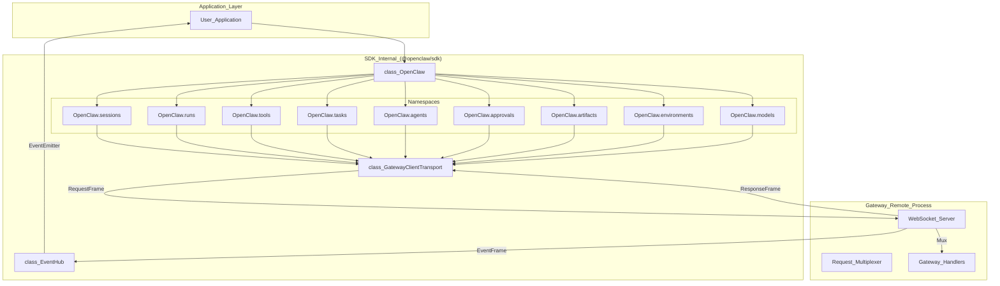
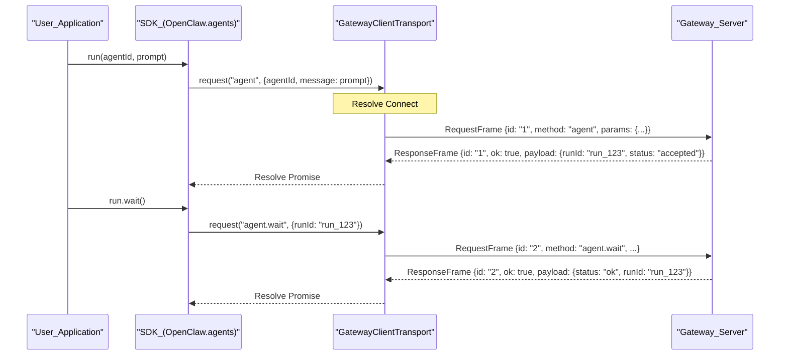

# Client SDK

Relevant source files

The following files were used as context for generating this wiki page:

- [apps/android/app/src/main/java/ai/openclaw/app/gateway/GatewayProtocol.kt](apps/android/app/src/main/java/ai/openclaw/app/gateway/GatewayProtocol.kt)
- [apps/shared/OpenClawKit/Sources/OpenClawProtocol/GatewayModels.swift](apps/shared/OpenClawKit/Sources/OpenClawProtocol/GatewayModels.swift)
- [docs/gateway/operator-scopes.md](docs/gateway/operator-scopes.md)
- [docs/gateway/protocol.md](docs/gateway/protocol.md)
- [packages/ai/src/utils/deferred-event-buffer.test.ts](packages/ai/src/utils/deferred-event-buffer.test.ts)
- [packages/gateway-client/src/client.handshake.test.ts](packages/gateway-client/src/client.handshake.test.ts)
- [packages/gateway-client/src/protocol-client-contract.ts](packages/gateway-client/src/protocol-client-contract.ts)
- [packages/gateway-client/src/protocol-client.handshake.test.ts](packages/gateway-client/src/protocol-client.handshake.test.ts)
- [packages/gateway-client/src/protocol-client.socket-factory.test.ts](packages/gateway-client/src/protocol-client.socket-factory.test.ts)
- [packages/gateway-client/src/protocol-client.ts](packages/gateway-client/src/protocol-client.ts)
- [packages/gateway-protocol/src/client-info.ts](packages/gateway-protocol/src/client-info.ts)
- [packages/gateway-protocol/src/error-details.ts](packages/gateway-protocol/src/error-details.ts)
- [packages/gateway-protocol/src/gateway-error-details.ts](packages/gateway-protocol/src/gateway-error-details.ts)
- [packages/gateway-protocol/src/index.test.ts](packages/gateway-protocol/src/index.test.ts)
- [packages/gateway-protocol/src/index.ts](packages/gateway-protocol/src/index.ts)
- [packages/gateway-protocol/src/schema/error-codes.test.ts](packages/gateway-protocol/src/schema/error-codes.test.ts)
- [packages/gateway-protocol/src/schema/error-codes.ts](packages/gateway-protocol/src/schema/error-codes.ts)
- [packages/gateway-protocol/src/schema/logs-chat.test.ts](packages/gateway-protocol/src/schema/logs-chat.test.ts)
- [packages/gateway-protocol/src/schema/logs-chat.ts](packages/gateway-protocol/src/schema/logs-chat.ts)
- [packages/gateway-protocol/src/schema/protocol-schema-fragment-transport.ts](packages/gateway-protocol/src/schema/protocol-schema-fragment-transport.ts)
- [packages/gateway-protocol/src/validator-registry.ts](packages/gateway-protocol/src/validator-registry.ts)
- [packages/sdk/src/event-hub.test.ts](packages/sdk/src/event-hub.test.ts)
- [packages/sdk/src/event-hub.ts](packages/sdk/src/event-hub.ts)
- [packages/sdk/src/transport.test.ts](packages/sdk/src/transport.test.ts)
- [packages/sdk/src/transport.ts](packages/sdk/src/transport.ts)
- [packages/sdk/src/transport.websocket.test.ts](packages/sdk/src/transport.websocket.test.ts)
- [src/agents/code-mode.bridge.host-denial.test.ts](src/agents/code-mode.bridge.host-denial.test.ts)
- [src/agents/tools/message-tool-execution.test.ts](src/agents/tools/message-tool-execution.test.ts)
- [src/gateway/chat-abort.test.ts](src/gateway/chat-abort.test.ts)
- [src/gateway/chat-abort.ts](src/gateway/chat-abort.ts)
- [src/gateway/live-chat-projector.ts](src/gateway/live-chat-projector.ts)
- [src/gateway/method-scopes.test.ts](src/gateway/method-scopes.test.ts)
- [src/gateway/method-scopes.ts](src/gateway/method-scopes.ts)
- [src/gateway/methods/core-descriptors.since.test.ts](src/gateway/methods/core-descriptors.since.test.ts)
- [src/gateway/methods/core-descriptors.ts](src/gateway/methods/core-descriptors.ts)
- [src/gateway/server-methods-list.test.ts](src/gateway/server-methods-list.test.ts)
- [src/gateway/server-methods/chat-broadcast.test.ts](src/gateway/server-methods/chat-broadcast.test.ts)
- [src/gateway/server-methods/chat-broadcast.ts](src/gateway/server-methods/chat-broadcast.ts)
- [src/gateway/server-methods/chat-send-request.test.ts](src/gateway/server-methods/chat-send-request.test.ts)
- [src/gateway/server-methods/chat-send-request.ts](src/gateway/server-methods/chat-send-request.ts)
- [src/gateway/server-methods/chat-send-session.ts](src/gateway/server-methods/chat-send-session.ts)
- [src/gateway/server-methods/plugin-host-hooks.ts](src/gateway/server-methods/plugin-host-hooks.ts)
- [src/gateway/server-methods/sessions-subscriptions.ts](src/gateway/server-methods/sessions-subscriptions.ts)
- [src/gateway/server-methods/sessions-suggestions.test.ts](src/gateway/server-methods/sessions-suggestions.test.ts)
- [src/gateway/server-methods/sessions-suggestions.ts](src/gateway/server-methods/sessions-suggestions.ts)
- [src/gateway/server-methods/sessions-typing.test.ts](src/gateway/server-methods/sessions-typing.test.ts)
- [src/gateway/server.node-chat-subscriptions.test.ts](src/gateway/server.node-chat-subscriptions.test.ts)
- [src/gateway/worker-environments/live-chat.test-support.ts](src/gateway/worker-environments/live-chat.test-support.ts)
- [src/plugins/contracts/session-actions.contract.test.ts](src/plugins/contracts/session-actions.contract.test.ts)
- [ui/src/api/gateway.node.test.ts](ui/src/api/gateway.node.test.ts)
- [ui/src/api/gateway.ts](ui/src/api/gateway.ts)
- [ui/src/test-helpers/control-ui-e2e.ts](ui/src/test-helpers/control-ui-e2e.ts)

The OpenClaw Client SDK (`@openclaw/sdk`) is a TypeScript/JavaScript package located in `packages/sdk` that provides a high-level, programmatic interface for interacting with the OpenClaw Gateway. It wraps the [Gateway WebSocket protocol](2.1) into a structured class-based API, handling handshaking, authentication, request-response multiplexing, and event distribution.

## Core Architecture

The SDK is designed around the `OpenClaw` class, which serves as the primary entry point. It organizes Gateway functionality into logical namespaces and manages the underlying WebSocket lifecycle through the `GatewayClientTransport`.

### SDK Entity Mapping
The following diagram illustrates how the SDK bridges high-level TypeScript calls to the low-level WebSocket frames defined in the protocol.

Title: SDK Internal Architecture and Data Flow

Sources: `[packages/gateway-client/src/protocol-client.ts:1-20]()`, `[docs/gateway/protocol.md:10-33]()`, `[packages/sdk/src/transport.ts:1-10]()`

## Key Classes and Implementation

### The OpenClaw Class
The `OpenClaw` class is the central coordinator. It initializes the transport and provides access to functional namespaces. It handles the initial connection and configuration resolution.

*   **Configuration**: The SDK resolves Gateway URLs and credentials (token or password) via connection options.
*   **Authentication**: Supports token-based, password-based, and device-token authentication. The SDK integrates with the `GatewayProtocolClient` to handle the underlying WebSocket handshake and protocol versioning. `[docs/gateway/protocol.md:108-151]()`, `[ui/src/api/gateway.ts:119-145]()`
*   **Protocol Support**: The SDK wraps RPC methods like `agent`, `agent.wait`, `sessions.list`, and `tools.invoke`. `[src/gateway/methods/core-descriptors.ts:39-124]()`, `[packages/gateway-protocol/src/index.ts:5-52]()`

Sources: `[packages/gateway-client/src/protocol-client.ts:146-174]()`, `[docs/gateway/protocol.md:9-33]()`, `[ui/src/api/gateway.ts:1-29]()`

### GatewayClientTransport
The `GatewayClientTransport` (implementing `OpenClawTransport`) manages the `WebSocket` connection using `GatewayProtocolClient`. It is responsible for:
1.  **Framing**: Wrapping method calls into `RequestFrame` objects. Standard frames include `type: "req"`, `id`, `method`, and `params`. `[docs/gateway/protocol.md:48-53]()`, `[apps/android/app/src/main/java/ai/openclaw/app/gateway/GatewayProtocol.kt:22-29]()`
2.  **Multiplexing**: Tracking pending requests and resolving the correct promise when a `ResponseFrame` arrives. `[docs/gateway/protocol.md:52-52]()`, `[apps/android/app/src/main/java/ai/openclaw/app/gateway/GatewayProtocol.kt:31-38]()`
3.  **Connection Options**: Configurable parameters include `url`, `token`, `password`, and `clientVersion`. `[ui/src/api/gateway.ts:119-145]()`

Sources: `[packages/sdk/src/transport.ts:1-20]()`, `[docs/gateway/protocol.md:34-73]()`, `[packages/gateway-client/src/protocol-client.ts:146-174]()`

### EventHub
The `EventHub` processes incoming `EventFrame` messages. It allows clients to stream real-time updates. `[docs/gateway/protocol.md:50-50]()`, `[apps/android/app/src/main/java/ai/openclaw/app/gateway/GatewayProtocol.kt:40-47]()`

Key event types include:
*   **Run Updates**: Lifecycle notifications for agent runs. `[src/gateway/server-methods-list.test.ts:44-56]()`
*   **Assistant Streams**: Real-time streaming of Talk deltas via `talk.event`. `[src/gateway/server-methods-list.test.ts:14-19]()`
*   **Session Changes**: Updates to session state and observer digests via `SessionObserverHealth`. `[apps/shared/OpenClawKit/Sources/OpenClawProtocol/GatewayModels.swift:107-115]()`, `[src/gateway/server-methods-list.test.ts:40-42]()`

Sources: `[packages/sdk/src/event-hub.test.ts:1-10]()`, `[src/gateway/server-methods-list.test.ts:11-57]()`, `[apps/shared/OpenClawKit/Sources/OpenClawProtocol/GatewayModels.swift:107-115]()`

## Functional Namespaces

The SDK exposes Gateway methods through typed namespaces. These namespaces wrap RPC methods and normalize complex response payloads.

| Namespace | Primary Role | Key Methods / RPC Targets |
| :--- | :--- | :--- |
| **Agents** | Agent management | `agents.list`, `agents.create`, `agents.update` |
| **Sessions** | Conversation state | `sessions.list`, `sessions.create`, `sessions.send` |
| **Runs** | Agent execution | `agent`, `agent.wait`, `chat.abort` |
| **Tools** | Tool discovery | `tools.catalog`, `tools.invoke`, `tools.effective` |
| **Approvals** | Human-in-the-loop | `exec.approval.get`, `exec.approval.resolve`, `plugin.approval.list` |
| **Tasks** | Background jobs | `cron.list`, `cron.add`, `cron.run` |
| **Artifacts** | File management | `artifacts.list`, `artifacts.get` |
| **Environments**| Sandbox control | `environments.list`, `environments.status` |
| **Models** | Model control | `models.list`, `models.authStatus` |

Sources: `[src/gateway/methods/core-descriptors.ts:39-124]()`, `[packages/gateway-protocol/src/index.ts:5-52]()`, `[src/gateway/server-methods-list.test.ts:59-136]()`

## Request-Response Flow

Every request initiated by the SDK follows a strict lifecycle involving unique IDs and typed frames.

Title: Request-Response Sequence for Agent Execution

Sources: `[packages/gateway-client/src/protocol-client.ts:146-174]()`, `[docs/gateway/protocol.md:46-53]()`, `[apps/android/app/src/main/java/ai/openclaw/app/gateway/GatewayProtocol.kt:22-38]()`

## Error Handling and Normalization

The SDK surfaces Gateway errors using standard error codes and classifications defined in the protocol.

*   **Status Normalization**: The SDK normalizes Gateway-specific status strings into consistent states. Terminal statuses like `onTrack`, `failed`, or `waiting-on-user` are mapped from the protocol. `[apps/shared/OpenClawKit/Sources/OpenClawProtocol/GatewayModels.swift:107-115]()`
*   **Error Codes**: Common error codes include `NOT_LINKED`, `NOT_PAIRED`, `AGENT_TIMEOUT`, and `FORBIDDEN`. `[apps/shared/OpenClawKit/Sources/OpenClawProtocol/GatewayModels.swift:24-32]()`, `[apps/android/app/src/main/java/ai/openclaw/app/gateway/GatewayProtocol.kt:13-20]()`
*   **Scope Failures**: Method-level authorization failures use `FORBIDDEN` with `MISSING_SCOPE` details, which the SDK parses to provide actionable feedback. `[docs/gateway/protocol.md:72-88]()`, `[packages/gateway-protocol/src/index.ts:1-11]()`
*   **Protocol Synchronization**: Models are generated from `protocol-gen` scripts to ensure consistency between TypeScript, Swift, and Kotlin clients. `[apps/shared/OpenClawKit/Sources/OpenClawProtocol/GatewayModels.swift:1-7]()`, `[apps/android/app/src/main/java/ai/openclaw/app/gateway/GatewayProtocol.kt:1-11]()`

Sources: `[apps/shared/OpenClawKit/Sources/OpenClawProtocol/GatewayModels.swift:24-115]()`, `[docs/gateway/protocol.md:52-70]()`, `[packages/gateway-protocol/src/index.ts:1-52]()`, `[apps/android/app/src/main/java/ai/openclaw/app/gateway/GatewayProtocol.kt:13-38]()`