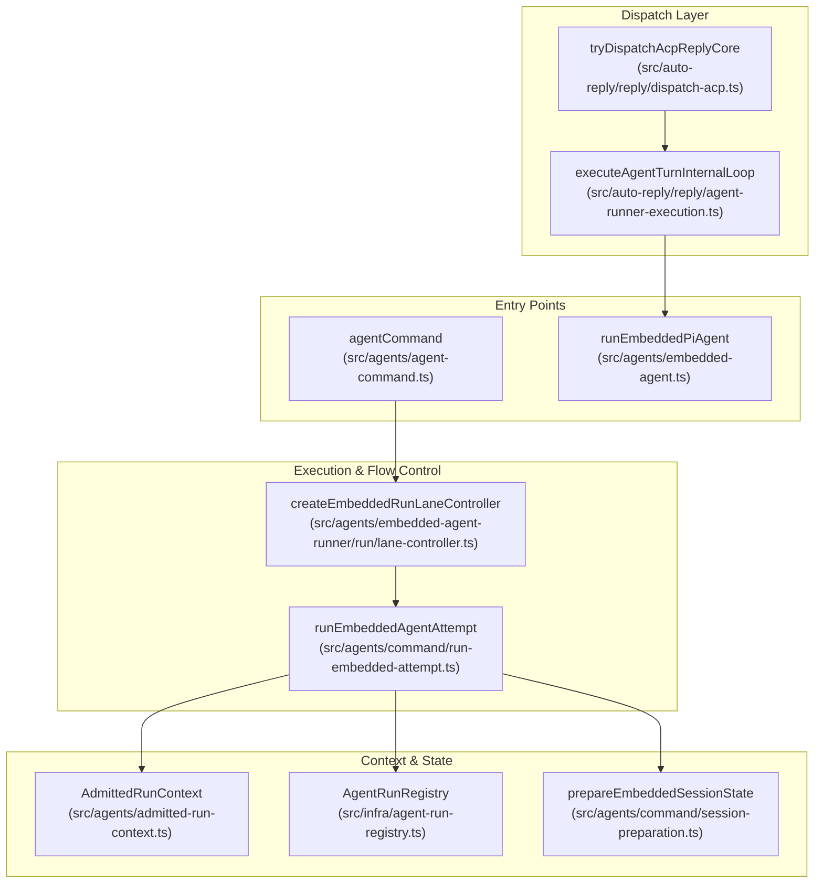

# Agent Runtime

Relevant source files

The following files were used as context for generating this wiki page:

- [extensions/copilot/harness.ts](extensions/copilot/harness.ts)
- [extensions/telegram/src/bot-message-dispatch.preview-hook-safety.test.ts](extensions/telegram/src/bot-message-dispatch.preview-hook-safety.test.ts)
- [packages/ai/src/providers/clean-for-gemini.ts](packages/ai/src/providers/clean-for-gemini.ts)
- [src/agents/agent-command-execution-identity.test.ts](src/agents/agent-command-execution-identity.test.ts)
- [src/agents/agent-command-execution-identity.ts](src/agents/agent-command-execution-identity.ts)
- [src/agents/agent-command.compaction-rotation.test.ts](src/agents/agent-command.compaction-rotation.test.ts)
- [src/agents/agent-command.compaction.test-support.ts](src/agents/agent-command.compaction.test-support.ts)
- [src/agents/agent-command.ingress-diagnostics.test.ts](src/agents/agent-command.ingress-diagnostics.test.ts)
- [src/agents/agent-command.live-model-switch.test.ts](src/agents/agent-command.live-model-switch.test.ts)
- [src/agents/agent-command.ts](src/agents/agent-command.ts)
- [src/agents/command/acp-execution.ts](src/agents/command/acp-execution.ts)
- [src/agents/command/ingress-diagnostics.ts](src/agents/command/ingress-diagnostics.ts)
- [src/agents/command/post-run.ts](src/agents/command/post-run.ts)
- [src/agents/command/prepare.ts](src/agents/command/prepare.ts)
- [src/agents/command/session-preparation.ts](src/agents/command/session-preparation.ts)
- [src/agents/embedded-agent-runner/run.cli-dispatch-lane.test.ts](src/agents/embedded-agent-runner/run.cli-dispatch-lane.test.ts)
- [src/agents/embedded-agent-runner/run/lane-controller.lifecycle.test.ts](src/agents/embedded-agent-runner/run/lane-controller.lifecycle.test.ts)
- [src/agents/embedded-agent-runner/run/lane-controller.queue-liveness.test.ts](src/agents/embedded-agent-runner/run/lane-controller.queue-liveness.test.ts)
- [src/agents/embedded-agent-runner/run/lane-controller.ts](src/agents/embedded-agent-runner/run/lane-controller.ts)
- [src/agents/embedded-agent-runner/run/lane-runtime.test.ts](src/agents/embedded-agent-runner/run/lane-runtime.test.ts)
- [src/agents/embedded-agent-runner/run/lane-runtime.ts](src/agents/embedded-agent-runner/run/lane-runtime.ts)
- [src/agents/embedded-agent-runner/run/run-settlement.test.ts](src/agents/embedded-agent-runner/run/run-settlement.test.ts)
- [src/agents/embedded-agent-runner/run/run-settlement.ts](src/agents/embedded-agent-runner/run/run-settlement.ts)
- [src/agents/embedded-agent-subscribe.raw-stream.test.ts](src/agents/embedded-agent-subscribe.raw-stream.test.ts)
- [src/agents/embedded-agent-subscribe.raw-stream.ts](src/agents/embedded-agent-subscribe.raw-stream.ts)
- [src/agents/embedded-agent-subscribe.tool-text-diagnostics.ts](src/agents/embedded-agent-subscribe.tool-text-diagnostics.ts)
- [src/agents/main-session-recovery/main-session-recovery-admission.ts](src/agents/main-session-recovery/main-session-recovery-admission.ts)
- [src/agents/main-session-recovery/main-session-restart-recovery-runtime.ts](src/agents/main-session-recovery/main-session-restart-recovery-runtime.ts)
- [src/agents/subagents/spawn/acp-spawn-parent-stream.ts](src/agents/subagents/spawn/acp-spawn-parent-stream.ts)
- [src/agents/tools/sessions-tool.self-archive.test.ts](src/agents/tools/sessions-tool.self-archive.test.ts)
- [src/auto-reply/dispatch.delivery-order.test.ts](src/auto-reply/dispatch.delivery-order.test.ts)
- [src/auto-reply/dispatch.ts](src/auto-reply/dispatch.ts)
- [src/auto-reply/reply-payload.ts](src/auto-reply/reply-payload.ts)
- [src/auto-reply/reply/acp-projector.test.ts](src/auto-reply/reply/acp-projector.test.ts)
- [src/auto-reply/reply/acp-projector.ts](src/auto-reply/reply/acp-projector.ts)
- [src/auto-reply/reply/agent-event-bridge.test.ts](src/auto-reply/reply/agent-event-bridge.test.ts)
- [src/auto-reply/reply/agent-event-bridge.ts](src/auto-reply/reply/agent-event-bridge.ts)
- [src/auto-reply/reply/agent-runner-execution-runtime.test.ts](src/auto-reply/reply/agent-runner-execution-runtime.test.ts)
- [src/auto-reply/reply/agent-runner-execution.ts](src/auto-reply/reply/agent-runner-execution.ts)
- [src/auto-reply/reply/before-deliver.test.ts](src/auto-reply/reply/before-deliver.test.ts)
- [src/auto-reply/reply/dispatch-acp-delivery.test.ts](src/auto-reply/reply/dispatch-acp-delivery.test.ts)
- [src/auto-reply/reply/dispatch-acp-delivery.ts](src/auto-reply/reply/dispatch-acp-delivery.ts)
- [src/auto-reply/reply/dispatch-acp-manager.runtime.ts](src/auto-reply/reply/dispatch-acp-manager.runtime.ts)
- [src/auto-reply/reply/dispatch-acp.test.ts](src/auto-reply/reply/dispatch-acp.test.ts)
- [src/auto-reply/reply/dispatch-acp.ts](src/auto-reply/reply/dispatch-acp.ts)
- [src/auto-reply/reply/dispatch-from-config.abort-and-dedupe.test-utils.ts](src/auto-reply/reply/dispatch-from-config.abort-and-dedupe.test-utils.ts)
- [src/auto-reply/reply/dispatch-from-config.acp-privacy.test.ts](src/auto-reply/reply/dispatch-from-config.acp-privacy.test.ts)
- [src/auto-reply/reply/dispatch-from-config.base.test-utils.ts](src/auto-reply/reply/dispatch-from-config.base.test-utils.ts)
- [src/auto-reply/reply/dispatch-from-config.choose-route.ts](src/auto-reply/reply/dispatch-from-config.choose-route.ts)
- [src/auto-reply/reply/dispatch-from-config.delivery-and-tts.test-utils.ts](src/auto-reply/reply/dispatch-from-config.delivery-and-tts.test-utils.ts)
- [src/auto-reply/reply/dispatch-from-config.events.ts](src/auto-reply/reply/dispatch-from-config.events.ts)
- [src/auto-reply/reply/dispatch-from-config.execute.ts](src/auto-reply/reply/dispatch-from-config.execute.ts)
- [src/auto-reply/reply/dispatch-from-config.finalize.ts](src/auto-reply/reply/dispatch-from-config.finalize.ts)
- [src/auto-reply/reply/dispatch-from-config.gather.ts](src/auto-reply/reply/dispatch-from-config.gather.ts)
- [src/auto-reply/reply/dispatch-from-config.hooks-and-send-policy.test-utils.ts](src/auto-reply/reply/dispatch-from-config.hooks-and-send-policy.test-utils.ts)
- [src/auto-reply/reply/dispatch-from-config.lifecycle-and-bindings.test-utils.ts](src/auto-reply/reply/dispatch-from-config.lifecycle-and-bindings.test-utils.ts)
- [src/auto-reply/reply/dispatch-from-config.lifecycle.ts](src/auto-reply/reply/dispatch-from-config.lifecycle.ts)
- [src/auto-reply/reply/dispatch-from-config.prepare-context.ts](src/auto-reply/reply/dispatch-from-config.prepare-context.ts)
- [src/auto-reply/reply/dispatch-from-config.prepare-operation.ts](src/auto-reply/reply/dispatch-from-config.prepare-operation.ts)
- [src/auto-reply/reply/dispatch-from-config.shared.test-harness.ts](src/auto-reply/reply/dispatch-from-config.shared.test-harness.ts)
- [src/auto-reply/reply/dispatch-from-config.stale-recovery.test.ts](src/auto-reply/reply/dispatch-from-config.stale-recovery.test.ts)
- [src/auto-reply/reply/dispatch-from-config.terminal-recovery.test.ts](src/auto-reply/reply/dispatch-from-config.terminal-recovery.test.ts)
- [src/auto-reply/reply/dispatch-from-config.test-harness.ts](src/auto-reply/reply/dispatch-from-config.test-harness.ts)
- [src/auto-reply/reply/dispatch-from-config.transcript.ts](src/auto-reply/reply/dispatch-from-config.transcript.ts)
- [src/auto-reply/reply/dispatch-from-config.types.ts](src/auto-reply/reply/dispatch-from-config.types.ts)
- [src/auto-reply/reply/get-reply-run-admission.ts](src/auto-reply/reply/get-reply-run-admission.ts)
- [src/auto-reply/reply/queue/drain.identity-guard.test.ts](src/auto-reply/reply/queue/drain.identity-guard.test.ts)
- [src/auto-reply/reply/reply-turn-admission.test.ts](src/auto-reply/reply/reply-turn-admission.test.ts)
- [src/auto-reply/reply/reply-turn-admission.ts](src/auto-reply/reply/reply-turn-admission.ts)
- [src/auto-reply/reply/source-reply-delivery-mode.test.ts](src/auto-reply/reply/source-reply-delivery-mode.test.ts)
- [src/auto-reply/reply/source-reply-delivery-mode.ts](src/auto-reply/reply/source-reply-delivery-mode.ts)
- [src/channels/plugins/acp-stateful-target-driver.test.ts](src/channels/plugins/acp-stateful-target-driver.test.ts)
- [src/channels/plugins/acp-stateful-target-driver.ts](src/channels/plugins/acp-stateful-target-driver.ts)
- [src/channels/turn/dispatch-result.ts](src/channels/turn/dispatch-result.ts)
- [src/channels/turn/execution.ts](src/channels/turn/execution.ts)
- [src/channels/turn/lifecycle.ts](src/channels/turn/lifecycle.ts)
- [src/channels/turn/run-channel-turn.finalize.test.ts](src/channels/turn/run-channel-turn.finalize.test.ts)
- [src/channels/turn/run-channel-turn.pipeline.test.ts](src/channels/turn/run-channel-turn.pipeline.test.ts)
- [src/channels/turn/types.ts](src/channels/turn/types.ts)
- [src/commands/agent.acp.test.ts](src/commands/agent.acp.test.ts)
- [src/commands/agent.test.ts](src/commands/agent.test.ts)
- [src/config/sessions/lifecycle.ts](src/config/sessions/lifecycle.ts)
- [src/gateway/agent-turn/agent-admission-controller.ts](src/gateway/agent-turn/agent-admission-controller.ts)
- [src/gateway/gateway-acp-bind.live.test.ts](src/gateway/gateway-acp-bind.live.test.ts)
- [src/gateway/gateway-concurrent-streams.test.ts](src/gateway/gateway-concurrent-streams.test.ts)
- [src/gateway/server-methods/chat-send-turn-adoption.ts](src/gateway/server-methods/chat-send-turn-adoption.ts)
- [src/gateway/server-methods/sessions-rewind.storage.test.ts](src/gateway/server-methods/sessions-rewind.storage.test.ts)
- [src/gateway/server-methods/sessions-shared.ts](src/gateway/server-methods/sessions-shared.ts)
- [src/gateway/server.hooks-admission.test.ts](src/gateway/server.hooks-admission.test.ts)
- [src/gateway/server.startup-recovery-webchat.test.ts](src/gateway/server.startup-recovery-webchat.test.ts)
- [src/gateway/worker-environments/session-placement-lifecycle.ts](src/gateway/worker-environments/session-placement-lifecycle.ts)
- [src/infra/agent-events.run-listeners.test.ts](src/infra/agent-events.run-listeners.test.ts)
- [src/infra/agent-events.test.ts](src/infra/agent-events.test.ts)
- [src/infra/agent-events.ts](src/infra/agent-events.ts)
- [src/infra/agent-run-registry.ts](src/infra/agent-run-registry.ts)
- [src/infra/kysely-sync-cache-state.ts](src/infra/kysely-sync-cache-state.ts)
- [src/infra/kysely-sync.test.ts](src/infra/kysely-sync.test.ts)
- [src/infra/kysely-sync.ts](src/infra/kysely-sync.ts)
- [src/plugin-sdk/acp-runtime.ts](src/plugin-sdk/acp-runtime.ts)
- [src/plugin-sdk/acpx.ts](src/plugin-sdk/acpx.ts)
- [src/sessions/session-lifecycle-admission.test.ts](src/sessions/session-lifecycle-admission.test.ts)
- [src/sessions/session-lifecycle-admission.ts](src/sessions/session-lifecycle-admission.ts)
- [src/shared/chat-message-content.ts](src/shared/chat-message-content.ts)
- [src/shared/text-truncate.test.ts](src/shared/text-truncate.test.ts)
- [src/shared/text-truncate.ts](src/shared/text-truncate.ts)

The Agent Runtime is OpenClaw's execution engine for AI agent interactions. It orchestrates model calls, tool execution, context management, and session state across multiple providers (OpenAI, Anthropic, Google, etc.). This system is powered by Pi Agent Core and OpenClaw-specific extensions for sandboxing, memory, authentication, and failover.

The runtime handles the translation of natural language intents into structured code execution and model interactions, managing the state transitions between user inputs and agent responses.

## Architecture Overview

The Agent Runtime consists of several interconnected systems that bridge high-level agent logic with low-level model providers and local system tools. It utilizes an orchestration layer that manages the lifecycle of an "attempt," which includes bootstrapping the environment, preparing tools, and executing the model interaction loop [src/agents/agent-command.ts:76-150]().

### System Architecture Diagram
The following diagram illustrates how the high-level runtime concepts map to the internal code structure, emphasizing the role of `lane-controller` in managing execution flow and lifecycle generations.

Sources: [src/agents/agent-command.ts:76-150](), [src/agents/embedded-agent-runner/run/lane-controller.ts:41-49](), [src/infra/agent-run-registry.ts:17-50](), [src/auto-reply/reply/agent-runner-execution.ts:118-126]()

### Data Flow: Natural Language to Code Entity
This diagram bridges the gap between natural language requests and the specific code entities that handle them within the `Agent Runtime`.

```mermaid
graph LR
    UserRequest["'User Message'"] -- "1. Admission" --> Admission["admitReplyTurn<br/>(src/auto-reply/reply/reply-turn-admission.ts)"]
    Admission -- "2. Identity" --> Identity["prepareAgentCommandExecutionIdentity<br/>(src/agents/agent-command-execution-identity.ts)"]
    Identity -- "3. Execution" --> Command["agentCommandInternal<br/>(src/agents/agent-command.ts)"]
    Command -- "4. Queueing" --> Queue["enqueueCommandInLane<br/>(src/process/command-queue.ts)"]
    Queue -- "5. Attempt" --> Attempt["runEmbeddedAgentAttempt<br/>(src/agents/command/run-embedded-attempt.ts)"]
    Attempt -- "6. Persistence" --> Persist["persistAgentSession<br/>(src/agents/command/attempt-execution.shared.ts)"]
```

Sources: [src/auto-reply/reply/reply-turn-admission.ts:35-35](), [src/agents/agent-command-execution-identity.ts:32-35](), [src/agents/agent-command.ts:76-84](), [src/agents/embedded-agent-runner/run/lane-controller.ts:15-18](), [src/agents/command/attempt-execution.shared.ts:45-45]()

## Execution Pipeline

The execution pipeline manages the lifecycle of an agent run, including retry loops, failover, and error classification.

*   **Lane Control:** The `createEmbeddedRunLaneController` manages concurrency and timeouts, ensuring that foreground and background tasks are prioritized correctly [src/agents/embedded-agent-runner/run/lane-controller.ts:51-55]().
*   **Lifecycle Generations:** The system uses `lifecycleGeneration` strings to track and invalidate stale runs during gateway restarts or configuration reloads [src/infra/agent-run-registry.ts:95-111]().
*   **Failover:** The runtime handles live model switching via `LiveSessionModelSwitchError`, allowing an active session to migrate to a fallback provider if the primary one fails [src/agents/agent-command.live-model-switch.test.ts:57-57](), [src/auto-reply/reply/agent-runner-execution.ts:150-157]().

For details, see [Execution Pipeline](#3.1).

Sources: [src/agents/embedded-agent-runner/run/lane-controller.ts:41-110](), [src/infra/agent-run-registry.ts:95-111](), [src/auto-reply/reply/agent-runner-execution.ts:150-157]()

## System Prompt & Context

OpenClaw constructs dynamic system prompts by merging modular sections and injecting session-specific context.

*   **Preparation:** `prepareAgentCommandExecution` initializes the runtime context, including session stores and workspace directories [src/agents/command/prepare.ts:53-55]().
*   **Context Injection:** The system prepares the session state (transcript, memory, tools) via `prepareEmbeddedSessionState` before the model call [src/agents/command/session-preparation.ts:59-59]().
*   **Bootstrap Budget:** The runtime monitors `bootstrapWarningSignatures` to alert users when system prompt construction exceeds expected resource limits [src/auto-reply/reply/agent-runner-execution.ts:14-14]().

For details, see [System Prompt & Context](#3.2).

Sources: [src/agents/command/prepare.ts:53-55](), [src/agents/command/session-preparation.ts:59-59]()

## Model Providers & Authentication

The runtime utilizes a robust authentication and model selection hierarchy.

*   **Auth Profiles:** Executions are bound to specific `auth-profiles.json` identities. The `authProfileStore` manages these credentials during the run [src/agents/agent-command.live-model-switch.test.ts:160-160]().
*   **Model Selection:** `resolveEmbeddedModelSelection` determines the specific model and provider to use, taking into account agent-specific overrides and session locks [src/agents/agent-command.ts:47-47]().
*   **Failover Signals:** `FailoverReason` signals are used to trigger provider rotation when a model is unavailable or rate-limited [src/agents/agent-command.live-model-switch.test.ts:51-51]().

For details, see [Model Providers & Authentication](#3.3).

Sources: [src/agents/agent-command.live-model-switch.test.ts:160-160](), [src/agents/agent-command.ts:47-47]()

## Tools System

The tools system allows agents to interact with the filesystem, execute code, and access external APIs.

*   **Tool Policies:** `toolPolicyRestrictsTools` gates tool access based on agent configuration and session security levels [src/auto-reply/reply/dispatch-acp.ts:32-32]().
*   **Coding Tools:** The runtime provides specialized system tools via `createHostWorkspaceWriteTool` for filesystem operations [src/commands/agent.test.ts:12-12]().
*   **Execution Identity:** Every tool invocation is stamped with an `executionIdentity` to maintain an audit trail [src/agents/agent-command-execution-identity.ts:31-35]().

For details, see [Tools System](#3.4).

Sources: [src/auto-reply/reply/dispatch-acp.ts:32-32](), [src/commands/agent.test.ts:12-12]()

## Commands & Auto-Reply

The runtime manages autonomous agent loops through a structured turn-based system.

*   **Auto-Reply Logic:** The `tryDispatchAcpReplyCore` function handles the decision-making process for whether an agent should respond to a specific message [src/auto-reply/reply/dispatch-acp.ts:36-36]().
*   **Turn Ledger:** A `ReplyTurnLedger` tracks the history of turns within a single request to prevent infinite loops and manage recursion [src/auto-reply/reply/dispatch-from-config.lifecycle.ts:37-37]().
*   **Directives:** Directives like `/think` or `/verbose` are parsed and applied to the run context [src/agents/agent-command.ts:136-138]().

For details, see [Commands & Auto-Reply](#3.5).

Sources: [src/auto-reply/reply/dispatch-acp.ts:36-36](), [src/auto-reply/reply/dispatch-from-config.lifecycle.ts:37-37]()

## Context Compaction

To manage long-running sessions, the runtime employs aggressive truncation and compaction strategies.

*   **Compaction Lifecycle:** `runCliTurnCompactionLifecycle` is triggered when session context approaches model limits [src/agents/agent-command.live-model-switch.test.ts:89-89]().
*   **Memory Flushing:** `runMemoryFlushIfNeeded` ensures that important context is moved to long-term memory before being truncated from the active window [src/agents/agent-command.live-model-switch.test.ts:90-99]().
*   **Post-Run Cleanup:** `finalizeEmbeddedAgentCommand` performs final state sync and compaction reporting [src/agents/command/post-run.ts:50-51]().

For details, see [Context Compaction](#3.6).

Sources: [src/agents/agent-command.live-model-switch.test.ts:89-99](), [src/agents/command/post-run.ts:50-51]()

## Automation & Cron

OpenClaw includes a built-in scheduler for periodic tasks and automated agent actions.

*   **Cron Integration:** The `cronRunsByJobId` map in the run context tracks active scheduled tasks [src/infra/agent-run-registry.ts:42-42]().
*   **Capacity Wait:** The runtime can pause execution for capacity via `registerAgentRunCapacityWait` if too many automated tasks are running [src/infra/agent-run-capacity-wait.ts:59]().

For details, see [Automation & Cron](#3.7).

Sources: [src/infra/agent-run-registry.ts:42-42](), [src/infra/agent-run-capacity-wait.ts:59]()

## ACP & Sub-Agents

The Agent Control Protocol (ACP) enables complex workflows by allowing agents to spawn and control sub-agents.

*   **ACP Dispatch:** `tryDispatchAcpReplyCore` routes messages through ACP runtimes, managing sub-agent lifecycle events [src/auto-reply/reply/dispatch-acp.ts:36-36]().
*   **Sub-Agent Sessions:** Sub-agents are identified by specific session keys (e.g., `isSubagentSessionKey`) and managed in a dedicated registry [src/agents/agent-command.ts:22-22]().
*   **Control Plane:** The `acpManager` handles the resolution and execution of sub-agent turns [src/auto-reply/reply/dispatch-acp.ts:158-160]().

For details, see [ACP & Sub-Agents](#3.8).

Sources: [src/auto-reply/reply/dispatch-acp.ts:36-160](), [src/agents/agent-command.ts:22-22]()

## Codex & CLI Backends

OpenClaw supports multiple runtime backends for different performance and capability requirements.

*   **Codex Runtime:** A native app-server harness for high-performance tool execution.
*   **CLI Backends:** The system can bridge to external CLI agents like `claude-cli` or `opencode` [src/agents/agent-command.ts:36-36]().
*   **Harness Selection:** `resolveAvailableAgentHarnessPolicy` determines the optimal runtime (OpenClaw vs. Codex vs. CLI) for a given agent configuration [src/commands/agent.test.ts:124-128]().

For details, see [Codex & CLI Backends](#3.9).

Sources: [src/agents/agent-command.ts:36-36](), [src/commands/agent.test.ts:124-128]()