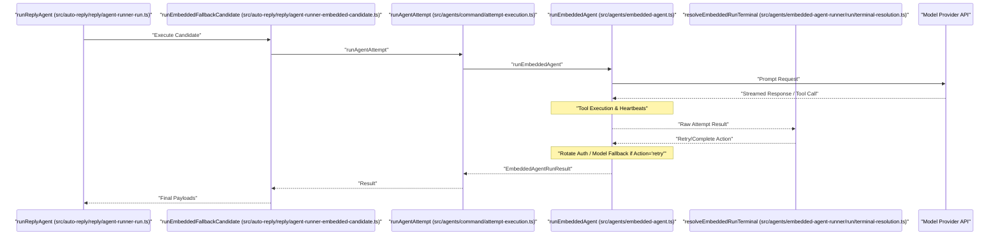
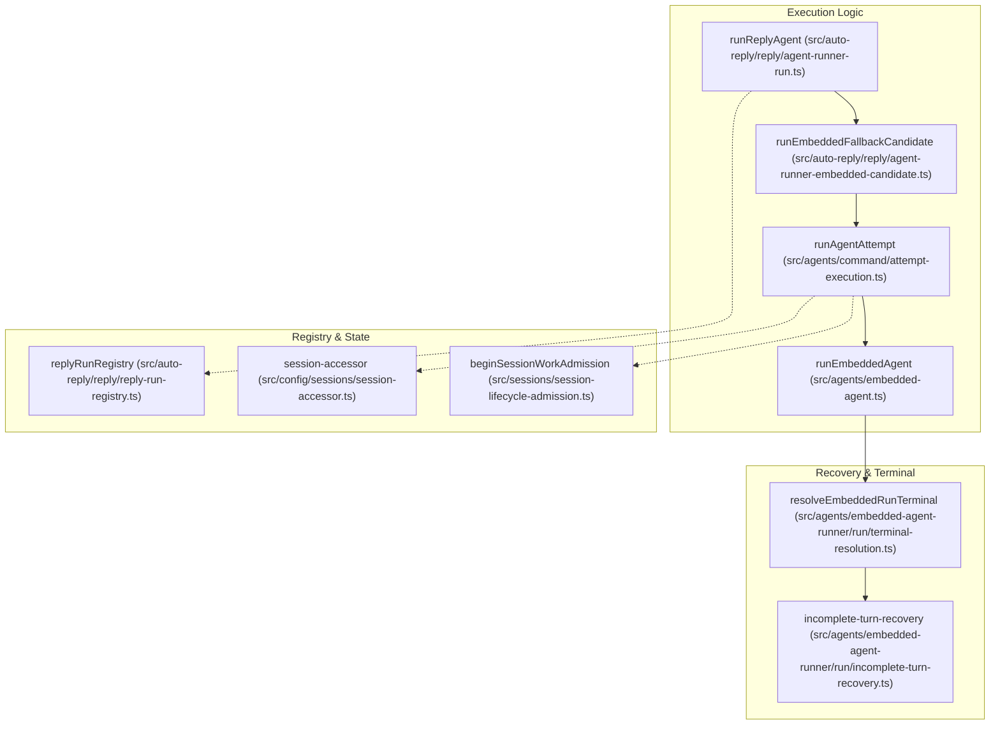

# Execution Pipeline

Relevant source files

The following files were used as context for generating this wiki page:

- [docs/concepts/queue.md](docs/concepts/queue.md)
- [extensions/active-memory/transcript-watch.ts](extensions/active-memory/transcript-watch.ts)
- [extensions/qa-lab/src/suite-runtime-agent-process.ts](extensions/qa-lab/src/suite-runtime-agent-process.ts)
- [qa/scenarios/memory/active-memory-cold-first-turn-trigger-recall.yaml](qa/scenarios/memory/active-memory-cold-first-turn-trigger-recall.yaml)
- [qa/scenarios/memory/active-memory-preprompt-recall.yaml](qa/scenarios/memory/active-memory-preprompt-recall.yaml)
- [qa/scenarios/scheduling/heartbeat-inbound-metadata.yaml](qa/scenarios/scheduling/heartbeat-inbound-metadata.yaml)
- [src/agents/command/attempt-execution.cli.test.ts](src/agents/command/attempt-execution.cli.test.ts)
- [src/agents/command/attempt-execution.ts](src/agents/command/attempt-execution.ts)
- [src/agents/command/compaction-accounting.ts](src/agents/command/compaction-accounting.ts)
- [src/agents/command/run-embedded-attempt.ts](src/agents/command/run-embedded-attempt.ts)
- [src/agents/delegation-capability.test.ts](src/agents/delegation-capability.test.ts)
- [src/agents/delegation-capability.ts](src/agents/delegation-capability.ts)
- [src/agents/embedded-agent-runner/result-fallback-classifier.test.ts](src/agents/embedded-agent-runner/result-fallback-classifier.test.ts)
- [src/agents/embedded-agent-runner/result-fallback-classifier.ts](src/agents/embedded-agent-runner/result-fallback-classifier.ts)
- [src/agents/embedded-agent-runner/run-loop.ts](src/agents/embedded-agent-runner/run-loop.ts)
- [src/agents/embedded-agent-runner/run.attempt-normalization.direct.test.ts](src/agents/embedded-agent-runner/run.attempt-normalization.direct.test.ts)
- [src/agents/embedded-agent-runner/run.empty-error-retry.owner-test-support.ts](src/agents/embedded-agent-runner/run.empty-error-retry.owner-test-support.ts)
- [src/agents/embedded-agent-runner/run.harness-auth-failover.test.ts](src/agents/embedded-agent-runner/run.harness-auth-failover.test.ts)
- [src/agents/embedded-agent-runner/run.incomplete-turn.delivery-resolution.test.ts](src/agents/embedded-agent-runner/run.incomplete-turn.delivery-resolution.test.ts)
- [src/agents/embedded-agent-runner/run.midturn-precheck-retry.test-support.ts](src/agents/embedded-agent-runner/run.midturn-precheck-retry.test-support.ts)
- [src/agents/embedded-agent-runner/run.overflow-compaction.loop.test.ts](src/agents/embedded-agent-runner/run.overflow-compaction.loop.test.ts)
- [src/agents/embedded-agent-runner/run.overflow-context-recovery.test.ts](src/agents/embedded-agent-runner/run.overflow-context-recovery.test.ts)
- [src/agents/embedded-agent-runner/run.prepared-harness-credentials.test.ts](src/agents/embedded-agent-runner/run.prepared-harness-credentials.test.ts)
- [src/agents/embedded-agent-runner/run.projection-retry.test-support.ts](src/agents/embedded-agent-runner/run.projection-retry.test-support.ts)
- [src/agents/embedded-agent-runner/run.recovery-cancellation.test-support.ts](src/agents/embedded-agent-runner/run.recovery-cancellation.test-support.ts)
- [src/agents/embedded-agent-runner/run.session-prompt-state.test.ts](src/agents/embedded-agent-runner/run.session-prompt-state.test.ts)
- [src/agents/embedded-agent-runner/run.shared-integration.test.ts](src/agents/embedded-agent-runner/run.shared-integration.test.ts)
- [src/agents/embedded-agent-runner/run.terminal-timeout.test.ts](src/agents/embedded-agent-runner/run.terminal-timeout.test.ts)
- [src/agents/embedded-agent-runner/run/assistant-failover.test.ts](src/agents/embedded-agent-runner/run/assistant-failover.test.ts)
- [src/agents/embedded-agent-runner/run/assistant-failure.test.ts](src/agents/embedded-agent-runner/run/assistant-failure.test.ts)
- [src/agents/embedded-agent-runner/run/assistant-failure.ts](src/agents/embedded-agent-runner/run/assistant-failure.ts)
- [src/agents/embedded-agent-runner/run/attempt-dispatch-preparation.ts](src/agents/embedded-agent-runner/run/attempt-dispatch-preparation.ts)
- [src/agents/embedded-agent-runner/run/attempt-normalization.ts](src/agents/embedded-agent-runner/run/attempt-normalization.ts)
- [src/agents/embedded-agent-runner/run/attempt-recovery.test.ts](src/agents/embedded-agent-runner/run/attempt-recovery.test.ts)
- [src/agents/embedded-agent-runner/run/attempt-recovery.ts](src/agents/embedded-agent-runner/run/attempt-recovery.ts)
- [src/agents/embedded-agent-runner/run/attempt-result.test.ts](src/agents/embedded-agent-runner/run/attempt-result.test.ts)
- [src/agents/embedded-agent-runner/run/attempt-result.ts](src/agents/embedded-agent-runner/run/attempt-result.ts)
- [src/agents/embedded-agent-runner/run/attempt-stream-prepare.test.ts](src/agents/embedded-agent-runner/run/attempt-stream-prepare.test.ts)
- [src/agents/embedded-agent-runner/run/attempt-stream-prepare.ts](src/agents/embedded-agent-runner/run/attempt-stream-prepare.ts)
- [src/agents/embedded-agent-runner/run/attempt-terminal-evidence.ts](src/agents/embedded-agent-runner/run/attempt-terminal-evidence.ts)
- [src/agents/embedded-agent-runner/run/attempt.settled-turn-finalization-context.test.ts](src/agents/embedded-agent-runner/run/attempt.settled-turn-finalization-context.test.ts)
- [src/agents/embedded-agent-runner/run/failover-policy.test.ts](src/agents/embedded-agent-runner/run/failover-policy.test.ts)
- [src/agents/embedded-agent-runner/run/failover-policy.ts](src/agents/embedded-agent-runner/run/failover-policy.ts)
- [src/agents/embedded-agent-runner/run/failover-retry-controller.test.ts](src/agents/embedded-agent-runner/run/failover-retry-controller.test.ts)
- [src/agents/embedded-agent-runner/run/failover-retry-controller.ts](src/agents/embedded-agent-runner/run/failover-retry-controller.ts)
- [src/agents/embedded-agent-runner/run/incomplete-turn-classification.ts](src/agents/embedded-agent-runner/run/incomplete-turn-classification.ts)
- [src/agents/embedded-agent-runner/run/incomplete-turn-recovery.ts](src/agents/embedded-agent-runner/run/incomplete-turn-recovery.ts)
- [src/agents/embedded-agent-runner/run/incomplete-turn-resolution.test.ts](src/agents/embedded-agent-runner/run/incomplete-turn-resolution.test.ts)
- [src/agents/embedded-agent-runner/run/incomplete-turn-resolution.ts](src/agents/embedded-agent-runner/run/incomplete-turn-resolution.ts)
- [src/agents/embedded-agent-runner/run/internal-params.ts](src/agents/embedded-agent-runner/run/internal-params.ts)
- [src/agents/embedded-agent-runner/run/overflow-context-recovery.test.ts](src/agents/embedded-agent-runner/run/overflow-context-recovery.test.ts)
- [src/agents/embedded-agent-runner/run/overflow-context-recovery.ts](src/agents/embedded-agent-runner/run/overflow-context-recovery.ts)
- [src/agents/embedded-agent-runner/run/params.ts](src/agents/embedded-agent-runner/run/params.ts)
- [src/agents/embedded-agent-runner/run/payloads.process-errors.test.ts](src/agents/embedded-agent-runner/run/payloads.process-errors.test.ts)
- [src/agents/embedded-agent-runner/run/payloads.test.ts](src/agents/embedded-agent-runner/run/payloads.test.ts)
- [src/agents/embedded-agent-runner/run/payloads.ts](src/agents/embedded-agent-runner/run/payloads.ts)
- [src/agents/embedded-agent-runner/run/prompt-failure.test.ts](src/agents/embedded-agent-runner/run/prompt-failure.test.ts)
- [src/agents/embedded-agent-runner/run/prompt-failure.ts](src/agents/embedded-agent-runner/run/prompt-failure.ts)
- [src/agents/embedded-agent-runner/run/retry-budget.ts](src/agents/embedded-agent-runner/run/retry-budget.ts)
- [src/agents/embedded-agent-runner/run/run-attempt-dispatch.ts](src/agents/embedded-agent-runner/run/run-attempt-dispatch.ts)
- [src/agents/embedded-agent-runner/run/runtime-preparation.ts](src/agents/embedded-agent-runner/run/runtime-preparation.ts)
- [src/agents/embedded-agent-runner/run/session-prompt-state.ts](src/agents/embedded-agent-runner/run/session-prompt-state.ts)
- [src/agents/embedded-agent-runner/run/settled-tool-evidence.test.ts](src/agents/embedded-agent-runner/run/settled-tool-evidence.test.ts)
- [src/agents/embedded-agent-runner/run/settled-turn-finalization.test.ts](src/agents/embedded-agent-runner/run/settled-turn-finalization.test.ts)
- [src/agents/embedded-agent-runner/run/settled-turn-finalization.ts](src/agents/embedded-agent-runner/run/settled-turn-finalization.ts)
- [src/agents/embedded-agent-runner/run/terminal-preparation.test.ts](src/agents/embedded-agent-runner/run/terminal-preparation.test.ts)
- [src/agents/embedded-agent-runner/run/terminal-preparation.ts](src/agents/embedded-agent-runner/run/terminal-preparation.ts)
- [src/agents/embedded-agent-runner/run/terminal-resolution.test.ts](src/agents/embedded-agent-runner/run/terminal-resolution.test.ts)
- [src/agents/embedded-agent-runner/run/terminal-resolution.ts](src/agents/embedded-agent-runner/run/terminal-resolution.ts)
- [src/agents/embedded-agent-runner/run/types.ts](src/agents/embedded-agent-runner/run/types.ts)
- [src/agents/embedded-agent-subscribe.handlers.messages.update-commentary.test.ts](src/agents/embedded-agent-subscribe.handlers.messages.update-commentary.test.ts)
- [src/agents/embedded-agent-subscribe.handlers.tools.completion.ts](src/agents/embedded-agent-subscribe.handlers.tools.completion.ts)
- [src/agents/embedded-agent-subscribe.handlers.tools.test.ts](src/agents/embedded-agent-subscribe.handlers.tools.test.ts)
- [src/agents/embedded-agent-subscribe.handlers.tools.ts](src/agents/embedded-agent-subscribe.handlers.tools.ts)
- [src/agents/embedded-agent-subscribe.types.ts](src/agents/embedded-agent-subscribe.types.ts)
- [src/agents/failover/signal.ts](src/agents/failover/signal.ts)
- [src/agents/harness/user-input-bridge.ts](src/agents/harness/user-input-bridge.ts)
- [src/agents/session-placement-admission.test.ts](src/agents/session-placement-admission.test.ts)
- [src/agents/session-placement-admission.ts](src/agents/session-placement-admission.ts)
- [src/agents/subagents/registry/subagent-registry-cleanup.test.ts](src/agents/subagents/registry/subagent-registry-cleanup.test.ts)
- [src/agents/subagents/registry/subagent-registry-cleanup.ts](src/agents/subagents/registry/subagent-registry-cleanup.ts)
- [src/auto-reply/model.ts](src/auto-reply/model.ts)
- [src/auto-reply/reply.directive.parse.test.ts](src/auto-reply/reply.directive.parse.test.ts)
- [src/auto-reply/reply/agent-runner-cli-candidate.ts](src/auto-reply/reply/agent-runner-cli-candidate.ts)
- [src/auto-reply/reply/agent-runner-compaction-accounting.ts](src/auto-reply/reply/agent-runner-compaction-accounting.ts)
- [src/auto-reply/reply/agent-runner-core.test.ts](src/auto-reply/reply/agent-runner-core.test.ts)
- [src/auto-reply/reply/agent-runner-core.ts](src/auto-reply/reply/agent-runner-core.ts)
- [src/auto-reply/reply/agent-runner-direct-runtime-config.test.ts](src/auto-reply/reply/agent-runner-direct-runtime-config.test.ts)
- [src/auto-reply/reply/agent-runner-embedded-candidate.ts](src/auto-reply/reply/agent-runner-embedded-candidate.ts)
- [src/auto-reply/reply/agent-runner-execute.ts](src/auto-reply/reply/agent-runner-execute.ts)
- [src/auto-reply/reply/agent-runner-execution-cli-admission.test.ts](src/auto-reply/reply/agent-runner-execution-cli-admission.test.ts)
- [src/auto-reply/reply/agent-runner-execution-cli-delegation.test.ts](src/auto-reply/reply/agent-runner-execution-cli-delegation.test.ts)
- [src/auto-reply/reply/agent-runner-execution-cli-sessions.test.ts](src/auto-reply/reply/agent-runner-execution-cli-sessions.test.ts)
- [src/auto-reply/reply/agent-runner-execution-lifecycle.test.ts](src/auto-reply/reply/agent-runner-execution-lifecycle.test.ts)
- [src/auto-reply/reply/agent-runner-execution-message-tools.test.ts](src/auto-reply/reply/agent-runner-execution-message-tools.test.ts)
- [src/auto-reply/reply/agent-runner-fallback-candidate.ts](src/auto-reply/reply/agent-runner-fallback-candidate.ts)
- [src/auto-reply/reply/agent-runner-fallback-cycle.types.ts](src/auto-reply/reply/agent-runner-fallback-cycle.types.ts)
- [src/auto-reply/reply/agent-runner-run-params.ts](src/auto-reply/reply/agent-runner-run-params.ts)
- [src/auto-reply/reply/agent-runner-run.ts](src/auto-reply/reply/agent-runner-run.ts)
- [src/auto-reply/reply/agent-runner-steer-adoption.ts](src/auto-reply/reply/agent-runner-steer-adoption.ts)
- [src/auto-reply/reply/agent-runner-utils.test.ts](src/auto-reply/reply/agent-runner-utils.test.ts)
- [src/auto-reply/reply/agent-runner.runreplyagent.e2e.test.ts](src/auto-reply/reply/agent-runner.runreplyagent.e2e.test.ts)
- [src/auto-reply/reply/directive-handling.parse.ts](src/auto-reply/reply/directive-handling.parse.ts)
- [src/auto-reply/reply/directive-parsing.ts](src/auto-reply/reply/directive-parsing.ts)
- [src/auto-reply/reply/directives.ts](src/auto-reply/reply/directives.ts)
- [src/auto-reply/reply/dispatch-from-config.send-policy-routing.test-utils.ts](src/auto-reply/reply/dispatch-from-config.send-policy-routing.test-utils.ts)
- [src/auto-reply/reply/exec/directive.ts](src/auto-reply/reply/exec/directive.ts)
- [src/auto-reply/reply/get-reply-run-context.ts](src/auto-reply/reply/get-reply-run-context.ts)
- [src/auto-reply/reply/get-reply-run-execute.ts](src/auto-reply/reply/get-reply-run-execute.ts)
- [src/auto-reply/reply/get-reply-run-helpers.ts](src/auto-reply/reply/get-reply-run-helpers.ts)
- [src/auto-reply/reply/get-reply-run.media-only.test.ts](src/auto-reply/reply/get-reply-run.media-only.test.ts)
- [src/auto-reply/reply/get-reply.types.ts](src/auto-reply/reply/get-reply.types.ts)
- [src/auto-reply/reply/queue.collect.test.ts](src/auto-reply/reply/queue.collect.test.ts)
- [src/auto-reply/reply/queue/directive.ts](src/auto-reply/reply/queue/directive.ts)
- [src/auto-reply/reply/queue/drain.ts](src/auto-reply/reply/queue/drain.ts)
- [src/auto-reply/reply/queue/types.ts](src/auto-reply/reply/queue/types.ts)
- [src/auto-reply/reply/reply-operation-agent-turn-state.ts](src/auto-reply/reply/reply-operation-agent-turn-state.ts)
- [src/auto-reply/reply/session-system-events.ts](src/auto-reply/reply/session-system-events.ts)
- [src/auto-reply/reply/source-reply-delivery-runtime.ts](src/auto-reply/reply/source-reply-delivery-runtime.ts)
- [src/commands/doctor-heartbeat-session-target.test.ts](src/commands/doctor-heartbeat-session-target.test.ts)
- [src/commands/doctor-heartbeat-session-target.ts](src/commands/doctor-heartbeat-session-target.ts)
- [src/config/sessions/cleanup-service.serialization.test.ts](src/config/sessions/cleanup-service.serialization.test.ts)
- [src/cron/isolated-agent/run-executor.ts](src/cron/isolated-agent/run-executor.ts)
- [src/gateway/server-methods/chat-send-late-followup.test.ts](src/gateway/server-methods/chat-send-late-followup.test.ts)
- [src/gateway/server-methods/chat-send-late-followup.ts](src/gateway/server-methods/chat-send-late-followup.ts)
- [src/infra/heartbeat-delivery-normalization.ts](src/infra/heartbeat-delivery-normalization.ts)
- [src/infra/heartbeat-events-filter.ts](src/infra/heartbeat-events-filter.ts)
- [src/infra/heartbeat-failure-notice.test.ts](src/infra/heartbeat-failure-notice.test.ts)
- [src/infra/heartbeat-failure-notice.ts](src/infra/heartbeat-failure-notice.ts)
- [src/infra/heartbeat-runner-delivery.ts](src/infra/heartbeat-runner-delivery.ts)
- [src/infra/heartbeat-runner-prompt.ts](src/infra/heartbeat-runner-prompt.ts)
- [src/infra/heartbeat-runner-run.ts](src/infra/heartbeat-runner-run.ts)
- [src/infra/heartbeat-runner.ack-token-heartbeat-acks.test.ts](src/infra/heartbeat-runner.ack-token-heartbeat-acks.test.ts)
- [src/infra/heartbeat-runner.isolated-session-mirror.test.ts](src/infra/heartbeat-runner.isolated-session-mirror.test.ts)
- [src/infra/heartbeat-runner.stale-exec.test.ts](src/infra/heartbeat-runner.stale-exec.test.ts)
- [src/infra/heartbeat-runner.tool-response.test.ts](src/infra/heartbeat-runner.tool-response.test.ts)
- [src/infra/outbound/outbound-session.test.ts](src/infra/outbound/outbound-session.test.ts)
- [src/infra/outbound/outbound-session.ts](src/infra/outbound/outbound-session.ts)
- [src/infra/outbound/targets.test.ts](src/infra/outbound/targets.test.ts)
- [src/infra/outbound/targets.ts](src/infra/outbound/targets.ts)
- [test/vitest/vitest.agents-paths.mjs](test/vitest/vitest.agents-paths.mjs)

The agent execution pipeline transforms an inbound message into a model response. It encompasses directive parsing, command detection, model selection with fallback, auth profile resolution, system prompt construction, tool policy enforcement, streaming response delivery, and context overflow recovery.

This page documents the complete execution flow from message receipt through final reply delivery, focusing on the `runEmbeddedPiAgent` lifecycle and the `runEmbeddedAttempt` orchestration.

---

## Execution Stages

The pipeline consists of distinct processing stages, each handling specific aspects of the agent turn lifecycle.

| Stage | Key Functions | Primary Responsibility |
|---|---|---|
| **Admission** | `beginSessionWorkAdmission` | Validates session availability and concurrency locks before starting a run. [src/auto-reply/reply/get-reply-run.media-only.test.ts:13-13]() |
| **Model Resolution** | `findModelInCatalog`, `resolveRunModelHasVision` | Selects the model and determines capabilities like vision based on catalog and config. [src/auto-reply/reply/agent-runner-cli-candidate.ts:53-62]() |
| **Preparation** | `prepareReplyRunContext`, `buildEmbeddedRunExecutionParams` | Sets up the sandbox environment, resolves auth profiles, and prepares execution parameters. [src/auto-reply/reply/get-reply-run.media-only.test.ts:18-18](), [src/auto-reply/reply/agent-runner-embedded-candidate.ts:67-77]() |
| **Execution** | `runReplyAgent`, `runEmbeddedAgent`, `runCliAgentWithLifecycle` | Orchestrates the turn lifecycle, retry loops, and runtime-specific (Embedded/CLI) dispatch. [src/auto-reply/reply/agent-runner-run.ts:65-67](), [src/agents/command/attempt-execution.ts:89-89](), [src/auto-reply/reply/agent-runner-cli-candidate.ts:142-153]() |
| **Tool Dispatch** | `resolveEffectiveToolPolicy`, `createCliToolSummaryTracker` | Executes tool calls, enforces policies, and manages tool result presentation. [src/auto-reply/reply/get-reply-run.media-only.test.ts:98-112](), [src/auto-reply/reply/agent-runner-cli-candidate.ts:99-107]() |
| **Attempt Dispatch** | `dispatchEmbeddedRunAttempt` | Orchestrates prompt submission, tool stream boundaries, and heartbeat monitoring. [src/agents/embedded-agent-runner/run/run-attempt-dispatch.ts:118-129]() |
| **State Management** | `persistSessionTranscriptTurn`, `updateSessionEntry` | Updates session history, tracks token usage, and persists the final agent response. [src/agents/command/attempt-execution.ts:27-30](), [src/auto-reply/reply/agent-runner-run.ts:4-4]() |

Sources: [src/auto-reply/reply/agent-runner-run.ts:65-158](), [src/auto-reply/reply/agent-runner-embedded-candidate.ts:39-149](), [src/auto-reply/reply/agent-runner-cli-candidate.ts:41-153](), [src/agents/command/attempt-execution.ts:1-128]()

---

## Pipeline Call Chain

The execution pipeline routes through nested function calls, each adding retry logic, concurrency control, or error handling.

| Layer | Layer Name | Primary Entry Point | Responsibility |
|---|---|---|---|
| **L1** | **Reply Orchestration** | `runReplyAgent` | Top-level entry for auto-replies; manages session reset, steering, and followup scheduling. [src/auto-reply/reply/agent-runner-run.ts:65-67]() |
| **L2** | **Runtime Selection** | `runEmbeddedFallbackCandidate` / `runCliFallbackCandidate` | Bridges the generic turn to a specific execution runtime (Embedded LLM vs CLI Backend). [src/auto-reply/reply/agent-runner-embedded-candidate.ts:39-40](), [src/auto-reply/reply/agent-runner-cli-candidate.ts:41-46]() |
| **L3** | **Attempt Orchestration** | `runAgentAttempt` | Orchestrates one agent attempt across embedded, CLI, and ACP runtimes. [src/agents/command/attempt-execution.ts:53-54]() |
| **L4** | **Agent Runtime** | `runEmbeddedAgent` | Low-level orchestration for a specific agent run, handling failover and streaming. [src/agents/command/attempt-execution.ts:89-89]() |

Sources: [src/auto-reply/reply/agent-runner-run.ts:65-158](), [src/agents/command/attempt-execution.ts:1-128](), [src/auto-reply/reply/agent-runner-embedded-candidate.ts:39-149]()

---

**Message flow from channel inbound to model API and back**

Title: "Agent Run Lifecycle Sequence"

Sources: [src/auto-reply/reply/agent-runner-run.ts:65-158](), [src/auto-reply/reply/agent-runner-embedded-candidate.ts:39-149](), [src/agents/command/attempt-execution.ts:53-89](), [src/agents/embedded-agent-runner/run/terminal-resolution.ts:95-97]()

---

## Failover and Context Management

The pipeline manages model-level failover and context overflow by classifying errors to decide whether to retry, rotate credentials, or trigger compaction.

### Error Classification & Failover
The pipeline uses specialized handlers to map raw provider errors to internal recovery strategies:
- **Result Classification**: `classifyEmbeddedAgentRunResultForModelFallback` determines if a run failure (e.g., 429 Rate Limit) is eligible for model fallback. [src/agents/command/attempt-execution.cli.test.ts:41-41]()
- **Auth Profile Rotation**: Auth profiles are resolved via `resolveRunAuthProfile` and can be rotated during fallback cycles to resolve permission or credit issues. [src/auto-reply/reply/agent-runner-cli-candidate.ts:83-85]()

### Context Compaction & Incomplete Turn Recovery
When a model signals a context window overflow or produces an incomplete response, the pipeline triggers recovery:
- **Reasoning-Only Retry**: If a model produces reasoning but no visible text, `resolveReasoningOnlyRetryInstruction` generates a prompt to force a final answer. [src/agents/embedded-agent-runner/run/incomplete-turn-recovery.ts:155-163]()
- **Empty Response Retry**: `resolveEmptyResponseRetryInstruction` handles cases where the model stops without outputting tokens or tool calls. [src/agents/embedded-agent-runner/run/terminal-resolution.ts:37-37]()
- **Compaction Continuation**: `COMPACTION_CONTINUATION_RETRY_INSTRUCTION` is used to resume a turn after the session history has been compacted to free up context space. [src/agents/embedded-agent-runner/run/terminal-resolution.ts:66-67]()

Sources: [src/agents/embedded-agent-runner/run/incomplete-turn-recovery.ts:1-173](), [src/agents/embedded-agent-runner/run/terminal-resolution.ts:1-157](), [src/auto-reply/reply/agent-runner-cli-candidate.ts:83-85]()

---

## Session and Registry Management

The system tracks active runs to coordinate user aborts, restarts, and status commands.

### Lifecycle & Generations
The system uses "lifecycle generations" (`getAgentEventLifecycleGeneration`) to ensure that events and operations are associated with the correct run instance, preventing stale replies from previous turns. [src/agents/command/attempt-execution.cli.test.ts:22-22]()

### Termination and Abort
Runs can be terminated for various reasons, managed by the `replyRunRegistry`:
- **Superseded Abort**: If a new user message arrives while a run is active, `createAgentRunSupersededAbortError` is used to cancel the current turn. [src/auto-reply/reply/agent-runner-cli-candidate.ts:15-15]()
- **Terminal Backstop**: `createAgentLifecycleTerminalBackstop` ensures that run resources are cleaned up even if the main execution loop crashes. [src/auto-reply/reply/agent-runner-cli-candidate.ts:74-81]()
- **Restart Recovery**: `buildCurrentRunRestartRecoveryClaim` allows a run to be resumed after a Gateway restart by claiming the previous session state. [src/auto-reply/reply/agent-runner.runreplyagent.e2e.test.ts:19-19]()

Sources: [src/auto-reply/reply/agent-runner-cli-candidate.ts:74-81](), [src/auto-reply/reply/agent-runner-run.ts:47-50](), [src/agents/embedded-agent-runner/run/terminal-outcome.ts:54-58]()

---

## Code Entity Reference

Title: "Execution Pipeline Entity Map"

Sources: [src/auto-reply/reply/agent-runner-run.ts:65-158](), [src/agents/command/attempt-execution.ts:1-128](), [src/agents/embedded-agent-runner/run/terminal-resolution.ts:1-157](), [src/agents/embedded-agent-runner/run/incomplete-turn-recovery.ts:1-173]()