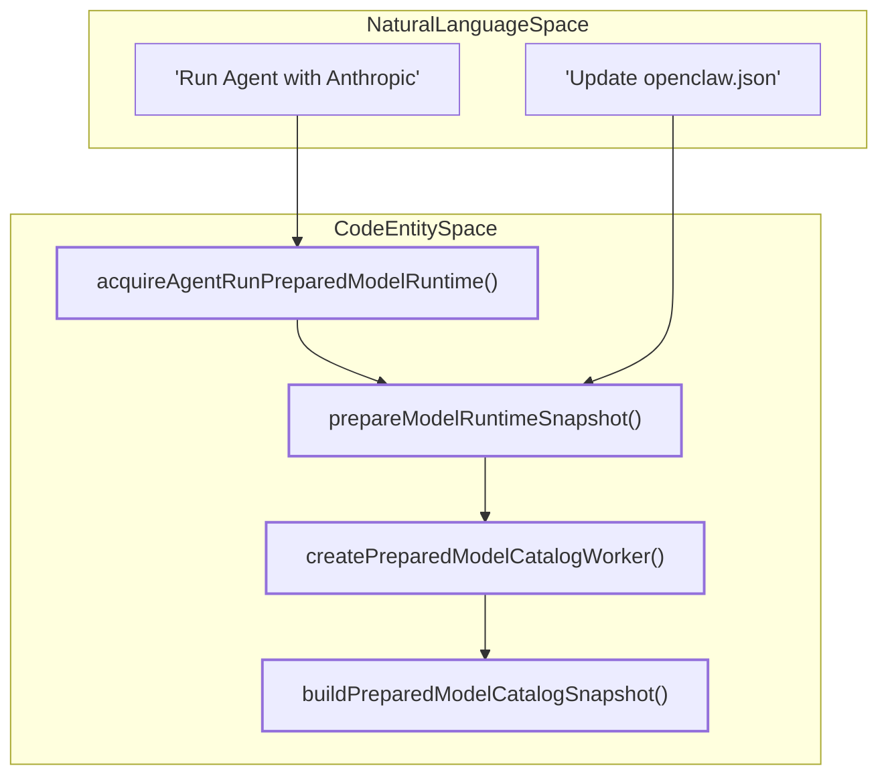
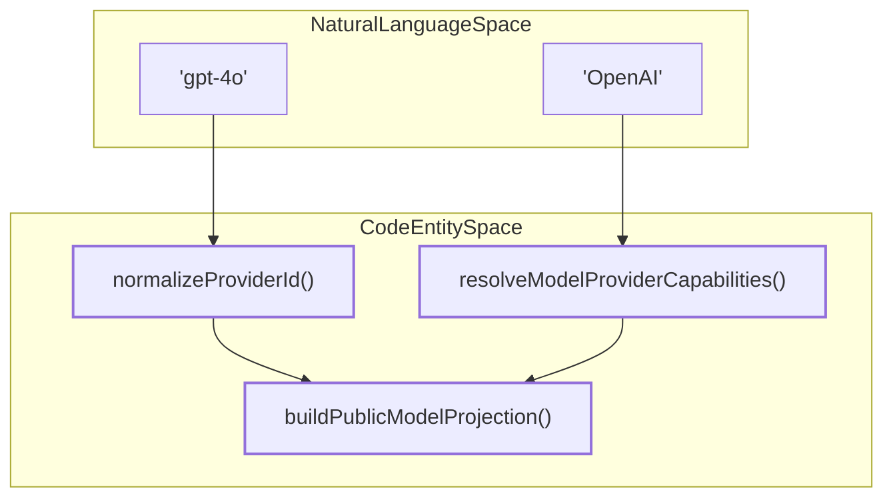

# Model Providers & Authentication

Relevant source files

The following files were used as context for generating this wiki page:

- [docs/concepts/models.md](docs/concepts/models.md)
- [extensions/lmstudio/src/stream.test.ts](extensions/lmstudio/src/stream.test.ts)
- [extensions/openai/transport-policy.test.ts](extensions/openai/transport-policy.test.ts)
- [extensions/qa-lab/src/cron-run-wait.test.ts](extensions/qa-lab/src/cron-run-wait.test.ts)
- [extensions/venice/pricing-api.ts](extensions/venice/pricing-api.ts)
- [packages/ai/src/internal/openai.ts](packages/ai/src/internal/openai.ts)
- [packages/ai/src/provider-options.ts](packages/ai/src/provider-options.ts)
- [packages/ai/src/provider-transport-parity.test.ts](packages/ai/src/provider-transport-parity.test.ts)
- [packages/ai/src/providers/anthropic-usage.test.ts](packages/ai/src/providers/anthropic-usage.test.ts)
- [packages/ai/src/providers/anthropic-usage.ts](packages/ai/src/providers/anthropic-usage.ts)
- [packages/ai/src/providers/anthropic.test.ts](packages/ai/src/providers/anthropic.test.ts)
- [packages/ai/src/providers/anthropic.ts](packages/ai/src/providers/anthropic.ts)
- [packages/ai/src/providers/mistral-http-client.contract.test.ts](packages/ai/src/providers/mistral-http-client.contract.test.ts)
- [packages/ai/src/providers/mistral.test.ts](packages/ai/src/providers/mistral.test.ts)
- [packages/ai/src/providers/mistral.ts](packages/ai/src/providers/mistral.ts)
- [packages/ai/src/providers/openai-chatgpt-responses.ts](packages/ai/src/providers/openai-chatgpt-responses.ts)
- [packages/ai/src/providers/openai-completions-tool-calls.ts](packages/ai/src/providers/openai-completions-tool-calls.ts)
- [packages/ai/src/providers/openai-completions.legacy-function-call.test.ts](packages/ai/src/providers/openai-completions.legacy-function-call.test.ts)
- [packages/ai/src/providers/openai-completions.off-effort.test.ts](packages/ai/src/providers/openai-completions.off-effort.test.ts)
- [packages/ai/src/providers/openai-completions.test.ts](packages/ai/src/providers/openai-completions.test.ts)
- [packages/ai/src/providers/openai-completions.ts](packages/ai/src/providers/openai-completions.ts)
- [packages/ai/src/providers/openai-responses-shared.ts](packages/ai/src/providers/openai-responses-shared.ts)
- [packages/ai/src/transports/anthropic-transport-stream.test.ts](packages/ai/src/transports/anthropic-transport-stream.test.ts)
- [packages/ai/src/transports/anthropic-transport-stream.ts](packages/ai/src/transports/anthropic-transport-stream.ts)
- [packages/ai/src/transports/deepseek-dsml-grammar.ts](packages/ai/src/transports/deepseek-dsml-grammar.ts)
- [packages/ai/src/transports/deepseek-text-filter.ts](packages/ai/src/transports/deepseek-text-filter.ts)
- [packages/ai/src/transports/openai-completions-dsml.recovery.test.ts](packages/ai/src/transports/openai-completions-dsml.recovery.test.ts)
- [packages/ai/src/transports/openai-completions-dsml.test.ts](packages/ai/src/transports/openai-completions-dsml.test.ts)
- [packages/ai/src/transports/openai-completions-dsml.ts](packages/ai/src/transports/openai-completions-dsml.ts)
- [packages/ai/src/transports/openai-completions-host.ts](packages/ai/src/transports/openai-completions-host.ts)
- [packages/ai/src/transports/openai-completions-params.compat-and-tool-choice.test.ts](packages/ai/src/transports/openai-completions-params.compat-and-tool-choice.test.ts)
- [packages/ai/src/transports/openai-completions-params.reasoning.test.ts](packages/ai/src/transports/openai-completions-params.reasoning.test.ts)
- [packages/ai/src/transports/openai-completions-params.shaping.test.ts](packages/ai/src/transports/openai-completions-params.shaping.test.ts)
- [packages/ai/src/transports/openai-completions-stream.reasoning-and-buffering.test.ts](packages/ai/src/transports/openai-completions-stream.reasoning-and-buffering.test.ts)
- [packages/ai/src/transports/openai-completions-stream.reasoning-details.test.ts](packages/ai/src/transports/openai-completions-stream.reasoning-details.test.ts)
- [packages/ai/src/transports/openai-completions-stream.tool-assembly.test.ts](packages/ai/src/transports/openai-completions-stream.tool-assembly.test.ts)
- [packages/ai/src/transports/openai-completions-stream.tool-calls.test.ts](packages/ai/src/transports/openai-completions-stream.tool-calls.test.ts)
- [packages/ai/src/transports/openai-completions-stream.ts](packages/ai/src/transports/openai-completions-stream.ts)
- [packages/ai/src/transports/openai-completions-stream.usage.test.ts](packages/ai/src/transports/openai-completions-stream.usage.test.ts)
- [packages/ai/src/transports/openai-completions-transport.response-hook.test.ts](packages/ai/src/transports/openai-completions-transport.response-hook.test.ts)
- [packages/ai/src/transports/openai-completions-transport.ts](packages/ai/src/transports/openai-completions-transport.ts)
- [packages/ai/src/transports/openai-responses-client.ts](packages/ai/src/transports/openai-responses-client.ts)
- [packages/ai/src/transports/openai-responses-contracts.ts](packages/ai/src/transports/openai-responses-contracts.ts)
- [packages/ai/src/transports/openai-responses-params-internal.ts](packages/ai/src/transports/openai-responses-params-internal.ts)
- [packages/ai/src/transports/openai-responses-prompt-observer.test.ts](packages/ai/src/transports/openai-responses-prompt-observer.test.ts)
- [packages/ai/src/transports/openai-responses-replay-internal.test.ts](packages/ai/src/transports/openai-responses-replay-internal.test.ts)
- [packages/ai/src/transports/openai-responses-replay-internal.ts](packages/ai/src/transports/openai-responses-replay-internal.ts)
- [packages/ai/src/transports/openai-responses-websocket-client.test.ts](packages/ai/src/transports/openai-responses-websocket-client.test.ts)
- [packages/ai/src/transports/openai-responses-websocket.test.ts](packages/ai/src/transports/openai-responses-websocket.test.ts)
- [packages/ai/src/transports/openai-responses-websocket.ts](packages/ai/src/transports/openai-responses-websocket.ts)
- [packages/ai/src/transports/openai-transport-params.code-mode.test.ts](packages/ai/src/transports/openai-transport-params.code-mode.test.ts)
- [packages/ai/src/transports/openai-transport-params.ts](packages/ai/src/transports/openai-transport-params.ts)
- [packages/ai/src/transports/openai-transport-shared.ts](packages/ai/src/transports/openai-transport-shared.ts)
- [packages/ai/src/transports/transport-stream-shared.ts](packages/ai/src/transports/transport-stream-shared.ts)
- [packages/ai/src/utils/assistant-text-phase.test.ts](packages/ai/src/utils/assistant-text-phase.test.ts)
- [packages/ai/src/utils/assistant-text-phase.ts](packages/ai/src/utils/assistant-text-phase.ts)
- [packages/ai/src/utils/reasoning-tag-text-partitioner.test.ts](packages/ai/src/utils/reasoning-tag-text-partitioner.test.ts)
- [packages/ai/src/utils/stream-first-event-timeout.ts](packages/ai/src/utils/stream-first-event-timeout.ts)
- [packages/ai/test/fixtures/provider-transport-parity/openai-success.snap.txt](packages/ai/test/fixtures/provider-transport-parity/openai-success.snap.txt)
- [packages/llm-core/src/types.ts](packages/llm-core/src/types.ts)
- [packages/model-catalog-core/src/model-catalog-pricing.test.ts](packages/model-catalog-core/src/model-catalog-pricing.test.ts)
- [packages/model-catalog-core/src/model-catalog-pricing.ts](packages/model-catalog-core/src/model-catalog-pricing.ts)
- [scripts/publish-model-catalog.mts](scripts/publish-model-catalog.mts)
- [src/agents/agent-auth-credential-modes.ts](src/agents/agent-auth-credential-modes.ts)
- [src/agents/agent-auth-credentials.ts](src/agents/agent-auth-credentials.ts)
- [src/agents/deepseek-text-filter.test.ts](src/agents/deepseek-text-filter.test.ts)
- [src/agents/embedded-agent-runner/model.static-catalog.prepared.test.ts](src/agents/embedded-agent-runner/model.static-catalog.prepared.test.ts)
- [src/agents/embedded-agent-runner/run.overflow-compaction.misc-owners.test.ts](src/agents/embedded-agent-runner/run.overflow-compaction.misc-owners.test.ts)
- [src/agents/embedded-agent-runner/run/auth-profile-success.ts](src/agents/embedded-agent-runner/run/auth-profile-success.ts)
- [src/agents/embedded-agent-subscribe.subscribe-embedded-agent-session.reasoning-delivery.test.ts](src/agents/embedded-agent-subscribe.subscribe-embedded-agent-session.reasoning-delivery.test.ts)
- [src/agents/harness/runtime-plugin-load-plan.ts](src/agents/harness/runtime-plugin-load-plan.ts)
- [src/agents/harness/runtime-plugin.test.ts](src/agents/harness/runtime-plugin.test.ts)
- [src/agents/harness/runtime-plugin.ts](src/agents/harness/runtime-plugin.ts)
- [src/agents/model-auth-availability.test.ts](src/agents/model-auth-availability.test.ts)
- [src/agents/model-auth-availability.ts](src/agents/model-auth-availability.ts)
- [src/agents/model-catalog-browse.test.ts](src/agents/model-catalog-browse.test.ts)
- [src/agents/model-catalog-browse.ts](src/agents/model-catalog-browse.ts)
- [src/agents/prepared-model-catalog-worker.integration.test.ts](src/agents/prepared-model-catalog-worker.integration.test.ts)
- [src/agents/prepared-model-catalog-worker.test.ts](src/agents/prepared-model-catalog-worker.test.ts)
- [src/agents/prepared-model-catalog-worker.ts](src/agents/prepared-model-catalog-worker.ts)
- [src/agents/prepared-model-catalog.worker.ts](src/agents/prepared-model-catalog.worker.ts)
- [src/agents/prepared-model-runtime-auth.ts](src/agents/prepared-model-runtime-auth.ts)
- [src/agents/prepared-model-runtime-config-stamp.test.ts](src/agents/prepared-model-runtime-config-stamp.test.ts)
- [src/agents/prepared-model-runtime-generation-scope.ts](src/agents/prepared-model-runtime-generation-scope.ts)
- [src/agents/prepared-model-runtime-lease.ts](src/agents/prepared-model-runtime-lease.ts)
- [src/agents/prepared-model-runtime.build.ts](src/agents/prepared-model-runtime.build.ts)
- [src/agents/prepared-model-runtime.catalog-contract.ts](src/agents/prepared-model-runtime.catalog-contract.ts)
- [src/agents/prepared-model-runtime.catalog-owner.test.ts](src/agents/prepared-model-runtime.catalog-owner.test.ts)
- [src/agents/prepared-model-runtime.configured-catalog.ts](src/agents/prepared-model-runtime.configured-catalog.ts)
- [src/agents/prepared-model-runtime.configured-completion.ts](src/agents/prepared-model-runtime.configured-completion.ts)
- [src/agents/prepared-model-runtime.configured.ts](src/agents/prepared-model-runtime.configured.ts)
- [src/agents/prepared-model-runtime.facts.ts](src/agents/prepared-model-runtime.facts.ts)
- [src/agents/prepared-model-runtime.full-catalog.ts](src/agents/prepared-model-runtime.full-catalog.ts)
- [src/agents/prepared-model-runtime.inbound-registry.test.ts](src/agents/prepared-model-runtime.inbound-registry.test.ts)
- [src/agents/prepared-model-runtime.inbound-registry.ts](src/agents/prepared-model-runtime.inbound-registry.ts)
- [src/agents/prepared-model-runtime.lifecycle.test.ts](src/agents/prepared-model-runtime.lifecycle.test.ts)
- [src/agents/prepared-model-runtime.owner-selection.test.ts](src/agents/prepared-model-runtime.owner-selection.test.ts)
- [src/agents/prepared-model-runtime.owner.ts](src/agents/prepared-model-runtime.owner.ts)
- [src/agents/prepared-model-runtime.plugin-context.test.ts](src/agents/prepared-model-runtime.plugin-context.test.ts)
- [src/agents/prepared-model-runtime.plugin-context.ts](src/agents/prepared-model-runtime.plugin-context.ts)
- [src/agents/prepared-model-runtime.plugin-generation.ts](src/agents/prepared-model-runtime.plugin-generation.ts)
- [src/agents/prepared-model-runtime.reload-auth.test.ts](src/agents/prepared-model-runtime.reload-auth.test.ts)
- [src/agents/prepared-model-runtime.scoped-catalog.ts](src/agents/prepared-model-runtime.scoped-catalog.ts)
- [src/agents/prepared-model-runtime.scoped-refresh.test.ts](src/agents/prepared-model-runtime.scoped-refresh.test.ts)
- [src/agents/prepared-model-runtime.startup-static.test.ts](src/agents/prepared-model-runtime.startup-static.test.ts)
- [src/agents/prepared-model-runtime.test-harness.ts](src/agents/prepared-model-runtime.test-harness.ts)
- [src/agents/prepared-model-runtime.test.ts](src/agents/prepared-model-runtime.test.ts)
- [src/agents/prepared-model-runtime.ts](src/agents/prepared-model-runtime.ts)
- [src/agents/prepared-model-runtime.types.ts](src/agents/prepared-model-runtime.types.ts)
- [src/agents/provider-auth-aliases.test.ts](src/agents/provider-auth-aliases.test.ts)
- [src/agents/runtime-plugins.memory-corpus.integration.test.ts](src/agents/runtime-plugins.memory-corpus.integration.test.ts)
- [src/agents/runtime-plugins.test.ts](src/agents/runtime-plugins.test.ts)
- [src/agents/runtime-plugins.ts](src/agents/runtime-plugins.ts)
- [src/agents/sessions/model-registry.test.ts](src/agents/sessions/model-registry.test.ts)
- [src/agents/sessions/model-registry.ts](src/agents/sessions/model-registry.ts)
- [src/agents/sessions/resolve-config-value.ts](src/agents/sessions/resolve-config-value.ts)
- [src/agents/sessions/sdk.ts](src/agents/sessions/sdk.ts)
- [src/agents/transport-stream-shared.test.ts](src/agents/transport-stream-shared.test.ts)
- [src/agents/zai.live.test.ts](src/agents/zai.live.test.ts)
- [src/auto-reply/reply/get-reply-run.prepared-metadata.test.ts](src/auto-reply/reply/get-reply-run.prepared-metadata.test.ts)
- [src/auto-reply/reply/get-reply-run.ts](src/auto-reply/reply/get-reply-run.ts)
- [src/auto-reply/reply/queue.drain-restart.test.ts](src/auto-reply/reply/queue.drain-restart.test.ts)
- [src/config/types.models.ts](src/config/types.models.ts)
- [src/gateway/server-chat-metadata-lifecycle.integration.test.ts](src/gateway/server-chat-metadata-lifecycle.integration.test.ts)
- [src/gateway/server-methods/models-list-auth-resolver.ts](src/gateway/server-methods/models-list-auth-resolver.ts)
- [src/gateway/server-methods/models-list-result.cli-runtime-availability.test.ts](src/gateway/server-methods/models-list-result.cli-runtime-availability.test.ts)
- [src/gateway/server-methods/models-list-result.configured-static.test.ts](src/gateway/server-methods/models-list-result.configured-static.test.ts)
- [src/gateway/server-methods/models-list-result.openai-routes.test-support.ts](src/gateway/server-methods/models-list-result.openai-routes.test-support.ts)
- [src/gateway/server-methods/models-list-result.openai-routes.test.ts](src/gateway/server-methods/models-list-result.openai-routes.test.ts)
- [src/gateway/server-methods/models-list-result.provider-outcomes.test.ts](src/gateway/server-methods/models-list-result.provider-outcomes.test.ts)
- [src/gateway/server-methods/models-list-result.ts](src/gateway/server-methods/models-list-result.ts)
- [src/gateway/server-methods/models.test.ts](src/gateway/server-methods/models.test.ts)
- [src/gateway/server-model-catalog-auth.ts](src/gateway/server-model-catalog-auth.ts)
- [src/gateway/server-model-catalog.test.ts](src/gateway/server-model-catalog.test.ts)
- [src/gateway/server-model-catalog.ts](src/gateway/server-model-catalog.ts)
- [src/gateway/server-model-catalog.types.ts](src/gateway/server-model-catalog.types.ts)
- [src/gateway/server.sessions.agent-model-catalog.test.ts](src/gateway/server.sessions.agent-model-catalog.test.ts)
- [src/infra/approval-native-route-coordinator.ts](src/infra/approval-native-route-coordinator.ts)
- [src/llm/providers/stream-wrappers/openai.test.ts](src/llm/providers/stream-wrappers/openai.test.ts)
- [src/llm/providers/stream-wrappers/openai.ts](src/llm/providers/stream-wrappers/openai.ts)
- [src/plugins/current-plugin-metadata-snapshot.test.ts](src/plugins/current-plugin-metadata-snapshot.test.ts)
- [src/plugins/gateway-startup-plugin-metadata.ts](src/plugins/gateway-startup-plugin-metadata.ts)
- [src/plugins/memory-state.test.ts](src/plugins/memory-state.test.ts)
- [src/plugins/memory-state.ts](src/plugins/memory-state.ts)
- [src/plugins/plugin-metadata-snapshot.types.ts](src/plugins/plugin-metadata-snapshot.types.ts)
- [src/plugins/provider-runtime.usage-harness.test.ts](src/plugins/provider-runtime.usage-harness.test.ts)
- [src/plugins/runtime/generation-scope.ts](src/plugins/runtime/generation-scope.ts)
- [src/state/creator-namespace-migration.test.ts](src/state/creator-namespace-migration.test.ts)
- [test/scripts/publish-model-catalog.test.ts](test/scripts/publish-model-catalog.test.ts)

OpenClaw acts as a multi-platform AI gateway that abstracts various LLM providers (Anthropic, OpenAI, Google Gemini, Ollama, LM Studio, etc.) into a unified interface. This page documents how OpenClaw configures these providers, manages authentication profiles, and resolves credentials during agent execution through a robust snapshotting system.

For **Gateway authentication** (WebSocket tokens, passwords, and device pairing), see [Authentication & Authorization](#2.2). For the full configuration schema, see [Configuration Reference](#2.3.1).

---

## Prepared Model Runtime & Snapshots

OpenClaw uses a "Prepared Model Runtime" system to ensure agent runs operate against a consistent, immutable snapshot of configuration, model catalogs, and authentication state. This prevents race conditions during configuration updates or plugin reloads.

### Lifecycle & Ownership
*   **Publication Ownership**: The `PreparedModelRuntimeOwner` manages the lifecycle of a specific configuration set [src/agents/prepared-model-runtime.owner.ts:76-91]().
*   **Leasing**: Agent runs acquire a `PreparedModelRuntimeLease`, which prevents the underlying snapshot from being garbage collected until the run completes [src/agents/prepared-model-runtime.owner.ts:63-74]().
*   **Serialization**: Workspace builds are serialized using `runSerializedPreparedModelRuntimeTask` to manage heap growth and ensure that health probes remain responsive during heavy catalog discovery [src/agents/prepared-model-runtime.build.ts:84-116]().

### The Discovery Pipeline
When a runtime is prepared, OpenClaw triggers a discovery worker to resolve the available capabilities for that specific agent scope. This process is handled by `createPreparedModelCatalogWorker`, which executes in a separate thread to avoid blocking the Gateway [src/agents/prepared-model-catalog.worker.ts:1-10]().

**Title: Model Runtime Preparation Flow**

Sources: [src/agents/prepared-model-runtime.ts:20-28](), [src/agents/prepared-model-runtime.build.ts:14-17](), [src/agents/prepared-model-runtime.startup-static.test.ts:132-141]()

---

## Auth Profiles & Credential Resolution

Authentication for model providers is managed through `AuthProfileStore`, which tracks credentials, usage statistics, and failure counts.

### Profile Management
*   **Resolution Hierarchy**: The system resolves credentials by checking explicit profiles in `auth-profiles.json`, followed by environment variables via `resolveAmbientAgentCredentialsForDiscovery`, and finally implicit discovery [src/agents/prepared-model-runtime.facts.ts:24-28]().
*   **External CLI Sync**: Credentials can be synchronized from external CLI tools using `listExternalCliSyncProviderIds` and `overlayExternalAuthProfiles` [src/agents/prepared-model-catalog.worker.ts:22-23]().
*   **Dynamic Auth Selection**: OpenClaw evaluates credential modes (API Key, Token, CLI, Device) to determine the best available authentication path for a specific model [src/agents/prepared-model-catalog.worker.ts:17-21]().

### Implicit & Synthetic Auth
*   **Synthetic Auth**: Providers can resolve "synthetic" credentials (e.g., from a local config file or a specific CLI tool) via `resolveSyntheticAuth` [src/agents/prepared-model-runtime.startup-static.test.ts:37-43]().
*   **Provider Auth Choices**: Plugins define eligible auth methods (e.g., `anthropic-cli`, `setup-token`, `apiKey`) which the Gateway matches against stored profiles [src/gateway/server-methods/models.test.ts:48-57]().

Sources: [src/agents/prepared-model-runtime-auth.ts:19-24](), [src/agents/prepared-model-catalog.worker.ts:39-87](), [src/agents/prepared-model-runtime.facts.ts:107-120]()

---

## Provider Normalization & Capabilities

OpenClaw normalizes disparate provider responses into a canonical model catalog using `normalizeProviderId` and `buildPublicModelProjection`.

### Capability Mapping
*   **Reasoning & Thinking**: The system detects reasoning capabilities and maps them to agent parameters such as `thinkingLevelMap`. This is surfaced to the Gateway via `resolveGatewayModelThinkingProfile` [src/gateway/server-methods/models-list-result.ts:52-54]().
*   **Transport Selection**: The runtime determines the optimal transport (Stream, WebSocket, or Auto) for a model, such as selecting `openai-responses` for compatible OpenAI models [packages/ai/src/transports/openai-responses-client.ts:95-112]().

**Title: Provider & Model Normalization**

Sources: [src/gateway/server-methods/models-list-result.ts:60-64](), [src/gateway/server-methods/models-list-result.ts:1-3](), [packages/ai/src/transports/openai-responses-client.ts:159-176]()

---

## Child Pages

### [Provider Normalization](#3.3.1)
Explains the `normalizeProviders` pipeline, how `resolveImplicitProviders` discovers local tools like Copilot or Bedrock, and the synchronization process between `openclaw.json` and `models.json`.

### [OAuth & Custom Providers](#3.3.2)
Covers the OAuth plugin architecture, including specific implementations like the Google Gemini CLI device flow, the Qwen Portal integration, and Venice AI discovery mechanisms.

Sources: [src/agents/prepared-model-runtime.build.ts:1-55](), [src/gateway/server-methods/models-list-result.ts:1-86](), [src/agents/prepared-model-runtime.facts.ts:1-98](), [docs/concepts/models.md:1-79]()