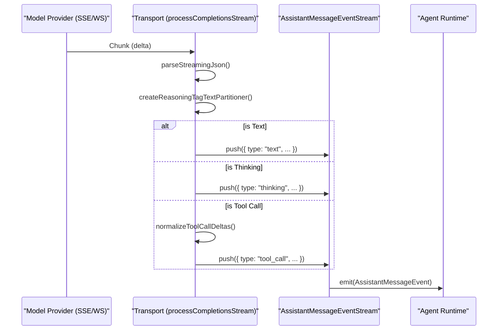

# OAuth & Custom Providers

<details>
<summary>Relevant source files</summary>

The following files were used as context for generating this wiki page:

- [docs/concepts/model-providers.md](docs/concepts/model-providers.md)
- [docs/plugins/sdk-runtime.md](docs/plugins/sdk-runtime.md)
- [extensions/anthropic/cli-auth-api.ts](extensions/anthropic/cli-auth-api.ts)
- [extensions/anthropic/cli-auth-seam.test.ts](extensions/anthropic/cli-auth-seam.test.ts)
- [extensions/anthropic/cli-auth-seam.ts](extensions/anthropic/cli-auth-seam.ts)
- [extensions/lmstudio/src/stream.test.ts](extensions/lmstudio/src/stream.test.ts)
- [extensions/openai/cli-auth-api.test.ts](extensions/openai/cli-auth-api.test.ts)
- [extensions/openai/cli-auth-api.ts](extensions/openai/cli-auth-api.ts)
- [extensions/openai/transport-policy.test.ts](extensions/openai/transport-policy.test.ts)
- [extensions/qa-lab/src/cron-run-wait.test.ts](extensions/qa-lab/src/cron-run-wait.test.ts)
- [packages/ai/src/internal/openai.ts](packages/ai/src/internal/openai.ts)
- [packages/ai/src/provider-options.ts](packages/ai/src/provider-options.ts)
- [packages/ai/src/provider-transport-parity.test.ts](packages/ai/src/provider-transport-parity.test.ts)
- [packages/ai/src/providers/anthropic-usage.test.ts](packages/ai/src/providers/anthropic-usage.test.ts)
- [packages/ai/src/providers/anthropic-usage.ts](packages/ai/src/providers/anthropic-usage.ts)
- [packages/ai/src/providers/anthropic.test.ts](packages/ai/src/providers/anthropic.test.ts)
- [packages/ai/src/providers/anthropic.ts](packages/ai/src/providers/anthropic.ts)
- [packages/ai/src/providers/mistral-http-client.contract.test.ts](packages/ai/src/providers/mistral-http-client.contract.test.ts)
- [packages/ai/src/providers/mistral.test.ts](packages/ai/src/providers/mistral.test.ts)
- [packages/ai/src/providers/mistral.ts](packages/ai/src/providers/mistral.ts)
- [packages/ai/src/providers/openai-chatgpt-responses.ts](packages/ai/src/providers/openai-chatgpt-responses.ts)
- [packages/ai/src/providers/openai-completions-tool-calls.ts](packages/ai/src/providers/openai-completions-tool-calls.ts)
- [packages/ai/src/providers/openai-completions.legacy-function-call.test.ts](packages/ai/src/providers/openai-completions.legacy-function-call.test.ts)
- [packages/ai/src/providers/openai-completions.off-effort.test.ts](packages/ai/src/providers/openai-completions.off-effort.test.ts)
- [packages/ai/src/providers/openai-completions.test.ts](packages/ai/src/providers/openai-completions.test.ts)
- [packages/ai/src/providers/openai-completions.ts](packages/ai/src/providers/openai-completions.ts)
- [packages/ai/src/providers/openai-responses-shared.ts](packages/ai/src/providers/openai-responses-shared.ts)
- [packages/ai/src/transports/anthropic-transport-stream.test.ts](packages/ai/src/transports/anthropic-transport-stream.test.ts)
- [packages/ai/src/transports/anthropic-transport-stream.ts](packages/ai/src/transports/anthropic-transport-stream.ts)
- [packages/ai/src/transports/deepseek-dsml-grammar.ts](packages/ai/src/transports/deepseek-dsml-grammar.ts)
- [packages/ai/src/transports/deepseek-text-filter.ts](packages/ai/src/transports/deepseek-text-filter.ts)
- [packages/ai/src/transports/openai-completions-dsml.recovery.test.ts](packages/ai/src/transports/openai-completions-dsml.recovery.test.ts)
- [packages/ai/src/transports/openai-completions-dsml.test.ts](packages/ai/src/transports/openai-completions-dsml.test.ts)
- [packages/ai/src/transports/openai-completions-dsml.ts](packages/ai/src/transports/openai-completions-dsml.ts)
- [packages/ai/src/transports/openai-completions-host.ts](packages/ai/src/transports/openai-completions-host.ts)
- [packages/ai/src/transports/openai-completions-params.compat-and-tool-choice.test.ts](packages/ai/src/transports/openai-completions-params.compat-and-tool-choice.test.ts)
- [packages/ai/src/transports/openai-completions-params.reasoning.test.ts](packages/ai/src/transports/openai-completions-params.reasoning.test.ts)
- [packages/ai/src/transports/openai-completions-params.shaping.test.ts](packages/ai/src/transports/openai-completions-params.shaping.test.ts)
- [packages/ai/src/transports/openai-completions-stream.reasoning-and-buffering.test.ts](packages/ai/src/transports/openai-completions-stream.reasoning-and-buffering.test.ts)
- [packages/ai/src/transports/openai-completions-stream.reasoning-details.test.ts](packages/ai/src/transports/openai-completions-stream.reasoning-details.test.ts)
- [packages/ai/src/transports/openai-completions-stream.tool-assembly.test.ts](packages/ai/src/transports/openai-completions-stream.tool-assembly.test.ts)
- [packages/ai/src/transports/openai-completions-stream.tool-calls.test.ts](packages/ai/src/transports/openai-completions-stream.tool-calls.test.ts)
- [packages/ai/src/transports/openai-completions-stream.ts](packages/ai/src/transports/openai-completions-stream.ts)
- [packages/ai/src/transports/openai-completions-stream.usage.test.ts](packages/ai/src/transports/openai-completions-stream.usage.test.ts)
- [packages/ai/src/transports/openai-completions-transport.response-hook.test.ts](packages/ai/src/transports/openai-completions-transport.response-hook.test.ts)
- [packages/ai/src/transports/openai-completions-transport.ts](packages/ai/src/transports/openai-completions-transport.ts)
- [packages/ai/src/transports/openai-responses-client.ts](packages/ai/src/transports/openai-responses-client.ts)
- [packages/ai/src/transports/openai-responses-contracts.ts](packages/ai/src/transports/openai-responses-contracts.ts)
- [packages/ai/src/transports/openai-responses-params-internal.ts](packages/ai/src/transports/openai-responses-params-internal.ts)
- [packages/ai/src/transports/openai-responses-prompt-observer.test.ts](packages/ai/src/transports/openai-responses-prompt-observer.test.ts)
- [packages/ai/src/transports/openai-responses-replay-internal.test.ts](packages/ai/src/transports/openai-responses-replay-internal.test.ts)
- [packages/ai/src/transports/openai-responses-replay-internal.ts](packages/ai/src/transports/openai-responses-replay-internal.ts)
- [packages/ai/src/transports/openai-responses-websocket-client.test.ts](packages/ai/src/transports/openai-responses-websocket-client.test.ts)
- [packages/ai/src/transports/openai-responses-websocket.test.ts](packages/ai/src/transports/openai-responses-websocket.test.ts)
- [packages/ai/src/transports/openai-responses-websocket.ts](packages/ai/src/transports/openai-responses-websocket.ts)
- [packages/ai/src/transports/openai-transport-params.code-mode.test.ts](packages/ai/src/transports/openai-transport-params.code-mode.test.ts)
- [packages/ai/src/transports/openai-transport-params.ts](packages/ai/src/transports/openai-transport-params.ts)
- [packages/ai/src/transports/openai-transport-shared.ts](packages/ai/src/transports/openai-transport-shared.ts)
- [packages/ai/src/transports/transport-stream-shared.ts](packages/ai/src/transports/transport-stream-shared.ts)
- [packages/ai/src/utils/assistant-text-phase.test.ts](packages/ai/src/utils/assistant-text-phase.test.ts)
- [packages/ai/src/utils/assistant-text-phase.ts](packages/ai/src/utils/assistant-text-phase.ts)
- [packages/ai/src/utils/reasoning-tag-text-partitioner.test.ts](packages/ai/src/utils/reasoning-tag-text-partitioner.test.ts)
- [packages/ai/src/utils/stream-first-event-timeout.ts](packages/ai/src/utils/stream-first-event-timeout.ts)
- [packages/ai/test/fixtures/provider-transport-parity/openai-success.snap.txt](packages/ai/test/fixtures/provider-transport-parity/openai-success.snap.txt)
- [packages/llm-core/src/types.ts](packages/llm-core/src/types.ts)
- [src/agents/deepseek-text-filter.test.ts](src/agents/deepseek-text-filter.test.ts)
- [src/agents/embedded-agent-subscribe.subscribe-embedded-agent-session.reasoning-delivery.test.ts](src/agents/embedded-agent-subscribe.subscribe-embedded-agent-session.reasoning-delivery.test.ts)
- [src/agents/sessions/sdk.ts](src/agents/sessions/sdk.ts)
- [src/agents/transport-stream-shared.test.ts](src/agents/transport-stream-shared.test.ts)
- [src/agents/zai.live.test.ts](src/agents/zai.live.test.ts)
- [src/commands/onboard-inference.test.ts](src/commands/onboard-inference.test.ts)
- [src/commands/onboard-inference.ts](src/commands/onboard-inference.ts)
- [src/config/sessions/session-accessor.transcript-turn.ts](src/config/sessions/session-accessor.transcript-turn.ts)
- [src/config/types.models.ts](src/config/types.models.ts)
- [src/llm/providers/stream-wrappers/openai.test.ts](src/llm/providers/stream-wrappers/openai.test.ts)
- [src/llm/providers/stream-wrappers/openai.ts](src/llm/providers/stream-wrappers/openai.ts)
- [src/plugin-sdk/process-runtime.ts](src/plugin-sdk/process-runtime.ts)
- [src/plugin-sdk/session-transcript-runtime.guarded.test.ts](src/plugin-sdk/session-transcript-runtime.guarded.test.ts)
- [src/plugin-sdk/session-transcript-runtime.test.ts](src/plugin-sdk/session-transcript-runtime.test.ts)
- [src/state/creator-namespace-migration.test.ts](src/state/creator-namespace-migration.test.ts)
- [ui/src/e2e/browser-route-handoff.e2e.test.ts](ui/src/e2e/browser-route-handoff.e2e.test.ts)

</details>


OpenClaw provides a robust architecture for managing diverse authentication mechanisms beyond simple API keys. This includes OAuth 2.0 flows, Google Gemini CLI integration, Qwen Portal device flows, and specialized provider bridges for external runtimes like GitHub Copilot and Anthropic's Claude CLI. This architecture ensures that the Agent Runtime can access models across cloud, local, and CLI-backed providers while maintaining a seamless user experience for credential rotation and refresh.

## Authentication & Provider Architecture

OpenClaw supports several authentication strategies for model providers, ranging from static keys to dynamic, short-lived tokens and platform-specific discovery.

### Authentication Modes

*   **API Key**: Standard bearer token authentication resolved from environment variables or configuration profiles. For Google, this includes `GEMINI_API_KEY` or `GOOGLE_API_KEY` [packages/ai/src/env-api-keys.ts:5-5]().
*   **OAuth & OpenID Connect**: Used for providers requiring user-authorized sessions. The system supports OAuth profile management via `upsertAuthProfileWithLock` [src/system-agent/setup-inference.test.ts:7-7]().
*   **CLI-Backed Auth**: Integration with external tools like `claude-cli` and `google-gemini-cli`. The system detects these backends via `detectInferenceBackends` [src/commands/onboard-inference.ts:8-24]() and manages their credentials through specialized harness plugins.
*   **Device Flow & Portals**: Specialized flows for providers like Qwen Portal or Venice AI discovery, where authentication involves device-pairing or implicit provider resolution via `resolveImplicitProviders` [packages/ai/src/transports/openai-responses-client.ts:139-143]().

### Auth Resolution Flow

The system resolves a model request into a concrete authenticated transport using the provider-specific transport logic. The `resolveTransportTurnState` method manages the mapping between an agent's execution context and the required credentials, including support for runtime plugin loading for OpenAI and Azure variants [packages/ai/src/transports/openai-responses-client.ts:129-157]().

**Code Entity Space: Auth & Provider Mapping**

| System Name | Code Entity | File |
| :--- | :--- | :--- |
| **CLI Inference Detection** | `detectInferenceBackends` | [src/commands/onboard-inference.ts:8-8]() |
| **Claude CLI Auth Probe** | `probeClaudeCliAuthStatus` | [src/commands/onboard-inference.ts:151-151]() |
| **Codex Login Status** | `classifyCodexLoginStatus` | [src/commands/onboard-inference.ts:118-118]() |
| **Gemini CLI Creds** | `readGeminiCliCredentialsCached` | [src/commands/onboard-inference.ts:9-9]() |

**Provider Auth Resolution Diagram**
```mermaid
graph TD
    subgraph "Auth_Resolution_Pipeline"
        ["detectInferenceBackends()"]
        ["resolveTransportTurnState()"]
        ["getEnvApiKey()"]
    end

    subgraph "Credential_Sources"
        ApiKey["Environment Variable"]
        CLICreds["CLI Backend (Claude/Gemini/Codex)"]
        OAuthProfile["Auth Profile Store"]
    end

    subgraph "Transports"
        OpenAIClient["createOpenAIResponsesClient()"]
        MistralClient["streamMistral()"]
        AnthropicClient["createAnthropicMessagesTransportStreamFn()"]
    end

    ["getEnvApiKey()"] --> ApiKey
    ApiKey --> OpenAIClient
    ApiKey --> MistralClient
    ["detectInferenceBackends()"] --> CLICreds
    CLICreds --> ["resolveTransportTurnState()"]
    ["resolveTransportTurnState()"] --> AnthropicClient
```
Sources: [src/commands/onboard-inference.ts:65-174](), [packages/ai/src/transports/openai-responses-client.ts:129-176](), [packages/ai/src/providers/mistral.ts:145-172]()

---

## Custom Provider Implementations

OpenClaw allows plugins to define complex provider behaviors, including dynamic model discovery and custom stream wrappers.

### Google Gemini CLI & Codex Integration
OpenClaw prioritizes native CLI tools for inference when available on the host system.
- **Backend Detection**: `detectInferenceBackends` probes for `codex`, `claude`, and `gemini` commands [src/commands/onboard-inference.ts:118-192]().
- **Credential Scoping**: The system distinguishes between OAuth tokens and API keys, providing detailed status such as "logged in · ChatGPT account" or "API key (usage-billed)" [src/commands/onboard-inference.ts:89-101]().
- **Version Probing**: To ensure stability, backends whose version probes time out are excluded from the candidate list [src/commands/onboard-inference.test.ts:179-199]().

### Mistral & Bounded Fetching
The Mistral provider implements specialized safety measures for streaming.
- **Bounded Fetcher**: `createBoundedMistralFetcher` wraps the standard fetch with a 16 MiB cap to prevent memory exhaustion from malicious or malfunctioning SSE streams [packages/ai/src/providers/mistral.ts:76-113]().
- **Byte Guard**: Uses `createSseByteGuard` to monitor the `ReadableStream` and cancel the upstream reader if limits are exceeded [packages/ai/src/providers/mistral.ts:86-90]().

### OpenAI Responses & Compaction Replay
The `openai-responses` API is handled with a complex retry and replay architecture to manage encrypted content and context compaction.
- **Encrypted Content Retry**: `createResponsesStreamWithEncryptedContentRetry` handles errors like `invalid_encrypted_content` by stripping problematic reasoning or compaction blobs and retrying the request [packages/ai/src/transports/openai-responses-replay-internal.ts:170-173]().
- **Compaction Rejection**: If a server rejects a compaction blob, the system can rebuild history via `resolveNextResponsesEncryptedContentAttempt` [packages/ai/src/transports/openai-responses-replay-internal.ts:127-168]().

---

## Event Bridge & Transcript Projection

Custom providers map non-standard event streams into the OpenClaw `AssistantMessage` format using specialized processors.

**Code Entity Space: Event Mapping**

| Source Event | OpenClaw Projection | File |
| :--- | :--- | :--- |
| `message_delta` | `AssistantMessageEvent` | [packages/ai/src/transports/anthropic-transport-stream.test.ts:115-115]() |
| `response.completed` | `Usage` & `AssistantMessage` | [packages/ai/src/transports/openai-responses-websocket-client.test.ts:184-184]() |
| `content_block_delta` | `text` or `thinking` | [packages/ai/src/transports/openai-completions-stream.ts:122-123]() |
| `tool_use` | `toolCall` | [packages/ai/src/transports/anthropic-transport-stream.ts:1-20]() |

**Stream Processing Flow**

Sources: [packages/ai/src/transports/openai-completions-stream.ts:95-157](), [packages/ai/src/providers/openai-completions.ts:151-169](), [packages/ai/src/providers/mistral.ts:134-183]()

### Plugin Runtime Helpers
Plugins accessing these features use the `api.runtime` object, which provides access to:
- **Config Mutation**: `api.runtime.config.mutateConfigFile` for persisting auth changes [docs/plugins/sdk-runtime.md:39-39]().
- **Agent Ingress**: `api.runtime.agent.runCommandFromIngress` for channel plugins to admit authenticated turns [docs/plugins/sdk-runtime.md:86-87]().
- **Interactive Helpers**: `renderPresentationForDelivery` for rendering rich UI cards across different messaging platforms [docs/plugins/sdk-runtime.md:65-66]().

Sources: [docs/plugins/sdk-runtime.md:1-97](), [packages/ai/src/transports/openai-responses-client.ts:95-176](), [src/commands/onboard-inference.ts:1-192](), [packages/ai/src/providers/mistral.ts:1-183](), [packages/ai/src/transports/openai-completions-stream.ts:95-157]()