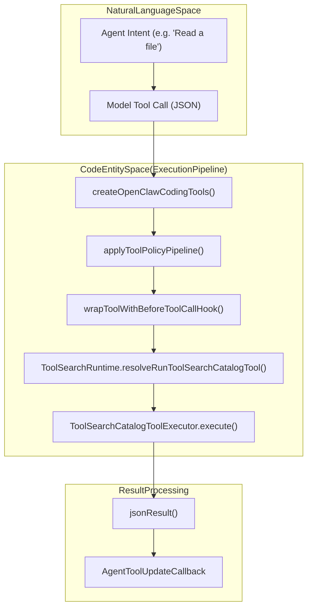
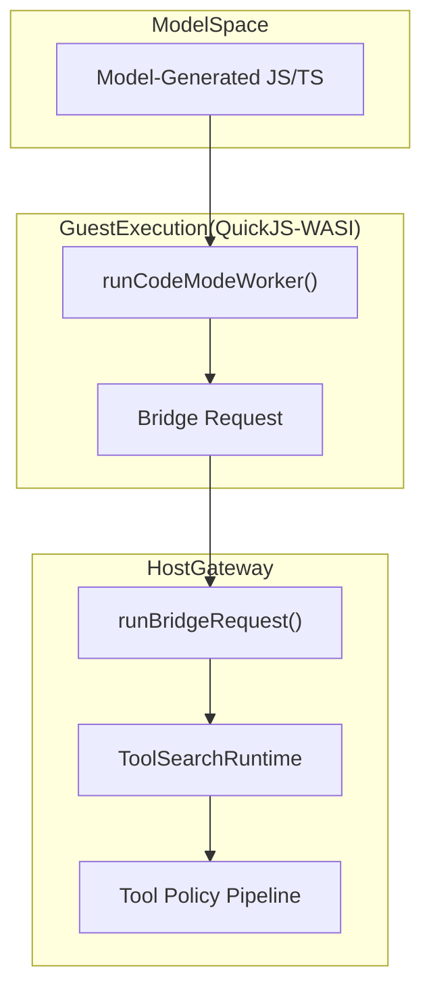

# Tools System

Relevant source files

The following files were used as context for generating this wiki page:

- [docs/concepts/agent-loop.md](docs/concepts/agent-loop.md)
- [docs/tools/code-mode.md](docs/tools/code-mode.md)
- [docs/tools/tool-search.md](docs/tools/tool-search.md)
- [extensions/codex/src/app-server/event-projector-assistant.ts](extensions/codex/src/app-server/event-projector-assistant.ts)
- [src/agents/agent-tools.deferred-followup.ts](src/agents/agent-tools.deferred-followup.ts)
- [src/agents/code-mode-bridge.ts](src/agents/code-mode-bridge.ts)
- [src/agents/code-mode-execution.ts](src/agents/code-mode-execution.ts)
- [src/agents/code-mode-headless.test.ts](src/agents/code-mode-headless.test.ts)
- [src/agents/code-mode-headless.ts](src/agents/code-mode-headless.ts)
- [src/agents/code-mode-json.test.ts](src/agents/code-mode-json.test.ts)
- [src/agents/code-mode-json.ts](src/agents/code-mode-json.ts)
- [src/agents/code-mode-runtime.test.ts](src/agents/code-mode-runtime.test.ts)
- [src/agents/code-mode-runtime.ts](src/agents/code-mode-runtime.ts)
- [src/agents/code-mode-state.ts](src/agents/code-mode-state.ts)
- [src/agents/code-mode-swarm.test.ts](src/agents/code-mode-swarm.test.ts)
- [src/agents/code-mode-worker-lifecycle.test.ts](src/agents/code-mode-worker-lifecycle.test.ts)
- [src/agents/code-mode-worker-types.ts](src/agents/code-mode-worker-types.ts)
- [src/agents/code-mode.agent-loop.test.ts](src/agents/code-mode.agent-loop.test.ts)
- [src/agents/code-mode.bridge.lifecycle.test.ts](src/agents/code-mode.bridge.lifecycle.test.ts)
- [src/agents/code-mode.bridge.test.ts](src/agents/code-mode.bridge.test.ts)
- [src/agents/code-mode.limits.test.ts](src/agents/code-mode.limits.test.ts)
- [src/agents/code-mode.output.test.ts](src/agents/code-mode.output.test.ts)
- [src/agents/code-mode.test-support.ts](src/agents/code-mode.test-support.ts)
- [src/agents/code-mode.test.ts](src/agents/code-mode.test.ts)
- [src/agents/code-mode.ts](src/agents/code-mode.ts)
- [src/agents/code-mode.wait.test.ts](src/agents/code-mode.wait.test.ts)
- [src/agents/code-mode.worker.ts](src/agents/code-mode.worker.ts)
- [src/agents/embedded-agent-runner/run/code-mode-outcome.test.ts](src/agents/embedded-agent-runner/run/code-mode-outcome.test.ts)
- [src/agents/embedded-agent-runner/run/code-mode-outcome.ts](src/agents/embedded-agent-runner/run/code-mode-outcome.ts)
- [src/agents/sessions/tools/limits.test.ts](src/agents/sessions/tools/limits.test.ts)
- [src/agents/sessions/tools/limits.ts](src/agents/sessions/tools/limits.ts)
- [src/agents/tool-search-catalog.ts](src/agents/tool-search-catalog.ts)
- [src/agents/tool-search-code-mode.ts](src/agents/tool-search-code-mode.ts)
- [src/agents/tool-search-config.ts](src/agents/tool-search-config.ts)
- [src/agents/tool-search-runtime.test.ts](src/agents/tool-search-runtime.test.ts)
- [src/agents/tool-search-runtime.ts](src/agents/tool-search-runtime.ts)
- [src/agents/tool-search-types.ts](src/agents/tool-search-types.ts)
- [src/agents/tool-search.stream-errors.test.ts](src/agents/tool-search.stream-errors.test.ts)
- [src/agents/tool-search.test-support.ts](src/agents/tool-search.test-support.ts)
- [src/agents/tool-search.test.ts](src/agents/tool-search.test.ts)
- [src/agents/tool-search.ts](src/agents/tool-search.ts)
- [src/agents/tools/gateway-tool.test.ts](src/agents/tools/gateway-tool.test.ts)
- [src/agents/tools/gateway-tool.ts](src/agents/tools/gateway-tool.ts)
- [src/agents/tools/terminal-tool.test.ts](src/agents/tools/terminal-tool.test.ts)
- [src/agents/tools/terminal-tool.ts](src/agents/tools/terminal-tool.ts)
- [src/auto-reply/reply/agent-runner-execution-timing.test.ts](src/auto-reply/reply/agent-runner-execution-timing.test.ts)
- [src/auto-reply/reply/agent-runner-trace.test.ts](src/auto-reply/reply/agent-runner-trace.test.ts)
- [src/auto-reply/reply/agent-runner-trace.ts](src/auto-reply/reply/agent-runner-trace.ts)
- [src/gateway/server-active-work.test.ts](src/gateway/server-active-work.test.ts)
- [src/gateway/server-chat-progress-snapshot.ts](src/gateway/server-chat-progress-snapshot.ts)
- [src/gateway/server-chat-state.test.ts](src/gateway/server-chat-state.test.ts)
- [src/gateway/server-chat-state.ts](src/gateway/server-chat-state.ts)
- [src/gateway/server-chat.agent-events.test.ts](src/gateway/server-chat.agent-events.test.ts)
- [src/gateway/server-chat.ts](src/gateway/server-chat.ts)
- [src/gateway/server-runtime-subscriptions.test.ts](src/gateway/server-runtime-subscriptions.test.ts)
- [src/gateway/server-runtime-subscriptions.ts](src/gateway/server-runtime-subscriptions.ts)
- [src/gateway/server.sessions.archive-terminal.test.ts](src/gateway/server.sessions.archive-terminal.test.ts)
- [src/gateway/session-lifecycle-persistence-owner.test.ts](src/gateway/session-lifecycle-persistence-owner.test.ts)
- [src/gateway/session-lifecycle-persistence-owner.ts](src/gateway/session-lifecycle-persistence-owner.ts)
- [src/gateway/session-lifecycle-state.persistence.test.ts](src/gateway/session-lifecycle-state.persistence.test.ts)
- [src/gateway/session-lifecycle-state.test.ts](src/gateway/session-lifecycle-state.test.ts)
- [src/gateway/session-list-order.ts](src/gateway/session-list-order.ts)
- [src/gateway/session-utils-contracts.ts](src/gateway/session-utils-contracts.ts)
- [src/gateway/terminal/session-manager.eviction.test.ts](src/gateway/terminal/session-manager.eviction.test.ts)
- [src/gateway/terminal/session-manager.task-lifecycle.test.ts](src/gateway/terminal/session-manager.task-lifecycle.test.ts)
- [src/gateway/terminal/session-manager.test-helpers.ts](src/gateway/terminal/session-manager.test-helpers.ts)
- [src/gateway/terminal/session-manager.ts](src/gateway/terminal/session-manager.ts)
- [src/gateway/tool-resolution.terminal.test.ts](src/gateway/tool-resolution.terminal.test.ts)
- [src/tasks/task-registry-activity.ts](src/tasks/task-registry-activity.ts)
- [src/tasks/task-registry-lifecycle.ts](src/tasks/task-registry-lifecycle.ts)
- [src/tasks/task-registry.test.ts](src/tasks/task-registry.test.ts)
- [src/tasks/task-status-access.ts](src/tasks/task-status-access.ts)
- [ui/src/components/browser/browser-panel.styles.ts](ui/src/components/browser/browser-panel.styles.ts)
- [ui/src/components/terminal/terminal-session-picker.ts](ui/src/components/terminal/terminal-session-picker.ts)

The tools system in OpenClaw enables agents to extend their capabilities beyond generating text by invoking structured, typed functions. These tools allow the agent to interact with the local filesystem, execute shell commands, manage background processes, automate browsers, and perform web searches [src/agents/agent-tools.ts:1-5](). Tool usage is governed by a policy pipeline that ensures security and contextual appropriateness through explicit approvals, session-scoped restrictions, and sandboxing [src/agents/agent-tools.ts:93-102]().

A significant evolution of the tool system is **Code Mode**, an experimental feature where models orchestrate tools by writing JavaScript or TypeScript programs executed in an isolated QuickJS-WASI environment [docs/tools/code-mode.md:12-16]().

**Related pages:**
- [Tool Policies & Filtering](#3.4.1) — Document tool policy resolution (global/agent/profile/group), owner-only restrictions, sandbox vs host tools, and plugin tool integration.
- [Exec & Background Processes](#3.4.2) — Explain exec/process tools, foreground vs background execution, process registry, session management, and output buffering.
- [Memory & Search](#3.4.3) — Document memory system including `MemoryIndexManager`, hybrid search (vector + FTS), file watchers, and memory tools.
- [Browser Automation](#3.4.4) — Document integrated browser control, CDP-based tab control, and agent browser actions.
- [Web Search & Fetch](#3.4.5) — Document web search tool integration (Brave, Perplexity, Tavily, etc.) and SSRF protection.
- [Image & Media Tools](#3.4.6) — Document image generation, PDF processing, and media understanding pipeline.

---

## Tool Assembly & Lifecycle

OpenClaw assembles available tools for an agent turn by constructing an inventory based on the agent's configuration, active plugins, and available skills. The `createOpenClawCodingTools` function [src/agents/agent-tools.ts:68]() serves as a core factory for gathering specialized execution and session tools.

The lifecycle of a tool call involves:
1.  **Inventory Resolution**: Determining which tools the agent is allowed to see based on policy, tool profiles, and explicit allowlists/denylists [src/agents/agent-tools.ts:93-108]().
2.  **Pre-Execution Hooks**: Before execution, tools are wrapped by `wrapToolWithBeforeToolCallHook` [src/agents/agent-tools.before-tool-call.ts:33](). This stage handles loop detection, plugin approvals, and diagnostic telemetry [src/agents/agent-tools.ts:100-103]().
3.  **Schema Normalization**: Adapting tool definitions for specific model providers. OpenClaw handles provider-specific constraints like `const` or `enum` mapping and strips unsupported keywords [src/agents/agent-tools.create-openclaw-coding-tools.test.ts:19-21]().
4.  **Execution Handling**: Routing the model's tool call to the appropriate internal handler. Tool results are typically returned as `AgentToolResult` [src/agents/tool-search-runtime.ts:15]().

### Tool Execution Flow
This diagram bridges the "Natural Language Space" of agent intent to the "Code Entity Space" of the tool execution pipeline.

Sources: [src/agents/agent-tools.ts:60-102](), [src/agents/agent-tools.before-tool-call.ts:33](), [src/agents/tool-search.ts:46](), [src/agents/tools/common.ts:50](), [src/agents/tool-search-runtime.ts:15]()

---

## Code Mode & Headless Execution

OpenClaw Code Mode replaces broad tool exposure with a compact interface consisting of `exec` and `wait` [docs/tools/code-mode.md:12-16](). The model writes a program that interacts with a hidden tool catalog via async global functions [docs/tools/code-mode.md:62-64]().

*   **Isolated Execution**: Guest code runs in a `QuickJS-WASI` worker thread [docs/tools/code-mode.md:35-36]().
*   **State Persistence**: Parked runs are managed in `activeRuns` [src/agents/code-mode-state.ts:69](), allowing for asynchronous resumes when nested tool calls settle [src/agents/code-mode-execution.ts:124-141]().
*   **Headless Scripts**: `runCodeModeScriptHeadless` allows executing scripts without publishing resumable snapshot state, useful for internal automation [src/agents/code-mode-headless.ts:190-194]().

### Code Mode Orchestration
This diagram shows how model-generated code bridges to the underlying OpenClaw tools.

Sources: [docs/tools/code-mode.md:55-78](), [src/agents/code-mode-worker.ts:42](), [src/agents/code-mode-bridge.ts:8](), [src/agents/code-mode-execution.ts:108-122]()

---

## Tool Discovery & Search

When an agent has access to a large tool catalog (e.g., via MCP or many plugins), OpenClaw uses `tool_search` to compact the prompt surface [src/agents/tool-search.ts:110-118]().

*   **Catalog Indexing**: Tools are indexed lexically based on their name, description, and parameters [src/agents/tool-search-runtime.ts:67-77]().
*   **Ranking**: `scoreLexical` and `levenshteinDistance` are used to find relevant tools for a model's query [src/agents/tool-search-runtime.ts:7-8](), [src/agents/tool-search-runtime.ts:33]().
*   **Dynamic Resolution**: `findEntry` resolves tool IDs or names into callable handles within the `ToolSearchCatalogSession` [src/agents/tool-search-runtime.ts:142-163]().

Sources: [src/agents/tool-search.ts:1-118](), [src/agents/tool-search-runtime.ts:1-177](), [src/agents/tool-search-catalog.ts:1-177]()

---

## Security & Policy Resolution

The tool system implements a multi-layered security model to ensure that agents only access authorized capabilities.

*   **Conversation Profile**: `resolveConversationCapabilityProfile` consolidates facts about the sender and workspace to inform tool availability [src/agents/conversation-capability-profile.ts:59-61]().
*   **Policy Resolution**: `resolveConversationToolPolicies` determines effective permissions [src/agents/agent-tools.ts:66-67]().
*   **Owner-Only Tools**: Sensitive tools are restricted via `GATEWAY_OWNER_ONLY_CORE_TOOLS` [src/agents/agent-tools.ts:29]().

---

## Summary of Key Code Entities

| Symbol | File | Description |
| :--- | :--- | :--- |
| `createOpenClawCodingTools` | [src/agents/agent-tools.ts:68]() | Factory for assembling standard coding and session tools. |
| `ToolSearchRuntime` | [src/agents/tool-search-runtime.ts:34]() | Manages tool discovery, ranking, and execution within a catalog. |
| `runCodeModeExec` | [src/agents/code-mode-execution.ts:61]() | Orchestrates the execution of model-generated code in the QuickJS sandbox. |
| `activeRuns` | [src/agents/code-mode-state.ts:69]() | Registry of parked Code Mode snapshots waiting for tool settlement. |
| `applyToolPolicyPipeline` | [src/agents/agent-tools.ts:102]() | Filters the tool inventory through global and agent security policies. |

Sources: [src/agents/agent-tools.ts:1-127](), [src/agents/tool-search-runtime.ts:1-749](), [src/agents/code-mode-execution.ts:1-166](), [src/agents/code-mode-state.ts:1-187]()