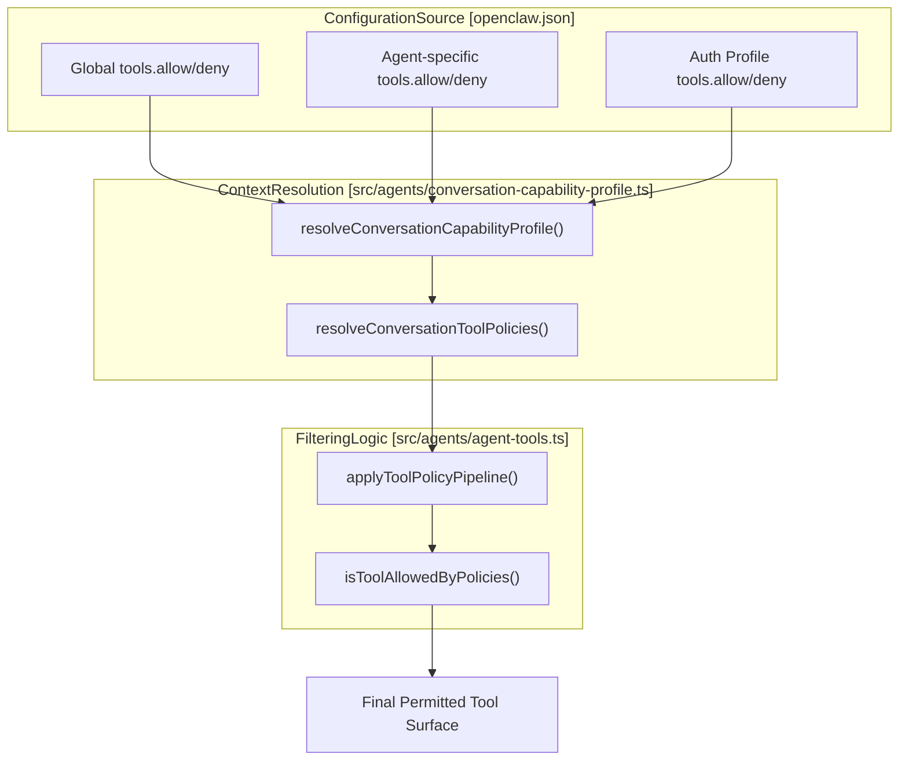
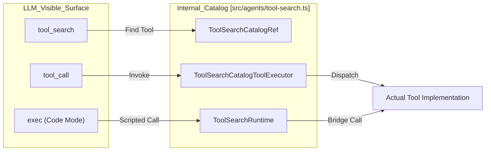
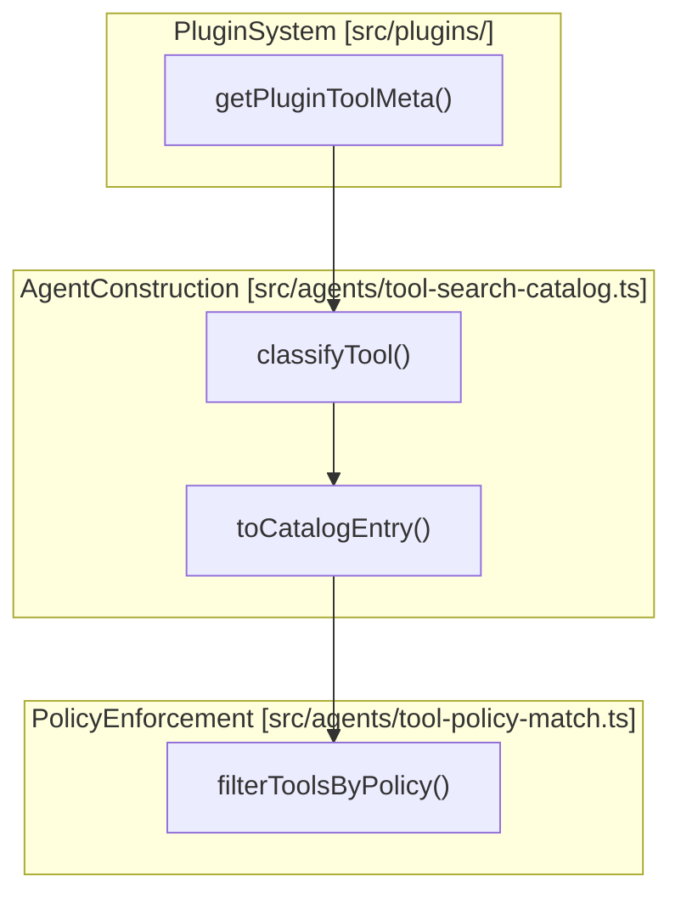

# Tool Policies & Filtering

Relevant source files

The following files were used as context for generating this wiki page:

- [docs/concepts/agent-loop.md](docs/concepts/agent-loop.md)
- [docs/tools/code-mode.md](docs/tools/code-mode.md)
- [docs/tools/tool-search.md](docs/tools/tool-search.md)
- [extensions/codex/src/app-server/event-projector-assistant.ts](extensions/codex/src/app-server/event-projector-assistant.ts)
- [src/agents/agent-tools.deferred-followup.ts](src/agents/agent-tools.deferred-followup.ts)
- [src/agents/code-mode-bridge.ts](src/agents/code-mode-bridge.ts)
- [src/agents/code-mode-execution.ts](src/agents/code-mode-execution.ts)
- [src/agents/code-mode-headless.test.ts](src/agents/code-mode-headless.test.ts)
- [src/agents/code-mode-headless.ts](src/agents/code-mode-headless.ts)
- [src/agents/code-mode-json.test.ts](src/agents/code-mode-json.test.ts)
- [src/agents/code-mode-json.ts](src/agents/code-mode-json.ts)
- [src/agents/code-mode-runtime.test.ts](src/agents/code-mode-runtime.test.ts)
- [src/agents/code-mode-runtime.ts](src/agents/code-mode-runtime.ts)
- [src/agents/code-mode-state.ts](src/agents/code-mode-state.ts)
- [src/agents/code-mode-swarm.test.ts](src/agents/code-mode-swarm.test.ts)
- [src/agents/code-mode-worker-lifecycle.test.ts](src/agents/code-mode-worker-lifecycle.test.ts)
- [src/agents/code-mode-worker-types.ts](src/agents/code-mode-worker-types.ts)
- [src/agents/code-mode.agent-loop.test.ts](src/agents/code-mode.agent-loop.test.ts)
- [src/agents/code-mode.bridge.lifecycle.test.ts](src/agents/code-mode.bridge.lifecycle.test.ts)
- [src/agents/code-mode.bridge.test.ts](src/agents/code-mode.bridge.test.ts)
- [src/agents/code-mode.limits.test.ts](src/agents/code-mode.limits.test.ts)
- [src/agents/code-mode.output.test.ts](src/agents/code-mode.output.test.ts)
- [src/agents/code-mode.test-support.ts](src/agents/code-mode.test-support.ts)
- [src/agents/code-mode.test.ts](src/agents/code-mode.test.ts)
- [src/agents/code-mode.ts](src/agents/code-mode.ts)
- [src/agents/code-mode.wait.test.ts](src/agents/code-mode.wait.test.ts)
- [src/agents/code-mode.worker.ts](src/agents/code-mode.worker.ts)
- [src/agents/embedded-agent-runner/run/code-mode-outcome.test.ts](src/agents/embedded-agent-runner/run/code-mode-outcome.test.ts)
- [src/agents/embedded-agent-runner/run/code-mode-outcome.ts](src/agents/embedded-agent-runner/run/code-mode-outcome.ts)
- [src/agents/sessions/tools/limits.test.ts](src/agents/sessions/tools/limits.test.ts)
- [src/agents/sessions/tools/limits.ts](src/agents/sessions/tools/limits.ts)
- [src/agents/tool-search-catalog.ts](src/agents/tool-search-catalog.ts)
- [src/agents/tool-search-code-mode.ts](src/agents/tool-search-code-mode.ts)
- [src/agents/tool-search-config.ts](src/agents/tool-search-config.ts)
- [src/agents/tool-search-runtime.test.ts](src/agents/tool-search-runtime.test.ts)
- [src/agents/tool-search-runtime.ts](src/agents/tool-search-runtime.ts)
- [src/agents/tool-search-types.ts](src/agents/tool-search-types.ts)
- [src/agents/tool-search.stream-errors.test.ts](src/agents/tool-search.stream-errors.test.ts)
- [src/agents/tool-search.test-support.ts](src/agents/tool-search.test-support.ts)
- [src/agents/tool-search.test.ts](src/agents/tool-search.test.ts)
- [src/agents/tool-search.ts](src/agents/tool-search.ts)
- [src/agents/tools/gateway-tool.test.ts](src/agents/tools/gateway-tool.test.ts)
- [src/agents/tools/gateway-tool.ts](src/agents/tools/gateway-tool.ts)
- [src/agents/tools/terminal-tool.test.ts](src/agents/tools/terminal-tool.test.ts)
- [src/agents/tools/terminal-tool.ts](src/agents/tools/terminal-tool.ts)
- [src/auto-reply/reply/agent-runner-execution-timing.test.ts](src/auto-reply/reply/agent-runner-execution-timing.test.ts)
- [src/auto-reply/reply/agent-runner-trace.test.ts](src/auto-reply/reply/agent-runner-trace.test.ts)
- [src/auto-reply/reply/agent-runner-trace.ts](src/auto-reply/reply/agent-runner-trace.ts)
- [src/gateway/server-active-work.test.ts](src/gateway/server-active-work.test.ts)
- [src/gateway/server-chat-progress-snapshot.ts](src/gateway/server-chat-progress-snapshot.ts)
- [src/gateway/server-chat-state.test.ts](src/gateway/server-chat-state.test.ts)
- [src/gateway/server-chat-state.ts](src/gateway/server-chat-state.ts)
- [src/gateway/server-chat.agent-events.test.ts](src/gateway/server-chat.agent-events.test.ts)
- [src/gateway/server-chat.ts](src/gateway/server-chat.ts)
- [src/gateway/server-runtime-subscriptions.test.ts](src/gateway/server-runtime-subscriptions.test.ts)
- [src/gateway/server-runtime-subscriptions.ts](src/gateway/server-runtime-subscriptions.ts)
- [src/gateway/server.sessions.archive-terminal.test.ts](src/gateway/server.sessions.archive-terminal.test.ts)
- [src/gateway/session-lifecycle-persistence-owner.test.ts](src/gateway/session-lifecycle-persistence-owner.test.ts)
- [src/gateway/session-lifecycle-persistence-owner.ts](src/gateway/session-lifecycle-persistence-owner.ts)
- [src/gateway/session-lifecycle-state.persistence.test.ts](src/gateway/session-lifecycle-state.persistence.test.ts)
- [src/gateway/session-lifecycle-state.test.ts](src/gateway/session-lifecycle-state.test.ts)
- [src/gateway/session-list-order.ts](src/gateway/session-list-order.ts)
- [src/gateway/session-utils-contracts.ts](src/gateway/session-utils-contracts.ts)
- [src/gateway/terminal/session-manager.eviction.test.ts](src/gateway/terminal/session-manager.eviction.test.ts)
- [src/gateway/terminal/session-manager.task-lifecycle.test.ts](src/gateway/terminal/session-manager.task-lifecycle.test.ts)
- [src/gateway/terminal/session-manager.test-helpers.ts](src/gateway/terminal/session-manager.test-helpers.ts)
- [src/gateway/terminal/session-manager.ts](src/gateway/terminal/session-manager.ts)
- [src/gateway/tool-resolution.terminal.test.ts](src/gateway/tool-resolution.terminal.test.ts)
- [src/tasks/task-registry-activity.ts](src/tasks/task-registry-activity.ts)
- [src/tasks/task-registry-lifecycle.ts](src/tasks/task-registry-lifecycle.ts)
- [src/tasks/task-registry.test.ts](src/tasks/task-registry.test.ts)
- [src/tasks/task-status-access.ts](src/tasks/task-status-access.ts)
- [ui/src/components/browser/browser-panel.styles.ts](ui/src/components/browser/browser-panel.styles.ts)
- [ui/src/components/terminal/terminal-session-picker.ts](ui/src/components/terminal/terminal-session-picker.ts)

This page documents the tool policy resolution workflow, filtering mechanisms, and safety guards in OpenClaw's agent runtime. Tool policies control which tools are permitted or denied according to global settings, agent configuration, auth profiles, and ownership boundaries.

---

## Policy Resolution Hierarchy

OpenClaw employs a layered approach to tool policy resolution. The effective policy is resolved by merging global defaults with agent-specific overrides, profile-based restrictions, and sub-agent capability constraints.

### Implementation Details

The core logic for building the tool surface resides in `createOpenClawCodingTools` [src/agents/agent-tools.ts:187-215](). This function assembles core, shell, and plugin tools, then applies the policy pipeline.

- `resolveConversationToolPolicies` [src/agents/agent-tools.ts:64-67]() computes the final merged policy for a session.
- `applyToolPolicyPipeline` [src/agents/agent-tools.ts:102-102]() is the primary engine that executes the filtering steps.
- `isToolExplicitlyAllowedByFactoryPolicy` [src/agents/openclaw-tools.ts:20-21]() and related factory policies gate specific tool categories like media generation.
- `GATEWAY_OWNER_ONLY_CORE_TOOLS` [src/agents/agent-tools.ts:29-29]() defines high-risk tools (like `gateway` or `bash`) that are restricted to the gateway owner by default.

### Data Flow and Normalization

Before policies are applied, tool names and parameters are normalized to ensure consistency across different model providers:
- `normalizeToolPolicyName` [src/agents/agent-tools.ts:106-106]() canonicalizes tool identifiers.
- `filterToolsByMessageProvider` [src/agents/agent-tools.ts:41-41]() ensures tools are compatible with the specific LLM provider's schema requirements.
- `expandToolGroups` [src/agents/agent-tools.ts:104-104]() resolves group aliases (e.g., `coding`) into their constituent tool names.
- `filterLocalModelLeanTools` [src/agents/agent-tools.ts:77-79]() reduces the tool surface for local models with smaller context windows.

### Tool Policy Resolution Workflow

Title: "Tool Policy Resolution Pipeline"

Sources: [src/agents/agent-tools.ts:59-108](), [src/agents/conversation-capability-profile.ts:59-61]()

---

## Sandbox vs Host Tools

OpenClaw distinguishes between tools running in a restricted sandbox (e.g., Docker) and those running directly on the host machine.

### Filesystem Isolation
The system dynamically selects tool implementations based on the `sandboxed` flag:
- **Read/Write:** `createSandboxedReadTool` vs `createOpenClawReadTool` [src/agents/agent-tools.create-openclaw-coding-tools.test.ts:35-36]().
- **Path Guarding:** `resolveToolFsConfig` [src/agents/agent-tools.ts:98-98]() and `resolveSessionPermissionCoreToolPolicy` [src/agents/agent-tools.ts:90-90]() ensure that even host-mode tools cannot escape the designated agent workspace.
- **Provenance:** `createMemoryWriteProvenanceObserver` [src/agents/agent-tools.ts:80-80]() tracks which tool modified specific files via `withMemoryWriteProvenance` [src/agents/agent-tools.read.ts:42-42]().

### Exec & Shell Policy
Shell execution is governed by `applyExecPolicyLayer` [src/agents/agent-tools.ts:19-19](). This layer handles:
- **Elevated Privileges:** Restricting `sudo` or specific binary paths.
- **Background Processes:** Buffering output for long-running tasks via `ProcessToolDefaults` [src/agents/agent-tools.ts:55-55]().
- **Scoping:** `resolveProcessToolScopeKey` [src/agents/agent-tools.ts:53-53]() isolates process environments between different agent sessions.

---

## Tool Search & Code Mode

For agents with large tool catalogs, OpenClaw provides **Tool Search** and **Code Mode** to prevent context window overflow and improve orchestration.

### Tool Search Catalog
When the number of tools exceeds model limits, the runtime employs `createToolSearchTools` [src/agents/tool-search.ts:109-111]().
- **Compaction:** Instead of the full list, the agent sees `tool_search`, `tool_describe`, and `tool_call` [src/agents/tool-search.ts:47-50]().
- **Execution:** `TOOL_CALL_RAW_TOOL_NAME` [src/agents/tool-search.ts:47-47]() allows the agent to invoke any tool in the catalog by name.
- **Ranking:** `scoreLexical` [src/agents/tool-search-runtime.ts:33-33]() and `levenshteinDistance` [src/agents/tool-search-runtime.ts:7-7]() are used to suggest tools when an unknown ID is provided [src/agents/tool-search-runtime.ts:111-140]().

### Code Mode Execution
Code Mode allows the model to write JavaScript/TypeScript programs that call tools via a guest bridge [docs/tools/code-mode.md:12-16]().
- **Sandbox:** Execution occurs in an isolated `QuickJS-WASI` worker [docs/tools/code-mode.md:35-36]().
- **Tool Exposure:** Catalog tools are exposed as async global functions inside the guest VM [docs/tools/code-mode.md:62-64]().
- **Lifecycle:** `runCodeModeExec` [src/agents/code-mode-execution.ts:61-61]() manages the worker lifecycle, while `activeRuns` [src/agents/code-mode-state.ts:69-69]() tracks parked snapshots for `wait` resumes.
- **Filtering:** Code Mode tools like `exec` and `wait` are subject to the same policy resolution as other tools [docs/tools/code-mode.md:72-73]().

Title: "Tool Search and Catalog Dispatch"

Sources: [src/agents/tool-search.ts:34-52](), [src/agents/tool-search-runtime.ts:142-163](), [docs/tools/code-mode.md:55-83](), [src/agents/code-mode-execution.ts:76-79]()

---

## Plugin Tool Integration

Plugins can inject tools into the agent's environment, which are then subject to the same policy pipeline as core tools.

- **Discovery:** `resolveOpenClawPluginToolsForOptions` [src/agents/agent-tools.ts:82-82]() fetches tools exported by active plugins.
- **Metadata Retrieval:** `getPluginToolMeta` [src/agents/tool-search-catalog.ts:3-3]() is used to extract tool definitions and classify them as `openclaw` or `mcp` sources [src/agents/tool-search-catalog.ts:97-115]().
- **MCP Bridge:** MCP tools are normalized and grouped under the `MCP` namespace in Code Mode [docs/tools/code-mode.md:74-75]().

### Plugin Tool Flow

Title: "Plugin Tool Registration and Policy Mapping"

Sources: [src/agents/tool-search-catalog.ts:97-177](), [src/agents/tool-policy-match.ts:28-28]()

---

## Policy & Execution Entity Map

| Code Entity | Role in Filtering / Execution | Source |
| :--- | :--- | :--- |
| `resolveConversationCapabilityProfile` | Aggregates all session facts for policy decisions | [src/agents/conversation-capability-profile.ts:59-61]() |
| `applyToolPolicyPipeline` | Executes the sequence of filters (sandbox, profile, etc) | [src/agents/agent-tools.ts:102-102]() |
| `ToolSearchRuntime` | Manages tool discovery and scoped execution for catalogs | [src/agents/tool-search-runtime.ts:34-34]() |
| `runCodeModeWorker` | Executes model-generated code in a QuickJS-WASI sandbox | [src/agents/code-mode-execution.ts:108-108]() |
| `filterToolsByPolicy` | Matches tool IDs against allow/deny lists | [src/agents/tool-policy-match.ts:28-28]() |
| `GATEWAY_OWNER_ONLY_CORE_TOOLS` | Hardcoded list of dangerous tools for owner-only use | [src/agents/agent-tools.ts:29-29]() |
| `compactToolSearchCatalogEntry` | Reduces tool schema size for model prompts | [src/agents/tool-search-catalog.ts:23-23]() |

Sources: [src/agents/agent-tools.ts:17-153](), [src/agents/tool-search-runtime.ts:34-77](), [src/agents/code-mode-execution.ts:61-122]()