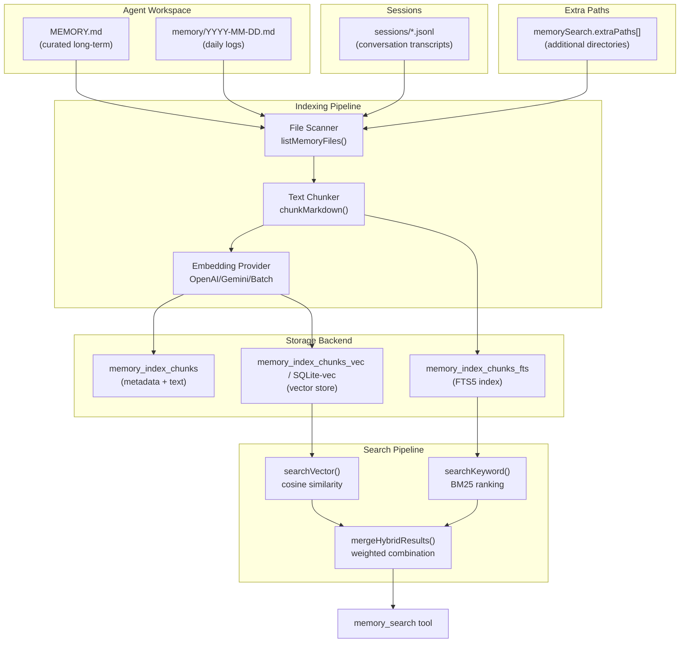
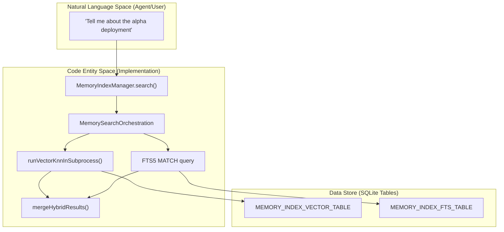
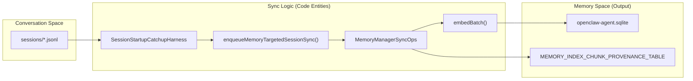

# Memory & Search

Relevant source files

The following files were used as context for generating this wiki page:

- [.agents/skills/openclaw-update/SKILL.md](.agents/skills/openclaw-update/SKILL.md)
- [.agents/skills/openclaw-update/agents/openai.yaml](.agents/skills/openclaw-update/agents/openai.yaml)
- [.agents/skills/update-team-server/SKILL.md](.agents/skills/update-team-server/SKILL.md)
- [.github/labeler.yml](.github/labeler.yml)
- [CHANGELOG.md](CHANGELOG.md)
- [appcast.xml](appcast.xml)
- [docs/.i18n/glossary.zh-CN.json](docs/.i18n/glossary.zh-CN.json)
- [docs/.i18n/zh-Hans-navigation.json](docs/.i18n/zh-Hans-navigation.json)
- [docs/cli/memory.md](docs/cli/memory.md)
- [docs/concepts/memory-architecture.md](docs/concepts/memory-architecture.md)
- [docs/concepts/memory-builtin.md](docs/concepts/memory-builtin.md)
- [docs/docs.json](docs/docs.json)
- [docs/releases/2026.8.1.md](docs/releases/2026.8.1.md)
- [docs/releases/2026.8.2.md](docs/releases/2026.8.2.md)
- [docs/releases/2026.9.1.md](docs/releases/2026.9.1.md)
- [docs/releases/index.md](docs/releases/index.md)
- [extensions/memory-core/src/cli-index-search.runtime.ts](extensions/memory-core/src/cli-index-search.runtime.ts)
- [extensions/memory-core/src/cli-reset.runtime.ts](extensions/memory-core/src/cli-reset.runtime.ts)
- [extensions/memory-core/src/cli-runtime-common.ts](extensions/memory-core/src/cli-runtime-common.ts)
- [extensions/memory-core/src/cli-status.runtime.ts](extensions/memory-core/src/cli-status.runtime.ts)
- [extensions/memory-core/src/cli.host.runtime.ts](extensions/memory-core/src/cli.host.runtime.ts)
- [extensions/memory-core/src/cli.runtime.ts](extensions/memory-core/src/cli.runtime.ts)
- [extensions/memory-core/src/cli.test.ts](extensions/memory-core/src/cli.test.ts)
- [extensions/memory-core/src/cli.ts](extensions/memory-core/src/cli.ts)
- [extensions/memory-core/src/cli.types.ts](extensions/memory-core/src/cli.types.ts)
- [extensions/memory-core/src/memory/hybrid.test.ts](extensions/memory-core/src/memory/hybrid.test.ts)
- [extensions/memory-core/src/memory/hybrid.ts](extensions/memory-core/src/memory/hybrid.ts)
- [extensions/memory-core/src/memory/index.test.ts](extensions/memory-core/src/memory/index.test.ts)
- [extensions/memory-core/src/memory/manager-async-state.test.ts](extensions/memory-core/src/memory/manager-async-state.test.ts)
- [extensions/memory-core/src/memory/manager-async-state.ts](extensions/memory-core/src/memory/manager-async-state.ts)
- [extensions/memory-core/src/memory/manager-candidate-repair.test.ts](extensions/memory-core/src/memory/manager-candidate-repair.test.ts)
- [extensions/memory-core/src/memory/manager-db.test.ts](extensions/memory-core/src/memory/manager-db.test.ts)
- [extensions/memory-core/src/memory/manager-db.ts](extensions/memory-core/src/memory/manager-db.ts)
- [extensions/memory-core/src/memory/manager-index-generation-lease.ts](extensions/memory-core/src/memory/manager-index-generation-lease.ts)
- [extensions/memory-core/src/memory/manager-index.test-support.ts](extensions/memory-core/src/memory/manager-index.test-support.ts)
- [extensions/memory-core/src/memory/manager-keyword-retrieval.test.ts](extensions/memory-core/src/memory/manager-keyword-retrieval.test.ts)
- [extensions/memory-core/src/memory/manager-keyword-retrieval.ts](extensions/memory-core/src/memory/manager-keyword-retrieval.ts)
- [extensions/memory-core/src/memory/manager-provider-lifecycle-fallback.test.ts](extensions/memory-core/src/memory/manager-provider-lifecycle-fallback.test.ts)
- [extensions/memory-core/src/memory/manager-provider-lifecycle-leases.test.ts](extensions/memory-core/src/memory/manager-provider-lifecycle-leases.test.ts)
- [extensions/memory-core/src/memory/manager-provider-lifecycle.test.ts](extensions/memory-core/src/memory/manager-provider-lifecycle.test.ts)
- [extensions/memory-core/src/memory/manager-provider-lifecycle.ts](extensions/memory-core/src/memory/manager-provider-lifecycle.ts)
- [extensions/memory-core/src/memory/manager-provider-runtime-facts.ts](extensions/memory-core/src/memory/manager-provider-runtime-facts.ts)
- [extensions/memory-core/src/memory/manager-registry.test.ts](extensions/memory-core/src/memory/manager-registry.test.ts)
- [extensions/memory-core/src/memory/manager-registry.ts](extensions/memory-core/src/memory/manager-registry.ts)
- [extensions/memory-core/src/memory/manager-reindex-lock.ts](extensions/memory-core/src/memory/manager-reindex-lock.ts)
- [extensions/memory-core/src/memory/manager-search-maintenance.ts](extensions/memory-core/src/memory/manager-search-maintenance.ts)
- [extensions/memory-core/src/memory/manager-search-orchestration.test.ts](extensions/memory-core/src/memory/manager-search-orchestration.test.ts)
- [extensions/memory-core/src/memory/manager-search-orchestration.ts](extensions/memory-core/src/memory/manager-search-orchestration.ts)
- [extensions/memory-core/src/memory/manager-search.test.ts](extensions/memory-core/src/memory/manager-search.test.ts)
- [extensions/memory-core/src/memory/manager-search.ts](extensions/memory-core/src/memory/manager-search.ts)
- [extensions/memory-core/src/memory/manager-session-reindex.ts](extensions/memory-core/src/memory/manager-session-reindex.ts)
- [extensions/memory-core/src/memory/manager-session-sync-ops.ts](extensions/memory-core/src/memory/manager-session-sync-ops.ts)
- [extensions/memory-core/src/memory/manager-session-sync-state.test.ts](extensions/memory-core/src/memory/manager-session-sync-state.test.ts)
- [extensions/memory-core/src/memory/manager-session-sync-state.ts](extensions/memory-core/src/memory/manager-session-sync-state.ts)
- [extensions/memory-core/src/memory/manager-session-update-race.test.ts](extensions/memory-core/src/memory/manager-session-update-race.test.ts)
- [extensions/memory-core/src/memory/manager-source-sync-ops.ts](extensions/memory-core/src/memory/manager-source-sync-ops.ts)
- [extensions/memory-core/src/memory/manager-status-state.test.ts](extensions/memory-core/src/memory/manager-status-state.test.ts)
- [extensions/memory-core/src/memory/manager-status-state.ts](extensions/memory-core/src/memory/manager-status-state.ts)
- [extensions/memory-core/src/memory/manager-sync-base.ts](extensions/memory-core/src/memory/manager-sync-base.ts)
- [extensions/memory-core/src/memory/manager-sync-control.test.ts](extensions/memory-core/src/memory/manager-sync-control.test.ts)
- [extensions/memory-core/src/memory/manager-sync-control.ts](extensions/memory-core/src/memory/manager-sync-control.ts)
- [extensions/memory-core/src/memory/manager-sync-ops.startup-catchup.test.ts](extensions/memory-core/src/memory/manager-sync-ops.startup-catchup.test.ts)
- [extensions/memory-core/src/memory/manager-sync-ops.ts](extensions/memory-core/src/memory/manager-sync-ops.ts)
- [extensions/memory-core/src/memory/manager-sync-yield.test.ts](extensions/memory-core/src/memory/manager-sync-yield.test.ts)
- [extensions/memory-core/src/memory/manager-targeted-sync.test.ts](extensions/memory-core/src/memory/manager-targeted-sync.test.ts)
- [extensions/memory-core/src/memory/manager-targeted-sync.ts](extensions/memory-core/src/memory/manager-targeted-sync.ts)
- [extensions/memory-core/src/memory/manager-vector-rebuild-state.ts](extensions/memory-core/src/memory/manager-vector-rebuild-state.ts)
- [extensions/memory-core/src/memory/manager.reindex-recovery.test.ts](extensions/memory-core/src/memory/manager.reindex-recovery.test.ts)
- [extensions/memory-core/src/memory/manager.ts](extensions/memory-core/src/memory/manager.ts)
- [extensions/memory-core/src/memory/project-ranking.ts](extensions/memory-core/src/memory/project-ranking.ts)
- [packages/memory-host-sdk/src/engine-storage.ts](packages/memory-host-sdk/src/engine-storage.ts)
- [packages/memory-host-sdk/src/host/types.ts](packages/memory-host-sdk/src/host/types.ts)
- [scripts/github/barnacle-auto-response.mjs](scripts/github/barnacle-auto-response.mjs)
- [src/agents/internal-runtime-context.test.ts](src/agents/internal-runtime-context.test.ts)
- [src/agents/internal-runtime-context.ts](src/agents/internal-runtime-context.ts)
- [src/auto-reply/tokens.test.ts](src/auto-reply/tokens.test.ts)
- [src/auto-reply/tokens.ts](src/auto-reply/tokens.ts)
- [src/infra/restart-handoff.test.ts](src/infra/restart-handoff.test.ts)
- [src/plugin-sdk/memory-core-host-engine-storage.ts](src/plugin-sdk/memory-core-host-engine-storage.ts)
- [src/plugin-sdk/memory-core-host-runtime-cli.ts](src/plugin-sdk/memory-core-host-runtime-cli.ts)
- [src/plugin-sdk/sqlite-runtime.ts](src/plugin-sdk/sqlite-runtime.ts)
- [test/scripts/barnacle-auto-response.test.ts](test/scripts/barnacle-auto-response.test.ts)
- [test/scripts/docs-sync-publish.test.ts](test/scripts/docs-sync-publish.test.ts)

The memory system in OpenClaw provides a robust mechanism for indexing Markdown files and session transcripts, enabling agents to perform semantic and keyword-based retrieval. This system integrates a hybrid search engine (vector + Full-Text Search), background "dreaming" for long-term memory promotion, and a structured QMD (Queryable Memory Document) format.

---

## Architecture Overview

The memory system bridges unstructured natural language data into a structured "Code Entity Space." It monitors the agent's workspace and session history, converting text into searchable indices stored in SQLite.

Title: Memory Indexing and Search Pipeline

Sources: `[extensions/memory-core/src/memory/manager.ts:13-15]()`, `[extensions/memory-core/src/memory/manager.ts:82-84]()`, `[docs/concepts/memory-builtin.md:17-24]()`, `[docs/concepts/memory-builtin.md:91-93]()`

---

## Memory Index Management

The `MemoryIndexManager` orchestrates the lifecycle of memory indices, handling high-level indexing operations and provider coordination [extensions/memory-core/src/memory/manager.ts:82-126]().

### Core Components
- **MemoryIndexManager**: The primary controller for an agent's memory database. It manages the `MemoryIndexDatabase` connection and handles the transition between keyword-only and semantic search [extensions/memory-core/src/memory/manager.ts:82-126]().
- **MemorySearchOrchestration**: The base class providing the search execution logic, including hybrid merging and result ranking [extensions/memory-core/src/memory/manager.ts:82-82]().
- **MemoryManagerRegistry**: Ensures singleton access to index managers per agent/purpose to prevent SQLite locking conflicts [extensions/memory-core/src/memory/manager.ts:62-62]().

### Synchronization & Reindexing
The system uses a shadow reindexing strategy to update the index without blocking search availability:
- **Shadow Reindexing**: Full reindexes build a replacement in a temporary database and publish the memory tables atomically [docs/concepts/memory-builtin.md:123-125]().
- **Incremental Sync**: The `sync` method handles periodic updates, resolving targeted session transcripts or workspace file changes [extensions/memory-core/src/memory/manager.ts:120-125]().
- **File Watching**: Changes to memory files trigger a debounced reindex (1.5s default) [docs/concepts/memory-builtin.md:112-113]().
- **Index Compatibility**: Changing the embedding provider or model can pause search until a rebuild occurs [docs/concepts/memory-builtin.md:114-116](). The `MemoryIndexManager` tracks `providerRequirement` and `requestedProvider` to ensure consistency [extensions/memory-core/src/memory/manager.ts:90-91]().

### Startup Catch-up
On startup, the `SessionStartupCatchupHarness` scans session archives to identify stale or missing indices [extensions/memory-core/src/memory/manager-sync-ops.startup-catchup.test.ts:26-33](). It marks invalidated sessions as dirty and schedules a `session-startup-catchup` sync [extensions/memory-core/src/memory/manager-sync-ops.startup-catchup.test.ts:152-155]().

Sources: `[extensions/memory-core/src/memory/manager.ts:62-126]()`, `[docs/concepts/memory-builtin.md:112-125]()`, `[extensions/memory-core/src/memory/manager-sync-ops.startup-catchup.test.ts:152-155]()`

---

## Memory Formats & Storage

OpenClaw uses a specialized SQLite schema to maintain high-performance indices.

| Table Constant | Physical Table Name | Purpose |
| :--- | :--- | :--- |
| `MEMORY_INDEX_VECTOR_TABLE` | `memory_index_chunks_vec` | Stores embedding vectors for semantic search [extensions/memory-core/src/memory/manager.ts:15](). |
| `MEMORY_INDEX_FTS_TABLE` | `memory_index_chunks_fts` | SQLite FTS5 index for full-text search [extensions/memory-core/src/memory/manager.ts:14](). |
| `MEMORY_EMBEDDING_CACHE_TABLE` | `memory_embedding_cache` | Caches API responses from embedding providers [extensions/memory-core/src/memory/manager.ts:13](). |
| `MEMORY_INDEX_CHUNK_PROVENANCE_TABLE` | `memory_index_chunk_provenance` | Tracks the origin (owner, agent, system) and session context of each chunk [extensions/memory-core/src/memory/index.test.ts:9](). |

### QMD (Queryable Memory Document)
The QMD format enables structured indexing of Markdown. Chunks are generated with line-number metadata and recall annotations.
- **Recall Metadata**: Annotations like `<!-- trigger: phrase -->` and `<!-- importance: 9 -->` are extracted and stored [extensions/memory-core/src/memory/index.test.ts:125-128]().
- **Project Scoping**: The `<!-- project: key -->` annotation allows memory to be scoped to specific codebases or projects [extensions/memory-core/src/memory/index.test.ts:137-137]().
- **Provenance**: Recalled prose carries metadata about its origin class (`owner`, `agent`, `untrusted`, or `system`), ensuring recalled text cannot rewrite its own trust classification [docs/concepts/memory-builtin.md:100-103]().

Sources: `[extensions/memory-core/src/memory/manager.ts:13-15]()`, `[extensions/memory-core/src/memory/index.test.ts:9-137]()`, `[docs/concepts/memory-builtin.md:100-103]()`

---

## Dreaming & Background Processing

Dreaming is a background multi-agent sweep where the system analyzes short-term activity to distill long-term insights.

### Short-Term Promotion
The system tracks "short-term recalls" to identify concepts for promotion to durable memory.
- **Consolidation**: `readShortTermRecallEntries` and `recordShortTermRecalls` manage the lifecycle of concepts before they are committed to `MEMORY.md` [extensions/memory-core/src/cli.test.ts:30-30]().
- **Dreaming State**: Managed via `openMemoryCoreStateStore`, which tracks the progress and configuration of background sweeps [extensions/memory-core/src/cli.test.ts:28-28]().

### Session Sync
Sessions are synchronized to memory using a targeted approach. `enqueueMemoryTargetedSessionSync` ensures that recent conversation transcripts are indexed without requiring a full workspace scan [extensions/memory-core/src/memory/manager.ts:56-58]().
- **Batching**: The manager supports batched embedding operations to handle large session backfills efficiently [extensions/memory-core/src/memory/manager.ts:105-111]().
- **Maintenance**: `runMemorySearchMaintenance` handles background cleanup and index optimization [extensions/memory-core/src/memory/manager.ts:51-51]().

Sources: `[extensions/memory-core/src/cli.test.ts:28-30]()`, `[extensions/memory-core/src/memory/manager.ts:51-111]()`

---

## Memory Tools & CLI

### CLI Reference (`openclaw memory`)
The `memory-core` plugin provides a suite of CLI commands for manual index management [docs/cli/memory.md:16-18]().

- **`memory status`**: Reports chunk counts, embedding bytes, and provider readiness. Use `--deep` to initialize the provider and verify model settings [docs/cli/memory.md:24-49]().
- **`memory index`**: Runs incremental or full (`--force`) reindexing [docs/cli/memory.md:51-62]().
- **`memory reset`**: Atomically drops memory-owned tables in `openclaw-agent.sqlite` while preserving transcripts and source files [docs/cli/memory.md:93-113]().
- **`memory forget`**: Removes provenance-tracked memories derived from specific sessions or participants [docs/cli/memory.md:15-15]().

### Embedding Providers
OpenClaw supports a wide range of embedding providers, configurable via `memory.search.provider` [docs/concepts/memory-builtin.md:36-46](). Supported providers include OpenAI, Bedrock, Gemini, GitHub Copilot, and Local (llama.cpp) [docs/concepts/memory-builtin.md:73-85]().

Sources: `[docs/cli/memory.md:15-113]()`, `[docs/concepts/memory-builtin.md:36-85]()`

---

## Bridging "Natural Language Space" to "Code Entity Space"

### Diagram 1: Search Execution Flow
This diagram maps the natural language search request to the internal class methods and the specific SQLite tables involved in hybrid retrieval.

Title: Search Logic to Code Entity Mapping

Sources: `[extensions/memory-core/src/memory/manager.ts:82-82]()`, `[extensions/memory-core/src/memory/manager-search-orchestration.test.ts:15-18]()`, `[docs/concepts/memory-builtin.md:17-24]()`

### Diagram 2: Session Ingestion Flow
This diagram shows how conversation data flows from raw files into the searchable memory index.

Title: Session Transcript Ingestion Pipeline

Sources: `[extensions/memory-core/src/memory/manager.ts:56-58]()`, `[extensions/memory-core/src/memory/manager-sync-ops.startup-catchup.test.ts:26-33]()`, `[extensions/memory-core/src/memory/index.test.ts:9-12]()`